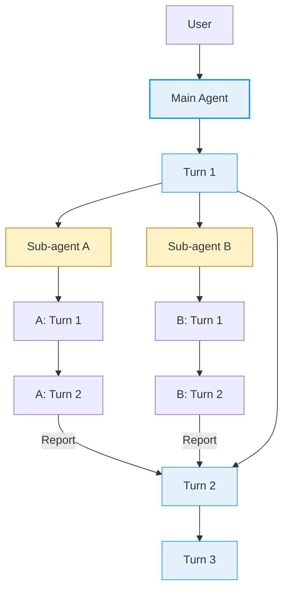
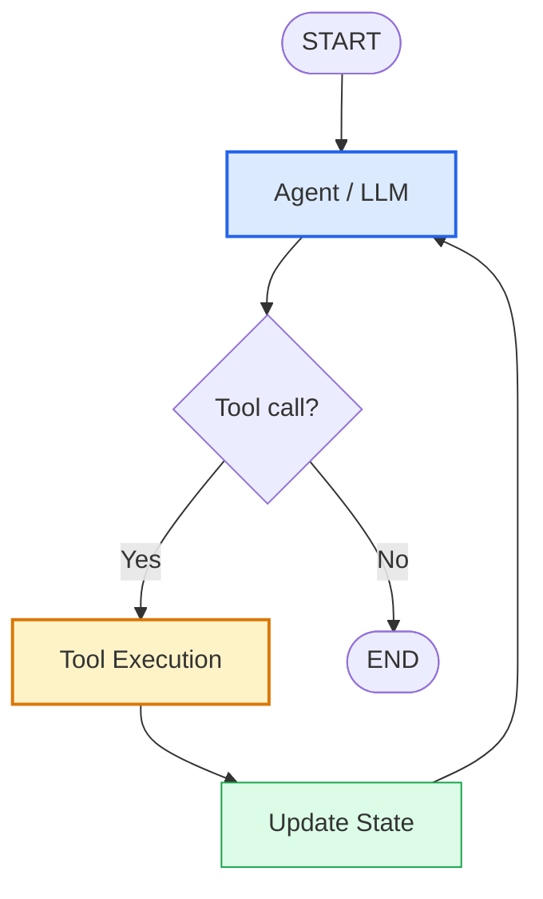
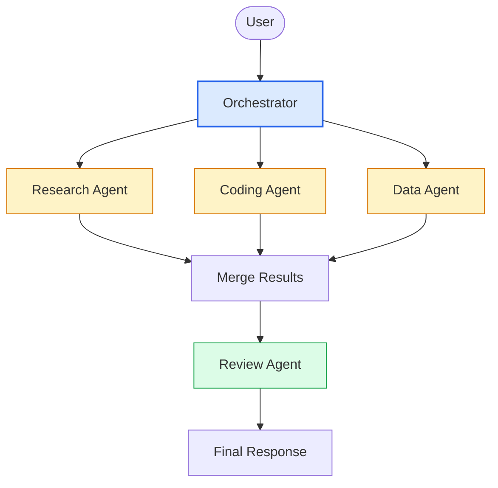
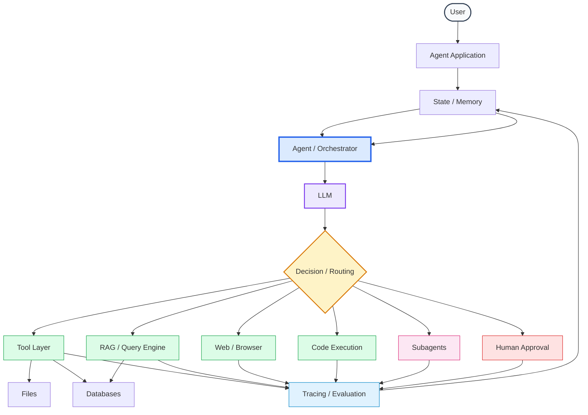

Yes. One correction first: since you now want the **LangGraph material incorporated into the same “Modern AI Systems → Agents” notebook**, I would not make this a separate LangGraph-only notebook. The better structure is a **framework-aware Agents notebook** where we first build the agent from scratch, then see how LlamaIndex and LangGraph map those primitives to abstractions.

The Hugging Face LangGraph material explicitly emphasizes **state, nodes, edges, `StateGraph`, conditional routing, persistence, human-in-the-loop, and controlled multi-step workflows**. ([Hugging Face][1]) The first-graph example also makes an important conceptual distinction: a graph can contain LLM-driven decisions without necessarily being an “agent” if no tool interaction is involved. ([Hugging Face][2])

Below is the notebook I recommend building.

# Notebook: Modern AI Systems → Agents

### First Principles → LlamaIndex → LangGraph → Production Agent Systems

---

## 0. Learning Objective

The goal is **not** to memorize LlamaIndex or LangGraph APIs.

The goal is to understand:

```text
                 MODERN AI AGENT
                       │
          ┌────────────┼────────────┐
          │            │            │
         LLM         STATE        TOOLS
          │            │            │
          └────────────┼────────────┘
                       │
                  CONTROL LOOP
                       │
          ┌────────────┴────────────┐
          │                         │
       Decision                 Execution
          │                         │
          └────────────┬────────────┘
                       │
                    Result
                       │
                    Update
                       │
                    Repeat
```

Then we progressively move from:

```text
Python
  ↓
Agent loop
  ↓
Tool calling
  ↓
State
  ↓
Memory
  ↓
RAG tools
  ↓
Multi-turn agents
  ↓
Subagents
  ↓
Workflows
  ↓
Graphs
  ↓
LlamaIndex
  ↓
LangGraph
  ↓
Production architecture
```

---

# Part I — Agent From First Principles

## 1. What Exactly Is an Agent?

Start with the simplest definition:

```text
Agent = LLM + Tools + State + Control Loop
```

An LLM by itself:

```text
User
 │
 ▼
LLM
 │
 ▼
Response
```

An agent:

```text
User
 │
 ▼
Agent
 │
 ├──► LLM
 │     │
 │     └──► Decision
 │
 ├──► Tool
 │     │
 │     └──► Observation
 │
 └──► State
       │
       └──► Updated context
              │
              └──────► LLM
```

### Important distinction

An agent is **not simply an LLM with a fancy prompt**.

The key additional capability is:

> The system can decide what action to take, execute that action, observe the result, and continue.

---

# 2. Build the Smallest Possible Agent

Before using any framework:

```python
def agent(user_input):

    state = {
        "input": user_input,
        "observations": []
    }

    while True:

        decision = llm(state)

        if decision.type == "final":
            return decision.content

        if decision.type == "tool_call":
            result = execute_tool(
                decision.name,
                decision.arguments
            )

            state["observations"].append(result)
```

This is the conceptual heart of an agent.

Everything else is abstraction around this.

---

# 3. ReAct

The first agent architecture we implement:

```text
                ┌──────────────┐
                │     User     │
                └──────┬───────┘
                       │
                       ▼
                ┌──────────────┐
                │     LLM      │
                └──────┬───────┘
                       │
                Decision
                 /           \
                /             \
           Final               Tool
             │                   │
             ▼                   ▼
          Response            Execute
                                 │
                                 ▼
                              Result
                                 │
                                 ▼
                              Observe
                                 │
                                 └──────► LLM
```

We will implement:

```text
Thought
  ↓
Action
  ↓
Observation
  ↓
Thought
  ↓
Action
  ↓
Observation
  ↓
Final
```

Although modern function/tool-calling agents may not expose the model's private reasoning, the **control structure** remains essentially this loop.

---

# 4. Tools

Start with your existing tools:

```python
calculator
read_file
list_directory
get_system_info
```

Then expand.

A useful progression is:

### Level 1 — Local tools

```text
calculator
filesystem
directory
system information
datetime
environment
```

### Level 2 — Data tools

```text
CSV
JSON
Pandas
SQL
DuckDB
PostgreSQL
SQLite
```

### Level 3 — Knowledge tools

```text
document search
PDF search
vector search
RAG
Wikipedia
arXiv
web search
```

### Level 4 — Developer tools

```text
Python
Git
GitHub
terminal
tests
code search
documentation search
```

### Level 5 — External systems

```text
Email
Calendar
Slack
Jira
Linear
Google Drive
Notion
```

### Level 6 — Browser/computer tools

```text
browser
HTTP
web scraping
Playwright
computer interaction
```

---

# 5. Tool Contract

Every tool should have:

```python
Tool(
    name="calculator",
    description="Evaluate mathematical expressions",
    parameters={
        ...
    },
    function=calculator
)
```

Conceptually:

```text
                 TOOL
                  │
        ┌─────────┼─────────┐
        │         │         │
       Name   Description Schema
                  │
                  ▼
              Function
```

The model does **not directly execute Python**.

Instead:

```text
LLM
 │
 │ tool_call
 ▼
Tool Registry
 │
 ▼
Tool
 │
 ▼
Python Function
 │
 ▼
Result
```

This distinction becomes extremely important later.

---

# Part II — State

# 6. Agent State

Our first state:

```python
from dataclasses import dataclass, field

@dataclass
class AgentState:

    messages: list = field(default_factory=list)

    observations: list = field(default_factory=list)

    steps: int = 0

    max_steps: int = 20

    final_answer: str | None = None

    errors: list = field(default_factory=list)
```

Architecture:

```text
                 AgentState
                     │
       ┌─────────────┼──────────────┐
       │             │              │
   Messages     Observations      Errors
       │             │              │
       └─────────────┼──────────────┘
                     │
                   Steps
                     │
                Final Answer
```

---

# 7. Why State Matters

Without state:

```text
LLM → Tool → Result
```

With state:

```text
                 STATE
                   │
                   ▼
User ───────► LLM ───────► Tool
              ▲              │
              │              ▼
              └──────── Result
```

State enables:

* multi-step execution
* multi-turn conversations
* memory
* retries
* branching
* subagents
* human approval
* persistence
* evaluation
* debugging

This concept becomes central in LangGraph. Its documentation explicitly describes state as the information flowing through the application and says nodes consume state and return state updates. ([Hugging Face][3])

---

# Part III — Multi-Turn Agents

## 8. Single Turn

```text
User
 ↓
Agent
 ↓
Answer
```

## Multi-turn

```text
User
 ↓
Turn 1
 ↓
State
 ↓
User
 ↓
Turn 2
 ↓
State
 ↓
User
 ↓
Turn 3
```

State:

```python
state = {
    "messages": [
        {"role": "user", "content": "..."},
        {"role": "assistant", "content": "..."},
        {"role": "tool", "content": "..."},
    ]
}
```

---

# 9. Multi-Turn + Subagents

This is the architecture you were exploring earlier:



The important idea:

```text
Main Agent State
       │
       ├──────────────► Subagent A State
       │
       └──────────────► Subagent B State

Subagent A ─────► Result
Subagent B ─────► Result

Result A + Result B
       │
       ▼
Main Agent State
```

---

# Part IV — RAG as a Tool

## 10. RAG Does Not Automatically Mean Agent

This distinction is important.

Traditional RAG:

```text
Question
   ↓
Retriever
   ↓
Documents
   ↓
LLM
   ↓
Answer
```

Agentic RAG:

```text
Question
   ↓
Agent
   ↓
Should I search?
   │
   ├── No ─────► Answer
   │
   └── Yes
        ↓
      Search
        ↓
      Results
        ↓
      Agent
        │
        ├── Search again
        │
        └── Answer
```

The retrieval system becomes a **tool available to the agent**.

---

# Part V — LlamaIndex

Now introduce LlamaIndex.

The conceptual mapping is:

```text
First-Principles Agent
        │
        ├── LLM
        ├── Tools
        ├── State
        └── Control Loop
                │
                ▼
          LlamaIndex
```

The notebook should then implement:

```python
FunctionTool
FunctionAgent
QueryEngine
Workflow
```

The purpose is not to hide our earlier implementation.

Instead:

```text
Our implementation
       ↓
Understand abstraction
       ↓
LlamaIndex abstraction
```

---

# 11. LlamaIndex Tool

Conceptually:

```python
from llama_index.core.tools import FunctionTool

tool = FunctionTool.from_defaults(
    fn=calculator,
    name="calculator",
    description="Calculate an expression"
)
```

Architecture:

```text
Python Function
      │
      ▼
FunctionTool
      │
      ├── Name
      ├── Description
      └── Schema
             │
             ▼
            LLM
```

---

# 12. LlamaIndex Agent

Then:

```text
User
 ↓
FunctionAgent
 ↓
LLM
 ↓
Tool Selection
 ↓
Tool Execution
 ↓
Observation
 ↓
LLM
 ↓
Final Answer
```

The critical thing students should recognize:

> `FunctionAgent` is an abstraction over the same fundamental control loop we implemented manually.

---

# 13. RAG + LlamaIndex Agent

Architecture:

```text
                    Agent
                      │
          ┌───────────┼────────────┐
          │           │            │
     Calculator    Web Search   Query Engine
                                  │
                                  ▼
                             Vector Store
                                  │
                                  ▼
                              Documents
```

Now the agent can decide:

```text
"Do I need arithmetic?"
"Do I need external knowledge?"
"Do I need my private documents?"
```

---

# Part VI — Workflows

This is where we move beyond a simple agent loop.

A workflow might be:

```text
START
  │
  ▼
Classify
  │
  ├──── question ────► Search
  │                       │
  │                       ▼
  │                    Answer
  │
  ├──── calculation ──► Calculator
  │                       │
  │                       ▼
  │                    Answer
  │
  └──── unsafe ───────► Human
                          │
                          ▼
                        END
```

This is not merely:

```python
while True:
    llm()
```

It is an **orchestrated execution graph**.

---

# Part VII — LangGraph

Now introduce LangGraph.

The Hugging Face course describes LangGraph as a framework for controlling the flow of LLM applications, particularly where predictable execution, state, branching, persistence, human intervention, and complex architectures are important. ([Hugging Face][1])

Its fundamental abstraction:

```text
Graph = Nodes + Edges + State
```

---

# 14. LangGraph State

```python
from typing_extensions import TypedDict

class State(TypedDict):
    messages: list
    result: str
```

Conceptually:

```text
                  STATE
                    │
        ┌───────────┼───────────┐
        │           │           │
    messages      result      metadata
```

---

# 15. Nodes

A node is essentially:

```python
def node(state):
    ...
    return {
        "result": "..."
    }
```

So:

```text
State
  │
  ▼
Node
  │
  ▼
State Update
```

The LangGraph course describes nodes as Python functions that take state, perform an operation, and return updates to state. Nodes may contain LLM calls, tools, conditional logic, or human intervention. ([Hugging Face][3])

---

# 16. Edges

Direct:

```text
A ─────► B
```

Conditional:

```text
       ┌──► B
       │
A ─────┤
       │
       └──► C
```

Example:

```python
builder.add_conditional_edges(
    "agent",
    route
)
```

---

# 17. First LangGraph

```python
from typing_extensions import TypedDict
from langgraph.graph import StateGraph, START, END

class State(TypedDict):
    message: str


def first_node(state):
    return {
        "message": state["message"] + " → Node 1"
    }


def second_node(state):
    return {
        "message": state["message"] + " → Node 2"
    }


builder = StateGraph(State)

builder.add_node("first", first_node)
builder.add_node("second", second_node)

builder.add_edge(START, "first")
builder.add_edge("first", "second")
builder.add_edge("second", END)

graph = builder.compile()
```

Execution:

```text
START
  │
  ▼
first
  │
  ▼
second
  │
  ▼
 END
```

This follows the same basic structure shown in the Hugging Face first-graph lesson. ([Hugging Face][2])

---

# Part VIII — Agent as a Graph

Now comes the important conceptual connection.

Our first-principles agent:

```text
LLM
 ↓
Tool?
 ├── No → END
 └── Yes
       ↓
     Tool
       ↓
      LLM
```

becomes:



This is the key transition:

> **An agent can be represented as a stateful graph.**

---

# 18. Tool-Calling Agent in LangGraph

We then build:

```text
             ┌────────────────────┐
             │      START         │
             └─────────┬──────────┘
                       ▼
             ┌────────────────────┐
             │    Agent Node     │
             │       LLM         │
             └─────────┬──────────┘
                       ▼
                ┌──────────────┐
                │ Tool call?   │
                └──────┬───────┘
                    Yes│   │No
                       │   └────────► END
                       ▼
             ┌────────────────────┐
             │    Tool Node      │
             └─────────┬──────────┘
                       ▼
             ┌────────────────────┐
             │ Update State       │
             └─────────┬──────────┘
                       │
                       └──────────► Agent
```

This is one of the most important diagrams in the notebook.

---

# Part IX — Deterministic Workflow vs Agent

We explicitly compare:

### Deterministic workflow

```text
A → B → C → D
```

### Conditional workflow

```text
A
├── B
├── C
└── D
```

### Agent

```text
        ┌──── Tool A
        │
LLM ────┼──── Tool B
        │
        ├──── Tool C
        │
        └──── END
```

### Agentic workflow

```text
START
 │
 ▼
Planner
 │
 ▼
Decision
 ├──── deterministic branch
 │
 ├──── agent branch
 │
 └──── human branch
             │
             ▼
            END
```

This distinction matters because **not every LLM workflow needs an agent**.

The Hugging Face material makes essentially this point in its first LangGraph example: Alfred's email-processing workflow uses LLM-based decisions but is not considered an agent there because no tool is involved. ([Hugging Face][2])

---

# Part X — Document Analysis Agent

Now reproduce the course's more realistic architecture.

```text
                     Document
                        │
                        ▼
                 ┌─────────────┐
                 │   Analyze   │
                 └──────┬──────┘
                        │
               ┌────────┴────────┐
               │                 │
             PDF              Spreadsheet
               │                 │
               ▼                 ▼
          Text Parser         Pandas
               │                 │
               └────────┬────────┘
                        ▼
                     Agent
                        │
              ┌─────────┼─────────┐
              │         │         │
            Search    Python    Reason
              │         │         │
              └─────────┼─────────┘
                        ▼
                      Answer
```

This is where the difference between:

```text
LLM application
```

and

```text
agentic application
```

becomes much clearer.

The LangGraph document-analysis material is specifically useful here because it demonstrates a graph whose processing depends on document type and analysis path. ([Hugging Face][4])

---

# Part XI — Human in the Loop

A production agent should not necessarily be allowed to execute everything automatically.

Architecture:

```text
Agent
 │
 ▼
Action
 │
 ▼
Policy
 │
 ├── SAFE ─────────► Execute
 │
 ├── LOW RISK ────► Execute + Log
 │
 └── HIGH RISK ───► Human Approval
                         │
                   ┌─────┴─────┐
                   │           │
                 Approve      Reject
                   │           │
                   ▼           ▼
                Execute       END
```

Examples requiring approval:

```text
send_email
delete_file
execute_shell
deploy_code
modify_database
make_purchase
send_message
```

This becomes especially valuable in LangGraph-style systems because the graph explicitly represents where execution can pause and resume.

---

# Part XII — Persistence

Now introduce:

```text
Agent State
     │
     ▼
Checkpoint
     │
     ▼
Database
```

Possible state:

```python
{
    "conversation_id": "...",
    "messages": [...],
    "tool_results": [...],
    "current_node": "...",
    "pending_action": "...",
}
```

Then:

```text
Request
  ↓
Load State
  ↓
Continue Graph
  ↓
Checkpoint
```

This is a major difference between a toy agent and a serious agent system.

---

# Part XIII — Subagents

Now build:

```text
                    Main Agent
                         │
             ┌───────────┼───────────┐
             ▼           ▼           ▼
          Research     Coding      Review
           Agent        Agent       Agent
             │           │           │
             └───────────┼───────────┘
                         ▼
                    Main Agent
```

Each subagent has:

```text
LLM
Tools
State
Prompt
Specialization
```

The main agent acts as an orchestrator.

---

# Part XIV — Multi-Agent Graph



---

# Part XV — Agent Memory

Separate:

```text
Context
Memory
State
Knowledge
```

These are not interchangeable.

### Context

What the model sees now.

### State

What the workflow needs to continue.

### Short-term memory

Conversation history.

### Long-term memory

Information retained between sessions.

### Knowledge

External information available through retrieval.

Architecture:

```text
                  Agent
                    │
       ┌────────────┼────────────┐
       │            │            │
    Context        State       Memory
       │            │            │
       │            │            ├── Short-term
       │            │            └── Long-term
       │            │
       │            └──── Workflow
       │
       └────────────► LLM
```

---

# Part XVI — Agent Evaluation

Do not finish the notebook after the agent "works."

Evaluate:

```text
Tool Selection
     │
     ├── Correct tool?
     ├── Correct arguments?
     └── Correct number of calls?

Task Execution
     │
     ├── Correct result?
     ├── Efficient?
     └── Robust?

Safety
     │
     ├── Unauthorized tool?
     ├── Dangerous action?
     └── Prompt injection?

Reliability
     │
     ├── Retry?
     ├── Recovery?
     └── Timeout?
```

Metrics:

```text
Task Success Rate
Tool Selection Accuracy
Argument Accuracy
Trajectory Accuracy
Latency
Token Cost
Number of Tool Calls
Error Rate
Human Intervention Rate
```

---

# Part XVII — Observability

Every agent run should ideally produce a trace:

```text
Run
 │
 ├── LLM call
 │
 ├── Tool call
 │
 ├── Tool result
 │
 ├── LLM call
 │
 ├── Tool call
 │
 └── Final answer
```

Represent it as:

```python
Trace(
    run_id=...,
    events=[
        LLMEvent(...),
        ToolCallEvent(...),
        ToolResultEvent(...),
        LLMEvent(...),
    ]
)
```

This lets us answer:

> Why did the agent do that?

That is essential for debugging.

---

# Part XVIII — Safety

We should explicitly implement:

```text
Tool Allowlist
Argument Validation
Path Restrictions
Timeouts
Rate Limits
Maximum Steps
Maximum Tool Calls
Human Approval
Sandboxing
Audit Logs
```

For example:

```python
MAX_STEPS = 20
MAX_TOOL_CALLS = 10
```

And:

```python
if tool_name not in allowed_tools:
    raise PermissionError(...)
```

For filesystem tools:

```text
Agent
 ↓
Path Validator
 ↓
Allowed Directory?
 ├── Yes → Read
 └── No  → Reject
```

---

# Part XIX — Framework Comparison

Now the notebook can finally compare the frameworks meaningfully.

| Concept        | First Principles | LlamaIndex           | LangGraph                  |
| -------------- | ---------------- | -------------------- | -------------------------- |
| LLM            | Direct API       | LLM abstraction      | Usually model abstraction  |
| Tool           | Python function  | `FunctionTool`     | Tool/node                  |
| State          | Dataclass/dict   | Agent/workflow state | `State`                  |
| Agent loop     | Manual           | Agent abstraction    | Graph                      |
| Routing        | `if/else`      | Agent/workflow       | Conditional edges          |
| Workflow       | Python           | Workflows            | `StateGraph`             |
| Memory         | Manual           | Framework components | State/checkpointing        |
| RAG            | Manual           | Strong ecosystem     | Build into graph           |
| Multi-agent    | Manual           | Agent composition    | Graph/subgraphs            |
| Human approval | Manual           | Workflow logic       | Graph interruption/control |
| Visualization  | Manual           | Workflow tooling     | Graph visualization        |
| Control        | High             | Medium/high          | Very high                  |

The key lesson:

```text
Framework ≠ Agent

Framework
    ↓
Provides abstractions for constructing
and controlling agents/workflows.
```

---

# Part XX — Final Architecture

By the end of the notebook, the complete system should look like:



---

# Final Notebook Structure

I would therefore make the actual `.ipynb` in this order:

```text
00. Introduction
01. What Is an Agent?
02. LLM vs Agent
03. Agent = LLM + Tools + State + Loop
04. Build Agent From Scratch
05. Tool Abstraction
06. Tool Registry
07. Tool Schemas
08. Function Calling
09. ReAct Loop
10. Error Handling
11. Agent State
12. Multi-Step Agents
13. Multi-Turn Agents
14. Memory
15. RAG as a Tool
16. Agentic RAG
17. Subagents
18. Multi-Agent Systems

19. LlamaIndex Introduction
20. LlamaIndex Tools
21. FunctionTool
22. FunctionAgent
23. QueryEngine as Tool
24. LlamaIndex Workflows
25. LlamaIndex Multi-Agent Concepts

26. Why Graphs?
27. LangGraph Introduction
28. State
29. Nodes
30. Edges
31. Conditional Edges
32. StateGraph
33. First Graph
34. LLM + Graph
35. Tool-Calling Agent Graph
36. Document Analysis Agent
37. Human-in-the-Loop
38. Persistence / Checkpoints
39. Subgraphs
40. Multi-Agent Graphs

41. Workflow vs Agent
42. Agent vs Graph
43. LlamaIndex vs LangGraph
44. Tool Safety
45. Agent Evaluation
46. Agent Observability
47. Production Architecture
48. Final Project
49. Exercises
50. Capstone
```

This is substantially better than making the notebook merely a collection of framework tutorials. The Hugging Face course itself places LlamaIndex and LangGraph under the broader **Frameworks for AI Agents** unit, and the LangGraph section specifically progresses from introduction → when to use it → building blocks → first graph → document analysis → conclusion. ([Hugging Face][5])

**The central learning principle should remain:** first build the mechanism yourself, then let LlamaIndex and LangGraph show you how production frameworks package the same fundamental ideas. That will prevent the notebook from becoming an API-memorization exercise.

[1]: https://huggingface.co/learn/agents-course/unit2/langgraph/when_to_use_langgraph
[2]: https://huggingface.co/learn/agents-course/unit2/langgraph/first_graph
[3]: https://huggingface.co/learn/agents-course/unit2/langgraph/building_blocks
[4]: https://huggingface.co/learn/agents-course/unit2/langgraph/document_analysis_agent
[5]: https://huggingface.co/learn/agents-course/unit2/langgraph/introduction
