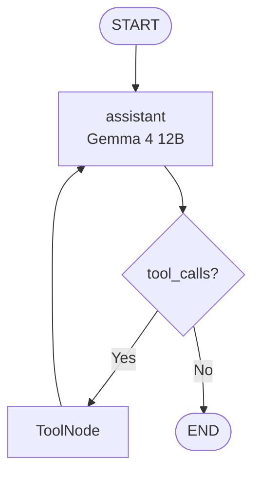
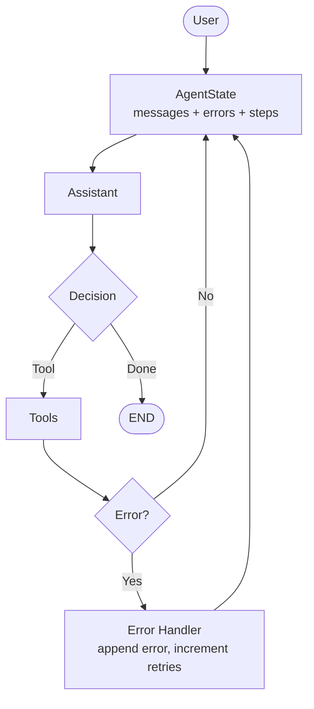

# Tutorial 01 — Part I: First Principles of Agent Systems
### What Is an Agent? → ReAct → Tools → LangGraph Runtime
#### Covers `LangGraph.md:75-215` + `tut1.md:290-800`

> Goal: After this tutorial you can build a tool-using agent **without** a framework, then rebuild the same agent as an explicit `StateGraph`. This is the foundation for every later LangGraph system.

---

## 0. Learning Objective

Not to memorize APIs. To understand the invariant:

```text
Agent = LLM + Tools + State + Control Loop   (LangGraph.md:79)
```

```
                 MODERN AI AGENT
                       │
          ┌────────────┼────────────┐
          │            │            │
         LLM         STATE        TOOLS
          │            │            │
          └────────────┼────────────┘
                       │
                  CONTROL LOOP
                       │
          ┌────────────┴────────────┐
          │                         │
       Decision                 Execution
          │                         │
          └────────────┬────────────┘
                       │
                    Result → Update → Repeat
```

By the end of Tutorial 01 you will have:
1. Built a minimal agent loop in pure Python
2. Abstracted tools via a registry + JSON schemas
3. Implemented ReAct (Thought→Action→Observation)
4. Re-implemented the same loop as a LangGraph `StateGraph` with `MessagesState` + `ToolNode` + conditional edges
5. Added error handling, max-steps, timeouts and allowlists

---

## 1. What Is an Agent? (`LangGraph.md:77`)

**LLM alone:**

```
User → LLM → Response
```

Deterministic, single-pass. No side effects.

**Agent:**

```
User → Agent → LLM → Decision → Tool → Observation → State → LLM → ...
                 ├──► Tool
                 └──► State (updated context)
```

> Key: *The system can decide what action to take, execute it, observe the result, and continue.* (`LangGraph.md:126`)

If there is no tool interaction / state update loop, it is an **LLM workflow**, not an agent (`LangGraph.md:1052`).

**Exercise:** Classify these — agent or not?
- `LLM summarizes a PDF` → workflow
- `LLM decides to call calculator, observes 56088, then answers` → agent
- `Graph that routes by document type without tools` → workflow (Hugging Face first-graph example)

---

## 2. LLM vs Agent (`LangGraph.md:83`)

| Aspect | LLM | Agent |
|---|---|---|
| Input | prompt | `State` (messages + observations + errors) |
| Output | text | `Decision` (final | tool_call) |
| Memory | context window only | explicit `State` persisted across turns |
| Capability | generation | decision + execution + observation loop |
| Failure mode | hallucination | wrong tool / args, loop, timeout |

Mental model (`tut1.md:290`):

```
LLM:  Input → Model → Output
Agent: Input → State → Model → Decision → Action → Observation → State → Model → ...
                └─────────────── runtime controls what happens next ───────────────┘
```

---

## 3. Agent = LLM + Tools + State + Loop (`LangGraph.md:79`)

Four primitives — everything else is sugar:

```python
# conceptual — no framework yet
state = {"input": user_input, "observations": [], "messages": []}
tools = {"calculator": calculator, "read_file": read_file}
```

```
User
 │
 ▼
Agent State ──► LLM ──► Decision ──┬── Final → Answer
                                   └── Tool → Execute → Observation
                                                  │
                                                  └──────────► State update → LLM
```

LangGraph maps these 1:1 (`LangGraph.md:1453`):

| First Principles | LangGraph |
|---|---|
| `state` dict / dataclass | `TypedDict` / `MessagesState` |
| `llm(state) -> decision` | **Node** function `def node(state): return update` |
| `if decision.type == ...` | **Conditional Edge** |
| `while True:` | **Graph cycle** `tools → assistant` |

We will prove this mapping by building both versions.

---

## 4. Build the Smallest Possible Agent (`LangGraph.md:132`)

### 4.1 Pure Python loop (study this before touching LangGraph)

```python
from dataclasses import dataclass, field

@dataclass
class AgentState:
    messages: list = field(default_factory=list)
    observations: list = field(default_factory=list)
    steps: int = 0
    max_steps: int = 20
    final_answer: str | None = None
    errors: list = field(default_factory=list)
```

```python
def agent(user_input: str, llm, tools: dict):
    state = AgentState(messages=[{"role": "user", "content": user_input}])

    while True:
        if state.steps >= state.max_steps:
            return "Max steps exceeded."

        decision = llm(state)  # returns {"type": "final"|"tool_call", ...}

        if decision["type"] == "final":
            state.final_answer = decision["content"]
            return state.final_answer

        if decision["type"] == "tool_call":
            name, args = decision["name"], decision["arguments"]
            # safety hooks (see §10)
            if name not in tools:
                state.errors.append(f"Unknown tool {name}")
                state.observations.append(f"Error: unknown tool {name}")
            else:
                try:
                    result = tools[name](**args)
                except Exception as e:
                    result = f"Tool error: {e}"
                    state.errors.append(str(e))
                state.observations.append(result)
                state.messages.append({"role": "tool", "name": name, "content": str(result)})

        state.steps += 1
```

This is the heart. `LangGraph.md:158` — *Everything else is abstraction around this.*

### 4.2 LangGraph equivalent — minimal graph

Same logic, now explicit as nodes + edges (`tut1.md:340`):

```python
# pip install -U langgraph langchain langchain-ollama
from typing_extensions import TypedDict
from langgraph.graph import StateGraph, START, END

class State(TypedDict):
    message: str

def hello_node(state: State):
    return {"message": state["message"] + " → Node 1"}

def second_node(state: State):
    return {"message": state["message"] + " → Node 2"}

builder = StateGraph(State)
builder.add_node("first", hello_node)
builder.add_node("second", second_node)
builder.add_edge(START, "first")
builder.add_edge("first", "second")
builder.add_edge("second", END)

graph = builder.compile()
graph.invoke({"message": "Hello"})  # {"message": "Hello → Node 1 → Node 2"}
```

```
START → first → second → END   (LangGraph.md:895)
```

Key invariant: **Node = `state -> state update`** (`LangGraph.md:804`).

### 4.3 Put the LLM inside a node (`tut1.md:484`)

```python
from langchain_ollama import ChatOllama
from typing_extensions import TypedDict

llm = ChatOllama(model="gemma4:12b", temperature=0)

class AgentState(TypedDict):
    user_input: str
    response: str

def call_model(state: AgentState):
    resp = llm.invoke(state["user_input"])
    return {"response": resp.content}

builder = StateGraph(AgentState)
builder.add_node("model", call_model)
builder.add_edge(START, "model")
builder.add_edge("model", END)
agent_graph = builder.compile()

agent_graph.invoke({"user_input": "Explain machine learning.", "response": ""})
```

> This is **still not an agent** — it is an LLM workflow. Tools + loop are missing.

---

## 5. Tool Abstraction (`LangGraph.md:218`)

Levels (`LangGraph.md:232-299`): Local → Data → Knowledge → Developer → External → Browser. Start with Level 1.

Raw function ≠ Tool. Tool adds contract:

```
                 TOOL
                  │
        ┌─────────┼─────────┐
        │         │         │
       Name  Description  Schema
                  │
                  ▼
              Function
```

```python
# Level 1 — local tools
def calculator(expression: str) -> str:
    """Evaluate mathematical expressions. Use for arithmetic."""
    allowed = set("0123456789+-*/(). ")
    if not all(c in allowed for c in expression):
        return "Invalid expression."
    try:
        return str(eval(expression))
    except Exception as e:
        return f"Calculation error: {e}"

from pathlib import Path
def list_directory(path: str = ".") -> str:
    """List files and directories."""
    p = Path(path)
    if not p.exists(): return f"Directory does not exist: {path}"
    return "\n".join(f"{'DIR' if x.is_dir() else 'FILE'}: {x.name}" for x in p.iterdir())

def read_file(path: str) -> str:
    """Read a UTF-8 text file."""
    p = Path(path)
    if not p.exists(): return f"File does not exist: {path}"
    return p.read_text(encoding="utf-8")

def system_info() -> str:
    """Return basic system information."""
    import platform, os
    return f"OS: {platform.system()} {platform.release()} | Python: {platform.python_version()} | CPUs: {os.cpu_count()}"
```

---

## 6. Tool Registry (`LangGraph.md:340`)

LLM never executes Python directly:

```
LLM --tool_call--> Tool Registry --lookup--> Tool --execute--> Python Function → Result
```

```python
from langchain.tools import tool

@tool
def calculator_tool(expression: str) -> str:
    """Calculate a mathematical expression."""
    allowed = set("0123456789+-*/(). ")
    if not all(c in allowed for c in expression):
        return "Invalid expression."
    try: return str(eval(expression))
    except Exception as e: return f"Calculation error: {e}"

@tool
def list_directory_tool(path: str = ".") -> str:
    """List files and directories in a directory."""
    p = Path(path)
    if not p.exists(): return f"Directory does not exist: {path}"
    return "\n".join(f"{'DIR' if x.is_dir() else 'FILE'}: {x.name}" for x in p.iterdir())

@tool
def read_file_tool(path: str) -> str:
    """Read a UTF-8 text file."""
    return Path(path).read_text(encoding="utf-8") if Path(path).exists() else f"File does not exist: {path}"

@tool
def system_info_tool() -> str:
    """Return basic system information."""
    import platform, os
    return f"{platform.system()} {platform.release()} Python {platform.python_version()}"

tools = [calculator_tool, list_directory_tool, read_file_tool, system_info_tool]
tool_registry = {t.name: t for t in tools}

# inspect contract
for t in tools:
    print(t.name, "|", t.description[:60], "|", t.args_schema.model_json_schema().keys())
```

Bind to Gemma (`tut1.md:750`):

```python
llm_with_tools = llm.bind_tools(tools)
resp = llm_with_tools.invoke("What is 123 * 456?")
print(resp.tool_calls)  # may be [] if model chooses to answer directly — test actual behavior
```

---

## 7. Tool Schemas / Contracts (`LangGraph.md:303`)

Every tool exposes JSON Schema so the LLM can produce structured `tool_calls`:

```python
print(calculator_tool.args_schema.model_json_schema())
# {
#   "properties": {"expression": {"type": "string", "description": "Calculate..." }},
#   "required": ["expression"]
# }
```

Contract:

```python
Tool(
    name="calculator",
    description="Evaluate mathematical expressions",
    parameters={"expression": {"type": "string"}},
    function=calculator
)
```

Validation happens **before** execution — add allowlist + path checks (see §10):

```python
ALLOWED_TOOLS = {"calculator", "list_directory", "read_file", "system_info"}
ALLOWED_DIRS = {Path(".").resolve()}

def validate_call(name: str, args: dict):
    if name not in ALLOWED_TOOLS:
        raise PermissionError(f"Tool not allowed: {name}")
    if name == "read_file" and "path" in args:
        p = Path(args["path"]).resolve()
        if not any(str(p).startswith(str(d)) for d in ALLOWED_DIRS):
            raise PermissionError(f"Path not allowed: {p}")
```

---

## 8. Function Calling

How structured calls flow:

```
User: "What is 123 * 456?"
  → llm_with_tools.invoke(messages)
  → AIMessage(content="", tool_calls=[{"name":"calculator","args":{"expression":"123 * 456"}}])
  → ToolNode executes calculator("123 * 456") → "56088"
  → ToolMessage(content="56088")
  → llm_with_tools.invoke(messages + tool_result) → "The answer is 56088."
```

Test directly (`tut1.md:786`):

```python
resp = llm_with_tools.invoke("What is 123 * 456?")
print(resp.content)
print(resp.tool_calls)

# If model returns a tool_call, execute manually:
if resp.tool_calls:
    call = resp.tool_calls[0]
    print(tool_registry[call["name"]].invoke(call["args"]))
```

> Gemma 4 12B via `ChatOllama` supports `bind_tools` / `tool_calls` (`tut1.md:804`). Always test — some local models answer inline without calling.

---

## 9. ReAct Loop (`LangGraph.md:164`)

Classic pattern:

```
Thought → Action → Observation → Thought → Action → Observation → Final
```

Modern tool-calling hides `Thought` inside the model's private reasoning, but **control structure is identical**:

```
┌──────────────┐
│     User     │
└──────┬───────┘
       ▼
┌──────────────┐    Decision
│     LLM      │   /        \
└──────┬───────┘ Final    Tool
       │           │         │
       ▼           ▼         ▼
    Response    END      Execute → Result → Observe → LLM
```

### 9.1 Pure Python ReAct

```python
def react_agent(user_input: str, max_steps=6):
    messages = [{"role": "user", "content": user_input}]
    for step in range(max_steps):
        resp = llm_with_tools.invoke(messages)
        messages.append({"role": "assistant", "content": resp.content, "tool_calls": resp.tool_calls})
        if not resp.tool_calls:
            return resp.content
        for call in resp.tool_calls:
            result = tool_registry[call["name"]].invoke(call["args"])
            messages.append({"role": "tool", "name": call["name"], "content": str(result)})
    return "Max steps reached"
```

### 9.2 LangGraph ReAct (`tut1.md:810`)

Two nodes + conditional edge — the canonical agent graph:



```python
from langgraph.graph import MessagesState
from langgraph.prebuilt import ToolNode
from typing import Literal

def assistant(state: MessagesState):
    resp = llm_with_tools.invoke(state["messages"])
    return {"messages": [resp]}

tool_node = ToolNode(tools)

def should_continue(state: MessagesState) -> Literal["tools", "__end__"]:
    if state["messages"][-1].tool_calls:
        return "tools"
    return END

from langgraph.graph import StateGraph, START, END

builder = StateGraph(MessagesState)
builder.add_node("assistant", assistant)
builder.add_node("tools", tool_node)
builder.add_edge(START, "assistant")
builder.add_conditional_edges("assistant", should_continue)
builder.add_edge("tools", "assistant")
graph = builder.compile()

# visualize
print(graph.get_graph().draw_mermaid())
# in notebook: display(Image(graph.get_graph().draw_mermaid_png()))

result = graph.invoke({"messages": [{"role": "user", "content": "What is 123 * 456?"}]})
for m in result["messages"]:
    print(type(m).__name__, ":", m.content[:200], "| tool_calls:", getattr(m, "tool_calls", None))
```

What actually happened (`tut1.md:1024`):

```
USER "What is 123 * 456?" → Gemma decides calculator → tool 123*456 → 56088 → Gemma formulates final
```

That is an agent. The `while True:` is now an explicit graph cycle.

**Why LangGraph over `while`?** (`tut1.md:1083`) Complexity scales to branches, retries, parallelism, human approval, persistence, subagents — all as graph structure.

---

## 10. Error Handling

Production agents need guards at three layers:

### 10.1 Loop guards

```python
MAX_STEPS = 20
MAX_TOOL_CALLS = 10

# inside node or should_continue
if state.get("steps", 0) >= MAX_STEPS:
    return END
```

### 10.2 Tool guards

```python
if tool_name not in ALLOWED_TOOLS:
    raise PermissionError(f"Blocked: {tool_name}")

# filesystem
# if not p.resolve().is_relative_to(ALLOWED_ROOT): reject
# timeouts
import signal
# or use langgraph prebuilt ToolNode with error handling
```

### 10.3 LangGraph error routing

Expand state to track errors, add an error-handler node:



```python
from typing import TypedDict, Annotated
from langgraph.graph.message import add_messages

class AgentState(TypedDict):
    messages: Annotated[list, add_messages]
    steps: int
    errors: list
    tool_errors: int

def assistant_with_guard(state: AgentState):
    if state.get("steps", 0) >= 20:
        from langchain_core.messages import AIMessage
        return {"messages": [AIMessage(content="Max steps reached.")] }
    resp = llm_with_tools.invoke(state["messages"])
    return {"messages": [resp], "steps": state.get("steps", 0) + 1}

# ToolNode automatically returns ToolMessage with error content on exception
# Route on error:

def route_after_tools(state: AgentState):
    last = state["messages"][-1]
    if "Tool error" in str(getattr(last, "content", "")):
        return "error_handler"
    return "assistant"

# builder.add_node("error_handler", error_handler)
# builder.add_conditional_edges("tools", route_after_tools)
```

Full safety checklist (`LangGraph.md:1408`):

```
Tool Allowlist | Argument Validation | Path Restrictions | Timeouts
Rate Limits | Maximum Steps | Maximum Tool Calls | Human Approval | Sandboxing | Audit Logs
```

---

## 11. End-to-End Run

```python
# 1. build tools + llm_with_tools ( §5-7 )
# 2. build graph ( §9.2 )
# 3. invoke

for query in [
    "What is 123 * 456?",
    "List files in .",
    "What OS am I on?",
]:
    out = graph.invoke({"messages": [{"role": "user", "content": query}]})
    print("Q:", query)
    print("A:", out["messages"][-1].content[:300])
    print("---")
```

**Expected:** model routes `123*456 → calculator`, directory query → `list_directory`, OS query → `system_info`, with 2-3 graph steps per query.

---

## 12. Exercises (do these before Tutorial 02)

1. **Basic Node:** `START → Gemma → END` — verify Ollama + `ChatOllama(model="gemma4:12b")` (`tut1.md:265`)
2. **Calculator:** `assistant ↔ tools` loop for `56088` — print `tool_calls` and `ToolMessage`
3. **Multiple Tools:** Add all 4 tools, run 3 queries above, log which tool was chosen
4. **Routing:** Implement `should_continue` with `Literal["tools", END]` explicitly
5. **Error Recovery:** Pass `calculator("2 +")` and `read_file("/etc/passwd")` — verify error message loops back to LLM and it retries/alternates
6. **Guardrails:** Enforce `MAX_STEPS=5`, `ALLOWED_TOOLS`, path validator; test rejection
7. **Visualization:** `graph.get_graph().draw_mermaid_png()` in notebook — confirm `START → assistant → tools → assistant → END`
8. **Trace:** Collect `result["messages"]` into `Trace(events=[LLMEvent, ToolCallEvent, ToolResultEvent])` (`LangGraph.md:1387`)

---

## 13. What Comes Next

Tutorial 01 gave you the **single-turn ReAct agent as a graph**. Tutorial 02 maps:

```
State → MessagesState + add_messages → Multi-turn + Memory (MemorySaver / thread_id) → Persistence
(LangGraph.md:1165, tut1.md:1165)
```

Keep the mental model:

```
Agent = Model + State + Tools + Control Flow + Execution + Feedback
LLM ≠ Agent | Tool ≠ Agent | Prompt ≠ Agent | Workflow ≠ Agent
```

---

*Sources: `LangGraph.md:75-215, 303-395, 1453`, `tut1.md:265-1060`, Hugging Face LangGraph building_blocks / first_graph.*
