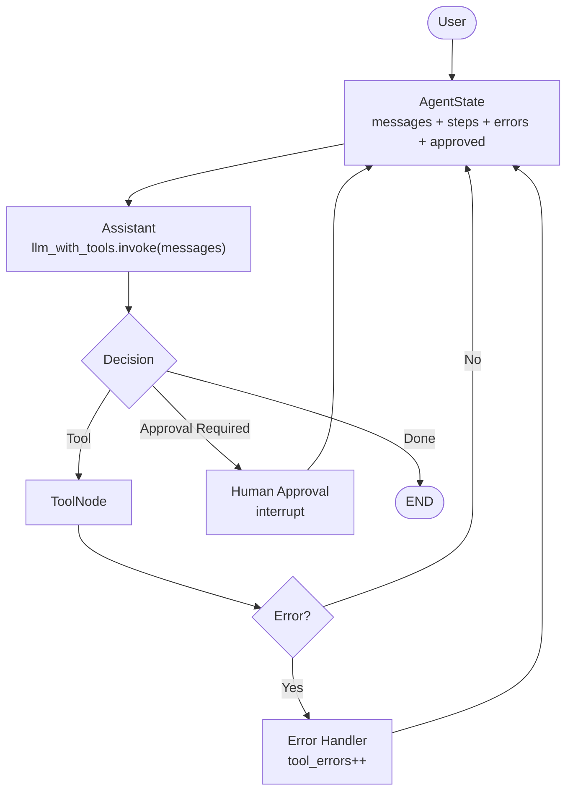

# Tutorial 02 — State / Multi-Turn / Memory

### From single-turn ReAct to stateful, persistent agents

#### Covers `LangGraph.md:357-547, 1153-1312` + `tut1.md:1165-1305`

> Prerequisite: Tutorial 01 ReAct graph (`assistant ↔ tools`). This tutorial adds the piece that turns a demo into a system: **State**.

---

## 0. Why State Matters (`LangGraph.md:399`)

Without state:

```
LLM → Tool → Result   (stateless, single shot)
```

With state:

```
              STATE
                │
                ▼
User ─────► LLM ─────► Tool
           ▲              │
           │              ▼
           └──────── Result
```

State enables (`LangGraph.md:410`):
`multi-step` | `multi-turn` | `memory` | `retries` | `branching` | `subagents` | `human approval` | `persistence` | `evaluation` | `debugging`

Hugging Face definition: *state is the information flowing through the application; nodes consume state and return state updates.* (`LangGraph.md:432`)

LangGraph primitive:

```
State → Node → State Update → Next Node
(LangGraph.md:815)
```

---

## 1. Agent State — First Principles (`LangGraph.md:358`)

### 1.1 Minimal dataclass (no framework)

```python
from dataclasses import dataclass, field

@dataclass
class AgentState:
    messages: list = field(default_factory=list)      # conversation
    observations: list = field(default_factory=list)  # tool outputs
    steps: int = 0
    max_steps: int = 20
    final_answer: str | None = None
    errors: list = field(default_factory=list)
```

```
              AgentState
                  │
    ┌─────────────┼──────────────┐
    │             │              │
 Messages    Observations     Errors
    │             │              │
    └─────────────┼──────────────┘
                  │
                Steps → Final Answer
```

### 1.2 LangGraph TypedDict state (`LangGraph.md:782`, `tut1.md:504`)

For graphs, state is a `TypedDict`. Reducers control how updates merge.

```python
from typing_extensions import TypedDict

class State(TypedDict):
    messages: list
    result: str
    # LangGraph calls the node as def node(state: State) -> {"result": "..."}
```

```
              STATE
                │
    ┌───────────┼───────────┐
    │           │           │
 messages    result      metadata
```

But naive `messages: list` **replaces** on update. We need **append** semantics.

### 1.3 `Annotated` + `add_messages` — the correct pattern (`tut1.md:1246`)

```python
from typing import Annotated, TypedDict
from langgraph.graph.message import add_messages
from langchain_core.messages import AnyMessage

class AgentState(TypedDict):
    messages: Annotated[list[AnyMessage], add_messages]
    user_id: str
    task_id: str
    tool_errors: int
    iteration: int
    approved: bool
```

`add_messages` is a reducer: `return {"messages": [new_msg]}` **appends** instead of overwriting. This is what `MessagesState` does internally (`tut1.md:870`):

```python
from langgraph.graph import MessagesState

# MessagesState == {"messages": Annotated[list, add_messages]}
class MessagesState(TypedDict):
    messages: Annotated[list[AnyMessage], add_messages]
```

Use `MessagesState` for Tutorial 02; extend to `AgentState` above when you need counters/flags.

---

## 2. Single Turn vs Multi-Turn (`LangGraph.md:437`)

**Single turn:**

```
User → Agent → Answer
```

**Multi-turn:**

```
User → Turn 1 → State → User → Turn 2 → State → User → Turn 3
```

State must accumulate:

```python
state = {
    "messages": [
        {"role": "user", "content": "..."},
        {"role": "assistant", "content": "..."},
        {"role": "tool", "content": "..."},
        {"role": "user", "content": "follow-up ..."},
    ]
}
```

LangGraph runtime handles this if you give it a **checkpointer** and a **thread_id**.

---

## 3. Memory vs State vs Context vs Knowledge (`LangGraph.md:1264`)

Not interchangeable:

| Term                        | Meaning                                                                          | Lifetime                     |
| --------------------------- | -------------------------------------------------------------------------------- | ---------------------------- |
| **Context**           | what model sees now (`messages` window)                                        | current`invoke`            |
| **State**             | what workflow needs to continue (`messages + steps + errors + pending_action`) | per thread, checkpointed     |
| **Short-term memory** | conversation history (`MessagesState`)                                         | per`thread_id`             |
| **Long-term memory**  | info retained between sessions (summaries, prefs)                                | cross-thread, external store |
| **Knowledge**         | external docs via retrieval (RAG tool)                                           | external                     |

```
              Agent
                │
    ┌───────────┼───────────┐
    │           │           │
 Context     State       Memory ── Short-term
    │           │               └─ Long-term
    │           └──── Workflow
    └──────────► LLM
```

This tutorial implements **State + Short-term memory + Checkpointing**. Long-term memory & Knowledge (RAG as tool) are Tutorial 03.

---

## 4. Multi-Turn with `MemorySaver` (`tut1.md:1165`, `LangGraph.md:1153`)

### 4.1 Compile with checkpointer

```python
from langgraph.checkpoint.memory import MemorySaver
from langgraph.graph import StateGraph, START, END, MessagesState
from langgraph.prebuilt import ToolNode
from langchain_ollama import ChatOllama
from langchain.tools import tool
from pathlib import Path

llm = ChatOllama(model="gemma4:12b", temperature=0)

@tool
def calculator(expression: str) -> str:
    """Calculate mathematical expressions."""
    allowed = set("0123456789+-*/(). ")
    if not all(c in allowed for c in expression): return "Invalid expression."
    try: return str(eval(expression))
    except Exception as e: return f"Calculation error: {e}"

tools = [calculator]
llm_with_tools = llm.bind_tools(tools)

def assistant(state: MessagesState):
    resp = llm_with_tools.invoke(state["messages"])
    return {"messages": [resp]}

tool_node = ToolNode(tools)

def should_continue(state: MessagesState):
    return "tools" if state["messages"][-1].tool_calls else END

builder = StateGraph(MessagesState)
builder.add_node("assistant", assistant)
builder.add_node("tools", tool_node)
builder.add_edge(START, "assistant")
builder.add_conditional_edges("assistant", should_continue)
builder.add_edge("tools", "assistant")

memory = MemorySaver()
graph_with_memory = builder.compile(checkpointer=memory)
```

### 4.2 Thread config — the session key

```python
config = {"configurable": {"thread_id": "user-001"}}

# Turn 1
graph_with_memory.invoke(
    {"messages": [{"role": "user", "content": "My name is Ajeet."}]},
    config=config
)

# Turn 2 — model should recall name via checkpointed messages
result = graph_with_memory.invoke(
    {"messages": [{"role": "user", "content": "What is my name?"}]},
    config=config
)
print(result["messages"][-1].content)

# Turn 3 — tool use still works with history
result = graph_with_memory.invoke(
    {"messages": [{"role": "user", "content": "What is 123 * 456?"}]},
    config=config
)
for m in result["messages"][-4:]:
    print(type(m).__name__, ":", str(m.content)[:120])
```

```
Thread
  ├── Turn 1  {"My name is Ajeet."}
  ├── Turn 2  {"What is my name?"}  → reads Turn 1 from checkpoint
  ├── Turn 3  {"What is 123*456?"}  → calculator → answer
  └── Turn N
```

**Verify checkpoint:**

```python
state = graph_with_memory.get_state(config)
print(state.values["messages"][-3:])
print("next:", state.next)  # should be empty at END
print("checkpoint_id:", state.config["configurable"]["checkpoint_id"])
```

Switch thread → isolated memory:

```python
other = {"configurable": {"thread_id": "user-002"}}
graph_with_memory.invoke({"messages": [{"role": "user", "content": "What is my name?"}]}, config=other)
# → should NOT know "Ajeet"
```

---

## 5. Persistence — Checkpoint → Database (`LangGraph.md:1153`)

```
Agent State → Checkpoint → Database
                │
Request → Load State → Continue Graph → Checkpoint
```

What gets persisted:

```python
{
    "conversation_id": "user-001",
    "messages": [...],
    "tool_results": [...],
    "current_node": "assistant",
    "pending_action": None,
}
```

| Checkpointer                        | Use                                    |
| ----------------------------------- | -------------------------------------- |
| `MemorySaver`                     | in-memory, dev / tests (this tutorial) |
| `SqliteSaver` / `PostgresSaver` | durable, production, survives restart  |

Swap-in for production (same API):

```python
# from langgraph.checkpoint.sqlite import SqliteSaver
# import sqlite3
# conn = sqlite3.connect("checkpoints.db", check_same_thread=False)
# memory = SqliteSaver(conn)
# graph = builder.compile(checkpointer=memory)
```

The graph code does not change — only the checkpointer.

---

## 6. Agent State Beyond Messages (`tut1.md:1239`)

Tutorial 01 used `MessagesState`. Real agents need counters, flags, auth:

```python
from typing import Annotated, TypedDict
from langgraph.graph.message import add_messages
from langchain_core.messages import AnyMessage

class AgentState(TypedDict):
    messages: Annotated[list[AnyMessage], add_messages]
    user_id: str
    task_id: str
    steps: int
    tool_errors: int
    approved: bool
    final_answer: str | None
```

Architecture (`tut1.md:1268`):



Example node that reads/writes extended state:

```python
def assistant_tracked(state: AgentState):
    # guard
    if state.get("steps", 0) >= 20:
        from langchain_core.messages import AIMessage
        return {"messages": [AIMessage(content="Max steps reached.")], "steps": state["steps"]+1}
    resp = llm_with_tools.invoke(state["messages"])
    return {"messages": [resp], "steps": state.get("steps", 0)+1}

def error_handler(state: AgentState):
    # called after ToolNode if last ToolMessage contains error
    return {"tool_errors": state.get("tool_errors", 0)+1, "steps": state.get("steps", 0)+1}
```

Route on error:

```python
def route_after_tools(state: AgentState):
    last = state["messages"][-1]
    content = str(getattr(last, "content", ""))
    if "error" in content.lower() or "invalid" in content.lower():
        return "error_handler"
    return "assistant"

# builder.add_node("error_handler", error_handler)
# builder.add_conditional_edges("tools", route_after_tools, {"error_handler":"error_handler","assistant":"assistant"})
```

Inspect full state at any turn:

```python
snap = graph_with_memory.get_state(config)
print({k: v for k, v in snap.values.items() if k != "messages"})
print("messages:", len(snap.values["messages"]))
```

---

## 7. Streaming & Inspection (useful for multi-turn debugging)

```python
# stream graph steps
for event in graph_with_memory.stream(
    {"messages": [{"role": "user", "content": "What is 7 * 8?"}]},
    config=config,
    stream_mode="values"
):
    print(list(event.keys()), "→", str(event["messages"][-1].content)[:80])

# get history
history = list(graph_with_memory.get_state_history(config))
print(f"{len(history)} checkpoints")
for i, h in enumerate(history[:3]):
    print(i, h.config["configurable"]["checkpoint_id"], "→", h.values["messages"][-1].content[:60])
```

---

## 8. End-to-End Run — 4-turn conversation

```python
config = {"configurable": {"thread_id": "demo-001"}}

turns = [
    "My name is Ajeet and I work on agent systems.",
    "Remember: my project uses Gemma 4 12B with LangGraph.",
    "What is my name and what is my stack?",
    "What is 1234 * 5678? Use the calculator.",
]

for q in turns:
    out = graph_with_memory.invoke({"messages": [{"role": "user", "content": q}]}, config=config)
    print("Q:", q)
    print("A:", out["messages"][-1].content[:300])
    print("steps in state:", graph_with_memory.get_state(config).values.get("steps", "—"))
    print("---")
```

Expected:

- Turn 3 recalls name + stack from Turns 1-2 (checkpointed `messages`)
- Turn 4 triggers `calculator` → `7006652`, still with full history

---

## 9. Common Pitfalls

1. **Forgot `add_messages`** → messages get replaced, history lost. Always `Annotated[list, add_messages]`.
2. **Reused `thread_id`** → cross-talk between users. Use `user_id` or `session_id` per conversation.
3. **No checkpointer** → `graph.invoke(..., config)` without `checkpointer` silently ignores `thread_id`.
4. **Unbounded `messages`** → context window overflow. Add summarization/trimming node in Tutorial 04.
5. **Mutating state in-place** → always `return {"key": new_value}`, never `state["key"] = ...` without return.

---

## 10. Exercises

1. **Recall test:** Turn 1 `My name is X`, Turn 2 `What is my name?` with `MemorySaver` — verify recall, then repeat with `thread_id="other"` and verify isolation.
2. **Counter state:** Extend to `AgentState` with `steps` and `tool_errors`; log them after each turn via `get_state`.
3. **Sqlite swap:** Replace `MemorySaver` with `SqliteSaver` (sqlite3 file), restart kernel, reload graph with same DB — verify history survived.
4. **History API:** Call `get_state_history(config)` after 3 turns; print `checkpoint_id` chain.
5. **Streaming:** Use `graph.stream(..., stream_mode="updates")` and log per-node updates.
6. **Trimming (preview):** Add a node that if `len(messages) > 10`, summarizes first 6 into a system message — test that Turn 10 still recalls Turn 1's name.
7. **Subagent preview:** Sketch `Main Agent State → Subagent A State / Subagent B State → Merge` (`LangGraph.md:530-546`) — no code, just state diagram for next tutorial.

---

## 11. What Comes Next

Tutorial 03: **RAG as a Tool + Document Analysis Agent + Subagents** (`LangGraph.md:550-610, 1060-1105, 1195-1261` + `tut1.md:1308-1399`)

You now have:

```
Single-turn ReAct (T01) + Stateful Multi-turn + Checkpoints (T02) →
Document routing → Agentic RAG → Supervisor / Swarm (T03)
```

Keep the invariant:

```
Thread = ordered checkpoints
State = messages (add_messages) + counters + flags
Memory = State persisted via checkpointer, keyed by thread_id
```

*Sources: `LangGraph.md:357-547, 1153-1312`, `tut1.md:1165-1305`, Hugging Face building_blocks / document_analysis_agent.*
