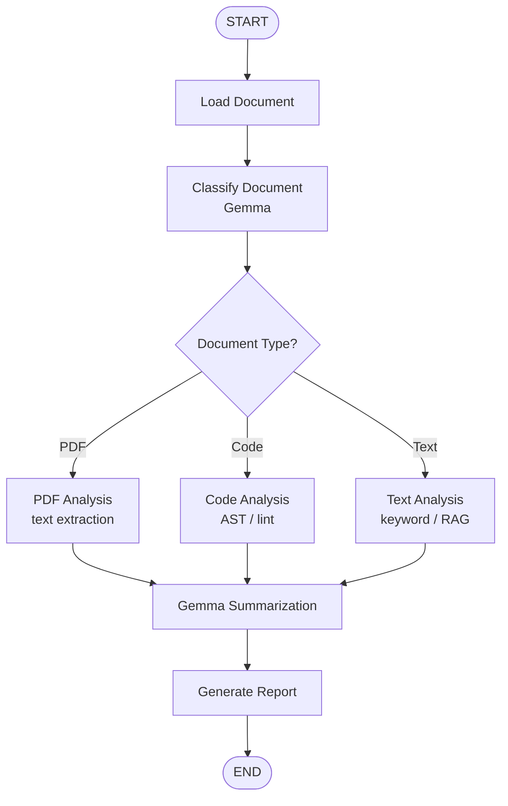
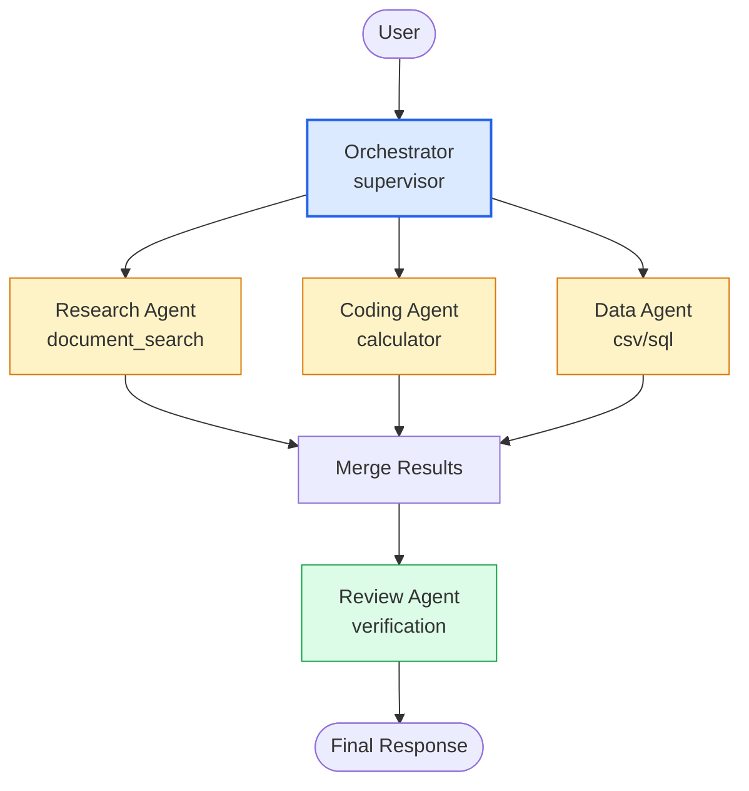

# Tutorial 03 — RAG as Tool / Document Analysis / Subagents
### From tool-using agent to orchestrated multi-agent system
#### Covers `LangGraph.md:550-610, 1060-1105, 1195-1261` + `tut1.md:1308-1400`

> Prerequisites: T01 ReAct graph + T02 `MessagesState` + `MemorySaver`. This tutorial adds **knowledge** (RAG) and **scale** (routing + subagents).

---

## 0. Mental Model

```
T01:  User → Agent → Tool → Observation → Answer
T02:  User → State(thread_id) → Agent → Checkpoint → Recall
T03:  User → Router/Classifier → RAG Tool / Parser / Subagent → Merge → Answer

Agent ≠ RAG
RAG = retrieval pipeline
Agent = decide whether/when/how to retrieve
```

Hugging Face emphasis: treat retrieval as a **tool** the agent can choose, not a mandatory prefix (`LangGraph.md:594`).

---

## 1. RAG Does Not Automatically Mean Agent (`LangGraph.md:550`)

**Traditional RAG (no agency):**
```
Question → Retriever → Documents → LLM → Answer
```
Always retrieves, then generates. Deterministic.

**Agentic RAG (tool):**
```
Question → Agent → Should I search?
                    ├── No → Answer directly
                    └── Yes → Search → Results → Agent → Search again? → Answer
```
Agent controls retrieval loop.

**When to use which:**
| Pattern | Use when |
|---|---|
| Traditional RAG | every query needs docs |
| Agentic RAG | sometimes answer from memory/tools, sometimes need docs, sometimes need 2-3 searches |

This tutorial builds agentic RAG.

---

## 2. Minimal Local RAG Tool (no external deps)

Build a tiny in-memory vector-ish store so tutorial runs offline. Swap with LlamaIndex/Chroma later without changing graph.

```python
from pathlib import Path
from langchain.tools import tool
import re

# 1. Corpus — replace with your docs / PDFs
docs = {
    "langgraph.md": Path("LangGraph.md").read_text()[:8000] if Path("LangGraph.md").exists() else "LangGraph is a framework for stateful agents with StateGraph, nodes, edges, checkpoints.",
    "tut1.md": Path("tut1.md").read_text()[:8000] if Path("tut1.md").exists() else "Gemma 4 12B via ChatOllama + LangGraph nodes + Tools + conditional edges.",
    "agents.md": "An agent is LLM + Tools + State + Control Loop. ReAct is Thought→Action→Observation. State enables multi-step, memory, human-in-loop.",
}

# naive keyword scorer — replace with embeddings later
def keyword_search(query: str, k=2):
    q_terms = set(re.findall(r"\w+", query.lower()))
    scored = []
    for name, text in docs.items():
        overlap = len(q_terms & set(re.findall(r"\w+", text.lower())))
        scored.append((overlap, name, text[:600]))
    scored.sort(reverse=True)
    return [f"[{name} score={s}]\n{text}" for s, name, text in scored[:k]]

@tool
def document_search(query: str) -> str:
    """Search local documents. Use when you need knowledge about LangGraph, agents, or course material. Input: natural language query."""
    results = keyword_search(query, k=2)
    return "\n\n---\n\n".join(results) if results else "No relevant documents found."

@tool
def calculator(expression: str) -> str:
    """Calculate arithmetic. Input like '123 * 456'."""
    allowed = set("0123456789+-*/(). ")
    if not all(c in allowed for c in expression): return "Invalid expression."
    try: return str(eval(expression))
    except Exception as e: return f"Calculation error: {e}"
```

**Upgrade path without changing graph:**

```python
# LlamaIndex-style ( LangGraph.md:640-714 )
# from llama_index.core.tools import FunctionTool
# from llama_index.core import VectorStoreIndex, Document
# index = VectorStoreIndex.from_documents([Document(text=t) for t in docs.values()])
# query_engine = index.as_query_engine()
# rag_tool = FunctionTool.from_defaults(fn=lambda q: str(query_engine.query(q)),
#                                       name="document_search",
#                                       description="Search private documents")

# Or Chroma / pgvector / etc — same tool name + description, graph unchanged
```

Bind:

```python
from langchain_ollama import ChatOllama
llm = ChatOllama(model="gemma4:12b", temperature=0)
tools = [document_search, calculator]
llm_with_tools = llm.bind_tools(tools)
```

Test:

```python
resp = llm_with_tools.invoke("What is an AI agent according to agents.md?")
print(resp.tool_calls)          # expect document_search
print(resp.content[:200])
```

---

## 3. RAG as Tool inside LangGraph (`LangGraph.md:701`)

Same ReAct graph as T01/T02 — just new tool in registry.

```python
from langgraph.graph import MessagesState, StateGraph, START, END
from langgraph.prebuilt import ToolNode

def assistant(state: MessagesState):
    return {"messages": [llm_with_tools.invoke(state["messages"])]}

tool_node = ToolNode(tools)

def should_continue(state: MessagesState):
    return "tools" if state["messages"][-1].tool_calls else END

builder = StateGraph(MessagesState)
builder.add_node("assistant", assistant)
builder.add_node("tools", tool_node)
builder.add_edge(START, "assistant")
builder.add_conditional_edges("assistant", should_continue)
builder.add_edge("tools", "assistant")

from langgraph.checkpoint.memory import MemorySaver
memory = MemorySaver()
graph = builder.compile(checkpointer=memory)
config = {"configurable": {"thread_id": "rag-001"}}

for q in [
    "What is 2*2?",                                          # no search needed
    "What is an AI agent according to the docs?",            # needs document_search
]:
    out = graph.invoke({"messages": [{"role": "user", "content": q}]}, config=config)
    print("Q:", q)
    print("A:", out["messages"][-1].content[:350])
    print("tool used:", [c["name"] for m in out["messages"] for c in getattr(m, "tool_calls", [])])
    print("---")
```

```
                    Agent
                      │
          ┌───────────┼────────────┐
          │           │            │
     Calculator   document_search  (future: web, db)
          │           │
          │        Vector Store → Documents
          └───────────┼────────────┘
                      ▼
                   Answer
```

Agent now decides: arithmetic → `calculator`, knowledge → `document_search`, trivial → direct answer.

---

## 4. Document Analysis Agent (`LangGraph.md:1060`, `tut1.md:1308`)

Beyond single `document_search` call — a **graph whose path depends on document type**. This is where workflow ≠ agent matters (`LangGraph.md:1001`).

```
                 Document
                    │
                    ▼
             ┌─────────────┐
             │   Analyze   │
             └──────┬──────┘
                    │
           ┌────────┴────────┐
           │                 │
         PDF              Spreadsheet
           │                 │
           ▼                 ▼
      Text Parser         Pandas
           │                 │
           └────────┬────────┘
                    ▼
                 Agent (Gemma)
            ┌─────┼─────┐
          Search  Python  Reason → Answer
```

### 4.1 Architecture as StateGraph (`tut1.md:1336`)



Agents don't have to be a single ReAct loop — they can be arbitrary stateful graphs (`tut1.md:1374`).

### 4.2 Implement with conditional edges

```python
from typing_extensions import TypedDict
from typing import Literal

class DocState(TypedDict):
    file_path: str
    doc_type: str       # pdf | code | text
    raw_text: str
    extracted: str
    summary: str
    report: str

def load_document(state: DocState):
    p = Path(state["file_path"])
    text = p.read_text(encoding="utf-8", errors="ignore")[:6000] if p.exists() else ""
    return {"raw_text": text}

def classify_document(state: DocState):
    # LLM classifier — or heuristic for demo
    text = state["raw_text"].lower()
    if ".pdf" in state["file_path"] or "pdf" in text[:200]:
        dtype = "pdf"
    elif "def " in text or "import " in text or state["file_path"].endswith(".py"):
        dtype = "code"
    else:
        dtype = "text"
    # with Gemma: llm.invoke(f"Classify as pdf/code/text: {text[:500]}") → parse
    return {"doc_type": dtype}

def route_doc(state: DocState) -> Literal["pdf_analysis","code_analysis","text_analysis"]:
    return {"pdf": "pdf_analysis", "code": "code_analysis", "text": "text_analysis"}[state["doc_type"]]

def pdf_analysis(state: DocState):
    # placeholder: PyPDF2 / pdfminer here
    return {"extracted": f"[PDF extracted {len(state['raw_text'])} chars]\n" + state["raw_text"][:1000]}

def code_analysis(state: DocState):
    # placeholder: ast parse, count functions
    import ast
    try:
        tree = ast.parse(state["raw_text"])
        funcs = [n.name for n in ast.walk(tree) if isinstance(n, ast.FunctionDef)]
        return {"extracted": f"Functions: {funcs}\n" + state["raw_text"][:1000]}
    except Exception as e:
        return {"extracted": f"Parse error: {e}"}

def text_analysis(state: DocState):
    # RAG step
    hits = keyword_search(state["raw_text"][:200], k=1)
    return {"extracted": hits[0] if hits else state["raw_text"][:1000]}

def summarize(state: DocState):
    resp = llm.invoke(f"Summarize in 3 bullets:\n{state['extracted'][:2000]}")
    return {"summary": resp.content}

def generate_report(state: DocState):
    return {"report": f"# Report ({state['doc_type']})\n\n{state['summary']}\n\n---\nChars: {len(state['raw_text'])}"}

builder = StateGraph(DocState)
for name, fn in [("load", load_document), ("classify", classify_document),
                 ("pdf_analysis", pdf_analysis), ("code_analysis", code_analysis),
                 ("text_analysis", text_analysis), ("summarize", summarize), ("report", generate_report)]:
    builder.add_node(name, fn)

builder.add_edge(START, "load")
builder.add_edge("load", "classify")
builder.add_conditional_edges("classify", route_doc)
for n in ["pdf_analysis","code_analysis","text_analysis"]:
    builder.add_edge(n, "summarize")
builder.add_edge("summarize", "report")
builder.add_edge("report", END)

doc_graph = builder.compile()
print(doc_graph.get_graph().draw_mermaid())

# run
out = doc_graph.invoke({"file_path": "LangGraph.md", "raw_text": "", "doc_type": "", "extracted": "", "summary": "", "report": ""})
print(out["report"][:800])
```

Swap `keyword_search` with real embeddings and `summarize` with a proper prompt — graph stays identical.

---

## 5. Subagents (`LangGraph.md:1195`, `tut1.md:1382`)

### 5.1 Concept

```
                    Main Agent (orchestrator)
                         │
             ┌───────────┼───────────┐
             ▼           ▼           ▼
          Research    Coding      Review
           Agent       Agent       Agent
             │           │           │
             └───────────┼───────────┘
                         ▼
                    Main Agent (merge)
```

Each subagent has its own `LLM + Tools + State + Prompt + Specialization` (`LangGraph.md:1212`).

Important idea (`LangGraph.md:530`):

```
Main State ──► Subagent A State
           └──► Subagent B State
                │            │
                ▼            ▼
             Result A     Result B → merged back into Main State
```

### 5.2 Supervisor pattern (`tut1.md:1399`)

LangGraph provides multi-agent primitives (supervisor / swarm) but first-principles version is just **a node that delegates to another graph**.

```python
from langgraph.graph import MessagesState

# --- subagent graphs (reuse T01 ReAct) ---
research_tools = [document_search]
code_tools = [calculator]

research_llm = llm.bind_tools(research_tools)
code_llm = llm.bind_tools(code_tools)

def research_assistant(state: MessagesState):
    return {"messages": [research_llm.invoke(state["messages"])]}

def code_assistant(state: MessagesState):
    return {"messages": [code_llm.invoke(state["messages"])]}

# build each as its own StateGraph (elided — same as §3)
# research_graph = StateGraph(MessagesState) ... .compile()
# code_graph = StateGraph(MessagesState) ... .compile()
```

Supervisor node (in main graph) decides which subagent to call:

```python
from typing import Literal

class MainState(MessagesState):
    next_agent: str   # research | code | review | done

def supervisor(state: MainState) -> Literal["research","code","review",END]:
    # LLM router — prompt Gemma to choose
    last = state["messages"][-1].content.lower()
    prompt = f"""You are supervisor. Given user intent, pick one:
- research: needs docs/knowledge
- code: needs calculation/execution
- review: needs verification
User: {last}
Reply with exactly one word."""
    choice = llm.invoke(prompt).content.strip().lower()
    if "research" in choice: return "research"
    if "code" in choice: return "code"
    if "review" in choice: return "review"
    return END

# Wrap subgraphs as nodes:
def call_research(state: MainState):
    # delegate — pass messages through
    out = research_graph.invoke({"messages": state["messages"]})
    return {"messages": [out["messages"][-1]]}

def call_code(state: MainState):
    out = code_graph.invoke({"messages": state["messages"]})
    return {"messages": [out["messages"][-1]]}
```

### 5.3 Multi-Agent Graph (`LangGraph.md:1227`)



```python
builder = StateGraph(MainState)
builder.add_node("supervisor", lambda s: s)  # placeholder — real: llm router
builder.add_node("research", call_research)
builder.add_node("code", call_code)
builder.add_node("review", lambda s: {"messages": [llm.invoke(f"Review: {s['messages'][-1].content[:400]}")]})

builder.add_edge(START, "supervisor")
builder.add_conditional_edges("supervisor", supervisor, {"research":"research","code":"code","review":"review", END: END})
builder.add_edge("research", "supervisor")  # loop back for multi-step
builder.add_edge("code", "supervisor")
builder.add_edge("review", END)

multi_graph = builder.compile(checkpointer=MemorySaver())
print(multi_graph.get_graph().draw_mermaid())
```

Parallel variant — run subagents concurrently, then merge (requires `add_messages` fan-out, LangGraph handles via `Send` API in newer versions):

```
Orchestrator → [Research || Code || Data] (parallel) → Merge → Review
```

---

## 6. Subgraphs & State Isolation

Each subgraph has its own state; main graph passes a **slice**. Pattern:

```python
# main state
class MainState(TypedDict):
    messages: Annotated[list, add_messages]
    research_result: str
    code_result: str

# research subgraph returns {"research_result": "..."}
# main merges: return {"research_result": subgraph_output["research_result"]}
```

This keeps tool namespaces isolated (research can't call `calculator` accidentally).

---

## 7. End-to-End Runs

### 7.1 Agentic RAG (2 turns, memory)

```python
cfg = {"configurable": {"thread_id": "t03-rag"}}
graph.invoke({"messages": [{"role": "user", "content": "What is LangGraph State according to docs?"}]}, config=cfg)
out = graph.invoke({"messages": [{"role": "user", "content": "And how does it relate to Nodes?"}]}, config=cfg)
print(out["messages"][-1].content[:500])
# should have called document_search on both, with history
```

### 7.2 Document analysis

```python
out = doc_graph.invoke({"file_path": "tut1.md", "raw_text": "", "doc_type": "", "extracted": "", "summary": "", "report": ""})
print(out["report"])
```

### 7.3 Multi-agent

```python
cfg2 = {"configurable": {"thread_id": "t03-multi"}}
out = multi_graph.invoke({"messages": [{"role": "user", "content": "Research LangGraph checkpointing and calculate 15*37"}]}, config=cfg2)
print(out["messages"][-1].content[:600])
```

---

## 8. Choosing Topology

| Need | Topology |
|---|---|
| Single decision → tool loop | ReAct graph (T01) |
| Type-dependent pipeline | Conditional routing (Doc Agent §4) |
| Specialized skills, same query | Supervisor → subagents (§5) |
| Independent parallel work → merge | Fan-out / `Send` |
| Review / QA gate | Supervisor → Review node |

> Not every LLM workflow needs an agent. Alfred email workflow is LLM decisions without tools — workflow, not agent (`LangGraph.md:1054`).

---

## 9. Exercises

1. **Keyword → Embedding swap:** Replace `keyword_search` with `sentence-transformers` or `Chroma` embeddings. Verify `document_search` tool name unchanged and graph still passes.
2. **Agentic vs forced RAG:** Add a `force_search` flag that always calls `document_search` before LLM. Compare answer quality vs agentic (LLM decides) on 5 queries.
3. **Doc routing:** Create 3 files (`notes.txt`, `script.py`, `paper.pdf` placeholder) and run `doc_graph` on each — confirm routing to correct analysis node via `draw_mermaid` trace.
4. **LlamaIndex QueryEngine as tool:** Wrap a `VectorStoreIndex.as_query_engine()` as `FunctionTool` (`LangGraph.md:640`) and bind to same graph — no graph change.
5. **Research subagent isolation:** Give `research_graph` only `[document_search]`, `code_graph` only `[calculator]`. Query that needs both — verify supervisor delegates twice.
6. **Parallel subagents:** Use `Send` API (LangGraph ≥0.2) to run `research` + `code` in parallel, then merge node that concatenates results.
7. **Memory + RAG:** 3-turn conversation where Turn 2 asks to "remember this doc snippet", Turn 3 queries it — verify `MemorySaver` recall without re-searching.
8. **Evaluation hook:** Log per-run `tool_selection_correct?`, `args_correct?` for RAG vs calculator decisions — precursor to T04 Evaluation.

---

## 10. What Comes Next

**Tutorial 04 — Production:** Human-in-the-Loop → Persistence (Sqlite/Postgres) → Safety (allowlist, path restrict, max steps) → Evaluation → Observability (`LangGraph.md:1108-1483`)

After T04, the stack is complete:

```
Local: Ollama → ChatOllama → LangChain → LangGraph
Graph: State → Nodes → Conditional Edges → StateGraph
Agent: ReAct (T01) + Memory (T02) + RAG/Doc/Subagents (T03) + HITL/Safety/Eval (T04)
       → Production architecture (LangGraph.md:1487)
```

*Sources: `LangGraph.md:550-610, 1060-1261`, `tut1.md:1308-1400`, Hugging Face document_analysis_agent + LangGraph multi-agent docs.*
