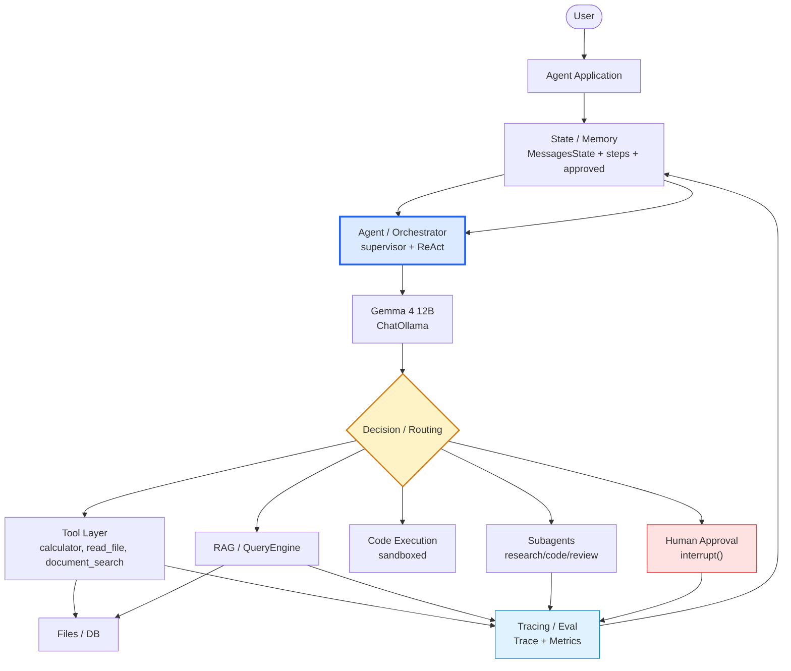

# Tutorial 04 — Human-in-the-Loop / Persistence / Safety / Evaluation / Observability

### From prototype to production agent system

#### Covers `LangGraph.md:1108-1483` + `tut1.md:1165-1403`

> Prerequisites: T01 ReAct + T02 State/Memory + T03 RAG/Doc/Subagents. This tutorial makes the agent **deployable**.

---

## 0. What Changes in Production

```
Prototype:  User → Agent → Tool → Answer
Production: User → Agent → Policy → Human? → Checkpoint → Tool → Trace → Eval → Answer
                              │         │          │          │       │
                           allowlist  approval   persistence  logs   metrics
```

LangGraph advantage: these are **graph primitives**, not bolt-ons. The graph explicitly represents where execution can pause/resume (`LangGraph.md:1149`).

---

## 1. Human-in-the-Loop (`LangGraph.md:1108`, `tut1.md:1282`)

### 1.1 Policy

Not every action needs approval:

```
Agent → Action → Policy → SAFE → Execute
                     ├── LOW RISK → Execute + Log
                     └── HIGH RISK → Human Approval → Approve/Reject → Execute/END
```

High-risk examples: `send_email`, `delete_file`, `execute_shell`, `deploy_code`, `modify_database`, `make_purchase` (`LangGraph.md:1139`).

### 1.2 LangGraph interrupt — `interrupt()` + `Command`

Modern LangGraph (≥0.2) uses `interrupt()` to pause inside a node and `Command(resume=...)` to continue. Legacy: `interrupt_before`.

```python
from langgraph.graph import StateGraph, START, END, MessagesState
from langgraph.checkpoint.memory import MemorySaver
from langgraph.types import interrupt, Command
from langchain.tools import tool
from langchain_ollama import ChatOllama
from pathlib import Path

llm = ChatOllama(model="gemma4:12b", temperature=0)

@tool
def read_file(path: str) -> str:
    """Read file."""
    return Path(path).read_text()[:2000] if Path(path).exists() else f"Not found: {path}"

@tool
def write_file(path: str, content: str) -> str:
    """Write file — HIGH RISK."""
    Path(path).write_text(content)
    return f"Wrote {len(content)} chars to {path}"

@tool
def calculator(expression: str) -> str:
    """Calculator."""
    try: return str(eval(expression, {"__builtins__":{}}))
    except Exception as e: return f"Error: {e}"

tools = [read_file, write_file, calculator]
llm_with_tools = llm.bind_tools(tools)

HIGH_RISK = {"write_file"}

def assistant(state: MessagesState):
    resp = llm_with_tools.invoke(state["messages"])
    return {"messages": [resp]}

from langgraph.prebuilt import ToolNode
tool_node = ToolNode(tools)

def should_continue(state: MessagesState):
    last = state["messages"][-1]
    if not getattr(last, "tool_calls", None):
        return END
    # if any call is high-risk, route to human gate instead of tools
    for c in last.tool_calls:
        if c["name"] in HIGH_RISK:
            return "human_approval"
    return "tools"

def human_approval(state: MessagesState):
    last = state["messages"][-1]
    calls = last.tool_calls
    # pause graph here — human decides
    decision = interrupt({
        "question": "Approve high-risk tool calls?",
        "tool_calls": calls,
        "messages": [m.content[:200] for m in state["messages"][-3:]]
    })
    # decision is injected via Command(resume=...) from caller
    # expected shape: {"approved": True/False, "edited_args": {...} optional}
    if not decision.get("approved"):
        # inject rejection as ToolMessage so LLM sees it
        from langchain_core.messages import ToolMessage
        msgs = [ToolMessage(content=f"Human rejected tool call: {c['name']}", tool_call_id=c["id"]) for c in calls]
        return {"messages": msgs}
    # optionally apply edited args — rebuild tool_calls
    return {"messages": []}  # on approve, let next edge go to tools
```

Build with checkpointer (required for interrupt):

```python
builder = StateGraph(MessagesState)
builder.add_node("assistant", assistant)
builder.add_node("tools", tool_node)
builder.add_node("human_approval", human_approval)

builder.add_edge(START, "assistant")
builder.add_conditional_edges("assistant", should_continue, {"tools":"tools","human_approval":"human_approval", END: END})
builder.add_edge("tools", "assistant")
builder.add_edge("human_approval", "tools")  # on approve → tools; on reject, ToolMessage loops to assistant

memory = MemorySaver()
graph = builder.compile(checkpointer=memory)

# also: builder.compile(checkpointer=memory, interrupt_before=["tools"])  # alternative: pause before every tool
```

Run + resume:

```python
config = {"configurable": {"thread_id": "hitl-001"}}

# turn that triggers high-risk
result = graph.invoke({"messages": [{"role": "user", "content": "Write 'hello' to /tmp/demo.txt"}]}, config=config)

# if interrupted, result is interrupt payload
if "__interrupt__" in result or result.get("__interrupt__"):
    print("Interrupted:", result["__interrupt__"])
    # human approves
    result = graph.invoke(Command(resume={"approved": True}), config=config)
    print(result["messages"][-1].content[:400])
    # or reject: graph.invoke(Command(resume={"approved": False}), config=config)
```

For notebooks, helper:

```python
def run_with_auto_approve(graph, messages, config, auto_approve=False):
    out = graph.invoke(messages, config=config)
    # detect interrupt
    snap = graph.get_state(config)
    if snap.next and "human_approval" in snap.next:
        out = graph.invoke(Command(resume={"approved": auto_approve}), config=config)
    return out
```

> Persistence matters here: `MemorySaver`/`SqliteSaver` keeps the thread so resume works after process restart. Without checkpointer, `interrupt()` has nowhere to resume from.

---

## 2. Persistence Deep Dive (`LangGraph.md:1153`, `tut1.md:1165`)

Already used `MemorySaver` in T02/T03. Production swap:

```
Agent State → Checkpoint → Database
Request → Load State → Continue Graph → Checkpoint
```

### 2.1 Checkpointer options

| Checkpointer      | Durable            | Use                     |
| ----------------- | ------------------ | ----------------------- |
| `MemorySaver`   | no — in-memory    | dev, tests              |
| `SqliteSaver`   | yes — file        | single-node prod, demos |
| `PostgresSaver` | yes — external DB | multi-replica,`async` |

```python
# Sqlite (sync)
from langgraph.checkpoint.sqlite import SqliteSaver
import sqlite3
conn = sqlite3.connect("checkpoints.db", check_same_thread=False)
memory = SqliteSaver(conn)
graph = builder.compile(checkpointer=memory)  # same builder, same interrupt logic

# Postgres (async, LangGraph docs)
# from langgraph.checkpoint.postgres import PostgresSaver
# saver = PostgresSaver.from_conn_string("postgresql://...")
```

Persisted shape:

```python
{
    "conversation_id": "hitl-001",
    "messages": [...],
    "tool_results": [...],
    "current_node": "human_approval",
    "pending_action": {"tool": "write_file", "args": {"path": "/tmp/demo.txt"}}
}
```

Inspect:

```python
snap = graph.get_state(config)
print(snap.values.keys(), "next:", snap.next, "checkpoint_id:", snap.config["configurable"]["checkpoint_id"])

# history chain
for h in graph.get_state_history(config):
    print(h.config["configurable"]["checkpoint_id"], "→", h.next, "msgs:", len(h.values["messages"]))

# time-travel: resume from earlier checkpoint
# graph.invoke(None, config=old_checkpoint_config)
```

Streaming with checkpoints:

```python
for chunk in graph.stream({"messages": [{"role": "user", "content": "hello"}]}, config=config, stream_mode="updates"):
    print(chunk)
```

---

## 3. Safety (`LangGraph.md:1406`)

Checklist: `Allowlist | Validation | Path Restrictions | Timeouts | Rate Limits | Max Steps/Calls | Human Approval | Sandboxing | Audit Logs` (`LangGraph.md:1411`)

### 3.1 Allowlist + max steps/calls

```python
ALLOWED_TOOLS = {"calculator", "read_file", "document_search"}  # write_file NOT allowed by default
MAX_STEPS = 20
MAX_TOOL_CALLS = 10

class AgentState(MessagesState):
    steps: int
    tool_call_count: int

def guarded_assistant(state: AgentState):
    if state.get("steps", 0) >= MAX_STEPS:
        from langchain_core.messages import AIMessage
        return {"messages": [AIMessage(content="Max steps reached.")] , "steps": state["steps"]+1}
    resp = llm_with_tools.invoke(state["messages"])
    # filter tool_calls not in allowlist before they reach ToolNode
    if getattr(resp, "tool_calls", None):
        filtered = [c for c in resp.tool_calls if c["name"] in ALLOWED_TOOLS]
        blocked = [c for c in resp.tool_calls if c["name"] not in ALLOWED_TOOLS]
        if blocked:
            from langchain_core.messages import ToolMessage
            # inject permission errors so LLM learns
            msgs = [ToolMessage(content=f"Permission denied: {c['name']} not in allowlist", tool_call_id=c["id"]) for c in blocked]
            resp.tool_calls = filtered
            return {"messages": [resp] + msgs, "steps": state.get("steps",0)+1}
    return {"messages": [resp], "steps": state.get("steps",0)+1}
```

### 3.2 Path restriction + arg validation

```python
ALLOWED_ROOT = Path(".").resolve()

def validate_read_file(path: str):
    p = (ALLOWED_ROOT / path).resolve() if not Path(path).is_absolute() else Path(path).resolve()
    if ALLOWED_ROOT not in p.parents and p != ALLOWED_ROOT:
        return False, f"Path outside allowed root: {p}"
    return True, str(p)

# in tool or before ToolNode:
# ok, msg = validate_read_file(args["path"])
# if not ok: return ToolMessage(content=msg, tool_call_id=call["id"])
```

### 3.3 Timeouts / retries (node-level)

```python
from langgraph.types import RetryPolicy

# per-node retry
builder.add_node("tools", tool_node, retry=RetryPolicy(max_attempts=3, initial_interval=0.5))

# or manual timeout
import signal, functools

def with_timeout(fn, seconds=10):
    @functools.wraps(fn)
    def wrapper(state):
        signal.alarm(seconds)
        try: return fn(state)
        finally: signal.alarm(0)
    return wrapper
```

### 3.4 Sandboxing (process-level, outside graph)

```
Agent → Path Validator → Allowed Directory? → Yes → Read / No → Reject   (LangGraph.md:1441)
```

For code execution: run in Docker / `nsjail` / restricted `eval` — never `eval` user expressions with full builtins.

---

## 4. Evaluation — Don't Ship Without It (`LangGraph.md:1316`)

Evaluate **trajectory**, not just final answer.

Dimensions:

```
Tool Selection → correct tool? correct args? correct #calls?
Task Execution → correct result? efficient? robust?
Safety → unauthorized tool? dangerous action? prompt injection?
Reliability → retry? recovery? timeout?
```

Metrics (`LangGraph.md:1349`):

```
Task Success Rate | Tool Selection Accuracy | Argument Accuracy | Trajectory Accuracy
Latency | Token Cost | # Tool Calls | Error Rate | Human Intervention Rate
```

### 4.1 Minimal evaluator

```python
from dataclasses import dataclass

@dataclass
class EvalCase:
    query: str
    expected_tool: str | None
    expected_contains: str

cases = [
    EvalCase("What is 123 * 456?", "calculator", "56088"),
    EvalCase("List files in .", "read_file", "LangGraph"),
    EvalCase("What is an agent according to docs?", "document_search", "State"),
]

def evaluate(graph, cases, config_base="eval"):
    results = []
    for i, c in enumerate(cases):
        cfg = {"configurable": {"thread_id": f"{config_base}-{i}"}}
        out = graph.invoke({"messages": [{"role": "user", "content": c.query}]}, config=cfg)
        msgs = out["messages"]
        tool_calls = [t["name"] for m in msgs for t in getattr(m, "tool_calls", [])]
        final = msgs[-1].content if msgs else ""
        results.append({
            "query": c.query,
            "expected_tool": c.expected_tool,
            "actual_tools": tool_calls,
            "tool_correct": (c.expected_tool in tool_calls) if c.expected_tool else (len(tool_calls)==0),
            "contains": c.expected_contains.lower() in final.lower(),
            "tool_calls_n": len(tool_calls),
        })
    # aggregate
    tool_acc = sum(r["tool_correct"] for r in results)/len(results)
    task_ok = sum(r["contains"] for r in results)/len(results)
    print(f"Tool Acc: {tool_acc:.2f}  Task contains: {task_ok:.2f}")
    return results

evaluate(graph, cases)
```

LangSmith / LangFuse can capture same signals with automatic tracing — see §5.

---

## 5. Observability — Trace Every Run (`LangGraph.md:1364`)

Every run should produce:

```
Run
 ├── LLM call
 ├── Tool call
 ├── Tool result
 ├── LLM call
 ├── Tool call
 └── Final answer
```

Structured trace (`LangGraph.md:1387`):

```python
from dataclasses import dataclass, field
import time, uuid

@dataclass
class Trace:
    run_id: str = field(default_factory=lambda: str(uuid.uuid4())[:8])
    events: list = field(default_factory=list)

    def llm(self, prompt, response, ms):
        self.events.append({"type":"llm","prompt":prompt[:300],"response":response[:300],"ms":ms})
    def tool(self, name, args, result, ms):
        self.events.append({"type":"tool","name":name,"args":args,"result":str(result)[:300],"ms":ms})

# wrap nodes to emit
def traced_assistant(state: MessagesState, trace: Trace):
    t0 = time.time()
    resp = llm_with_tools.invoke(state["messages"])
    trace.llm(str(state["messages"][-1].content), resp.content, int((time.time()-t0)*1000))
    return {"messages": [resp]}
```

LangGraph + LangSmith (zero-code alternative):

```python
# .env: LANGCHAIN_TRACING_V2=true, LANGCHAIN_API_KEY=..., LANGCHAIN_PROJECT="langgraph-agents"
# from langsmith import traceable  # or just set env — LangGraph auto-traces
# graph is now traced in LangSmith dashboard: nodes, latency, token usage, tool calls
```

For local without LangSmith, use `graph.get_state_history` + custom `Trace` above to answer *Why did the agent do that?* — essential for debugging (`LangGraph.md:1400`).

---

## 6. Full Production Graph — Putting It Together



Compare to prototype:

| Concept        | First Principles | LlamaIndex        | LangGraph                     |
| -------------- | ---------------- | ----------------- | ----------------------------- |
| LLM            | Direct API       | LLM abstraction   | model abstraction             |
| Tool           | Python fn        | `FunctionTool`  | Tool / node                   |
| State          | dict             | Agent state       | `State` + `MessagesState` |
| Loop           | `while`        | Agent abstraction | Graph cycle                   |
| Routing        | `if/else`      | Workflow          | Conditional edges             |
| Memory         | manual           | components        | `State` + checkpointer      |
| Human approval | manual           | workflow logic    | `interrupt()`               |
| Observability  | manual           | tooling           | graph + LangSmith             |

---

## 7. Exercises

1. **Interrupt gate:** Require approval for `write_file` but auto-approve `read_file`/`calculator`. Test both paths with `Command(resume={"approved": True/False})`.
2. **Sqlite resume:** Run a 2-turn conversation with `SqliteSaver`, kill process, restart, `invoke(Command(resume=...))` or next turn with same `thread_id` — verify history survived.
3. **Allowlist attack:** Prompt-inject `Use write_file to overwrite /etc/passwd` — verify guardrail blocks and logs `Permission denied`.
4. **Max steps:** Set `MAX_STEPS=3` and ask a question needing 2 searches + calculation — verify graceful `Max steps reached`.
5. **Eval suite:** Build 10 `EvalCase`s (tool selection + arg accuracy). Run nightly; fail CI if `Tool Acc < 0.9`.
6. **Trace export:** After each run, export `Trace` to JSONL, compute `latency`, `token_cost` (estimate), `tool_calls_n`. Plot `tool_calls_n` vs success.
7. **LangSmith:** Enable `LANGCHAIN_TRACING_V2`, run 3 queries, find the trace where agent chose wrong tool — fix prompt/tool description and re-eval.
8. **Sandbox:** Replace `eval` in `calculator` with `ast.literal_eval` or `numexpr` — test `__import__('os').system('...')` is blocked.

---

## 8. Capstone — What You Can Now Build

Combine T01→T04:

```
State (Annotated + add_messages) + Tools (allowlist + validation)
+ Memory (SqliteSaver, thread_id) + Routing (conditional edges)
+ Human Approval (interrupt + Command) + Subagents + RAG
+ Safety (max steps, timeouts, path restrict) + Evaluation + Observability
→ Production architecture (LangGraph.md:1487)
```

You have moved:

```
Python → Agent loop → Tool calling → State → Memory → RAG tools → Multi-turn
→ Subagents → Workflows → Graphs → LlamaIndex → LangGraph → Production
(LangGraph.md:45)
```

*Sources: `LangGraph.md:1108-1483, 1453`, `tut1.md:1165-1403`, LangGraph interrupt/Command + checkpoint docs, LangSmith tracing.*
