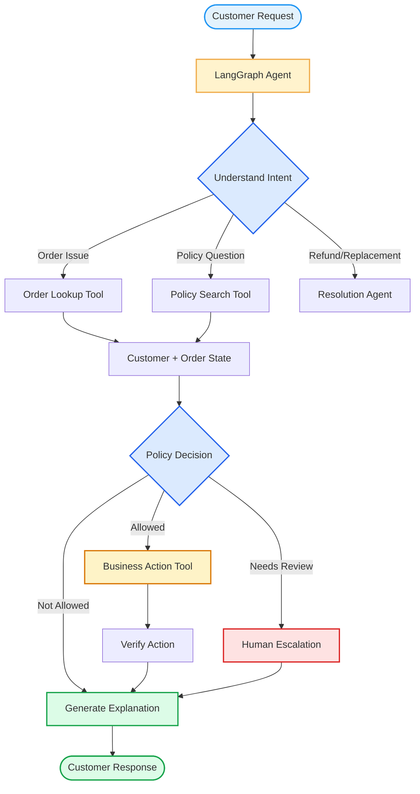
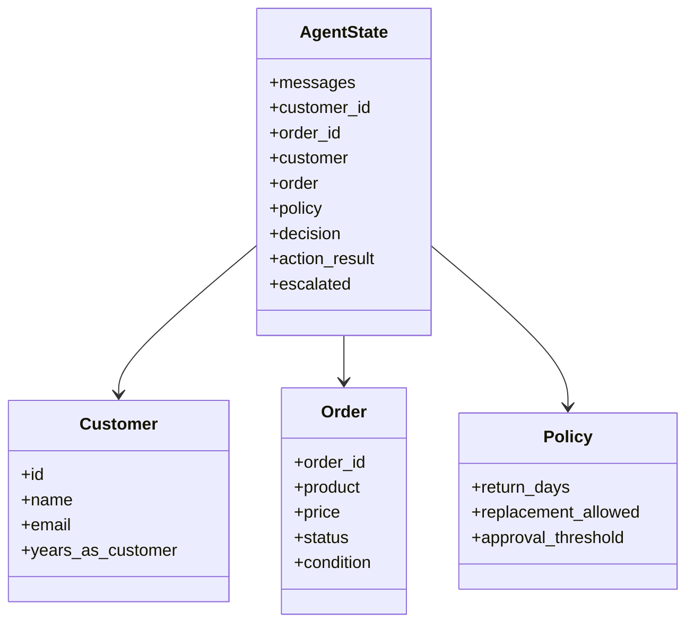
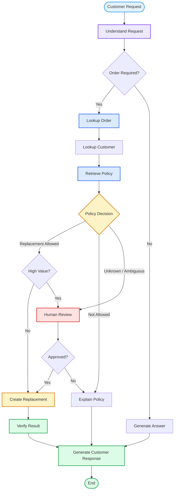

Absolutely. Since the goal is to **learn LangGraph + Agents by building something real**, I would not start with an artificial "weather agent." Let's build a business workflow where the agent has to **reason, use tools, route work, maintain state, and produce a decision**.

## Project: AI Customer Support & Resolution Agent

### Business problem

A company receives customer support requests such as:

> "My order #10452 arrived damaged. I want a replacement. I've been a customer for 3 years."

A traditional chatbot can answer questions, but a business-grade agent needs to:

1. Understand the request.
2. Identify the customer/order.
3. Look up order information.
4. Retrieve the company's refund/replacement policy.
5. Decide what action is allowed.
6. Potentially call a business operation such as `create_replacement`.
7. Escalate when the request is outside policy.
8. Produce a clear response to the customer.
9. Keep an auditable record of what happened.

This gives us a genuinely useful Agentic System.

---

# Architecture we're going to build



The important thing is that **LangGraph is not the intelligence**.

The architecture is:

```text
                 ┌──────────────────┐
                 │      Gemma 4     │
                 │      12B         │
                 └────────┬─────────┘
                          │
                          ▼
                  ┌───────────────┐
                  │   LangGraph   │
                  │ State Machine │
                  └───────┬───────┘
                          │
             ┌────────────┼────────────┐
             ▼            ▼            ▼
          Tools         Policy       Human
             │            │          Review
             └────────────┼────────────┘
                          ▼
                   Business Result
```

The LLM reasons over the problem.

**LangGraph controls the workflow.**

**Tools interact with the outside world.**

**State carries information between nodes.**

That's the fundamental mental model I want you to learn.

---

# Notebook structure

We'll build this progressively rather than dumping a giant implementation.

## `01_business_problem.ipynb`

Understand:

```text
Business problem
      ↓
Agent requirements
      ↓
Tools
      ↓
State
      ↓
Graph
      ↓
LLM
      ↓
Execution
```

---

# 1. Environment

You're already using a Conda environment and Ollama locally.

Create:

```bash
conda create -n agentic-support python=3.11 -y
conda activate agentic-support
```

Install:

```bash
pip install -U \
    langgraph \
    langchain \
    langchain-ollama \
    pydantic \
    pandas \
    jupyter
```

Verify Ollama:

```bash
ollama list
```

You should see:

```text
gemma4:12b
```

Then test:

```bash
ollama run gemma4:12b
```

---

# 2. First principle: What is our Agent?

Before LangGraph, let's define the simplest possible agent mathematically.

A conventional program:

```text
Input
  ↓
Function
  ↓
Output
```

An agent:

```text
Input
  ↓
State
  ↓
LLM
  ↓
Decision
  ↓
Tool / Action
  ↓
Observation
  ↓
Updated State
  ↓
LLM
  ↓
...
```

Conceptually:

$$
S_{t+1} = f(S_t, A_t, O_t)
$$

where:

* \(S_t\) = current state
* \(A_t\) = action
* \(O_t\) = observation
* \(S_{t+1}\) = updated state

The LLM chooses:

$$
A_t = \pi_\theta(S_t)
$$

where \(\pi_\theta\) is the model's decision policy.

LangGraph gives us the machinery to explicitly represent this process.

---

# 3. Our business database

We don't need PostgreSQL initially.

We'll create a tiny simulated business database.

```python
CUSTOMERS = {
    "C001": {
        "name": "Alice",
        "email": "alice@example.com",
        "years_as_customer": 3
    },
    "C002": {
        "name": "Bob",
        "email": "bob@example.com",
        "years_as_customer": 1
    }
}
```

Orders:

```python
ORDERS = {
    "10452": {
        "customer_id": "C001",
        "product": "MacBook Pro",
        "status": "delivered",
        "price": 2499,
        "condition": "damaged",
    },

    "10453": {
        "customer_id": "C002",
        "product": "Keyboard",
        "status": "delivered",
        "price": 120,
        "condition": "normal",
    }
}
```

Policy:

```python
RETURN_POLICY = {
    "standard_return_days": 30,
    "damaged_item_replacement": True,
    "customer_pays_return_shipping": False,
    "manager_approval_threshold": 1000,
}
```

This is deliberately simple.

Later we'll replace these with:

```text
PostgreSQL
Redis
Vector DB
REST APIs
CRM
ERP
Payment system
```

---

# 4. Tools

Now we introduce the most important Agent abstraction.

A tool is:

$$
Tool = (name, description, schema, implementation)
$$

For example:

```python
def lookup_order(order_id: str):
    return ORDERS.get(order_id)
```

Customer lookup:

```python
def lookup_customer(customer_id: str):
    return CUSTOMERS.get(customer_id)
```

Policy:

```python
def get_return_policy():
    return RETURN_POLICY
```

Business action:

```python
def create_replacement(order_id: str):
    order = ORDERS.get(order_id)

    if order is None:
        return {
            "success": False,
            "error": "Order not found"
        }

    return {
        "success": True,
        "order_id": order_id,
        "action": "replacement_created",
        "product": order["product"]
    }
```

And escalation:

```python
def escalate_to_human(reason: str):
    return {
        "escalated": True,
        "reason": reason
    }
```

---

# 5. Turn functions into LangChain tools

```python
from langchain_core.tools import tool
```

Then:

```python
@tool
def lookup_order(order_id: str):
    """Look up an order using its order ID."""
    return ORDERS.get(order_id)
```

```python
@tool
def lookup_customer(customer_id: str):
    """Look up customer information."""
    return CUSTOMERS.get(customer_id)
```

```python
@tool
def get_return_policy():
    """Retrieve the company's return and replacement policy."""
    return RETURN_POLICY
```

```python
@tool
def create_replacement(order_id: str):
    """Create a replacement order."""
    order = ORDERS.get(order_id)

    if order is None:
        return {
            "success": False,
            "error": "Order not found"
        }

    return {
        "success": True,
        "order_id": order_id,
        "action": "replacement_created",
        "product": order["product"]
    }
```

---

# 6. Our LLM

Now connect Gemma.

```python
from langchain_ollama import ChatOllama
```

```python
llm = ChatOllama(
    model="gemma4:12b",
    temperature=0
)
```

Test it:

```python
response = llm.invoke(
    "Explain what an AI agent is in one sentence."
)

print(response.content)
```

At this point:

```text
Python
  ↓
LangChain
  ↓
Ollama
  ↓
Gemma 4 12B
```

---

# 7. Give Gemma the tools

```python
tools = [
    lookup_order,
    lookup_customer,
    get_return_policy,
    create_replacement,
    escalate_to_human,
]
```

Bind:

```python
llm_with_tools = llm.bind_tools(tools)
```

Now the model can produce tool calls.

Conceptually:

```text
User:
"My order 10452 arrived damaged."

        ↓

Gemma

        ↓

Tool call:

lookup_order(
    order_id="10452"
)
```

The model doesn't directly execute Python.

It proposes:

```text
Tool name
+
Arguments
```

LangGraph/LangChain executes the tool.

This distinction is **fundamental**.

---

# 8. Define Agent State

This is where LangGraph becomes interesting.

```python
from typing import TypedDict, Annotated
from langgraph.graph.message import add_messages
```

```python
class AgentState(TypedDict):

    messages: Annotated[list, add_messages]

    customer_id: str | None
    order_id: str | None

    customer: dict | None
    order: dict | None
    policy: dict | None

    decision: str | None
    action_result: dict | None

    escalated: bool
```

State is the agent's working memory.

---

# 9. Visualize State



---

# 10. Build the first LangGraph

```python
from langgraph.graph import StateGraph, START, END
```

Our first graph:

```text
START
  ↓
Agent
  ↓
Tools
  ↓
Agent
  ↓
END
```

This is essentially the classic ReAct loop.

---

# 11. Agent node

```python
def agent_node(state: AgentState):

    response = llm_with_tools.invoke(
        state["messages"]
    )

    return {
        "messages": [response]
    }
```

The node doesn't execute tools.

It asks Gemma:

> "Given the current state, what should happen next?"

---

# 12. Tool node

LangGraph provides a convenient mechanism for tool execution.

```python
from langgraph.prebuilt import ToolNode
```

```python
tool_node = ToolNode(tools)
```

Now:

```text
Gemma
  ↓
Tool Call
  ↓
ToolNode
  ↓
Tool Result
  ↓
Gemma
```

---

# 13. Conditional routing

The graph needs to determine:

> Did the LLM request a tool?

```python
from langgraph.prebuilt import tools_condition
```

Then:

```python
builder = StateGraph(AgentState)

builder.add_node("agent", agent_node)
builder.add_node("tools", tool_node)

builder.add_edge(START, "agent")

builder.add_conditional_edges(
    "agent",
    tools_condition
)

builder.add_edge("tools", "agent")
```

Compile:

```python
graph = builder.compile()
```

This gives:

```text
               ┌───────────────┐
               │     START     │
               └───────┬───────┘
                       ↓
               ┌───────────────┐
               │     AGENT     │
               │    Gemma      │
               └───────┬───────┘
                       │
                Tool call?
                 /       \
               Yes        No
                ↓          ↓
          ┌──────────┐   END
          │  TOOLS   │
          └────┬─────┘
               │
               └──────────────→ AGENT
```

This is our **first real agentic graph**.

---

# 14. Run the agent

```python
from langchain_core.messages import HumanMessage
```

```python
result = graph.invoke(
    {
        "messages": [
            HumanMessage(
                content=
                "My order 10452 arrived damaged. "
                "Can I get a replacement?"
            )
        ],

        "customer_id": None,
        "order_id": "10452",
        "customer": None,
        "order": None,
        "policy": None,
        "decision": None,
        "action_result": None,
        "escalated": False,
    }
)
```

Then:

```python
for message in result["messages"]:
    print(message)
```

---

# 15. But this isn't enough

This is an important learning point.

We have built:

```text
LLM + Tools + Loop
```

But a real business agent needs **control**.

We don't want Gemma arbitrarily deciding:

```text
"Refund $10,000"
```

So we introduce deterministic business logic.

This is one of the most important principles of production agents:

> **Let the LLM reason about language; let deterministic code enforce business invariants.**

---

# 16. Add a policy node

```python
def policy_node(state: AgentState):

    order = state["order"]

    if order is None:
        return {
            "decision": "escalate"
        }

    if order["condition"] == "damaged":

        if order["price"] <= RETURN_POLICY["manager_approval_threshold"]:
            return {
                "decision": "approve_replacement"
            }

        return {
            "decision": "manager_review"
        }

    return {
        "decision": "deny"
    }
```

Now the graph becomes:

```text
                User
                 │
                 ▼
              Agent
                 │
                 ▼
               Tools
                 │
                 ▼
             Policy
            /   |   \
           /    |    \
       Approve Review Deny
          │      │      │
          ▼      ▼      ▼
       Action  Human  Explain
          │
          ▼
       Verify
          │
          ▼
       Response
```

That's much closer to a real enterprise agent.

---

# 17. Add Human-in-the-loop

For expensive or risky actions:

```text
Order > $1000
       ↓
Human approval
       ↓
Approve / Reject
```

For example:

```python
def human_review_node(state):

    print("\n⚠️ HUMAN REVIEW REQUIRED")

    print(
        f"Order: {state['order']}"
    )

    decision = input(
        "Approve replacement? [y/n]: "
    )

    if decision.lower() == "y":
        return {
            "decision": "approve_replacement"
        }

    return {
        "decision": "deny"
    }
```

Later we can replace this with:

```text
Slack
Email
Dashboard
Approval API
Ticketing System
```

---

# 18. The complete business workflow

Eventually our graph will look like this:



---

# 19. Then we make it genuinely agentic

Once the basic graph works, we'll add:

### Memory

```text
Conversation
     ↓
State
     ↓
Long-term customer memory
```

### RAG

```text
Policy Documents
      ↓
Retriever
      ↓
Policy Tool
      ↓
Agent
```

### Subagents

```text
                    Main Agent
                   /     |      \
                  /      |       \
          Order Agent  Policy   Customer Agent
                       Agent
```

### Parallel execution

```text
                 Main Agent
                 /        \
                ↓          ↓
          Order Lookup   Customer Lookup
                \          /
                 \        /
                  ↓      ↓
                  Merge
                    ↓
                  Agent
```

### Guardrails

```text
LLM
 ↓
Policy Validator
 ↓
Tool
 ↓
Result Validator
 ↓
User
```

### Persistence

```text
Agent
 ↓
Checkpoint
 ↓
Database
 ↓
Resume
```

### Observability

```text
                    Agent
                      │
          ┌───────────┼───────────┐
          ↓           ↓           ↓
       Traces       Tools       State
          │           │           │
          └───────────┼───────────┘
                      ↓
                  Evaluation
```

---

# 20. Why this project is particularly useful

By the end, you'll have learned almost every important Agent concept through **one coherent system**:

| Concept                 | Where we learn it           |
| ----------------------- | --------------------------- |
| LLM                     | Gemma 4 12B                 |
| Prompting               | Agent node                  |
| Tool calling            | Order/customer tools        |
| Tool schema             | `@tool`                   |
| ReAct                   | Agent ↔ Tool loop          |
| State                   | `AgentState`              |
| Nodes                   | Graph functions             |
| Edges                   | Workflow transitions        |
| Conditional routing     | Policy decisions            |
| Persistence             | Checkpointing               |
| Memory                  | Customer history            |
| RAG                     | Policy retrieval            |
| Human-in-loop           | Manager approval            |
| Subagents               | Specialized business agents |
| Parallelism             | Independent lookups         |
| Guardrails              | Policy validator            |
| Evaluation              | Test cases                  |
| Observability           | Tracing                     |
| Production architecture | Final system                |

Most importantly, we'll distinguish **three different things** that are often incorrectly mixed together:

```text
                 ┌────────────────────┐
                 │       AGENT        │
                 │                    │
                 │  Reasoning/Choice  │
                 └─────────┬──────────┘
                           │
                           ▼
                 ┌────────────────────┐
                 │     WORKFLOW       │
                 │                    │
                 │ State + Routing    │
                 └─────────┬──────────┘
                           │
                           ▼
                 ┌────────────────────┐
                 │       TOOLS        │
                 │                    │
                 │ Real-world Actions │
                 └────────────────────┘
```

**Gemma 4 12B is the reasoning engine.**

**LangGraph is the orchestration/state-machine layer.**

**Tools are the agent's capabilities.**

That's the foundation we'll build the entire project around.
