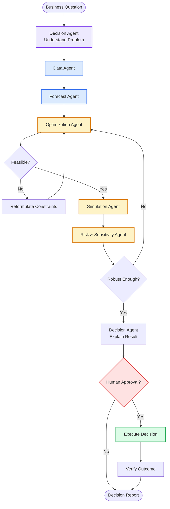

Yes. If your goal is **Applied Mathematics + AI + Agents**, I would avoid the usual "customer support / RAG chatbot / email agent" projects. Those are useful for learning orchestration, but they don't really exploit mathematical expertise.

A much more interesting direction is to build an agent around **decision-making under uncertainty and optimization**.

## My strongest recommendation: AI Operations Research Analyst

### Business problem: "What should the company do?"

Imagine a company that has:

* 50–500 products
* uncertain demand
* limited inventory
* multiple warehouses
* transportation costs
* supplier constraints
* delivery deadlines
* changing prices
* uncertain lead times
* service-level commitments

Management asks:

> **"Given what we currently know, how should we allocate inventory and production over the next 4 weeks to maximize expected profit while keeping service levels above 95%?"**

That's not a conventional chatbot problem.

It combines:

```text
                 BUSINESS
                    │
                    ▼
            Decision Problem
                    │
        ┌───────────┼────────────┐
        │           │            │
        ▼           ▼            ▼
    Statistics   Optimization   Simulation
        │           │            │
        └───────────┼────────────┘
                    ▼
               AI AGENT
                    │
        ┌───────────┼───────────┐
        ▼           ▼           ▼
     Data       Mathematical    Scenario
     Agent        Solver        Agent
        │           │            │
        └───────────┼────────────┘
                    ▼
             Business Decision
```

This is a **much less commoditized problem**.

---

# Project: Decision Intelligence Agent

I'd call the system:

> **Decision Intelligence Agent — An AI Operations Research Analyst**

The agent doesn't merely answer:

> "What is optimal?"

It investigates:

> **"What decision should we make, why, under what assumptions, and how sensitive is that decision to uncertainty?"**

That's a considerably deeper problem.

---

# Why this fits Applied Mathematics extremely well

You can bring in:

### Linear programming

$$
\max_x c^Tx
$$

subject to:

$$
Ax \le b
$$

### Mixed Integer Programming

$$
x_i \in \mathbb{Z}
$$

for decisions such as:

* open warehouse
* order truck
* schedule machine
* select supplier

### Convex optimization

$$
\min_x f(x)
$$

subject to convex constraints.

### Stochastic optimization

Instead of assuming demand \(D\) is known:

$$
D \sim P(D)
$$

we optimize expected performance:

$$
\max_x E[f(x,D)]
$$

### Robust optimization

Instead of trusting one forecast:

$$
D \in \mathcal U
$$

and solve:

$$
\max_x \min_{D\in\mathcal U} f(x,D)
$$

### Monte Carlo simulation

Generate:

$$
D_1,D_2,\ldots,D_N
$$

and estimate:

$$
E[f(X,D)]
$$

### Time-series forecasting

For example:

$$
D_t = f(D_{t-1},D_{t-2},\ldots)
$$

### Bayesian inference

Update beliefs:

$$
P(\theta|D)
\propto
P(D|\theta)P(\theta)
$$

### Sensitivity analysis

Ask:

> "What happens if demand increases 20%?"

### Scenario analysis

```text
Base case
   │
   ├── Demand +10%
   ├── Demand +25%
   ├── Supplier failure
   ├── Transport cost +30%
   └── Warehouse unavailable
```

And **AI agents orchestrate all of this**.

---

# The really interesting part

Don't make the LLM itself perform the optimization.

That would be the wrong architecture.

Instead:

```text
                    Gemma 4 12B
                         │
                         │ reasoning
                         ▼
                ┌─────────────────┐
                │ Decision Agent  │
                └────────┬────────┘
                         │
          ┌──────────────┼───────────────┐
          │              │               │
          ▼              ▼               ▼
     Data Agent     Forecast Agent   Optimization
                                          Agent
          │              │               │
          ▼              ▼               ▼
       SQL/Pandas     Statistics       OR-Tools
                                       SciPy
                                       Pyomo
                                          │
                                          ▼
                                    Simulation Agent
                                          │
                                          ▼
                                    Risk Analysis
                                          │
                         ┌────────────────┘
                         ▼
                   Decision Agent
                         │
                         ▼
                  Business Report
```

The LLM becomes the **orchestrator and reasoning interface**.

The mathematical algorithms remain deterministic and verifiable.

That is exactly the kind of hybrid AI system I think is worth studying.

---

# Example

Suppose the user asks:

> "We have 10,000 units of inventory. Demand next month is uncertain. We have three warehouses and two suppliers. Minimize expected logistics cost while maintaining at least a 95% probability of fulfilling demand."

The agent could determine:

```text
Problem type:
Stochastic inventory allocation
```

Then:

### Step 1 — Data Agent

Retrieve:

```text
historical demand
supplier lead times
warehouse capacity
transportation costs
current inventory
```

### Step 2 — Forecast Agent

Estimate:

$$
D_{next} \sim Distribution
$$

For example:

```text
Warehouse A:
μ = 4200
σ = 700

Warehouse B:
μ = 3100
σ = 500

Warehouse C:
μ = 2700
σ = 400
```

### Step 3 — Optimization Agent

Solve:

$$
\min_x
E[\text{transportation cost}]
+
E[\text{stockout cost}]
$$

subject to:

$$
x_A+x_B+x_C \le 10000
$$

and:

$$
P(\text{demand satisfied}) \ge 0.95
$$

### Step 4 — Simulation Agent

Run:

```text
10,000 Monte Carlo scenarios
```

### Step 5 — Sensitivity Agent

Test:

```text
Demand +10%
Demand +20%
Supplier failure
Transport cost +25%
```

### Step 6 — Decision Agent

Produce:

> Allocate 4,600 units to A, 3,100 to B and 2,300 to C. Expected logistics cost is X. Estimated service level is 96.7%. The solution becomes infeasible if supplier 2 capacity falls below Y.

Now the agent is doing something much more interesting than retrieving documents.

---

# LangGraph becomes genuinely useful here

The graph can represent the decision process.



Notice something important:

**The graph itself contains mathematical reasoning loops.**

For example:

```text
Optimize
   ↓
Simulate
   ↓
Analyze risk
   ↓
Not robust
   ↓
Modify model
   ↓
Optimize again
```

That's a much more interesting Agentic Workflow.

---

# Other less-solved business problems I'd consider

There are several excellent directions.

## 1. Dynamic Pricing Agent ⭐⭐⭐⭐⭐

Business:

> "What price should we charge tomorrow?"

Inputs:

```text
Demand
Competitor prices
Inventory
Seasonality
Customer segments
Price elasticity
Promotions
Capacity
```

Mathematics:

$$
\max_p E[(p-c)D(p)]
$$

with:

$$
D(p)=f(p,\text{context})
$$

Add:

* Bayesian optimization
* causal inference
* bandits
* constrained optimization
* uncertainty estimation

Agent:

```text
Market Agent
     ↓
Demand Agent
     ↓
Elasticity Agent
     ↓
Optimization Agent
     ↓
Simulation
     ↓
Risk Agent
     ↓
Pricing Decision
```

Very interesting.

---

# 2. Supply Chain Disruption Agent ⭐⭐⭐⭐⭐

Question:

> "Supplier X just announced a two-week delay. What should we do?"

The agent evaluates:

```text
Supplier alternatives
Inventory
Lead times
Transportation
Demand
Costs
Service levels
```

Then performs:

$$
\text{Scenario generation}
\rightarrow
\text{Optimization}
\rightarrow
\text{Simulation}
\rightarrow
\text{Decision}
$$

This could become a serious research-oriented project.

---

# 3. Financial Portfolio Risk Agent ⭐⭐⭐⭐⭐

Not a trading bot.

Instead:

> **"Given our portfolio, what risks are we exposed to?"**

Mathematics:

### Mean-variance

$$
\max_w
\mu^Tw-\lambda w^T\Sigma w
$$

### VaR

$$
P(L > VaR_\alpha)=1-\alpha
$$

### CVaR

$$
CVaR_\alpha
=
E[L\mid L>VaR_\alpha]
$$

### Monte Carlo

### Stress testing

### Correlation analysis

### Factor models

Agent architecture:

```text
Portfolio Agent
      ↓
Data Agent
      ↓
Risk Agent
      ├── VaR
      ├── CVaR
      ├── Stress Test
      └── Monte Carlo
      ↓
Optimization Agent
      ↓
Risk Report
```

---

# 4. Workforce Scheduling Agent ⭐⭐⭐⭐⭐

Business:

> "Schedule 500 employees across 30 shifts while minimizing cost and satisfying labor constraints."

Mathematics:

$$
\min_x \sum c_ix_i
$$

subject to:

```text
employee availability
labor laws
skills
minimum staffing
maximum hours
shift constraints
fairness
overtime
```

This is a beautiful combination of:

* integer programming
* constraint programming
* optimization
* fairness
* uncertainty
* AI agents

---

# 5. Energy Optimization Agent ⭐⭐⭐⭐⭐

This one is particularly interesting.

Business:

> "How should a building/factory operate its battery, HVAC and electricity purchases over the next 24 hours?"

Variables:

$$
x_t =
\begin{bmatrix}
battery_t\\
HVAC_t\\
grid_t
\end{bmatrix}
$$

Objective:

$$
\min
\sum_t
\left(
P_tG_t+
C_{battery}
\right)
$$

subject to:

```text
battery capacity
charging limits
temperature constraints
electricity prices
demand
equipment constraints
```

Then add uncertainty:

```text
weather
solar generation
load
electricity price
```

Now you've got:

```text
Forecasting
     +
Optimization
     +
Simulation
     +
Agents
```

This is an excellent applied-math problem.

---

# 6. Industrial Maintenance Decision Agent

Not:

> "What does this machine manual say?"

Instead:

> **"When should we maintain this machine?"**

Inputs:

```text
sensor streams
failure history
maintenance costs
downtime costs
production schedule
failure probability
```

Mathematics:

$$
\min_\tau
E[
C_{maintenance}(\tau)
+
C_{failure}(\tau)
]
$$

Potentially:

* survival analysis
* hazard functions
* Markov models
* Bayesian inference
* stochastic optimization
* predictive maintenance

Agent decides when additional analysis is required.

---

# 7. Contract / Procurement Negotiation Agent

This could be very interesting if treated mathematically.

Suppose:

```text
Supplier A
Supplier B
Supplier C
```

Each has:

```text
price
lead time
reliability
MOQ
payment terms
quality
```

Agent builds a multi-objective optimization:

$$
\min
\alpha Cost
+
\beta Risk
+
\gamma Delay
$$

subject to procurement constraints.

Then generates negotiation strategies.

This combines:

```text
Optimization
Game Theory
Decision Theory
LLMs
Agents
```

---

# What I would choose for you

Given that you're specifically trying to learn **AI Agents + Applied Mathematics**, I'd rank them:

| Project                                    |       Math |         AI | Agent complexity | Research potential |
| ------------------------------------------ | ---------: | ---------: | ---------------: | -----------------: |
| **Decision Intelligence / OR Agent** | ⭐⭐⭐⭐⭐ |   ⭐⭐⭐⭐ |       ⭐⭐⭐⭐⭐ |         ⭐⭐⭐⭐⭐ |
| Supply Chain Disruption                    | ⭐⭐⭐⭐⭐ |   ⭐⭐⭐⭐ |       ⭐⭐⭐⭐⭐ |         ⭐⭐⭐⭐⭐ |
| Dynamic Pricing                            | ⭐⭐⭐⭐⭐ | ⭐⭐⭐⭐⭐ |         ⭐⭐⭐⭐ |         ⭐⭐⭐⭐⭐ |
| Energy Optimization                        | ⭐⭐⭐⭐⭐ |   ⭐⭐⭐⭐ |       ⭐⭐⭐⭐⭐ |         ⭐⭐⭐⭐⭐ |
| Workforce Scheduling                       | ⭐⭐⭐⭐⭐ |     ⭐⭐⭐ |         ⭐⭐⭐⭐ |           ⭐⭐⭐⭐ |
| Predictive Maintenance                     | ⭐⭐⭐⭐⭐ |   ⭐⭐⭐⭐ |         ⭐⭐⭐⭐ |         ⭐⭐⭐⭐⭐ |
| Portfolio Risk                             | ⭐⭐⭐⭐⭐ |   ⭐⭐⭐⭐ |         ⭐⭐⭐⭐ |           ⭐⭐⭐⭐ |
| Customer Support                           |       ⭐⭐ |   ⭐⭐⭐⭐ |         ⭐⭐⭐⭐ |               ⭐⭐ |

### My recommendation

Build **Decision Intelligence Agent** first, and make the first concrete domain:

> **Supply-chain inventory + production optimization under uncertain demand.**

It gives you an unusually good learning laboratory because we can progressively introduce:

```text
Python
 ↓
NumPy
 ↓
Pandas
 ↓
Probability
 ↓
Statistics
 ↓
Forecasting
 ↓
Linear Programming
 ↓
Integer Programming
 ↓
Stochastic Optimization
 ↓
Monte Carlo
 ↓
Sensitivity Analysis
 ↓
Optimization Agent
 ↓
LangGraph
 ↓
Multi-Agent System
 ↓
Human-in-the-loop
 ↓
Evaluation
```

And crucially, **Gemma 4 12B doesn't replace the mathematics**. It sits on top of it, deciding *which mathematical procedure to invoke, interpreting the results, challenging assumptions, requesting another scenario, and communicating the final decision*.

That gives us a project where the agent is genuinely augmenting an expert rather than pretending to be the expert.
