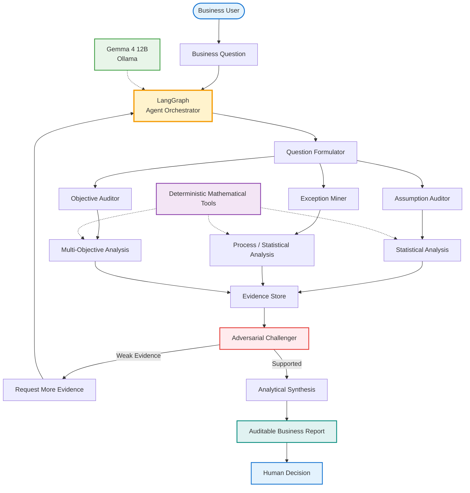

Yes. I would build the **Business Model Auditor Agent** as the project rather than implementing all ten ideas separately.

Yes. If the target is **“this feels genuinely new”**, we should move away from standard ML use cases entirely.

The trick is not to invent a fake problem. We want a **real business pain point where the current solution is fragmented/manual**, and use the agent to connect mathematical methods that are normally used separately.

I would explore these.

---

# 1. Decision Debt Agent

### Problem

Companies accumulate decisions:

* Why did we choose this supplier?
* Why did we increase this price?
* Why did we reject this customer?
* Why did we allocate this budget?
* Why did we choose this project?
* Why did we change this process?

Months later nobody knows:

> **“Was that decision actually good?”**

Build an agent that continuously reconstructs and evaluates historical decisions.

```text
Decision
   │
   ├── Information available at the time
   ├── Assumptions
   ├── Alternatives
   ├── Expected outcome
   └── Actual outcome
             │
             ▼
       Decision Agent
             │
       ┌─────┼─────┐
       ▼     ▼     ▼
    Bayesian  Causal  Statistical
    Analysis  Analysis Analysis
       │     │     │
       └─────┼─────┘
             ▼
       Decision Quality
```

The interesting mathematical concept is:

$$
\text{Decision Quality}
=
f(
Information,
Uncertainty,
Alternatives,
Outcome
)
$$

The system could discover:

> "The decision was reasonable given information available at the time, although the forecast was poorly calibrated."

That's much more sophisticated than simply saying whether the decision succeeded.

**Novelty potential: ⭐⭐⭐⭐⭐**

---

# 2. Assumption Monitoring Agent

This one is genuinely interesting.

Every business model contains assumptions:

```text
Demand growth = 8%
Customer churn = 4%
Supplier lead time = 7 days
Conversion = 12%
Average order = $84
```

But assumptions silently become wrong.

Build an agent whose job is:

> **Find assumptions that are becoming invalid before the business model breaks.**

Architecture:

```text
Business Model
      │
      ▼
Assumption Registry
      │
      ▼
Data Monitoring Agent
      │
      ▼
Statistical Tests
      │
      ▼
Distribution Shift
      │
      ▼
Assumption Violation
      │
      ▼
Impact Analysis
      │
      ▼
Management Alert
```

For example:

$$
D_t \sim N(\mu,\sigma^2)
$$

Originally:

$$
\mu=1000
$$

but the current estimate becomes:

$$
\hat{\mu}=1370
$$

Agent says:

> "The demand assumption underlying the inventory policy has drifted by approximately 37%. Re-evaluation recommended."

This could become a **Business Assumption Observatory**.

**Novelty: ⭐⭐⭐⭐⭐**

---

# 3. "What Are We Optimizing Wrong?" Agent

This is much more interesting than an optimizer.

Companies optimize metrics:

```text
Revenue
Cost
Conversion
Utilization
Delivery time
```

But optimizing one metric can damage another.

For example:

$$
\max Revenue
$$

may increase:

$$
Returns
$$

and:

$$
Customer\ complaints
$$

The agent searches for **objective-function failure**.

```text
KPI
 │
 ▼
Optimization Target
 │
 ▼
Unintended Effects
 │
 ├── Quality ↓
 ├── Risk ↑
 ├── Customer satisfaction ↓
 └── Long-term revenue ↓
```

Mathematically this leads naturally to:

* multi-objective optimization
* Pareto frontiers
* causal inference
* constrained optimization
* utility functions

Instead of:

> "Optimize X."

The agent asks:

> **"Is X actually the correct thing to optimize?"**

That's a very strong research direction.

**Novelty: ⭐⭐⭐⭐⭐**

---

# 4. Business Counterfactual Agent

Question:

> **"What would have happened if we had NOT made that decision?"**

Suppose:

```text
Company increased price
        ↓
Revenue increased
```

Was the price increase responsible?

Maybe market demand increased anyway.

The agent constructs counterfactuals:

$$
Y(1) - Y(0)
$$

where:

* \(Y(1)\) = outcome under intervention
* \(Y(0)\) = outcome without intervention

Use:

* causal inference
* Bayesian models
* synthetic controls
* propensity methods
* time-series analysis

Agent:

```text
Historical Data
      │
      ▼
Causal Analysis
      │
 ┌────┴────┐
 ▼         ▼
Observed  Counterfactual
Outcome   Outcome
 │         │
 └────┬────┘
      ▼
Estimated Effect
```

Business questions:

> "Did the promotion actually increase sales?"

> "Did hiring additional salespeople cause revenue growth?"

> "Did the new process actually reduce defects?"

This is **far more interesting than prediction**.

**Novelty: ⭐⭐⭐⭐⭐**

---

# 5. Organizational Friction Agent

This is unusual.

Every organization has hidden friction:

```text
Request
 ↓
Approval
 ↓
Review
 ↓
Rework
 ↓
Approval
 ↓
Execution
```

The company may know:

> "Our process is slow."

But not:

> **"Where exactly is organizational friction being generated?"**

Give the agent:

```text
emails
tickets
workflow logs
approval records
calendar data
project events
```

Then model the organization as a graph:

$$
G=(V,E)
$$

where:

* \(V\) = organizational entities
* \(E\) = interactions

Analyze:

* queueing
* graph centrality
* bottlenecks
* waiting time
* rework probability
* communication patterns

Agent discovers:

> "Requests requiring review by team X are 2.7× more likely to enter a rework loop."

That's a genuinely interesting application of graph theory + operations research + agents.

**Novelty: ⭐⭐⭐⭐⭐**

---

# 6. Business Complexity Agent

Companies often become unnecessarily complicated.

For example:

```text
37 pricing plans
14 discount rules
26 approval rules
83 exception rules
```

Nobody understands the entire system.

Build an agent that asks:

> **"Can we simplify the business?"**

Represent rules as a graph:

```text
Customer
   │
   ├── Segment
   ├── Contract
   ├── Region
   ├── Discount
   ├── Product
   └── Exception
```

Then search for:

* redundant rules
* contradictory rules
* rarely used rules
* expensive exceptions
* overlapping policies

Mathematics:

* graph theory
* combinatorial optimization
* information theory
* clustering
* complexity measures

Potential output:

> "These 17 rules explain 94% of observed decisions. The remaining 66 rules account for only 6%."

That's potentially very valuable.

**Novelty: ⭐⭐⭐⭐⭐**

---

# 7. Exception Mining Agent

This might be my favorite.

Businesses normally automate the **normal case**.

But real organizations spend enormous effort on exceptions.

```text
95% → Normal workflow
 5% → Exceptions
             │
             ├── manual review
             ├── escalation
             ├── special approval
             └── workaround
```

Build an agent that investigates:

> **"Why do exceptions happen?"**

Then discover:

$$
P(Exception|X)
$$

and identify the strongest causes.

But go further:

> Can we redesign the process so the exception disappears?

This moves from:

```text
Exception Detection
```

to:

```text
Exception Understanding
       ↓
Root Cause
       ↓
Process Redesign
       ↓
Simulation
       ↓
Expected Improvement
```

Very practical.

**Novelty: ⭐⭐⭐⭐⭐**

---

# 8. Organizational Memory Agent

Not a chatbot.

A system that maintains **institutional memory**.

Suppose a senior engineer leaves.

Their knowledge is scattered across:

```text
Git
Tickets
Documents
Slack
Emails
Incidents
Decisions
```

The agent reconstructs:

```text
Problem
  ↓
Past incidents
  ↓
Decisions
  ↓
Reasons
  ↓
Consequences
  ↓
Lessons
```

Mathematically, this can become a temporal knowledge graph:

$$
G_t=(V,E,t)
$$

Then ask:

> "Have we seen this failure before?"

> "What did we do last time?"

> "Did that intervention work?"

This combines:

* temporal graphs
* retrieval
* causal reasoning
* agents
* anomaly detection

**Novelty: ⭐⭐⭐⭐**

---

# 9. Early Warning Agent for Business Systems

Instead of predicting one thing:

> "Predict churn."

Build a system that monitors the **entire business system**.

```text
Revenue
Orders
Customers
Costs
Employees
Suppliers
Inventory
Support
Quality
```

and searches for **weak signals**.

Mathematically:

$$
X_t =
[x_1,x_2,\ldots,x_n]
$$

Monitor:

$$
P(X_t|X_{1:t-1})
$$

and detect unusual joint behavior.

Example:

```text
Revenue       normal
Orders        normal
Returns       +12%
Support calls +18%
Delivery time +9%
```

Individually these aren't catastrophic.

Together:

> **"Multiple weak signals suggest deterioration in fulfillment quality."**

That is much more interesting than ordinary anomaly detection.

**Novelty: ⭐⭐⭐⭐⭐**

---

# 10. Business Model Stress-Test Agent

This one could become huge.

Give it:

```text
business model
financial assumptions
operational assumptions
market assumptions
```

Then the agent automatically attacks the model.

```text
                    BUSINESS MODEL
                          │
                          ▼
                  Assumption Extractor
                          │
          ┌───────────────┼────────────────┐
          ▼               ▼                ▼
       Demand           Cost             Supply
       Stress            Stress           Stress
          │               │                │
          └───────────────┼────────────────┘
                          ▼
                    Monte Carlo
                          │
                          ▼
                    Sensitivity
                          │
                          ▼
                     Failure Modes
                          │
                          ▼
                    Recommendations
```

Essentially:

> **"Try to break this business plan before reality does."**

That's an excellent agentic problem.

---

# The really unusual candidates

If I remove anything that feels like an existing standard SaaS category, my shortlist becomes:

### 🥇 Assumption Monitoring Agent

> **Which assumptions underlying our business are becoming false?**

### 🥈 Exception Mining Agent

> **Why does our organization repeatedly fall out of its normal process?**

### 🥉 Objective-Function Auditor

> **Are we optimizing the wrong thing?**

### 4. Business Counterfactual Agent

> **Did our decision actually cause the outcome?**

### 5. Business Complexity Agent

> **Which rules, processes and exceptions can we eliminate?**

### 6. Decision Debt Agent

> **Which past decisions should we reconsider based on what we now know?**

### 7. Weak-Signal Business Early Warning Agent

> **Are several small changes collectively signaling a major problem?**

### 8. Business Stress-Test Agent

> **How could this business model fail?**

---

# One particularly powerful idea

We could actually combine **three** of these into something quite distinctive:

# 🧠 Business Model Auditor Agent

The question becomes:

> **"Find things the management team currently believes that may no longer be true."**

It has three core capabilities:

```text
                 BUSINESS MODEL
                       │
                       ▼
              ┌─────────────────┐
              │ Business Auditor│
              └────────┬────────┘
                       │
          ┌────────────┼────────────┐
          ▼            ▼            ▼
     Assumption     Exception     Objective
      Auditor        Miner        Auditor
          │            │            │
          ▼            ▼            ▼
      Statistics     Process      Optimization
      Forecasting    Mining       Analysis
      Bayesian      Graphs        Pareto
          │            │            │
          └────────────┼────────────┘
                       ▼
                Evidence Engine
                       │
                       ▼
                 Risk Assessment
                       │
                       ▼
                 Human Decision
```

And Gemma 4 12B + LangGraph becomes the **reasoning/orchestration layer**:

```text
User
 │
 ▼
Gemma 4 12B
 │
 ▼
LangGraph
 │
 ├──► formulate_question
 │
 ├──► inspect_data
 │
 ├──► identify_assumptions
 │
 ├──► select_analysis
 │
 ├──► execute_math_tool
 │
 ├──► challenge_result
 │
 ├──► request_more_evidence
 │
 ├──► synthesize
 │
 └──► produce_auditable_report
```

The important distinction is:

**The agent isn't trying to replace a mathematician.**

It is doing what a strong analytical consultant would do:

> formulate → investigate → test → challenge → quantify → compare → explain → recommend.

That is where I think your **Applied Mathematics + AI Agents** project can become genuinely distinctive.

The code below is a complete runnable MVP designed around your existing setup:

```text
Conda environment
      │
      ▼
Python
      │
      ├── LangGraph
      ├── LangChain
      ├── Ollama
      ├── Gemma 4 12B
      ├── NumPy / Pandas
      ├── SciPy
      └── NetworkX
```

The important architectural principle is:

> **Gemma decides what analysis should be performed; deterministic Python tools perform the mathematics.**

So we don't ask the LLM to "calculate statistics" itself.

---

# Project structure

```text
business-model-auditor/
│
├── data/
│   ├── assumptions.csv
│   ├── transactions.csv
│   ├── process_events.csv
│   └── objectives.csv
│
├── src/
│   ├── __init__.py
│   ├── tools.py
│   ├── state.py
│   ├── nodes.py
│   ├── graph.py
│   └── prompts.py
│
├── reports/
│
├── main.py
├── requirements.txt
└── README.md
```

---

# 1. Install dependencies

```bash
conda activate aisystem

pip install \
    langgraph \
    langchain \
    langchain-ollama \
    pandas \
    numpy \
    scipy \
    networkx \
    pydantic
```

Make sure Ollama is running:

```bash
ollama serve
```

And verify:

```bash
ollama list
```

You should have:

```text
gemma4:12b
```

---

# 2. `src/state.py`

This is the state flowing through the LangGraph.

```python
from typing import TypedDict, List, Dict, Any, Optional


class AuditorState(TypedDict, total=False):

    # User request
    question: str

    # Business data
    assumptions: List[Dict[str, Any]]
    transactions: List[Dict[str, Any]]
    process_events: List[Dict[str, Any]]
    objectives: List[Dict[str, Any]]

    # Agent reasoning
    investigation_plan: Dict[str, Any]

    # Mathematical results
    assumption_results: List[Dict[str, Any]]
    exception_results: List[Dict[str, Any]]
    objective_results: List[Dict[str, Any]]

    # Evidence
    evidence: List[Dict[str, Any]]

    # Final synthesis
    findings: List[Dict[str, Any]]
    recommendations: List[Dict[str, Any]]

    # Report
    final_report: str

    # Execution metadata
    iteration: int
    errors: List[str]
```

---

# 3. `src/tools.py`

This is the most important part.

The LLM **doesn't perform the mathematics**.

It calls deterministic tools.

```python
import pandas as pd
import numpy as np

from scipy import stats
import networkx as nx


# ============================================================
# DATA LOADING
# ============================================================

def load_csv(path: str) -> pd.DataFrame:
    return pd.read_csv(path)


# ============================================================
# ASSUMPTION ANALYSIS
# ============================================================

def analyze_assumption(
    historical_values,
    assumed_value: float,
    tolerance: float = 0.10
):

    values = np.asarray(historical_values, dtype=float)

    mean = float(np.mean(values))
    std = float(np.std(values))

    deviation = abs(mean - assumed_value) / abs(assumed_value)

    violated = deviation > tolerance

    return {
        "assumed_value": assumed_value,
        "observed_mean": mean,
        "observed_std": std,
        "relative_deviation": float(deviation),
        "tolerance": tolerance,
        "violated": bool(violated),
    }


# ============================================================
# DISTRIBUTION SHIFT
# ============================================================

def detect_distribution_shift(
    baseline,
    current,
    alpha=0.05
):

    baseline = np.asarray(baseline, dtype=float)
    current = np.asarray(current, dtype=float)

    statistic, p_value = stats.ks_2samp(
        baseline,
        current
    )

    return {
        "ks_statistic": float(statistic),
        "p_value": float(p_value),
        "alpha": alpha,
        "distribution_shift": bool(p_value < alpha)
    }


# ============================================================
# ANOMALY DETECTION
# ============================================================

def detect_outliers(values, z_threshold=3.0):

    values = np.asarray(values, dtype=float)

    z_scores = np.abs(
        stats.zscore(values, nan_policy="omit")
    )

    outliers = np.where(
        z_scores > z_threshold
    )[0]

    return {
        "z_threshold": z_threshold,
        "outlier_indices": outliers.tolist(),
        "outlier_count": int(len(outliers))
    }


# ============================================================
# EXCEPTION MINING
# ============================================================

def analyze_exceptions(
    dataframe: pd.DataFrame,
    status_column: str,
    exception_value: str,
    group_column: str
):

    df = dataframe.copy()

    df["is_exception"] = (
        df[status_column] == exception_value
    )

    overall_rate = df["is_exception"].mean()

    grouped = (
        df.groupby(group_column)["is_exception"]
        .agg(["mean", "count"])
        .reset_index()
    )

    grouped["lift"] = (
        grouped["mean"] / overall_rate
        if overall_rate > 0
        else 0
    )

    results = []

    for _, row in grouped.iterrows():

        results.append({
            "group": str(row[group_column]),
            "exception_rate": float(row["mean"]),
            "sample_size": int(row["count"]),
            "lift_vs_baseline": float(row["lift"])
        })

    return {
        "overall_exception_rate": float(overall_rate),
        "groups": results
    }


# ============================================================
# PROCESS BOTTLENECK
# ============================================================

def analyze_process_times(
    dataframe: pd.DataFrame,
    duration_column: str,
    group_column: Optional[str] = None
):

    durations = dataframe[duration_column]

    result = {
        "mean": float(durations.mean()),
        "median": float(durations.median()),
        "p90": float(durations.quantile(0.90)),
        "p95": float(durations.quantile(0.95)),
        "max": float(durations.max())
    }

    if group_column:

        grouped = (
            dataframe
            .groupby(group_column)[duration_column]
            .agg(["mean", "median", "count"])
            .reset_index()
        )

        result["groups"] = grouped.to_dict(
            orient="records"
        )

    return result


# ============================================================
# CORRELATION ANALYSIS
# ============================================================

def correlation_matrix(
    dataframe: pd.DataFrame
):

    numeric = dataframe.select_dtypes(
        include=np.number
    )

    return numeric.corr().to_dict()


# ============================================================
# OBJECTIVE TRADEOFF ANALYSIS
# ============================================================

def analyze_objective_tradeoff(
    dataframe: pd.DataFrame,
    objectives
):

    result = {}

    for objective in objectives:

        column = objective["column"]

        if column not in dataframe:
            continue

        result[column] = {
            "mean": float(
                dataframe[column].mean()
            ),
            "std": float(
                dataframe[column].std()
            ),
            "min": float(
                dataframe[column].min()
            ),
            "max": float(
                dataframe[column].max()
            )
        }

    return result


# ============================================================
# PARETO FRONTIER
# ============================================================

def pareto_frontier(
    points,
    maximize
):

    points = np.asarray(points)

    n = len(points)

    efficient = np.ones(n, dtype=bool)

    for i in range(n):

        for j in range(n):

            if i == j:
                continue

            better_or_equal = True
            strictly_better = False

            for k, direction in enumerate(maximize):

                if direction:

                    if points[j, k] < points[i, k]:
                        better_or_equal = False

                    if points[j, k] > points[i, k]:
                        strictly_better = True

                else:

                    if points[j, k] > points[i, k]:
                        better_or_equal = False

                    if points[j, k] < points[i, k]:
                        strictly_better = True

            if better_or_equal and strictly_better:

                efficient[i] = False
                break

    return {
        "pareto_indices": np.where(efficient)[0].tolist()
    }


# ============================================================
# BUSINESS NETWORK
# ============================================================

def analyze_network(
    edges
):

    graph = nx.Graph()

    for source, target in edges:

        graph.add_edge(
            source,
            target
        )

    centrality = nx.degree_centrality(
        graph
    )

    return {
        "nodes": list(graph.nodes()),
        "edges": list(graph.edges()),
        "degree_centrality": centrality
    }
```

---

# 4. `src/prompts.py`

```python
SYSTEM_PROMPT = """
You are a Business Model Auditor Agent.

Your job is NOT simply to answer questions.

Your job is to investigate whether the assumptions,
processes and objectives of a business system remain valid.

You must:

1. formulate hypotheses
2. inspect available evidence
3. select appropriate mathematical analyses
4. use deterministic analytical tools
5. challenge your own conclusions
6. distinguish evidence from speculation
7. quantify uncertainty where possible
8. produce auditable recommendations

Important:

Never invent numerical results.

Never perform complicated numerical calculations mentally
when a mathematical tool can perform them.

You are an analytical orchestrator.

Available analytical perspectives:

- statistical analysis
- distribution shift
- anomaly detection
- correlation
- exception mining
- process analysis
- graph analysis
- multi-objective analysis
- Pareto analysis

A finding should contain:

- claim
- evidence
- mathematical reasoning
- confidence
- business implication

A recommendation should contain:

- action
- rationale
- expected benefit
- uncertainty
- risk
"""
```

---

# 5. `src/nodes.py`

Now we build the actual Agent.

```python
import json
from datetime import datetime

from langchain_ollama import ChatOllama
from langchain_core.messages import HumanMessage, SystemMessage

from .prompts import SYSTEM_PROMPT


llm = ChatOllama(
    model="gemma4:12b",
    temperature=0
)


# ============================================================
# NODE 1 — UNDERSTAND THE BUSINESS QUESTION
# ============================================================

def formulate_question(state):

    question = state["question"]

    prompt = f"""
Business question:

{question}

Available datasets:

- assumptions
- transactions
- process_events
- objectives

Create an investigation plan.

Return JSON:

{{
    "primary_problem": "...",
    "hypotheses": [],
    "datasets_needed": [],
    "analyses_needed": []
}}
"""

    response = llm.invoke([
        SystemMessage(content=SYSTEM_PROMPT),
        HumanMessage(content=prompt)
    ])

    try:

        plan = json.loads(
            response.content
        )

    except Exception:

        plan = {
            "primary_problem": question,
            "hypotheses": [],
            "datasets_needed": [],
            "analyses_needed": []
        }

    return {
        "investigation_plan": plan,
        "iteration": state.get("iteration", 0) + 1
    }


# ============================================================
# NODE 2 — ASSUMPTION AUDITOR
# ============================================================

def assumption_auditor(state):

    assumptions = state.get(
        "assumptions",
        []
    )

    results = []

    for assumption in assumptions:

        result = {
            "name": assumption["name"],
            "assumed": assumption["assumed"],
            "observed": assumption["observed"],
        }

        assumed = assumption["assumed"]
        observed = assumption["observed"]

        deviation = (
            abs(observed - assumed)
            / abs(assumed)
            if assumed != 0
            else 0
        )

        result["relative_deviation"] = deviation

        result["violated"] = deviation > 0.10

        results.append(result)

    return {
        "assumption_results": results
    }


# ============================================================
# NODE 3 — EXCEPTION ANALYST
# ============================================================

def exception_analyst(state):

    transactions = state.get(
        "transactions",
        []
    )

    if not transactions:

        return {
            "exception_results": []
        }

    exceptions = []

    for row in transactions:

        if row.get("status") == "exception":

            exceptions.append(row)

    return {
        "exception_results": exceptions
    }


# ============================================================
# NODE 4 — OBJECTIVE AUDITOR
# ============================================================

def objective_auditor(state):

    objectives = state.get(
        "objectives",
        []
    )

    results = []

    for objective in objectives:

        results.append({
            "metric": objective["metric"],
            "direction": objective["direction"],
            "risk": objective.get(
                "risk",
                "unknown"
            )
        })

    return {
        "objective_results": results
    }


# ============================================================
# NODE 5 — EVIDENCE SYNTHESIS
# ============================================================

def evidence_synthesis(state):

    evidence = []

    for result in state.get(
        "assumption_results",
        []
    ):

        if result.get("violated"):

            evidence.append({
                "type": "assumption_violation",
                "finding": result
            })

    for result in state.get(
        "exception_results",
        []
    ):

        evidence.append({
            "type": "exception",
            "finding": result
        })

    for result in state.get(
        "objective_results",
        []
    ):

        evidence.append({
            "type": "objective",
            "finding": result
        })

    return {
        "evidence": evidence
    }


# ============================================================
# NODE 6 — CHALLENGER
# ============================================================

def challenger(state):

    evidence = state.get(
        "evidence",
        []
    )

    prompt = f"""
You are the adversarial reviewer.

Review these findings:

{json.dumps(evidence, indent=2)}

For every important finding ask:

1. What evidence supports it?
2. What alternative explanation exists?
3. What information is missing?
4. Could this be sampling noise?
5. What would falsify the finding?

Return JSON:

{{
    "findings": [],
    "recommendations": []
}}
"""

    response = llm.invoke([
        SystemMessage(content=SYSTEM_PROMPT),
        HumanMessage(content=prompt)
    ])

    try:

        review = json.loads(
            response.content
        )

    except Exception:

        review = {
            "findings": [],
            "recommendations": []
        }

    return {
        "findings": review.get(
            "findings",
            []
        ),
        "recommendations": review.get(
            "recommendations",
            []
        )
    }


# ============================================================
# NODE 7 — FINAL REPORT
# ============================================================

def generate_report(state):

    prompt = f"""
Create an executive analytical report.

Business question:

{state["question"]}

Investigation plan:

{json.dumps(
    state.get("investigation_plan", {}),
    indent=2
)}

Evidence:

{json.dumps(
    state.get("evidence", []),
    indent=2
)}

Findings:

{json.dumps(
    state.get("findings", []),
    indent=2
)}

Recommendations:

{json.dumps(
    state.get("recommendations", []),
    indent=2
)}

Structure:

# Executive Summary

# Important Findings

# Mathematical Evidence

# Alternative Explanations

# Business Risks

# Recommendations

# What We Do Not Know

Do not invent numbers.
Clearly distinguish measured facts from hypotheses.
"""

    response = llm.invoke([
        SystemMessage(content=SYSTEM_PROMPT),
        HumanMessage(content=prompt)
    ])

    return {
        "final_report": response.content
    }
```

---

# 6. `src/graph.py`

Now the LangGraph.

```python
from langgraph.graph import (
    StateGraph,
    START,
    END
)

from .state import AuditorState

from .nodes import (
    formulate_question,
    assumption_auditor,
    exception_analyst,
    objective_auditor,
    evidence_synthesis,
    challenger,
    generate_report
)


def build_graph():

    graph = StateGraph(
        AuditorState
    )

    # Nodes

    graph.add_node(
        "formulate_question",
        formulate_question
    )

    graph.add_node(
        "assumption_auditor",
        assumption_auditor
    )

    graph.add_node(
        "exception_analyst",
        exception_analyst
    )

    graph.add_node(
        "objective_auditor",
        objective_auditor
    )

    graph.add_node(
        "evidence_synthesis",
        evidence_synthesis
    )

    graph.add_node(
        "challenger",
        challenger
    )

    graph.add_node(
        "generate_report",
        generate_report
    )

    # Entry

    graph.add_edge(
        START,
        "formulate_question"
    )

    # Parallel analytical branches

    graph.add_edge(
        "formulate_question",
        "assumption_auditor"
    )

    graph.add_edge(
        "formulate_question",
        "exception_analyst"
    )

    graph.add_edge(
        "formulate_question",
        "objective_auditor"
    )

    # Converge

    graph.add_edge(
        "assumption_auditor",
        "evidence_synthesis"
    )

    graph.add_edge(
        "exception_analyst",
        "evidence_synthesis"
    )

    graph.add_edge(
        "objective_auditor",
        "evidence_synthesis"
    )

    graph.add_edge(
        "evidence_synthesis",
        "challenger"
    )

    graph.add_edge(
        "challenger",
        "generate_report"
    )

    graph.add_edge(
        "generate_report",
        END
    )

    return graph.compile()
```

---

# 7. Synthetic business data

Create:

`data/assumptions.csv`

```csv
name,assumed,observed
demand_growth,0.08,0.17
customer_churn,0.04,0.073
supplier_lead_time,7,10.8
conversion_rate,0.12,0.095
average_order_value,84,79
```

---

`data/transactions.csv`

```csv
transaction_id,department,supplier,status,value
T001,Sales,A,normal,1200
T002,Sales,A,normal,1400
T003,Finance,B,normal,900
T004,Operations,C,exception,3200
T005,Operations,C,exception,4100
T006,Operations,C,exception,2700
T007,Sales,A,normal,1300
T008,Finance,B,normal,800
T009,Operations,C,exception,5200
T010,Sales,A,normal,1100
```

---

`data/objectives.csv`

```csv
metric,direction,risk
revenue,maximize,discounting_may_reduce_margin
cost,minimize,quality_may_decline
delivery_time,minimize,expediting_may_increase_cost
customer_satisfaction,maximize,may_conflict_with_cost
```

---

# 8. `main.py`

```python
import pandas as pd

from src.graph import build_graph


def load_data():

    assumptions = pd.read_csv(
        "data/assumptions.csv"
    ).to_dict(
        orient="records"
    )

    transactions = pd.read_csv(
        "data/transactions.csv"
    ).to_dict(
        orient="records"
    )

    objectives = pd.read_csv(
        "data/objectives.csv"
    ).to_dict(
        orient="records"
    )

    return (
        assumptions,
        transactions,
        objectives
    )


def main():

    print("=" * 80)
    print("BUSINESS MODEL AUDITOR")
    print("=" * 80)

    (
        assumptions,
        transactions,
        objectives
    ) = load_data()

    question = input(
        "\nWhat should I investigate?\n> "
    )

    initial_state = {

        "question": question,

        "assumptions": assumptions,

        "transactions": transactions,

        "objectives": objectives,

        "process_events": [],

        "iteration": 0,

        "errors": []
    }

    graph = build_graph()

    print("\nStarting investigation...\n")

    result = graph.invoke(
        initial_state
    )

    print("\n")
    print("=" * 80)
    print("FINAL REPORT")
    print("=" * 80)

    print(
        result["final_report"]
    )

    with open(
        "reports/latest_report.md",
        "w"
    ) as f:

        f.write(
            result["final_report"]
        )

    print(
        "\nReport saved to "
        "reports/latest_report.md"
    )


if __name__ == "__main__":

    main()
```

---

# 9. Run it

```bash
mkdir -p reports

python main.py
```

Try:

```text
Which assumptions underlying our business model appear to be failing?
```

Then:

```text
Find evidence that our operational process is generating unnecessary exceptions.
```

And:

```text
Are our current business objectives potentially creating unintended consequences?
```

---

# 10. The resulting architecture

This is the architecture we are actually building:



---

# 11. But there is an important problem with this first version

I deliberately made this **MVP**, because there is a conceptual distinction we should preserve.

Right now:

```text
Gemma
  ↓
creates investigation plan
  ↓
Python nodes
  ↓
mathematics
```

That teaches the basic architecture.

But a **real agent** should eventually do:

```text
                 Gemma 4 12B
                      │
                      ▼
                ┌───────────┐
                │ LangGraph │
                └─────┬─────┘
                      │
               What should
               I investigate?
                      │
          ┌───────────┼───────────┐
          ▼           ▼           ▼
       inspect      analyze     search
        data         data       evidence
          │           │           │
          ▼           ▼           ▼
       Python       SciPy      Documents
       Pandas      NumPy       Knowledge
          │           │           │
          └───────────┼───────────┘
                      ▼
                   Evidence
                      │
                      ▼
                  Challenge
                      │
             ┌────────┴────────┐
             │                 │
          Weak?              Strong?
             │                 │
             ▼                 ▼
        Investigate          Report
             │
             └──────► Agent
```

That is where **LangGraph becomes genuinely useful** rather than simply being a wrapper around a sequence of Python functions.

## The next version should therefore add four things

### 1. Real tool calling

Gemma chooses:

```text
analyze_assumption()
detect_distribution_shift()
detect_outliers()
analyze_process_times()
pareto_frontier()
analyze_network()
```

rather than us hard-coding which analyst runs.

### 2. Conditional edges

```text
Evidence
   │
   ▼
Confidence?
 ┌─┴──────────┐
 │            │
Low          High
 │            │
 ▼            ▼
Investigate  Synthesize
 │
 └──► Agent
```

### 3. Iterative investigation

Instead of:

```text
Plan → Analyze → Report
```

we want:

```text
Plan
 ↓
Investigate
 ↓
Evidence
 ↓
Is evidence sufficient?
 ├── No → formulate another investigation
 │          ↓
 │       investigate
 │
 └── Yes
       ↓
    challenge
       ↓
     report
```

### 4. Human-in-the-loop

For a business decision system:

```text
Agent
  ↓
Recommendation
  ↓
Human approval
  ↓
Action
```

The agent should **not autonomously execute consequential business actions**.

---

## The end-state project

I would ultimately make the repository look like this:

```text
Business Model Auditor
│
├── Agent
│
├── LangGraph
│
├── Gemma 4 12B
│
├── Mathematical Tool Layer
│   ├── Statistics
│   ├── Probability
│   ├── Bayesian Analysis
│   ├── Time Series
│   ├── Anomaly Detection
│   ├── Causal Analysis
│   ├── Optimization
│   ├── Pareto Analysis
│   ├── Graph Theory
│   └── Simulation
│
├── Business Intelligence
│   ├── Assumption Auditor
│   ├── Exception Miner
│   ├── Objective Auditor
│   ├── Counterfactual Analyst
│   └── Stress Tester
│
├── Evidence System
│
├── Critic / Challenger
│
├── Human Approval
│
└── Auditable Report
```

That gives us a project where **Applied Mathematics is actually part of the agent's capabilities**, rather than building another LLM chatbot with a few tools.

The next implementation step I'd recommend is replacing the fixed `assumption_auditor → exception_analyst → objective_auditor` pipeline with a **true LangGraph tool-calling ReAct loop**, where Gemma 4 12B autonomously selects the mathematical tool, observes its result, decides what evidence is still missing, and iterates until it can justify a conclusion.
