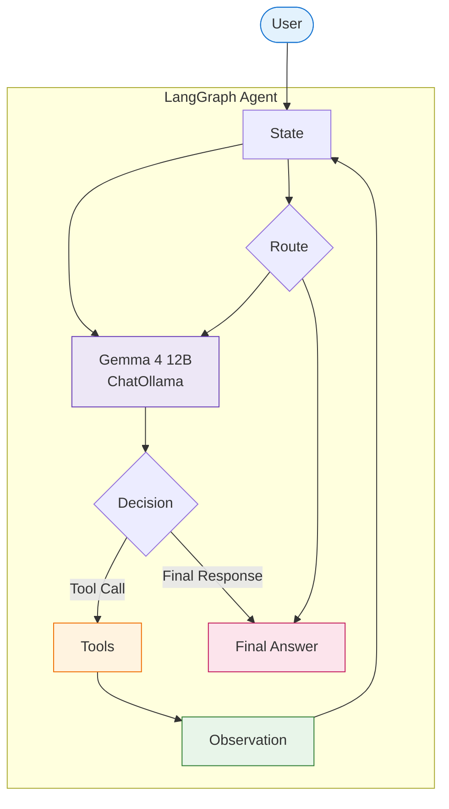
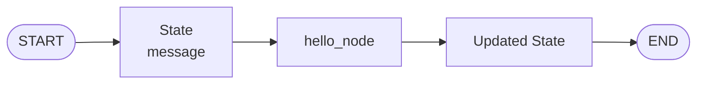
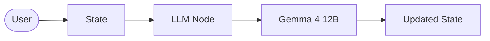
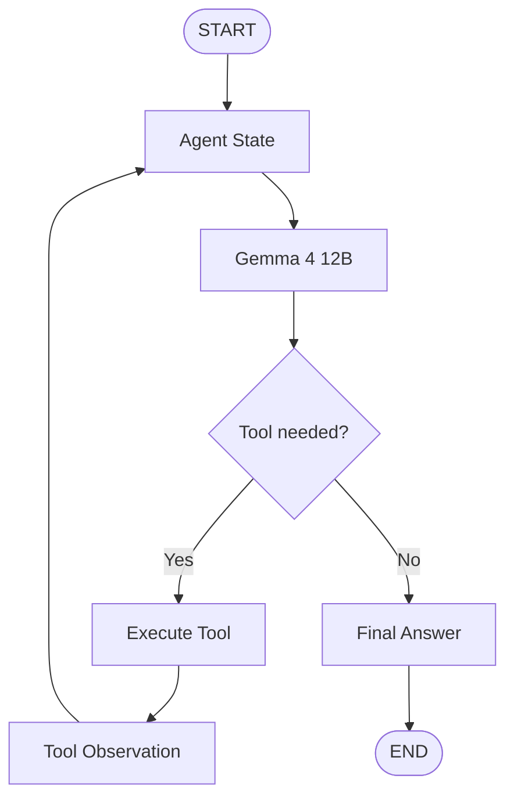
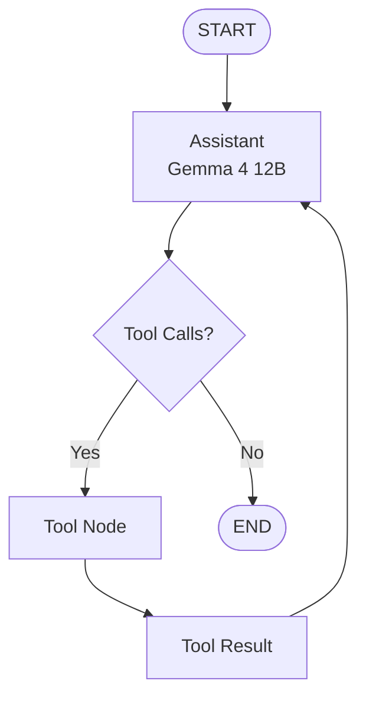
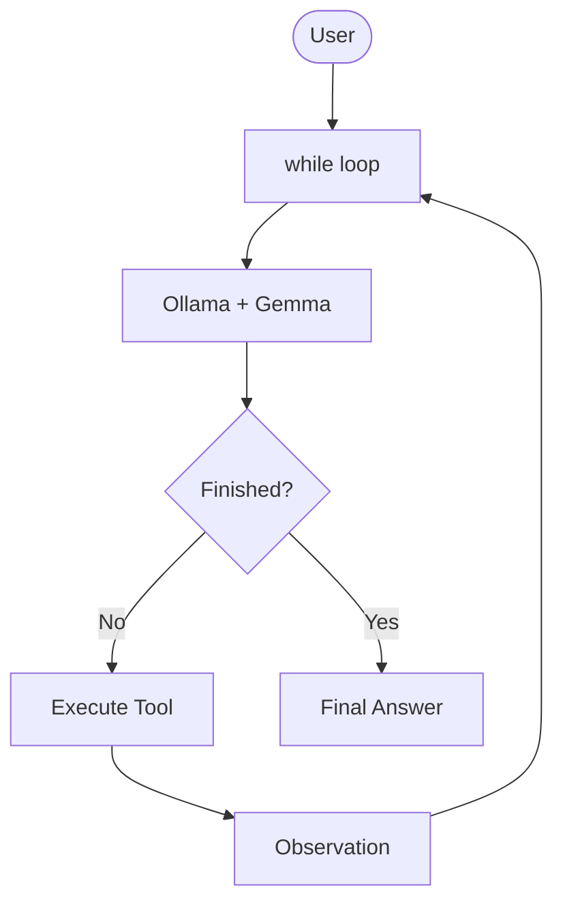
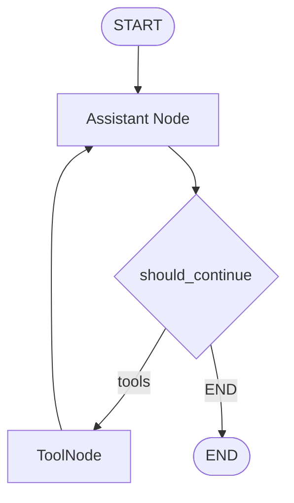
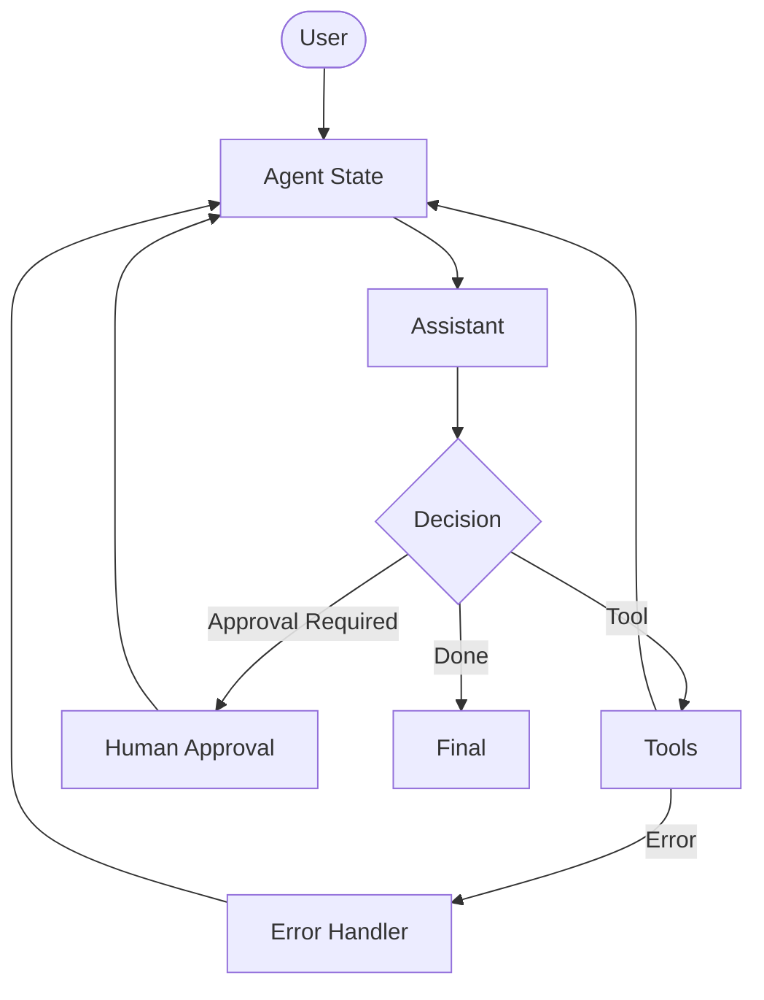
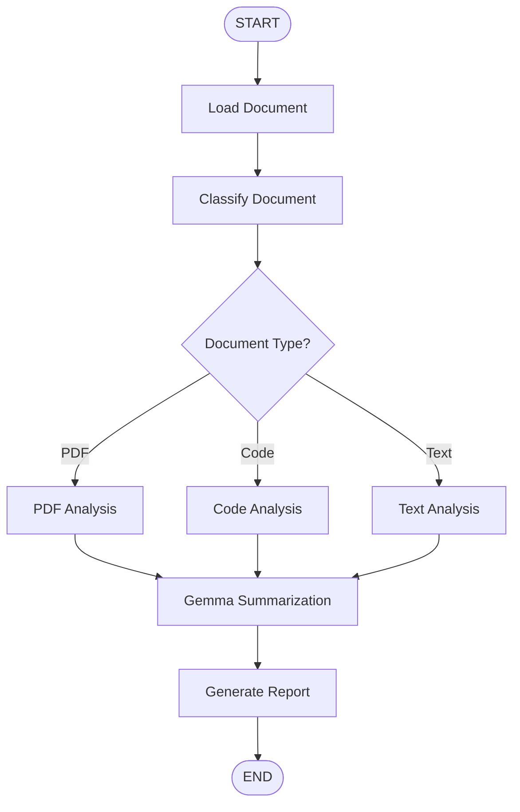
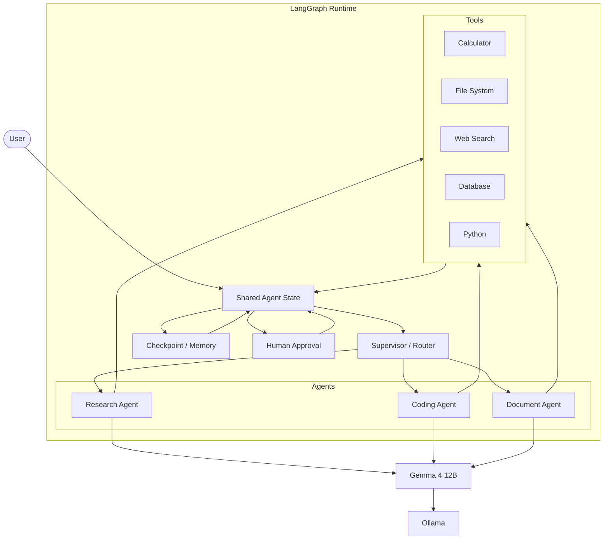

Yes. Since your goal is **Agents from first principles**, I would build this as a **progressive runnable notebook**, not as a framework cookbook.

We will use:

* **Ollama** → runs your local `gemma4:12b`
* **LangChain `ChatOllama`** → model interface
* **LangGraph** → agent orchestration/state machine
* **Python tools** → actual capabilities
* **LangGraph state** → memory/control flow
* **Mermaid** → visualize every important architecture
* Later: tool calling → ReAct → loops → routing → persistence → human approval → subagents → document analysis

This matches the Hugging Face course's core progression: **State → Nodes → Edges → StateGraph**, with nodes potentially containing LLM calls, tools, conditional logic, and human intervention. ([Hugging Face][1]) LangGraph itself is deliberately a low-level orchestration/runtime layer for stateful agents rather than a model-serving framework. ([Docs by LangChain][2])

For Ollama, the current LangChain integration is `ChatOllama` from `langchain-ollama`, and it supports tool calling, structured output, streaming, and other capabilities we will use later. ([Docs by LangChain][3])

# Notebook: Local Agents with Gemma 4 12B + LangGraph

I recommend saving this as:

```text
Labs/
└── Part-2/
    └── LangGraph/
        └── 01_LangGraph_Agents_Gemma4_12B.ipynb
```

The notebook will follow this progression:

```text
PART 0  Environment
        ↓
PART 1  Understand LangGraph
        ↓
PART 2  First Graph
        ↓
PART 3  Put Gemma 4 12B inside a Node
        ↓
PART 4  State
        ↓
PART 5  Tools
        ↓
PART 6  Tool Calling
        ↓
PART 7  Agent Loop
        ↓
PART 8  Conditional Routing
        ↓
PART 9  ReAct-style Agent
        ↓
PART 10 Multi-Turn State
        ↓
PART 11 Checkpointing / Memory
        ↓
PART 12 Human-in-the-loop
        ↓
PART 13 Document Analysis Agent
        ↓
PART 14 Subagents
        ↓
PART 15 Evaluation
        ↓
PART 16 Production Architecture
```

---

# 0. Install Dependencies

### Markdown cell

```markdown
# LangGraph Agents from First Principles
## Gemma 4 12B + Ollama + LangGraph

We are going to build an AI Agent from scratch using:

- Ollama
- Gemma 4 12B
- LangChain
- LangGraph
- Python tools

The objective is NOT merely to learn LangGraph APIs.

The objective is to understand:

    User
      ↓
    Agent State
      ↓
    LLM
      ↓
    Decision
      ↓
    Tool / Action
      ↓
    Observation
      ↓
    State Update
      ↓
    LLM
      ↓
    ...
      ↓
    Final Answer

We will progressively transform this simple loop into a
stateful, tool-using, multi-step agent.
```

---

# 1. Architecture

### Markdown cell

```markdown
## The system we are building

The LLM itself is NOT the agent.

The agent is the combination of:

    State
    + Model
    + Tools
    + Control Flow
    + Memory
    + Policies
    + Execution Runtime

LangGraph provides the orchestration layer.
Ollama provides local model execution.
Gemma 4 12B provides the reasoning/generation capability.
```

### Mermaid



---

# 2. Environment

### Code cell

```python
import sys
import os

print("Python:", sys.version)
```

### Code cell

```python
import langgraph
import langchain
import langchain_ollama

print("LangGraph:", langgraph.__version__)
print("LangChain:", langchain.__version__)
```

Install if necessary:

```bash
pip install -U langgraph langchain langchain-ollama
```

LangGraph's current installation documentation uses `pip install -U langgraph`, while provider integrations such as Ollama are installed separately. ([Docs by LangChain][4])

---

# 3. Verify Ollama

### Markdown

```markdown
## Verify the local model

We are deliberately keeping model serving outside LangGraph.

LangGraph does not care whether the model is:

- Ollama
- OpenAI
- Anthropic
- a local server
- another provider

LangGraph orchestrates the agent.

Ollama runs Gemma.
```

### Terminal

```bash
ollama list
```

You should see something similar to:

```text
gemma4:12b
```

Then:

```bash
ollama run gemma4:12b
```

Test:

```text
What is an AI agent?
```

---

# 4. Connect LangChain to Ollama

### Code

```python
from langchain_ollama import ChatOllama

llm = ChatOllama(
    model="gemma4:12b",
    temperature=0,
)
```

The current integration uses `ChatOllama(model=...)` and is provided by the `langchain-ollama` package. ([Docs by LangChain][3])

Test:

```python
response = llm.invoke(
    "Explain what an AI agent is in three sentences."
)

print(response.content)
```

---

# 5. First Principle: An LLM Is Not an Agent

### Markdown cell

```markdown
## Important distinction

LLM:

    Input
      ↓
    Model
      ↓
    Output

Agent:

    Input
      ↓
    State
      ↓
    Model
      ↓
    Decision
      ↓
    Action
      ↓
    Observation
      ↓
    State
      ↓
    Model
      ↓
    ...
```

This distinction is fundamental.

The model generates decisions/content.

The **agent runtime controls what happens next**.

---

# 6. First LangGraph

LangGraph's fundamental abstraction is a graph composed of state, nodes and edges. The official course describes nodes as Python functions that receive state and return state updates, while edges determine the next path. ([Hugging Face][1])

### Code

```python
from typing_extensions import TypedDict
from langgraph.graph import StateGraph, START, END
```

Define state:

```python
class State(TypedDict):
    message: str
```

Node:

```python
def hello_node(state: State):
    return {
        "message": state["message"] + " Hello from LangGraph!"
    }
```

Build graph:

```python
builder = StateGraph(State)

builder.add_node("hello", hello_node)

builder.add_edge(START, "hello")
builder.add_edge("hello", END)

graph = builder.compile()
```

Run:

```python
result = graph.invoke({
    "message": "Hello"
})

result
```

Expected:

```python
{
    "message": "Hello Hello from LangGraph!"
}
```

---

# 7. Understand the Graph



The important idea:

```text
State
  ↓
Node
  ↓
State
```

This is the basic computational unit.

---

# 8. Multiple Nodes

```python
class State(TypedDict):
    message: str
```

```python
def node_a(state):
    return {
        "message": state["message"] + " → A"
    }


def node_b(state):
    return {
        "message": state["message"] + " → B"
    }


def node_c(state):
    return {
        "message": state["message"] + " → C"
    }
```

```python
builder = StateGraph(State)

builder.add_node("A", node_a)
builder.add_node("B", node_b)
builder.add_node("C", node_c)

builder.add_edge(START, "A")
builder.add_edge("A", "B")
builder.add_edge("B", "C")
builder.add_edge("C", END)

graph = builder.compile()
```

```python
graph.invoke({
    "message": "START"
})
```

Result:

```text
START → A → B → C
```

---

# 9. Now Put Gemma Inside a Node

This is the first important transition.



### Code

```python
from typing_extensions import TypedDict

class AgentState(TypedDict):
    user_input: str
    response: str
```

```python
def call_model(state: AgentState):

    response = llm.invoke(
        state["user_input"]
    )

    return {
        "response": response.content
    }
```

Build:

```python
builder = StateGraph(AgentState)

builder.add_node("model", call_model)

builder.add_edge(START, "model")
builder.add_edge("model", END)

agent_graph = builder.compile()
```

Run:

```python
result = agent_graph.invoke({
    "user_input": "Explain machine learning.",
    "response": ""
})

print(result["response"])
```

Congratulations: Gemma is now operating inside a LangGraph graph.

But **this is still not an agent**.

It's an LLM workflow.

---

# 10. What Makes It an Agent?

We add:

```text
Tools
+
Decision
+
Loop
```

Architecture:



That loop is the heart of the agent.

---

# 11. Our First Tool

Start simple.

```python
def calculator(expression: str) -> str:
    """Calculate a mathematical expression."""
  
    allowed = set("0123456789+-*/(). ")

    if not all(c in allowed for c in expression):
        return "Invalid expression."

    try:
        return str(eval(expression))
    except Exception as e:
        return f"Calculation error: {e}"
```

Test:

```python
calculator("123 * 456")
```

Expected:

```text
56088
```

---

# 12. Convert Function into a Tool

LangChain tools can be created with `@tool`.

```python
from langchain.tools import tool
```

```python
@tool
def calculator(expression: str) -> str:
    """Calculate a mathematical expression."""
  
    allowed = set("0123456789+-*/(). ")

    if not all(c in allowed for c in expression):
        return "Invalid expression."

    try:
        return str(eval(expression))
    except Exception as e:
        return f"Calculation error: {e}"
```

Inspect:

```python
print(calculator.name)
print(calculator.description)
print(calculator.args_schema)
```

---

# 13. More Tools

Let's build a small local toolkit.

```python
from pathlib import Path
```

### Directory tool

```python
@tool
def list_directory(path: str = ".") -> str:
    """List files and directories in a directory."""
  
    p = Path(path)

    if not p.exists():
        return f"Directory does not exist: {path}"

    if not p.is_dir():
        return f"Not a directory: {path}"

    items = []

    for item in p.iterdir():
        kind = "DIR" if item.is_dir() else "FILE"
        items.append(f"{kind}: {item.name}")

    return "\n".join(items)
```

### Read file

```python
@tool
def read_file(path: str) -> str:
    """Read a UTF-8 text file."""

    p = Path(path)

    if not p.exists():
        return f"File does not exist: {path}"

    if not p.is_file():
        return f"Not a file: {path}"

    try:
        return p.read_text(encoding="utf-8")
    except Exception as e:
        return f"Could not read file: {e}"
```

### System information

```python
@tool
def system_info() -> str:
    """Return basic system information."""

    import platform
    import os

    return (
        f"OS: {platform.system()}\n"
        f"Release: {platform.release()}\n"
        f"Machine: {platform.machine()}\n"
        f"Python: {platform.python_version()}\n"
        f"CPU count: {os.cpu_count()}"
    )
```

---

# 14. Our Tool Registry

```python
tools = [
    calculator,
    list_directory,
    read_file,
    system_info,
]
```

Bind them to Gemma:

```python
llm_with_tools = llm.bind_tools(tools)
```

Now the model can produce tool calls.

This is a crucial transition:

```text
Before:

User → Gemma → Text


After:

User
 ↓
Gemma
 ↓
Tool Call
 ↓
Tool
 ↓
Observation
 ↓
Gemma
 ↓
Answer
```

---

# 15. Inspect Tool Calling Directly

Try:

```python
response = llm_with_tools.invoke(
    "What is 123 * 456?"
)

print(response)
```

Inspect:

```python
print(response.tool_calls)
```

Depending on the exact Gemma/Ollama model capabilities and integration version, the model may produce a tool call or a normal answer. This is why **we test the local model's actual behavior instead of assuming every model behaves identically**.

The LangChain Ollama integration currently documents tool calling as supported. ([Docs by LangChain][3])

---

# 16. Tool-Calling Graph

Now we build the actual agent.

We need two nodes:

```text
assistant
    ↓
tools
    ↓
assistant
    ↓
...
```

### Mermaid



This is the classic tool-using agent loop.

---

# 17. Messages Become State

Instead of:

```python
user_input
response
```

we now need conversation messages.

LangGraph provides message-oriented state patterns, and its official examples use `MessagesState` for this purpose. ([Docs by LangChain][2])

```python
from langgraph.graph import MessagesState
```

---

# 18. Assistant Node

```python
def assistant(state: MessagesState):

    response = llm_with_tools.invoke(
        state["messages"]
    )

    return {
        "messages": [response]
    }
```

---

# 19. Tool Node

LangGraph provides a prebuilt `ToolNode`.

```python
from langgraph.prebuilt import ToolNode

tool_node = ToolNode(tools)
```

---

# 20. Conditional Routing

We need to determine whether the model requested a tool.

```python
from typing import Literal
```

```python
def should_continue(
    state: MessagesState
) -> Literal["tools", END]:

    last_message = state["messages"][-1]

    if last_message.tool_calls:
        return "tools"

    return END
```

---

# 21. Build the Agent Graph

```python
from langgraph.graph import StateGraph, START, END
```

```python
builder = StateGraph(MessagesState)

builder.add_node("assistant", assistant)
builder.add_node("tools", tool_node)

builder.add_edge(START, "assistant")

builder.add_conditional_edges(
    "assistant",
    should_continue
)

builder.add_edge("tools", "assistant")

graph = builder.compile()
```

---

# 22. Visualize It

```python
print(
    graph.get_graph().draw_mermaid()
)
```

You should see the conceptual graph:

```text
START
  ↓
assistant
  ↓
tools? ── no ──→ END
  │
 yes
  ↓
tools
  ↓
assistant
```

The Hugging Face course itself demonstrates graph visualization using `draw_mermaid_png()`. ([Hugging Face][1])

For notebooks:

```python
from IPython.display import Image, display

display(
    Image(
        graph.get_graph().draw_mermaid_png()
    )
)
```

---

# 23. Run the Agent

```python
result = graph.invoke(
    {
        "messages": [
            {
                "role": "user",
                "content": "What is 123 * 456?"
            }
        ]
    }
)
```

Print:

```python
for message in result["messages"]:
    print(
        type(message).__name__,
        ":",
        message.content
    )
```

---

# 24. What Actually Happened?

This is the most important notebook exercise.

Conceptually:

```text
USER
 │
 │ "What is 123 * 456?"
 ▼
┌─────────────────┐
│ Gemma 4 12B     │
│                 │
│ Decide:         │
│ use calculator  │
└────────┬────────┘
         │
         │ tool_call
         ▼
┌─────────────────┐
│ calculator      │
│                 │
│ 123 * 456       │
└────────┬────────┘
         │
         │ 56088
         ▼
┌─────────────────┐
│ Gemma 4 12B     │
│                 │
│ formulate final │
└────────┬────────┘
         │
         ▼
       USER
```

That is an agent.

---

# 25. Why LangGraph?

At this point we could manually write:

```python
while True:
    response = llm(...)
  
    if tool_call:
        result = tool(...)
        messages.append(result)
    else:
        break
```

That is essentially what you implemented in your earlier `ReActAgent`.

LangGraph turns that control flow into an explicit graph.

The advantage becomes much clearer as complexity grows.

```text
Simple agent
    ↓
Conditional branches
    ↓
Retries
    ↓
Loops
    ↓
Parallel work
    ↓
Human approval
    ↓
Persistence
    ↓
Subagents
    ↓
Long-running workflows
```

LangGraph is specifically designed around this type of stateful orchestration. ([Docs by LangChain][2])

---

# 26. Our Previous Agent vs LangGraph

Your previous implementation was essentially:



The LangGraph version becomes:



This is conceptually the same agent.

The difference is that the orchestration is now explicit, inspectable and extensible.

---

# 27. Multi-Turn Agent

Now we introduce conversation state.

```python
from langgraph.checkpoint.memory import MemorySaver
```

```python
memory = MemorySaver()

graph_with_memory = builder.compile(
    checkpointer=memory
)
```

Use a thread:

```python
config = {
    "configurable": {
        "thread_id": "user-001"
    }
}
```

First turn:

```python
graph_with_memory.invoke(
    {
        "messages": [
            {
                "role": "user",
                "content": "My name is Ajeet."
            }
        ]
    },
    config=config
)
```

Second turn:

```python
result = graph_with_memory.invoke(
    {
        "messages": [
            {
                "role": "user",
                "content": "What is my name?"
            }
        ]
    },
    config=config
)
```

The important concept is:

```text
Thread
  │
  ├── Turn 1
  │
  ├── Turn 2
  │
  ├── Turn 3
  │
  └── Turn N
```

---

# 28. Agent State

We can expand state beyond messages.

For example:

```python
from typing import TypedDict, Annotated
from langgraph.graph.message import add_messages
```

Conceptually:

```python
class AgentState(TypedDict):
    messages: ...
    user_id: str
    task_id: str
    tool_errors: int
    iteration: int
    approved: bool
```

This is where LangGraph starts becoming much more powerful than a simple `while` loop.

---

# 29. Agent with Explicit State

Architecture:



Now we are building a real agent runtime.

---

# 30. Document Analysis Agent

This follows the direction of the Hugging Face LangGraph unit, which moves from the basic graph into a document-analysis agent. ([Hugging Face][5])

We can build:

```text
User
 ↓
Document Loader
 ↓
Document State
 ↓
Gemma
 ↓
Classification
 ↓
Extraction
 ↓
Analysis
 ↓
Final Report
```

---

# 31. Document Agent Architecture



This demonstrates something important:

**Agents don't have to be a single ReAct loop.**

They can be arbitrary stateful graphs.

---

# 32. Subagents

Eventually we will build:

```text
                 Supervisor
                     │
          ┌──────────┼──────────┐
          ↓          ↓          ↓
       Research    Coding     Analysis
        Agent       Agent       Agent
          │          │          │
          └──────────┼──────────┘
                     ↓
                  Report
```

LangGraph's ecosystem also includes support for multi-agent patterns such as supervisor and swarm architectures. ([LangChain Reference Docs][6])

---

# 33. Final Architecture We Are Working Toward



---

# 34. The Mental Model

By the end of this notebook, you should be able to look at an agent and decompose it into:

```text
                  AGENT
                    │
        ┌───────────┼───────────┐
        │           │           │
      STATE       MODEL       TOOLS
        │           │           │
        │           │           │
     memory      reasoning   actions
        │           │           │
        └───────────┼───────────┘
                    │
              CONTROL FLOW
                    │
          ┌─────────┼─────────┐
          │         │         │
        edges      loops    branches
                    │
                runtime
```

And importantly:

```text
LLM ≠ Agent

Tool ≠ Agent

Prompt ≠ Agent

Workflow ≠ necessarily Agent

Agent =
    Model
  + State
  + Tools
  + Control Flow
  + Execution
  + Feedback
```

---

# 35. Exercises

The notebook should finish with progressively harder exercises.

### Exercise 1 — Basic Node

Build:

```text
START → Gemma → END
```

### Exercise 2 — Calculator

Build:

```text
Gemma → Calculator → Gemma
```

### Exercise 3 — Multiple Tools

Add:

```text
calculator
list_directory
read_file
system_info
```

### Exercise 4 — Routing

Build:

```text
                  ┌→ calculator
Gemma → Router ───┼→ filesystem
                  └→ system
```

### Exercise 5 — Error Recovery

If a tool fails:

```text
Tool
 ↓
Error
 ↓
Gemma
 ↓
Retry / Alternative
```

### Exercise 6 — Human Approval

Require approval before:

```text
write_file
delete_file
shell_command
send_email
```

### Exercise 7 — Memory

Create:

```text
thread_id
    ↓
checkpoint
    ↓
conversation
```

### Exercise 8 — Document Agent

Build:

```text
document
 ↓
classify
 ↓
extract
 ↓
analyze
 ↓
report
```

### Exercise 9 — Subagents

Build:

```text
Supervisor
 ├── Researcher
 ├── Coder
 └── Reviewer
```

### Exercise 10 — Production Agent

Combine:

```text
State
+
Tools
+
Memory
+
Routing
+
Human Approval
+
Subagents
+
Evaluation
+
Observability
```

---

# 36. The Core Learning Path

I would **not** jump immediately into `create_react_agent()` or a high-level agent constructor.

For your first-principles project, learn it in this order:

```text
                    ┌───────────────────┐
                    │      LLM          │
                    └─────────┬─────────┘
                              ↓
                    ┌───────────────────┐
                    │     Messages      │
                    └─────────┬─────────┘
                              ↓
                    ┌───────────────────┐
                    │      State        │
                    └─────────┬─────────┘
                              ↓
                    ┌───────────────────┐
                    │      Nodes        │
                    └─────────┬─────────┘
                              ↓
                    ┌───────────────────┐
                    │      Edges        │
                    └─────────┬─────────┘
                              ↓
                    ┌───────────────────┐
                    │ Conditional Edges │
                    └─────────┬─────────┘
                              ↓
                    ┌───────────────────┐
                    │      Tools        │
                    └─────────┬─────────┘
                              ↓
                    ┌───────────────────┐
                    │    Tool Loop      │
                    └─────────┬─────────┘
                              ↓
                    ┌───────────────────┐
                    │      Memory       │
                    └─────────┬─────────┘
                              ↓
                    ┌───────────────────┐
                    │ Human-in-the-loop │
                    └─────────┬─────────┘
                              ↓
                    ┌───────────────────┐
                    │   Workflows       │
                    └─────────┬─────────┘
                              ↓
                    ┌───────────────────┐
                    │    Subagents      │
                    └─────────┬─────────┘
                              ↓
                    ┌───────────────────┐
                    │ Production Agent  │
                    └───────────────────┘
```

This also lines up well with the Hugging Face course structure: introduction → when to use LangGraph → building blocks → first graph → document analysis → conclusion. ([Hugging Face][7])

**One correction from the earlier approach:** I would call this notebook **“LangGraph Agents with Gemma 4 12B”**, not “LlamaIndex”, because the framework being taught here is LangGraph. LlamaIndex should remain a separate notebook/module so we can later compare **LlamaIndex vs LangGraph** at the architectural level.

For the local stack, the clean separation is:

```text
                 YOUR MACHINE
┌─────────────────────────────────────────────┐
│                                             │
│  Ollama                                     │
│    │                                        │
│    └── Gemma 4 12B                          │
│            ↑                                │
│            │                                 │
│      ChatOllama                             │
│            ↑                                │
│      LangChain                              │
│            ↑                                │
│      LangGraph                              │
│            ↑                                │
│      Your Agent                             │
│            ↑                                │
│          User                               │
│                                             │
└─────────────────────────────────────────────┘
```

So **we do not study model serving here**. Ollama/Gemma is simply our local model backend; the entire learning focus is the **agent runtime, state, tools, graphs, control flow, memory, and multi-agent architecture**. ([Docs by LangChain][3])

[1]: https://huggingface.co/learn/agents-course/unit2/langgraph/building_blocks
[2]: https://docs.langchain.com/oss/python/langgraph/overview?utm_source=chatgpt.com
[3]: https://docs.langchain.com/oss/python/integrations/chat/ollama?utm_source=chatgpt.com
[4]: https://docs.langchain.com/oss/python/langgraph/install?utm_source=chatgpt.com
[5]: https://huggingface.co/learn/agents-course/unit2/langgraph/document_analysis_agent
[6]: https://reference.langchain.com/python/langgraph/overview?utm_source=chatgpt.com
[7]: https://huggingface.co/learn/agents-course/unit2/langgraph/introduction
