# LlamaIndex — Modern AI Systems → Agents

> **Goal:** Learn LlamaIndex from first principles and understand how it turns LLMs, data, tools, agents, and workflows into an agentic system.

---

## 0. What We Are Building

We have already studied agents from first principles:

```text
User
  ↓
Agent
  ↓
LLM
  ↓
Decision
  ↓
Tool
  ↓
Observation
  ↓
Agent
  ↓
...
```

Now we want to answer:

> **How does a real agent framework organize these ideas?**

Our focus is **LlamaIndex**.

LlamaIndex is a toolkit for building LLM-powered applications and agents over data. In the Hugging Face Agents Course, its agent-related concepts are organized around **components, tools, agents, and workflows**.

---

# 1. Learning Objectives

By the end of this notebook, we should understand:

### LlamaIndex fundamentals

* What LlamaIndex is
* Why agent frameworks exist
* What a LlamaIndex component is
* What LlamaHub is
* How integrations are installed
* How LlamaIndex connects models and data

### Data / RAG

* `Document`
* `Node`
* loaders
* transformations
* embeddings
* vector stores
* `VectorStoreIndex`
* retrievers
* `QueryEngine`
* response synthesis
* evaluation

### Tools

* `FunctionTool`
* `QueryEngineTool`
* `ToolSpec`
* utility tools
* MCP tools

### Agents

* Function-calling agents
* ReAct agents
* custom agents
* `AgentWorkflow`
* agent state/context
* tool selection
* agentic RAG

### Workflows

* `Workflow`
* `Step`
* `Event`
* `StartEvent`
* `StopEvent`
* branches
* loops
* joins
* state
* event-driven execution

### Final mental model

We want to reach:

```text
LLM
 +
Tools
 +
Data
 +
Memory/Context
 +
Workflow
 +
Agent
 =
Agentic System
```

---

# 2. Where LlamaIndex Fits in the Modern AI System

Before writing code, separate the layers.

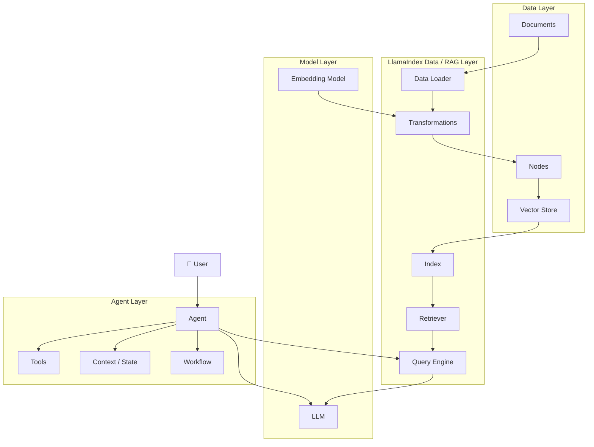

The critical point:

> **LlamaIndex is not the LLM.**

It is an application/framework layer that helps us compose models, data, tools, retrieval, agents, and workflows.

---

# 3. LlamaIndex vs Our From-Scratch Agent

Our previous implementation looked conceptually like:

```python
class Agent:
    model
    tools
    state

    def run():
        while not finished:
            decision = model(...)
            execute_tool(...)
            add_observation(...)
```

LlamaIndex gives us higher-level abstractions around similar concepts.

| From Scratch         | LlamaIndex                         |
| -------------------- | ---------------------------------- |
| `Tool`             | `FunctionTool`                   |
| Tool registry        | Tool collections / tool interfaces |
| RAG pipeline         | Components + Index + QueryEngine   |
| Agent loop           | Agent /`AgentWorkflow`           |
| Agent state          | `Context` / workflow state       |
| Control flow         | `Workflow`                       |
| Tool + RAG           | `QueryEngineTool`                |
| External integration | LlamaHub / ToolSpec                |
| Event-driven loop    | Workflow Events                    |

The purpose of learning LlamaIndex is **not** to forget the implementation we built earlier.

It is to recognize how a mature framework packages those concepts.

---

# 4. Installation

Create a dedicated environment.

```bash
conda create -n llamaindex-agents python=3.11 -y
conda activate llamaindex-agents
```

Install the core package:

```bash
pip install llama-index
```

For local development, we can add integrations separately.

LlamaHub follows a modular installation pattern where integrations are generally installed as packages such as:

```text
llama-index-{component}-{framework}
```

The Hugging Face course demonstrates this modular approach with LLM and embedding integrations.

---

# 5. Verify Installation

```python
import llama_index

print(llama_index.__version__)
```

Then:

```python
from llama_index.core import Document

doc = Document(text="Hello from LlamaIndex!")

print(doc)
```

---

# 6. The LlamaIndex Mental Model

Think of the framework as a collection of composable components.

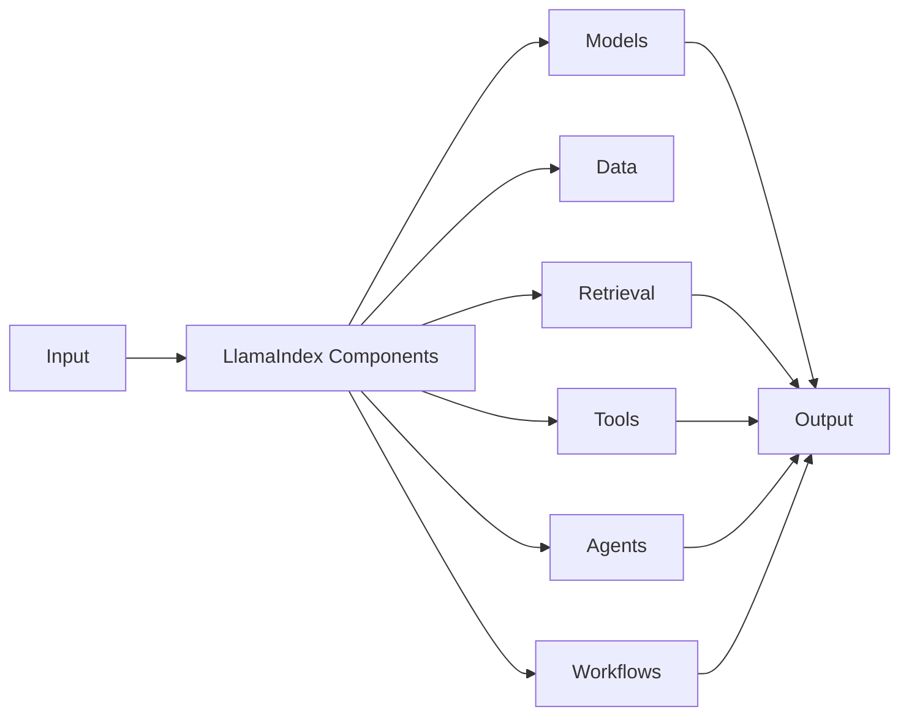

A component is essentially a reusable building block.

The Hugging Face course emphasizes that LlamaIndex has many components and focuses on `QueryEngine` as an important component because it can become a RAG tool for an agent.

---

# 7. LlamaHub

## 7.1 What is LlamaHub?

LlamaHub is an ecosystem/registry of integrations that can be used with LlamaIndex.

The course describes it as a registry containing hundreds of integrations, agents, and tools.

Conceptually:

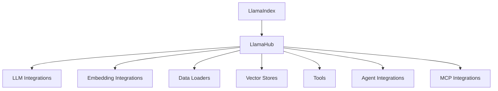

This solves a huge engineering problem.

Without an ecosystem:

```text
You
 ↓
Write every integration yourself
```

With an ecosystem:

```text
You
 ↓
Select integration
 ↓
Install package
 ↓
Use standard interface
```

---

# 8. Why Modular Packages Matter

Instead of installing every possible dependency:

```bash
pip install everything-on-earth
```

we install only what we need.

For example:

```bash
pip install llama-index-llms-ollama
```

or an embedding integration:

```bash
pip install llama-index-embeddings-huggingface
```

The exact integrations can evolve, so always verify the current package names in the relevant LlamaIndex documentation before installing.

---

# 9. Our Model Strategy

We are explicitly **not studying model serving here**.

Our architecture is:

```text
LlamaIndex
    ↓
LLM interface
    ↓
Ollama
    ↓
Local model
```

Therefore:

```text
Agent Architecture
        ≠
Model Serving Architecture
```

We can use your local Ollama setup as the model backend.

The agent framework doesn't need to know how the model is internally served.

---

# 10. Components

A simplified component graph:

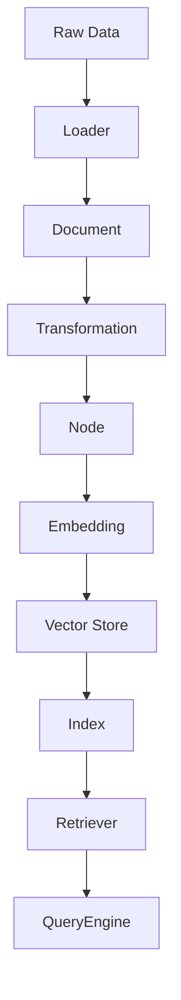

This is essentially the RAG side of LlamaIndex.

---

# 11. Documents

Start with:

```python
from llama_index.core import Document

document = Document(
    text="""
    An AI agent is a system that uses an AI model
    to interact with an environment through actions.
    """
)

print(document)
```

A `Document` represents source information.

---

# 12. Multiple Documents

```python
documents = [
    Document(text="Agents can use tools."),
    Document(text="Tools provide external capabilities."),
    Document(text="RAG allows an LLM to retrieve external information."),
]
```

---

# 13. Loading Data from a Directory

LlamaIndex provides `SimpleDirectoryReader` for loading files from local directories.

```python
from llama_index.core import SimpleDirectoryReader

documents = SimpleDirectoryReader(
    input_dir="./data"
).load_data()

print(len(documents))
```

Architecture:

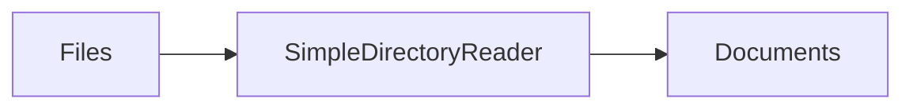

---

# 14. Document → Node

A document may be too large to send directly to a model.

We therefore split it.

```text
Document
   ↓
Chunks
   ↓
Nodes
```

The course describes a `Node` as a smaller chunk of text derived from a source document while retaining reference information.

---

# 15. Sentence Splitting

```python
from llama_index.core.node_parser import SentenceSplitter

splitter = SentenceSplitter(
    chunk_size=512,
    chunk_overlap=50,
)

nodes = splitter.get_nodes_from_documents(documents)

print("Documents:", len(documents))
print("Nodes:", len(nodes))
```

---

# 16. Why Chunking Exists

Suppose:

```text
Document = 100,000 tokens
```

We don't necessarily want:

```text
LLM ← entire document
```

Instead:

```text
Document
 ↓
Chunk 1
Chunk 2
Chunk 3
...
Chunk N
```

At query time:

```text
Question
 ↓
Retrieve relevant chunks
 ↓
LLM
```

This is the foundation of RAG.

---

# 17. Embeddings

An embedding maps semantic content to a vector.

Conceptually:

```text
"How do agents use tools?"
             ↓
       Embedding Model
             ↓
[0.12, -0.31, 0.87, ...]
```

Similar meanings should produce vectors that are close in embedding space.

---

# 18. Embedding Architecture

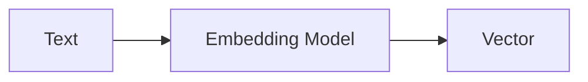

For local experimentation, we can use a Hugging Face embedding model.

For example:

```bash
pip install llama-index-embeddings-huggingface
```

Then:

```python
from llama_index.embeddings.huggingface import HuggingFaceEmbedding

embed_model = HuggingFaceEmbedding(
    model_name="BAAI/bge-small-en-v1.5"
)
```

The Hugging Face course uses this embedding model in its LlamaIndex RAG example.

---

# 19. Vector Store

We need somewhere to store embeddings.

Conceptually:

```mermaid
flowchart TD

    Documents["Documents"]
        ↓
    Nodes["Nodes"]
        ↓
    Embeddings["Embeddings"]
        ↓
    VectorStore["Vector Store"]
```

For local experimentation we can use Chroma.

```bash
pip install chromadb llama-index-vector-stores-chroma
```

The course demonstrates a persistent Chroma-backed vector store for the example application.

---

# 20. VectorStoreIndex

Now we can create an index.

```python
from llama_index.core import VectorStoreIndex

index = VectorStoreIndex(
    nodes,
    embed_model=embed_model
)
```

Conceptually:

```text
Nodes
 ↓
Embedding
 ↓
VectorStoreIndex
```

---

# 21. Retriever

A retriever answers:

> Which pieces of information are relevant to this query?

```python
retriever = index.as_retriever(
    similarity_top_k=3
)

results = retriever.retrieve(
    "What are AI agents?"
)

for result in results:
    print(result.score)
    print(result.text)
```

---

# 22. Query Engine

A query engine goes beyond raw retrieval.

```python
query_engine = index.as_query_engine()

response = query_engine.query(
    "What are AI agents?"
)

print(response)
```

The important distinction:

```text
Retriever
    ↓
Relevant nodes

QueryEngine
    ↓
Relevant nodes
    ↓
LLM
    ↓
Answer
```

LlamaIndex exposes `as_retriever`, `as_query_engine`, and `as_chat_engine` as different ways to interact with an index.

---

# 23. Query Engine Architecture

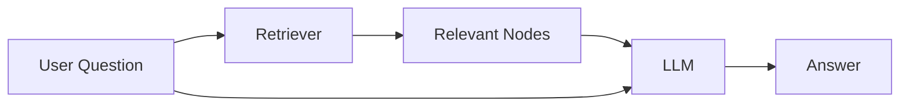

This is where RAG becomes useful to agents.

---

# 24. Response Synthesis

LlamaIndex supports different response synthesis strategies.

Conceptually:

```text
Retrieved Nodes
       ↓
Response Synthesizer
       ↓
Answer
```

Common strategies include:

```text
refine
compact
tree_summarize
```

The course describes `compact` as the default strategy in its example and explains how `refine` and `tree_summarize` differ in how retrieved chunks are processed.

---

# 25. The Big Transition: Query Engine → Tool

This is one of the most important ideas in the entire notebook.

A QueryEngine can become a **tool**.

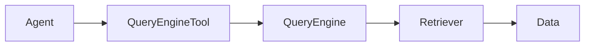

Now the agent decides:

```text
Do I need my RAG knowledge?

YES
 ↓
Use QueryEngineTool
```

That is **Agentic RAG**.

---

# 26. Tools

LlamaIndex provides several tool abstractions.

The Hugging Face course identifies four major categories:

1. `FunctionTool`
2. `QueryEngineTool`
3. `ToolSpec`
4. Utility tools

It also discusses MCP tool integration.

---

# 27. FunctionTool

Take a normal Python function:

```python
def multiply(a: int, b: int) -> int:
    """Multiply two integers."""
    return a * b
```

Turn it into a tool:

```python
from llama_index.core.tools import FunctionTool

multiply_tool = FunctionTool.from_defaults(
    multiply
)
```

Now:

```text
Python Function
      ↓
FunctionTool
      ↓
Agent capability
```

LlamaIndex can derive useful schema information from the function's signature, name, and documentation. The tool name and description are particularly important because they help the model select and use the correct tool.

---

# 28. Tool Schema

Our previous from-scratch implementation had:

```python
Tool(
    name="calculator",
    description="Evaluate arithmetic",
    parameters={...}
)
```

LlamaIndex is abstracting the same basic concept.

Think:

```text
Tool
├── name
├── description
├── arguments
├── callable
└── metadata
```

The LLM doesn't need the Python implementation.

It needs the **interface**.

---

# 29. Tool Selection

The agent receives something conceptually like:

```text
Available Tools:

multiply(a, b)
search_documents(query)
get_weather(location)
```

User:

```text
"What is 12 × 8?"
```

The model determines:

```text
Tool = multiply
Arguments = {a: 12, b: 8}
```

Then:

```text
Tool Execution
      ↓
96
      ↓
Agent
```

---

# 30. Tool Description Is Part of Agent Design

Bad:

```python
description="calculator"
```

Better:

```python
description="""
Multiply two integers.
Use this tool whenever the user asks for
multiplication of numerical values.
"""
```

Why?

Because the LLM chooses tools based heavily on the available tool interface and descriptions.

Therefore:

> **Tool design is prompt engineering through an API interface.**

---

# 31. QueryEngineTool

Now turn RAG into a tool.

```python
from llama_index.core.tools import QueryEngineTool

query_engine_tool = QueryEngineTool.from_defaults(
    query_engine=query_engine,
    name="knowledge_base",
    description=(
        "Search the knowledge base for information "
        "about the documents in the indexed dataset."
    ),
)
```

Now:

```text
Agent
  ↓
knowledge_base
  ↓
QueryEngine
  ↓
Retriever
  ↓
Documents
```

The course demonstrates this exact conceptual transition from QueryEngine to `QueryEngineTool`.

---

# 32. ToolSpec

Sometimes one tool isn't enough.

For example:

```text
Gmail
├── search_email
├── read_email
├── send_email
├── create_draft
└── delete_email
```

Rather than manually defining every tool, a ToolSpec can package related tools.

The Hugging Face material describes ToolSpecs as collections of related tools and demonstrates a Google/Gmail ToolSpec.

Conceptually:

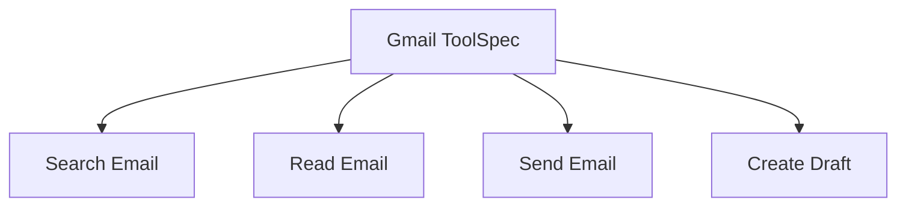

---

# 33. MCP

Modern agent systems increasingly need interoperability.

LlamaIndex can expose MCP tools through its tool integration mechanisms.

Conceptually:

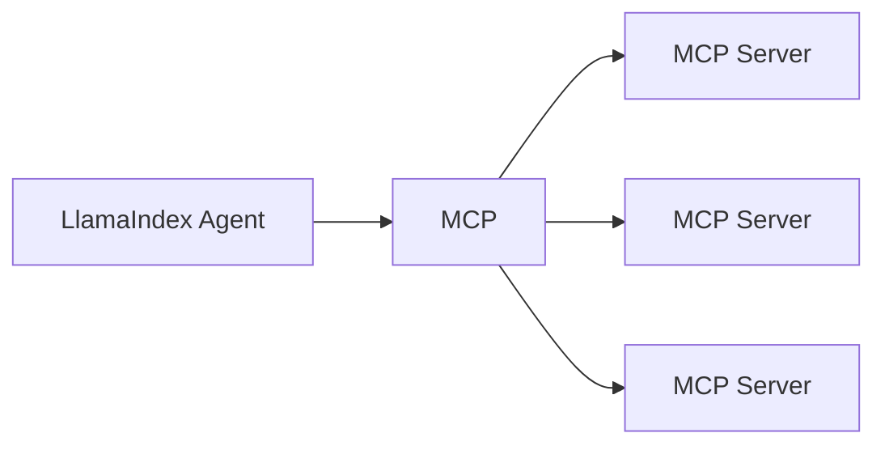

This separates:

```text
Agent
```

from:

```text
Tool implementation
```

and gives us a standardized protocol boundary.

---

# 34. Agents

Now we finally reach the central concept.

An agent is not simply:

```text
LLM + Tools
```

It is an execution loop.

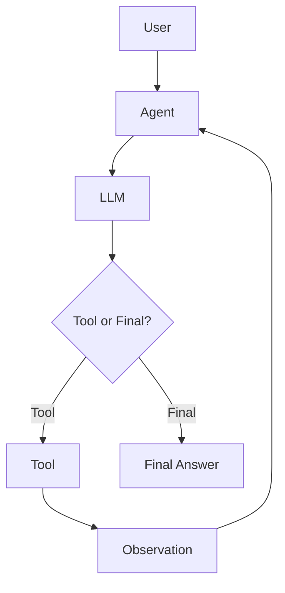

This is the architecture we implemented manually earlier.

---

# 35. Types of Agents in LlamaIndex

The Hugging Face course describes three main reasoning-agent styles:

```text
Function Calling Agents
ReAct Agents
Advanced Custom Agents
```

---

# 36. Function Calling Agent

Architecture:

```text
User
 ↓
LLM
 ↓
Structured Tool Call
 ↓
Tool
 ↓
Observation
 ↓
LLM
```

Advantages:

* structured tool calls
* explicit arguments
* easier parsing
* strong compatibility with function-calling models

---

# 37. ReAct Agent

ReAct combines reasoning and acting.

Conceptually:

```text
Thought
 ↓
Action
 ↓
Observation
 ↓
Thought
 ↓
Action
 ↓
Observation
 ↓
Final Answer
```

This is similar to the agent we built from scratch.

LlamaIndex supports ReAct-style agents for models that expose chat/text completion capabilities rather than a function-calling interface.

---

# 38. Function Calling vs ReAct

| Property          | Function Calling      | ReAct                     |
| ----------------- | --------------------- | ------------------------- |
| Tool calls        | Structured            | Text/action oriented      |
| Parsing           | Easier                | More involved             |
| Reasoning         | Model-dependent       | Explicit reasoning loop   |
| Model requirement | Function/tool support | Chat/text capable         |
| Typical use       | Modern tool APIs      | Broad model compatibility |

The key lesson:

> These are different **control strategies**, not different kinds of intelligence.

---

# 39. AgentWorkflow

LlamaIndex provides `AgentWorkflow` for constructing agents from tools/functions.

Conceptually:

```python
agent = AgentWorkflow.from_tools_or_functions(
    [multiply_tool],
    llm=llm
)
```

The course demonstrates this pattern directly.

---

# 40. First Agent

Example:

```python
from llama_index.core.agent.workflow import AgentWorkflow

agent = AgentWorkflow.from_tools_or_functions(
    [multiply_tool],
    llm=llm,
)
```

Then:

```python
response = await agent.run(
    "What is 12 multiplied by 7?"
)

print(response)
```

---

# 41. The Agent Loop

Conceptually:

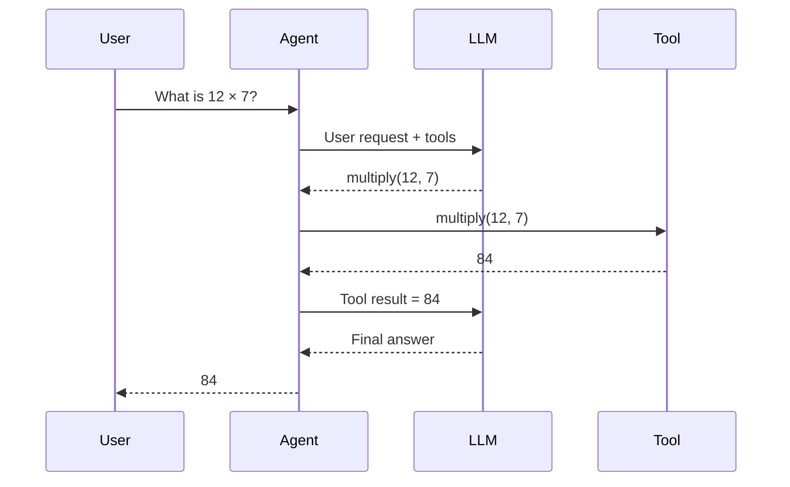

This is the same fundamental architecture we studied without a framework.

---

# 42. Agent State

A very important concept:

> Agents are not necessarily stateful by default.

The course notes that LlamaIndex agents are stateless by default and can use a `Context` object to preserve state across interactions.

Conceptually:

```text
Without Context:

Run 1 → forgotten
Run 2 → independent
Run 3 → independent
```

With Context:

```text
Run 1
 ↓
Context
 ↓
Run 2
 ↓
Context
 ↓
Run 3
```

---

# 43. Context

Conceptually:

```python
from llama_index.core.workflow import Context

ctx = Context(agent)
```

Then:

```python
response = await agent.run(
    "My name is Alice.",
    ctx=ctx
)

response = await agent.run(
    "What is my name?",
    ctx=ctx
)
```

The second interaction can use the context established by the first.

---

# 44. Why Context Matters

This connects directly to our previous study of multi-turn agents.

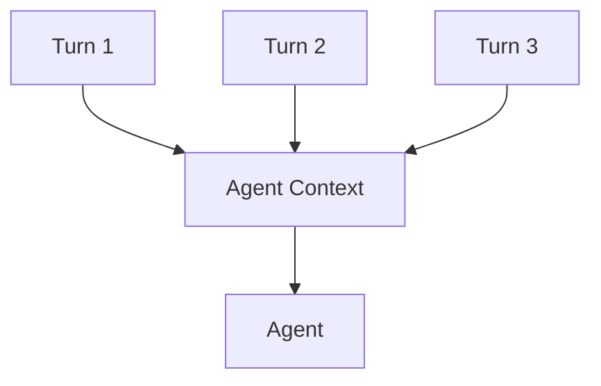

Context is therefore part of the agent runtime.

---

# 45. Agentic RAG

Now combine everything.

We have:

```text
LLM
+
Tools
+
QueryEngine
```

The agent decides when to retrieve information.

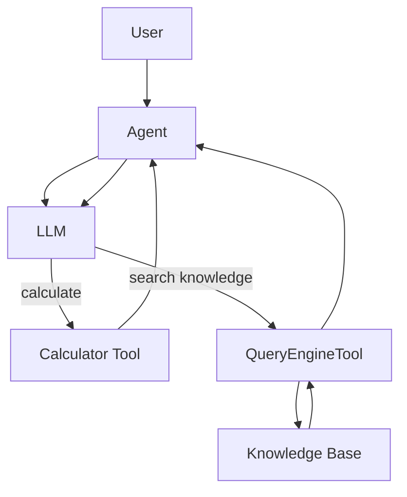

This is the basic idea behind **Agentic RAG**.

---

# 46. Why Agentic RAG Is Different From Normal RAG

Traditional RAG:

```text
Question
 ↓
Retrieve
 ↓
LLM
 ↓
Answer
```

Agentic RAG:

```text
Question
 ↓
Agent
 ↓
Should I retrieve?
 ├── No → Other action
 └── Yes
       ↓
   QueryEngine
       ↓
   Observation
       ↓
     Agent
       ↓
      LLM
```

The agent controls retrieval as an action.

---

# 47. Workflows

Now we reach one of the most important LlamaIndex concepts.

A workflow provides explicit control over execution.

The course describes a workflow as a structured sequence of steps connected through events.

Think:

```text
Agent = autonomous decision maker

Workflow = explicit control structure
```

---

# 48. Agent vs Workflow

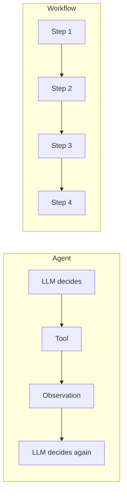

Agent:

> "What should I do next?"

Workflow:

> "I know the structure of what should happen, but I need dynamic execution."

---

# 49. Workflow Architecture

A LlamaIndex workflow is built around:

```text
Workflow
 ├── Steps
 └── Events
```

Events carry information between steps.

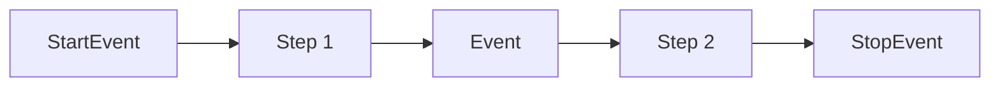

The workflow API uses `@step`, `StartEvent`, and `StopEvent`; intermediate events can carry typed data between steps.

---

# 50. Simple Workflow

```python
from llama_index.core.workflow import (
    StartEvent,
    StopEvent,
    Workflow,
    step,
)

class HelloWorkflow(Workflow):

    @step
    async def hello(
        self,
        ev: StartEvent
    ) -> StopEvent:

        return StopEvent(
            result="Hello from LlamaIndex Workflow!"
        )
```

Run:

```python
workflow = HelloWorkflow()

result = await workflow.run()

print(result)
```

---

# 51. Multi-Step Workflow

```python
from llama_index.core.workflow import (
    Event,
    StartEvent,
    StopEvent,
    Workflow,
    step,
)

class ProcessingEvent(Event):
    intermediate_result: str


class MyWorkflow(Workflow):

    @step
    async def step_one(
        self,
        ev: StartEvent
    ) -> ProcessingEvent:

        return ProcessingEvent(
            intermediate_result="Step 1 complete"
        )

    @step
    async def step_two(
        self,
        ev: ProcessingEvent
    ) -> StopEvent:

        return StopEvent(
            result=f"Finished: {ev.intermediate_result}"
        )
```

Run:

```python
workflow = MyWorkflow()

result = await workflow.run()

print(result)
```

---

# 52. Why Type Hints Matter

Notice:

```python
async def step_one(
    self,
    ev: StartEvent
) -> ProcessingEvent:
```

and:

```python
async def step_two(
    self,
    ev: ProcessingEvent
) -> StopEvent:
```

The event types describe the workflow graph.

Conceptually:

```text
StartEvent
    ↓
step_one
    ↓
ProcessingEvent
    ↓
step_two
    ↓
StopEvent
```

The workflow system can therefore understand how steps connect.

---

# 53. Branching

Workflows can branch.

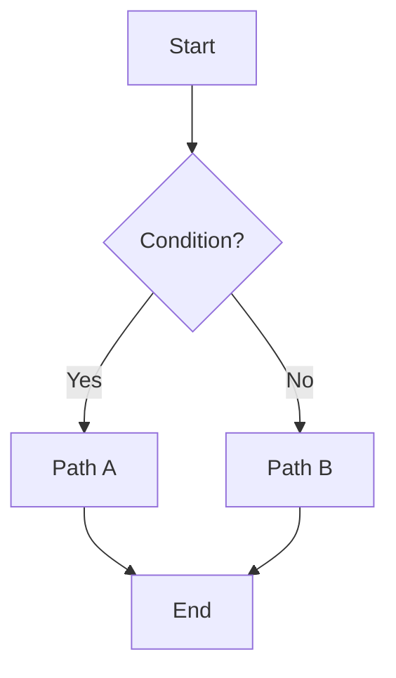

This is useful when the execution structure should be controlled explicitly.

---

# 54. Loops

A workflow can also loop.

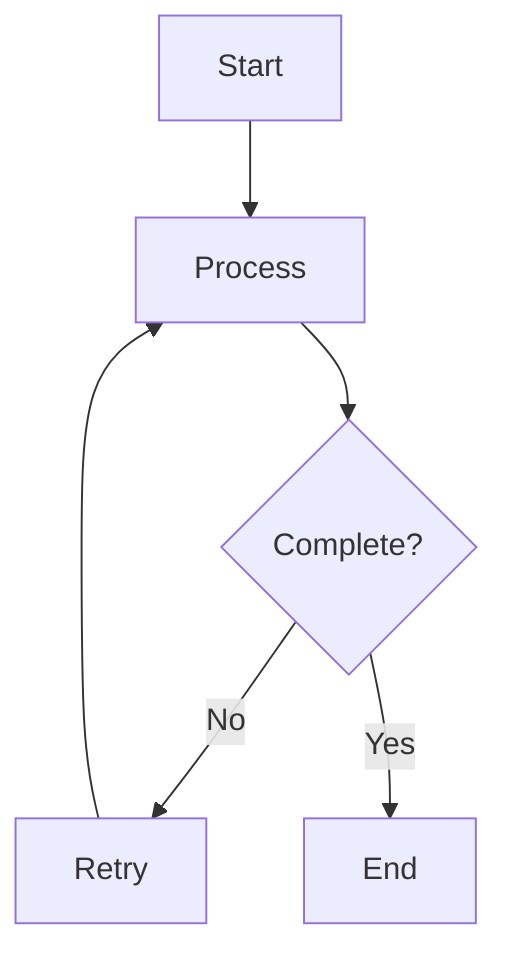

The LlamaIndex workflow system uses typed events to express branches, loops, and joins.

---

# 55. Workflow vs Agent

This distinction is essential.

### Agent

```text
Goal
 ↓
LLM decides next action
 ↓
Tool
 ↓
Observation
 ↓
LLM decides
```

### Workflow

```text
Known execution graph
 ↓
Step
 ↓
Event
 ↓
Step
 ↓
Event
```

### Hybrid

The most interesting architecture:

```text
Workflow
   ↓
Agent
   ↓
Tools
   ↓
Workflow
```

---

# 56. Hybrid Agentic Workflow

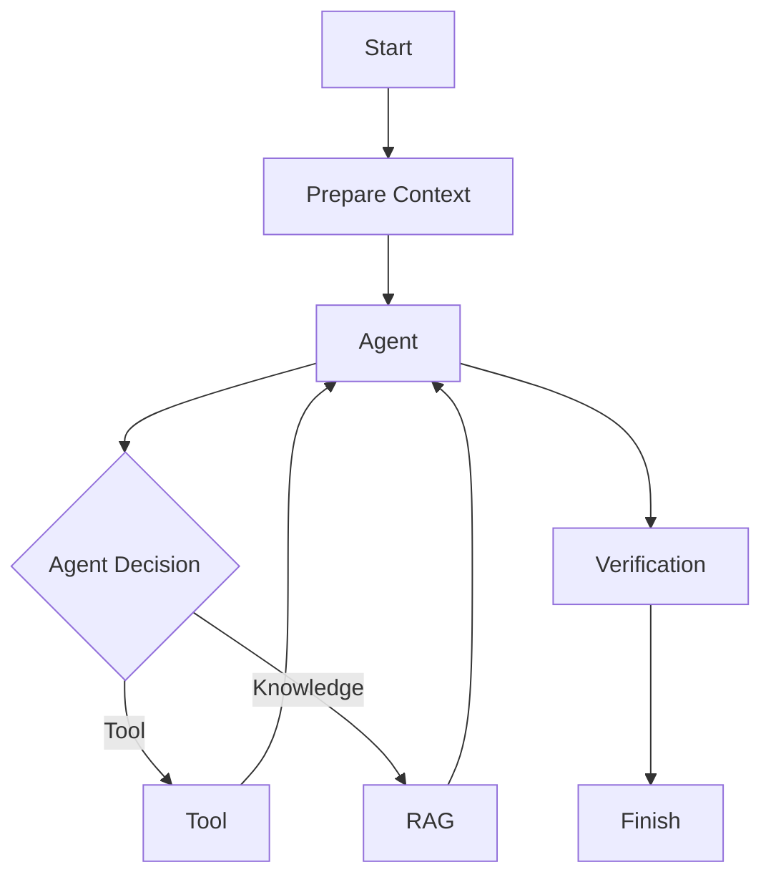

This is much closer to modern production agent architecture.

---

# 57. Agent Workflow and Subagents

We can extend the architecture.

```mermaid
flowchart TD

    User["User"]

    MainWorkflow["Main Workflow"]

    MainAgent["Main Agent"]

    ResearchAgent["Research Agent"]

    CodingAgent["Coding Agent"]

    ReviewAgent["Review Agent"]

    Final["Final Result"]

    User --> MainWorkflow
    MainWorkflow --> MainAgent

    MainAgent --> ResearchAgent
    MainAgent --> CodingAgent
    MainAgent --> ReviewAgent

    ResearchAgent --> MainAgent
    CodingAgent --> MainAgent
    ReviewAgent --> MainAgent

    MainAgent --> Final
```

This is the direction we will study later when we reach multi-agent systems.

---

# 58. Observability

An agent system must be observable.

We need to know:

```text
What did the agent do?
Why?
Which tool did it call?
What arguments did it use?
What did the tool return?
How long did it take?
Where did it fail?
```

Conceptually:

```mermaid
flowchart TD

    Agent["Agent"]

    Trace["Trace"]

    Trace --> LLM["LLM Call"]
    Trace --> Tool["Tool Call"]
    Trace --> Retrieval["Retrieval"]
    Trace --> Workflow["Workflow Step"]
    Trace --> Error["Error"]
    Trace --> Latency["Latency"]
```

The LlamaIndex course also introduces evaluation and observability around its RAG components, including faithfulness, answer relevancy, and correctness evaluators.

---

# 59. Evaluation

An agent can produce a response that is:

```text
Fluent
but wrong.
```

Therefore:

```text
Response
 ↓
Evaluation
 ↓
Quality measurement
```

Important dimensions:

```text
Correctness
Faithfulness
Relevance
Latency
Tool success
```

---

# 60. Faithfulness

Question:

> Is the generated answer supported by the retrieved context?

Useful for RAG.

```text
Retrieved Context
       ↓
Generated Answer
       ↓
Faithfulness Evaluator
```

---

# 61. Answer Relevancy

Question:

> Did the answer actually address the user's question?

---

# 62. Correctness

Question:

> Is the answer factually correct according to a reference or evaluation criterion?

These evaluation concepts are explicitly covered in the LlamaIndex course material.

---

# 63. Full LlamaIndex Agent Architecture

Now combine everything.

```mermaid
flowchart TD

    User["👤 User"]

    subgraph LIX["LlamaIndex Agent System"]

        Context["Context / State"]

        Agent["🤖 Agent"]

        LLM["🧠 LLM"]

        ToolRegistry["🔧 Tools"]

        QueryEngineTool["📚 QueryEngineTool"]

        Workflow["⚙️ Workflow"]

        Memory["💾 Memory"]

        Evaluator["📊 Evaluation"]

    end

    subgraph TOOLS["Tool Ecosystem"]

        Function["FunctionTool"]

        ToolSpec["ToolSpec"]

        MCP["MCP Tools"]

        Utility["Utility Tools"]

    end

    subgraph RAG["RAG"]

        Loader["Loader"]

        Documents["Documents"]

        Nodes["Nodes"]

        Embeddings["Embeddings"]

        VectorStore["Vector Store"]

        Retriever["Retriever"]

        QueryEngine["Query Engine"]

    end

    User --> Agent

    Agent --> Context
    Agent --> LLM
    Agent --> ToolRegistry
    Agent --> QueryEngineTool
    Agent --> Workflow
    Agent --> Memory

    ToolRegistry --> Function
    ToolRegistry --> ToolSpec
    ToolRegistry --> MCP
    ToolRegistry --> Utility

    QueryEngineTool --> QueryEngine

    Documents --> Loader
    Loader --> Nodes
    Nodes --> Embeddings
    Embeddings --> VectorStore
    VectorStore --> Retriever
    Retriever --> QueryEngine

    Agent --> Evaluator
```

This is the mental model to remember.

---

# 64. The Fundamental Execution Loop

Everything eventually reduces to:

```mermaid
flowchart TD

    Start(["START"])

    Input["User Input"]

    Context["Build Context"]

    LLM["LLM"]

    Decision{"What next?"}

    Tool["Execute Tool"]

    Observation["Observation"]

    Update["Update State"]

    Final["Final Answer"]

    Start --> Input
    Input --> Context
    Context --> LLM

    LLM --> Decision

    Decision -->|"Tool call"| Tool
    Tool --> Observation
    Observation --> Update
    Update --> Context

    Decision -->|"Final response"| Final
```

This is the same architecture we built manually.

The framework simply gives us more sophisticated abstractions.

---

# 65. LlamaIndex vs Our From-Scratch Implementation

This is an important exercise.

### Our code

```python
while not state.finished:

    decision = model.generate(
        state.messages,
        tools=tools
    )

    if decision["type"] == "tool_call":

        result = tools.execute(
            decision["name"],
            **decision["arguments"]
        )

        state.add_observation(result)

    else:

        state.finished = True
```

### Framework abstraction

Conceptually:

```python
agent = AgentWorkflow.from_tools_or_functions(
    tools,
    llm=llm
)

result = await agent.run(
    user_input
)
```

The framework hides implementation details.

Our job as engineers is to understand what is happening underneath.

---

# 66. Experiment — Build Our Own Function Tool

```python
def add(a: int, b: int) -> int:
    """
    Add two integers.

    Use this tool when the user asks for
    addition of numerical values.
    """
    return a + b
```

Convert:

```python
add_tool = FunctionTool.from_defaults(add)
```

Inspect:

```python
print(add_tool.metadata)
```

Questions:

1. What is the tool name?
2. What is its description?
3. What arguments does it expose?
4. How is the Python function represented to the LLM?

---

# 67. Experiment — Multiple Tools

Create:

```python
def add(a: int, b: int) -> int:
    """Add two integers."""
    return a + b


def multiply(a: int, b: int) -> int:
    """Multiply two integers."""
    return a * b


def subtract(a: int, b: int) -> int:
    """Subtract b from a."""
    return a - b
```

Convert all:

```python
tools = [
    FunctionTool.from_defaults(add),
    FunctionTool.from_defaults(multiply),
    FunctionTool.from_defaults(subtract),
]
```

Then create the agent.

The objective is not merely to get the answer.

Observe:

```text
Which tool does the model choose?
Why?
What arguments does it generate?
What happens when the request is ambiguous?
```

---

# 68. Experiment — Tool Description Engineering

Create two versions.

### Version A

```python
description="Math tool"
```

### Version B

```python
description="""
Adds two integer values.

Use this tool when the user explicitly asks
for addition or when arithmetic addition is
required to solve the task.
"""
```

Compare the agent's behavior.

This demonstrates:

> **Tool metadata is part of the agent's decision interface.**

---

# 69. Experiment — RAG as a Tool

Create a small knowledge base:

```text
data/
    agents.txt
    tools.txt
    workflows.txt
```

Example:

```text
agents.txt

An AI agent is a system that uses a model
to interact with an environment and accomplish
a user-defined objective.
```

Create an index.

Then:

```python
query_engine = index.as_query_engine()

knowledge_tool = QueryEngineTool.from_defaults(
    query_engine=query_engine,
    name="agent_knowledge",
    description="""
    Search the local knowledge base for information
    about AI agents, tools, workflows, and related
    concepts.
    """
)
```

Now give the agent:

```python
[
    calculator_tool,
    knowledge_tool
]
```

Ask:

```text
What is 123 * 456?
```

Then:

```text
What is an AI agent according to my documents?
```

The agent should select different capabilities.

---

# 70. Experiment — Agentic RAG

Ask:

```text
Compare the definition of an agent in my documents
with the definition of a workflow.
```

The agent may need to:

```text
Agent
 ↓
knowledge tool
 ↓
retrieve relevant nodes
 ↓
reason
 ↓
answer
```

This is the key difference between:

```text
RAG application
```

and:

```text
Agentic RAG
```

---

# 71. Experiment — Stateful Agent

Create a context:

```python
ctx = Context(agent)
```

Then:

```python
await agent.run(
    "My favorite programming language is Python.",
    ctx=ctx
)
```

Follow with:

```python
await agent.run(
    "What is my favorite programming language?",
    ctx=ctx
)
```

Now remove the context and repeat.

Compare the behavior.

This demonstrates the difference between:

```text
stateless agent
```

and:

```text
stateful agent
```

---

# 72. Experiment — Workflow

Build:

```text
Start
 ↓
Retrieve
 ↓
Process
 ↓
Verify
 ↓
Finish
```

Represent it using:

```text
StartEvent
ProcessingEvent
StopEvent
```

Then intentionally add a failure branch:

```mermaid
flowchart TD

    Start["Start"]

    Retrieve["Retrieve"]

    Verify{"Valid?"}

    Retry["Retry"]

    Answer["Answer"]

    Fail["Failure"]

    Start --> Retrieve
    Retrieve --> Verify

    Verify -->|"Yes"| Answer
    Verify -->|"No"| Retry

    Retry --> Retrieve
    Retrieve --> Fail
```

The goal is to learn that **workflow control flow can be explicit rather than entirely delegated to an LLM**.

---

# 73. Agent vs Workflow: Final Mental Model

Remember:

```text
                 CONTROL
                   ↑
                   │
       Workflow ───┼─── Agent
                   │
                   ↓
               AUTONOMY
```

More explicitly:

```text
Workflow
    =
Explicit execution structure

Agent
    =
Dynamic decision-making

Agentic Workflow
    =
Explicit structure
+
Dynamic decisions
```

---

# 74. When Should We Use Which?

### Use an Agent when:

```text
You don't know exactly which action
should happen next.
```

Example:

```text
"Investigate this problem."
```

The agent decides.

---

### Use a Workflow when:

```text
You know the major stages.
```

Example:

```text
Load
 ↓
Retrieve
 ↓
Analyze
 ↓
Verify
 ↓
Report
```

---

### Use both when:

```text
The overall process is known,
but individual decisions are dynamic.
```

This is extremely common in modern AI systems.

---

# 75. LlamaIndex Architecture in One Diagram

```mermaid
flowchart TD

    User["👤 USER"]

    subgraph APP["APPLICATION"]

        Agent["🤖 AGENT"]

        Context["🧠 CONTEXT"]

        Workflow["⚙️ WORKFLOW"]

    end

    subgraph REASONING["REASONING"]

        LLM["LLM"]

    end

    subgraph TOOLS["TOOLS"]

        FunctionTools["Function Tools"]
        QueryTools["QueryEngine Tools"]
        ToolSpecs["ToolSpecs"]
        MCPTools["MCP"]
    end

    subgraph DATA["DATA / RAG"]

        Loader["Loaders"]

        Documents["Documents"]

        Nodes["Nodes"]

        Embeddings["Embeddings"]

        Index["Index"]

        Retriever["Retriever"]

        QE["QueryEngine"]

        VectorDB["Vector Store"]

    end

    subgraph OBS["OBSERVABILITY"]

        Eval["Evaluation"]

        Trace["Tracing"]

    end

    User --> Agent

    Agent --> Context
    Agent --> Workflow
    Agent --> LLM

    LLM --> FunctionTools
    LLM --> QueryTools
    LLM --> ToolSpecs
    LLM --> MCPTools

    QueryTools --> QE

    Loader --> Documents
    Documents --> Nodes
    Nodes --> Embeddings
    Embeddings --> Index
    Index --> Retriever
    Retriever --> QE
    VectorDB --> Index

    Agent --> Eval
    Agent --> Trace
```

---

# 76. What We Have Learned

We started with:

```text
LLM
```

Then:

```text
LLM
 +
Tools
```

Then:

```text
LLM
 +
Tools
 +
Agent Loop
```

Then:

```text
LLM
 +
Tools
 +
Agent
 +
State
```

Then:

```text
LLM
 +
Tools
 +
Agent
 +
RAG
 +
State
```

Then:

```text
LlamaIndex
 =
Components
 +
Tools
 +
Agents
 +
Workflows
```

---

# 77. The Most Important Concepts

Memorize these relationships:

```text
Function
   ↓
FunctionTool
   ↓
Agent Capability
```

```text
Documents
   ↓
Nodes
   ↓
Embeddings
   ↓
Index
   ↓
Retriever
   ↓
QueryEngine
```

```text
QueryEngine
   ↓
QueryEngineTool
   ↓
Agent Capability
```

```text
Tools
   ↓
Agent
   ↓
LLM
   ↓
Tool Selection
   ↓
Observation
```

```text
Workflow
   ↓
Steps
   ↓
Events
   ↓
State / Control Flow
```

---

# 78. What LlamaIndex Gives Us

Without a framework:

```text
We implement:

Tool
Tool Registry
Schema
Agent Loop
State
RAG
Retrieval
Memory
Workflow
Tracing
Evaluation
```

With LlamaIndex:

```text
LlamaIndex
├── Components
├── Tools
├── QueryEngine
├── Agents
├── Context
├── Workflows
├── Integrations
└── Evaluation / Observability
```

The framework is therefore an **abstraction layer over recurring agent-system engineering problems**.

---

# 79. What We Should NOT Forget

A framework can make us productive while hiding the underlying mechanism.

Do not memorize:

```python
AgentWorkflow.from_tools_or_functions(...)
```

and stop there.

Instead ask:

```text
What happens internally?

How does the model see the tools?

How is the tool schema generated?

How is the tool selected?

How are arguments generated?

How is the tool executed?

How is the observation returned?

Where is state stored?

How does the loop terminate?

How are errors handled?

How are workflows connected?

How is RAG exposed to the agent?
```

These questions are far more important.

---

# 80. From LlamaIndex Back to First Principles

Our entire notebook can be reduced to:

```mermaid
flowchart TD

    User["User"]

    Perception["Observe"]

    Reason["Reason"]

    Action["Act"]

    Observation["Observe Result"]

    State["Update State"]

    User --> Perception
    Perception --> Reason

    Reason --> Action
    Action --> Observation
    Observation --> State

    State --> Reason

    Reason --> Final["Final Answer"]
```

LlamaIndex provides abstractions for implementing this loop at a much larger scale.

---

# 81. Final Architecture for Our Agent Curriculum

This is where I want our project to eventually arrive:

```mermaid
flowchart TD

    User["👤 User"]

    Runtime["🤖 Agent Runtime"]

    State["State / Context"]

    Planner["Planner"]

    LLM["LLM"]

    Tools["Tool Registry"]

    RAG["RAG / Query Engines"]

    Memory["Memory"]

    Workflow["Workflow Engine"]

    Policy["Permission / Safety"]

    Executor["Tool Executor"]

    Observation["Observations"]

    Evaluation["Evaluation"]

    Trace["Observability"]

    User --> Runtime

    Runtime --> State
    Runtime --> Planner
    Runtime --> LLM
    Runtime --> Workflow

    LLM -->|"Decision"| Planner

    Planner --> Policy

    Policy --> Tools
    Policy --> RAG
    Policy --> Memory

    Tools --> Executor
    RAG --> Executor
    Memory --> Executor

    Executor --> Observation

    Observation --> State
    State --> LLM

    Runtime --> Evaluation
    Runtime --> Trace

    Evaluation --> Runtime
```

This architecture connects everything we have learned so far.

---

# 82. Exercises

## Exercise 1 — Function Tool

Create:

```text
divide(a, b)
```

Requirements:

* integer/float arguments
* division-by-zero handling
* useful docstring
* convert to `FunctionTool`

---

## Exercise 2 — File Tool

Create:

```text
count_lines(path)
```

Then expose it as a tool.

---

## Exercise 3 — Tool Selection

Give an agent:

```text
add
multiply
divide
count_lines
```

Ask it five different questions.

Record:

```text
Question
Selected tool
Arguments
Result
```

---

## Exercise 4 — RAG Tool

Create a knowledge base containing:

```text
agents.md
tools.md
workflows.md
llamaindex.md
```

Turn the query engine into a `QueryEngineTool`.

---

## Exercise 5 — Agentic RAG

Give the agent:

```text
calculator
knowledge_base
```

Ask:

```text
What is 123 * 456?
```

and:

```text
What is an agent according to my documents?
```

Verify that different tools are selected.

---

## Exercise 6 — Context

Run:

```text
Turn 1:
My project is called Agent Systems.

Turn 2:
What is my project called?
```

Compare:

```text
with Context
```

versus:

```text
without Context
```

---

## Exercise 7 — Workflow

Build:

```text
Start
 ↓
Load Data
 ↓
Retrieve
 ↓
Generate
 ↓
Verify
 ↓
Stop
```

---

## Exercise 8 — Failure Recovery

Modify the workflow:

```text
Retrieve
 ↓
Verification
 ↓
Failure?
 ├── Retry
 └── Continue
```

---

# 83. Mastery Checklist

You should be able to explain all of these without looking at the notebook:

### LlamaIndex

* [ ] What is LlamaIndex?
* [ ] Why use a framework?
* [ ] What is LlamaHub?
* [ ] What is a component?

### RAG

* [ ] Document
* [ ] Node
* [ ] Chunking
* [ ] Embedding
* [ ] Vector store
* [ ] Index
* [ ] Retriever
* [ ] QueryEngine
* [ ] Response synthesis

### Tools

* [ ] FunctionTool
* [ ] QueryEngineTool
* [ ] ToolSpec
* [ ] Utility tools
* [ ] MCP tools

### Agents

* [ ] Function-calling agent
* [ ] ReAct agent
* [ ] AgentWorkflow
* [ ] Context
* [ ] Agentic RAG

### Workflows

* [ ] Workflow
* [ ] Step
* [ ] Event
* [ ] StartEvent
* [ ] StopEvent
* [ ] Branch
* [ ] Loop
* [ ] Join
* [ ] State

### Engineering

* [ ] Tool schema design
* [ ] Tool descriptions
* [ ] Error handling
* [ ] Evaluation
* [ ] Observability
* [ ] State management
* [ ] Permission boundaries

---

# 84. The Final Mental Model

If you remember only one diagram from this notebook, remember this:

```mermaid
flowchart TD

    User["👤 User"]

    Agent["🤖 Agent"]

    LLM["🧠 LLM"]

    Tool["🔧 Tools"]

    RAG["📚 RAG"]

    Memory["💾 Memory"]

    Workflow["⚙️ Workflow"]

    Environment["🌎 Environment"]

    User --> Agent

    Agent --> LLM

    LLM --> Tool
    LLM --> RAG
    LLM --> Memory
    LLM --> Workflow

    Tool --> Environment
    RAG --> Environment

    Tool --> Agent
    RAG --> Agent
    Memory --> Agent
    Workflow --> Agent

    Agent --> LLM
```

And underneath all of it:

```text
                 AGENT
                   │
          ┌────────┴────────┐
          │                 │
       REASON             ACT
          │                 │
         LLM              TOOLS
          │                 │
          └───────┬─────────┘
                  │
             OBSERVATION
                  │
                  ↓
               STATE
                  │
                  └────────→ REASON
```

That loop is the heart of modern agent systems.

LlamaIndex gives us increasingly sophisticated abstractions for constructing that loop, connecting it to data, exposing capabilities as tools, maintaining context, and organizing deterministic or event-driven workflows.

---

# 85. Next Notebook

The natural next step is **not another framework tutorial**.

We should now build:

```text
Notebook:
"LlamaIndex Agent — From Framework API to Internal Mechanics"
```

and implement, side-by-side:

```text
LlamaIndex
      │
      ├── FunctionTool
      │       ↕
      │   Our Tool
      │
      ├── AgentWorkflow
      │       ↕
      │   Our Agent Loop
      │
      ├── Context
      │       ↕
      │   Our AgentState
      │
      ├── QueryEngineTool
      │       ↕
      │   Our RAGTool
      │
      └── Workflow
              ↕
          Our State Machine
```

That is where we stop being **users of LlamaIndex** and start understanding **how agent frameworks are actually constructed**.

## References

* Hugging Face Agents Course — LlamaIndex introduction: [LlamaIndex Introduction](https://huggingface.co/learn/agents-course/unit2/llama-index/introduction?utm_source=chatgpt.com)
* Hugging Face Agents Course — LlamaHub: [LlamaHub](https://huggingface.co/learn/agents-course/unit2/llama-index/llama-hub?utm_source=chatgpt.com)
* Hugging Face Agents Course — Components: [LlamaIndex Components](https://huggingface.co/learn/agents-course/unit2/llama-index/components?utm_source=chatgpt.com)
* Hugging Face Agents Course — Tools: [LlamaIndex Tools](https://huggingface.co/learn/agents-course/unit2/llama-index/tools?utm_source=chatgpt.com)
* Hugging Face Agents Course — Agents: [LlamaIndex Agents](https://huggingface.co/learn/agents-course/unit2/llama-index/agents?utm_source=chatgpt.com)
* Hugging Face Agents Course — Workflows: [LlamaIndex Workflows](https://huggingface.co/learn/agents-course/unit2/llama-index/workflows?utm_source=chatgpt.com)
* Hugging Face Agents Course — Conclusion: [LlamaIndex Conclusion](https://huggingface.co/learn/agents-course/unit2/llama-index/conclusion?utm_source=chatgpt.com)
