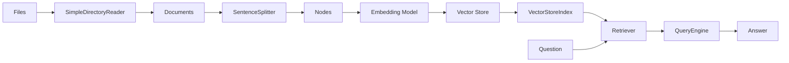
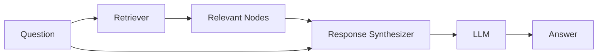

# Tutorial 02 — The RAG Pipeline: Documents → Query Engine

> **Companion to:** `../LlamaIndex.md` sections 11–25, 31.
> **Goal:** Build the full data stack — load files, split into nodes, embed, store in a vector store, index, retrieve, synthesize — and persist it so we never re-embed twice.

---

## 2.1 The Pipeline at a Glance



Every box is a component you can inspect and replace independently. Let's walk through each one with working code.

---

## 2.2 Load Documents

```python
from llama_index.core import SimpleDirectoryReader

documents = SimpleDirectoryReader(
    input_dir="./data",        # our knowledge base
    filename_as_id=True,       # stable ids derived from file paths
).load_data()

print(len(documents))
print(documents[0].metadata)   # {"file_path": ..., "file_name": ...}
```

> If your knowledge base has subsections, `recursive=True` loads subdirectories too.

---

## 2.3 Split Documents into Nodes

A document may be 100,000 tokens — too big for an LLM context. We chunk it.

```python
from llama_index.core.node_parser import SentenceSplitter

splitter = SentenceSplitter(
    chunk_size=512,
    chunk_overlap=50,
)

nodes = splitter.get_nodes_from_documents(documents)

print(f"Documents: {len(documents)}")
print(f"Nodes:     {len(nodes)}")
print(nodes[0].text[:200])
print(nodes[0].metadata)       # parent metadata inherited
```

Why overlap? A sentence split across the boundary loses context; a 50-token overlap keeps the tail/head of each neighbor available.

Other splitters worth knowing (all in `llama_index.core.node_parser`):

| Parser | Behavior |
| --- | --- |
| `SentenceSplitter` | Chunk on sentence boundaries (default) |
| `TokenTextSplitter` | Raw token-count chunks |
| `MarkdownNodeParser` | Split on Markdown headers; records `metadata["header_path"]` |
| `SemanticSplitterNodeParser` | Embedding-similarity breakpoints (slower, higher quality) |

### Relationships between nodes

The splitter automatically links siblings:

```python
from llama_index.core.schema import NodeRelationship

node = nodes[0]
print(NodeRelationship.PREVIOUS in node.relationships)  # -> bool
print(NodeRelationship.NEXT in node.relationships)
```

Nodes are not loose text — they know their position in the source document.

---

## 2.4 The IngestionPipeline — Chaining Transforms

You can orchestrate the exact same flow through `IngestionPipeline`, which chains any number of `TransformComponent`s (splitters, metadata extractors, embedders) and caches results so re-runs are cheap.

```python
from llama_index.core.ingestion import IngestionPipeline
from llama_index.core.node_parser import SentenceSplitter

# Settings.embed_model handles the embedding step automatically
pipeline = IngestionPipeline(
    transformations=[
        SentenceSplitter(chunk_size=512, chunk_overlap=50),
    ],
)

nodes = pipeline.run(documents=documents)   # .arun() for async
print(len(nodes))
```

When you pass a `vector_store` to the pipeline, embedded nodes are written straight into it.

### Custom transform

`TransformComponent` is the base class for any step — you can write your own:

```python
from llama_index.core.schema import TransformComponent
import re

class TextCleaner(TransformComponent):
    def __call__(self, nodes, **kwargs):
        for node in nodes:
            node.text = re.sub(r"\s+", " ", node.text).strip()
        return nodes
```

```python
pipeline = IngestionPipeline(transformations=[TextCleaner(), SentenceSplitter()])
nodes = pipeline.run(documents=documents)
```

---

## 2.5 Embeddings — Turning Text into Vectors

```python
from llama_index.core import Settings

# Already configured in Tutorial 01 — but let's make it explicit here
vec = Settings.embed_model.get_text_embedding("How do agents use tools?")
print(len(vec))
```

The embedding model maps similar meanings to nearby vectors. Two knobs matter:

- **batch size** (`embed_batch_size=10`) — throughput vs. memory.
- **normalization** — distance measures assume normalized vectors; local models default to normalized.

> **Rule:** The embedding model is part of your index's identity. Never mix models across an index's life. `nomic-embed-text` → 768 dims; `bge-small-en-v1.5` → 384 dims.

---

## 2.6 Vector Store — Where Vectors Live

Default behavior is an **in-memory** `SimpleVectorStore`. For a persistent local setup we use Chroma:

```python
import chromadb
from llama_index.vector_stores.chroma import ChromaVectorStore
from llama_index.core import StorageContext

# disk-backed Chroma
db = chromadb.PersistentClient(path="./chroma_db")
collection = db.get_or_create_collection("agent_kb")

vector_store = ChromaVectorStore(chroma_collection=collection)
storage_context = StorageContext.from_defaults(vector_store=vector_store)
```

> Note the current API: pass a Chroma **`Collection`** object (not the client). Use `PersistentClient(path=...)` for disk, `EphemeralClient()` for throw-away tests.

---

## 2.7 VectorStoreIndex — Bringing It Together

```python
from llama_index.core import VectorStoreIndex

# From documents: runs transformations + embedding, then stores
index = VectorStoreIndex.from_documents(
    documents,
    storage_context=storage_context,   # use Chroma on disk
)

# From pre-split nodes (same thing, manual control)
index = VectorStoreIndex.from_nodes(nodes)

# From an existing vector store (no re-embedding — loads persisted data)
index = VectorStoreIndex.from_vector_store(vector_store)
```

`VectorStoreIndex` is the "brain of the data stack": an object you can turn into different *interfaces*.

---

## 2.8 Retriever — Selecting Relevant Nodes

```python
retriever = index.as_retriever(similarity_top_k=3)

results = retriever.retrieve("What is agentic RAG?")
for r in results:
    print(f"{r.score:.4f} | {r.text[:80]}")
```

A retriever answers **which** chunks are relevant. It does not generate an answer — it returns `NodeWithScore` objects.

Hybrid retrieval (dense + BM25) catches keyword matches that vectors miss:

```python
from llama_index.core.retrievers import QueryFusionRetriever
from llama_index.retrievers.bm25 import BM25Retriever   # pip install llama-index-retrievers-bm25
import Stemmer

vector_retriever = index.as_retriever(similarity_top_k=5)
bm25_retriever = BM25Retriever.from_defaults(
    docstore=index.docstore,
    similarity_top_k=10,
    stemmer=Stemmer.Stemmer("english"),
)

fusion = QueryFusionRetriever(
    [vector_retriever, bm25_retriever],
    similarity_top_k=5,
    mode="relative_score",
)
for r in fusion.retrieve("What is agentic RAG?"):
    print(f"{r.score:.4f} | {r.text[:80]}")
```

---

## 2.9 QueryEngine — Retrieval + LLM Synthesis

A `QueryEngine` composes the retriever with response synthesis:

```python
query_engine = index.as_query_engine(
    similarity_top_k=3,
    response_mode="compact",   # default
)

response = query_engine.query("What is agentic RAG?")

print(response)                                  # the answer text
print(response.source_nodes[0].node.get_content())  # the chunks used
```

The pipeline inside:



### Response modes

| Mode | Behavior |
| --- | --- |
| `refine` | One LLM call per chunk, refining incrementally — most detail, most tokens |
| `compact` (default) | Packs chunks into the context window first → fewer calls |
| `tree_summarize` | Recursive bottom-up summarization |
| `accumulate` | Answer per chunk, concatenated |
| `simple_summarize` | Stuff all chunks into one prompt |
| `no_text` | Return sources only, no synthesis |

### Custom prompts

```python
from llama_index.core import PromptTemplate

qa_tmpl = PromptTemplate(
    "Context information is below.\n"
    "---------------------\n"
    "{context_str}\n"
    "---------------------\n"
    "Answer the query using ONLY the context above.\n"
    "Query: {query_str}\n"
    "Answer: "
)

query_engine = index.as_query_engine(
    text_qa_template=qa_tmpl,
    response_mode="compact",
)
print(query_engine.query("What is agentic RAG?"))
```

---

## 2.10 Chat Engine — Multi-Turn RAG

`as_chat_engine()` adds conversation history on top of the same index:

```python
chat_engine = index.as_chat_engine()

r1 = chat_engine.chat("What is agentic RAG?")
print(r1)

r2 = chat_engine.chat("What did you just say about agents?")   # has memory
print(r2)

chat_engine.reset()   # clear history
```

Chat modes:

| Mode | Behavior |
| --- | --- |
| `condense_question` | Rewrites "history + question" into a standalone query before retrieval |
| `context` | Retrieves from every message; context injected into system prompt |
| `condense_plus_context` | Combination |
| `simple` | Plain LLM chat, no retrieval |
| `best` (default) | Pick an agent-based approach automatically |

> For true **agentic RAG** (the LLM *decides* when to retrieve), we turn the query engine into a tool — that's Tutorial 03/04.

---

## 2.11 Persistence — Don't Re-Embed Every Time

Embedding is the expensive part. Two ways to persist:

### Way 1 — default in-memory stores, dumped to disk

```python
from llama_index.core import VectorStoreIndex, StorageContext, load_index_from_storage

storage_context = StorageContext.from_defaults()   # in-memory SimpleVectorStore
index = VectorStoreIndex.from_documents(documents, storage_context=storage_context)

index.storage_context.persist(persist_dir="./storage")

# Later, in a new process:
storage_context = StorageContext.from_defaults(persist_dir="./storage")
index = load_index_from_storage(storage_context)
```

> **CRITICAL gotcha:** `load_index_from_storage` will **not** rediscover your embed model — it falls back to a 1-dim MockEmbedding. Always re-set `Settings.embed_model` (or pass `embed_model=...`) before loading.

### Way 2 — Chroma (already disk-backed)

```python
db = chromadb.PersistentClient(path="./chroma_db")
collection = db.get_or_create_collection("agent_kb")
vector_store = ChromaVectorStore(chroma_collection=collection)

index = VectorStoreIndex.from_vector_store(vector_store)  # no re-embedding
query_engine = index.as_query_engine()
```

Chroma's native persistence means the index survives restarts automatically.

---

## 2.12 Document Management on an Index

```python
index.insert(Document(text="New knowledge to add."))
index.delete_ref_doc("doc_id_here", delete_from_docstore=True)
index.refresh_ref_docs(new_documents)   # incremental updates
```

`refresh_ref_docs` compares content hashes and only re-embeds what changed — cheap incremental ingestion.

---

## 2.13 Evaluation — Is the RAG System Good?

I'll do a deep dive in Tutorial 06, but the basics now:

```python
from llama_index.core.evaluation import (
    FaithfulnessEvaluator,
    RelevancyEvaluator,
)
from llama_index.core import Settings

faithfulness = FaithfulnessEvaluator(llm=Settings.llm)
relevancy = RelevancyEvaluator(llm=Settings.llm)

query = "What is agentic RAG?"
response = query_engine.query(query)

print("Faithful:", faithfulness.evaluate_response(response=response).passing)
print("Relevant:", relevancy.evaluate_response(query=query, response=response).passing)
```

- **Faithfulness:** is the answer supported by the retrieved context? (hallucination guard)
- **Relevancy:** did the answer address the question?

> **Async note:** In modern Python (3.12+), `nest_asyncio` is broken. Prefer `await evaluator.aevaluate_response(...)` inside an async context, or call the sync `.evaluate_response(...)` from a plain script.

---

## 2.14 Exercises

1. **Inspect the splitter:** Print the first 3 nodes' text and their `PREVIOUS`/`NEXT` relationships. Change `chunk_size` to 128 and observe how many nodes you get.
2. **Custom transform:** Write a transform that uppercases the first letter of every node and re-run the ingestion pipeline.
3. **Retriever vs query engine:** Run `retriever.retrieve(...)` and `query_engine.query(...)` with the same question; compare raw nodes vs. the synthesized answer.
4. **Persist + reload:** Build an index, persist to `./storage`, restart the kernel/process, reload, and confirm `as_query_engine()` works with **no** re-embedding (add a `print` in a small timing wrapper to see speedup).
5. **Comparison:** Query the same question with `response_mode="compact"`, `"refine"`, and `"tree_summarize"`; note token cost vs. answer quality differences.

---

## 2.15 Wrapping Up

You now control the entire data half of LlamaIndex:

```text
Files
  → SimpleDirectoryReader
  → Documents
  → SentenceSplitter
  → Nodes
  → Embeddings (Settings.embed_model)
  → ChromaVectorStore (storage_context)
  → VectorStoreIndex
  → Retriever / QueryEngine / ChatEngine
  → persist / load
```

Tutorial 03 converts the `QueryEngine` into a **tool** — the bridge between "RAG application" and "agentic RAG".

---

## References

- Documents & nodes: <https://developers.llamaindex.ai/python/framework/module_guides/loading/documents_and_nodes>
- Node parsers: <https://developers.llamaindex.ai/python/framework/module_guides/loading/node_parsers>
- Ingestion pipeline: <https://developers.llamaindex.ai/python/framework/module_guides/loading/ingestion_pipeline>
- Embeddings: <https://developers.llamaindex.ai/python/framework/module_guides/models/embeddings>
- Chroma: <https://developers.llamaindex.ai/python/framework/understanding/rag/storing>
- Save & load: <https://developers.llamaindex.ai/python/framework/module_guides/storing/save_load>
- Response synthesis: <https://developers.llamaindex.ai/python/framework/module_guides/querying/response_synthesizers>
- Evaluation usage: <https://developers.llamaindex.ai/python/framework/module_guides/evaluating/usage_pattern>