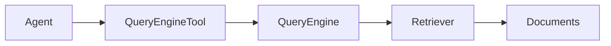
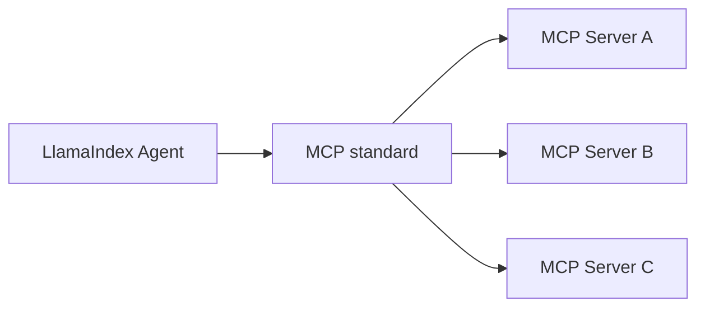

# Tutorial 03 — Tools: Turning Capabilities into an API for the LLM

> **Companion to:** `../LlamaIndex.md` sections 26–33, 66–69.
> **Goal:** Understand the tool abstractions — `FunctionTool`, `QueryEngineTool`, `ToolSpec`, utility tools, MCP — and, critically, why **tool metadata is the agent's decision interface**.

---

## 3.1 The Core Idea

```text
Python function
     ↓
Tool (name + description + schema + callable)
     ↓
Agent capability
```

The LLM never sees your Python code. It sees a JSON function schema:

```json
{
  "type": "function",
  "function": {
    "name": "multiply",
    "description": "Multiply two integers. Use this when the user asks for multiplication.",
    "parameters": {
      "type": "object",
      "properties": {
        "a": {"type": "integer", "description": "First operand"},
        "b": {"type": "integer", "description": "Second operand"}
      },
      "required": ["a", "b"]
    }
  }
}
```

> **Tool design is prompt engineering through an API interface.** The model picks a tool and writes arguments based *almost entirely* on `name` + `description`. Spending time here pays off more than any other tuning.

---

## 3.2 FunctionTool — Wrap a Python Function

```python
from llama_index.core.tools import FunctionTool


def multiply(a: int, b: int) -> int:
    """Multiply two integers.

    Use this tool whenever the user asks for multiplication,
    products, or area/volume calculations that need a*b.
    """
    return a * b


multiply_tool = FunctionTool.from_defaults(multiply)
```

Inspect what the model will see:

```python
print(multiply_tool.metadata.name)          # "multiply"
print(multiply_tool.metadata.description)   # docstring-based
print(multiply_tool.metadata.get_parameters_dict())  # JSON schema
```

Call it directly:

```python
result = multiply_tool.call(a=12, b=8)       # ToolOutput
# or async: await multiply_tool.acall(a=12, b=8)
print(result.content)   # -> "96"
```

### How the schema is derived

`FunctionTool.from_defaults` inspects the function's signature (type hints, defaults, even `Annotated` descriptions), builds a Pydantic schema automatically, and extracts parameter docs from the docstring (Sphinx `:param:`, Google style, Javadoc `@param`).

Describe arguments explicitly with `Annotated`:

```python
from typing import Annotated


def get_weather(
    location: Annotated[str, "City name and state, e.g. 'San Francisco, CA'"],
) -> str:
    """Returns the current weather for a location."""
    return "72F, sunny"


weather_tool = FunctionTool.from_defaults(get_weather)
```

### Manual metadata override

```python
multiply_tool = FunctionTool.from_defaults(
    multiply,
    name="math_multiply",
    description="Compute the product of two numbers. Use for any multiplication request.",
)
```

---

## 3.3 Tool Metadata Is Agent Design

Compare these two tools exposed to the same model:

```text
Bad:
  name: calc
  description: "Math tool"

Good:
  name: multiply_integers
  description: "Multiply two integers. Use whenever the user asks for
                multiplication of numerical values."
```

The second produces dramatically more reliable tool selection. Two practical constraints:

- Keep descriptions under **1024 characters** (the framework raises beyond that).
- Name → `^[a-zA-Z0-9_-]+$` (auto-sanitized otherwise).
- Use distinct names and verbs you'd search the model's ta for: `search_knowledge_base`, `calculate`, etc.

---

## 3.4 QueryEngineTool — Turn RAG into a Tool

This is the single most important bridge in the entire series:

```python
from llama_index.core.tools import QueryEngineTool

knowledge_tool = QueryEngineTool.from_defaults(
    query_engine=query_engine,    # from Tutorial 02
    name="agent_knowledge",
    description=(
        "Search the local knowledge base for information about "
        "AI agents, tools, RAG, and workflows. Use this tool whenever "
        "the answer might be in the indexed documents."
    ),
)
```

Now the architecture:



The agent now *decides* whether to call it. That decision is the difference between:

```text
RAG application  → question → always retrieve → answer
Agentic RAG      → agent → decide to retrieve → action → observation → answer
```

Use `return_direct=True` when a tool's answer is final and the LLM shouldn't re-write it:

```python
direct_tool = QueryEngineTool.from_defaults(
    query_engine, name="faq", description="FAQ answers.",
    return_direct=True,
)
```

---

## 3.5 ToolSpec — Bundles of Related Tools

A single service often needs several tools. Instead of wiring them by hand, use a `ToolSpec`:

```text
Gmail
 ├── search_email
 ├── create_draft
 ├── update_draft
 ├── get_draft
 └── send_draft
```

```python
from llama_index.tools.google import GmailToolSpec   # pip install llama-index-tools-google

tool_spec = GmailToolSpec()
tools = tool_spec.to_tool_list()
print([t.metadata.name for t in tools])
```

Common LlamaHub ToolSpecs:

| Spec | Install | Import |
| --- | --- | --- |
| Wikipedia | `pip install llama-index-tools-wikipedia` | `from llama_index.tools.wikipedia import WikipediaToolSpec` |
| Gmail / Google Calendar / Google Search | `pip install llama-index-tools-google` | `from llama_index.tools.google import *` |
| Yahoo Finance | `pip install llama-index-tools-yahoo-finance` | `from llama_index.tools.yahoo_finance import YahooFinanceToolSpec` |
| Slack | `pip install llama-index-tools-slack` | `from llama_index.tools.slack import SlackToolSpec` |
| OpenAPI | `pip install llama-index-tools-openapi` | `from llama_index.tools.openapi import OpenAPIToolSpec` |
| Code interpreter | `pip install llama-index-tools-code-interpreter` | `from llama_index.tools.code_interpreter import CodeInterpreterToolSpec` |

> ⚠️ Code-interpreter tools execute arbitrary code — never hand them to an untrusted agent.

Tool lists are ordinary lists — mix and match:

```python
from llama_index.tools.wikipedia import WikipediaToolSpec

wiki_tools = WikipediaToolSpec().to_tool_list()
all_tools = [multiply_tool, knowledge_tool] + wiki_tools
```

### Writing your own ToolSpec

```python
from llama_index.core.tools import BaseToolSpec


class MathToolSpec(BaseToolSpec):
    spec_functions = ["add", "multiply"]

    def add(self, a: float, b: float) -> float:
        """Add two numbers."""
        return a + b

    def multiply(self, a: float, b: float) -> float:
        """Multiply two numbers."""
        return a * b


tools = MathToolSpec().to_tool_list()
```

---

## 3.6 Utility Tools — Taming Big Outputs

Tools that return huge payloads (a full web page, a giant document) can blow the context window. `LoadAndSearchToolSpec` splits such a tool into a *load* tool (indexes the output) and a *search* tool (queries it):

```python
from llama_index.core.tools.tool_spec.load_and_search import LoadAndSearchToolSpec
from llama_index.tools.wikipedia import WikipediaToolSpec

wiki = WikipediaToolSpec()
search_tool = wiki.to_tool_list()[1]   # the search tool

tools = LoadAndSearchToolSpec.from_defaults(search_tool).to_tool_list()
```

`OnDemandLoaderTool` wraps any `BaseReader` into a load-index-query tool in one object.

---

## 3.7 MCP Tools — Interoperability

MCP (Model Context Protocol) standardizes how agents talk to external tool servers. A single MCP client can surface tools from any server exposing an MCP endpoint.

> **Naming note:** The class is `McpToolSpec`, not the older-sounding `McpToolsManager`.

```python
# pip install llama-index-tools-mcp
from llama_index.tools.mcp import BasicMCPClient, McpToolSpec

# Transports: SSE, streamable HTTP, or local stdio
mcp_client = BasicMCPClient("http://127.0.0.1:8000/sse")
# local: BasicMCPClient("python", args=["server.py"])

mcp_tool_spec = McpToolSpec(
    client=mcp_client,
    allowed_tools=["weather", "stock_price"],   # optional filter
)

tools = await mcp_tool_spec.to_tool_list_async()   # each becomes an async FunctionTool
```

Or as a one-liner:

```python
from llama_index.tools.mcp import aget_tools_from_mcp_url

tools = await aget_tools_from_mcp_url("http://127.0.0.1:8000/mcp")
```

The flip side: LlamaIndex can also expose *its own* workflows as MCP servers (`workflow_as_mcp`).



This separates your agent from the tool implementations behind a standardized protocol boundary.

---

## 3.8 Tool Callbacks — Human in the Loop

A tool can intercept its own result and ask a human before returning:

```python
def confirm(result):
    approved = input(f"Send '{result}'? (y/n): ").strip().lower()
    return "Message sent." if approved == "y" else "Send this message instead: 'Hello!'"


def send_greeting(destination: str, message: str) -> str:
    """Send a greeting message to a destination."""
    return f"{destination}: {message}"


greeting_tool = FunctionTool.from_defaults(send_greeting, callback=confirm)
```

> The agent runs `tool.acall(...)` → invokes the wrapped fn → gets the result → calls the callback → callback may **replace** the `ToolOutput`/content the model sees.

---

## 3.9 Error Handling in Tools

A raised exception does **not** crash the agent. Agents wrap tool execution and convert failures into an error result the LLM can read and react to:

```python
def divide(a: float, b: float) -> float:
    """Divide two numbers."""
    if b == 0:
        raise ValueError("Cannot divide by zero.")
    return a / b
```

The model sees the error text back as an observation — good tool descriptions should tell it how to recover ("if the tool reports an error, fix the arguments and retry").

---

## 3.10 How Tools Get to the Agent

Anything in the agent's `tools=` list is validated and, if it's a plain function, auto-wrapped:

```python
# raw functions are auto-converted to FunctionTool
agent = FunctionAgent(
    tools=[multiply, divide],      # no manual wrapping needed
    llm=llm,
)
```

or via the convenience constructor from Tutorial 04. Just remember: **"handoff" is a reserved tool name** in multi-agent setups.

---

## 3.11 Exercises

1. **Schema inspection:** Write a function with `Annotated` parameter descriptions, convert it to a `FunctionTool`, and print `get_parameters_dict()`. Confirm the descriptions appear in the JSON schema.
2. **Div-by-zero:** Give an agent a `divide` tool that raises on zero, ask it to compute `10 / 0`, and read the full `ToolCallResult` event to see how the error text comes back.
3. **RAG as a tool:** Index your tutorial-02 knowledge base and wrap it in a `QueryEngineTool` with a strong description. Print `tool.metadata.description`.
4. **ToolSpec:** Build a `MathToolSpec` with 3 functions and list the generated tool names.
5. **MCP sketch:** Write the two lines needed to load tools from an MCP HTTP endpoint into a `FunctionAgent`, including the allowed-tools filter.

---

## 3.12 Wrapping Up

```text
FunctionTool   = one Python function exposed to the LLM
QueryEngineTool= RAG exposed as a tool  ← agentic RAG
ToolSpec       = a bundle of related tools (Gmail, Wikipedia, ...)
Utility tools  = LoadAndSearch / OnDemandLoader (big-output safety)
MCP tools      = external tool servers behind a standard protocol

The LLM sees only: name + description + parameter schema.
```

Next tutorial wires these tools into an actual **agent** — the decision loop — using `FunctionAgent`, `ReActAgent`, and `AgentWorkflow`.

---

## References

- Tools guide: <https://developers.llamaindex.ai/python/framework/module_guides/deploying/agents/tools>
- FunctionTool API: <https://developers.llamaindex.ai/python/framework-api-reference/tools/function>
- Function-tool callback example: <https://developers.llamaindex.ai/python/examples/tools/function_tool_callback>
- MCP guide: <https://developers.llamaindex.ai/python/framework/module_guides/mcp/llamaindex_mcp>
- LlamaHub tools: <https://llamahub.ai/?category=tools>