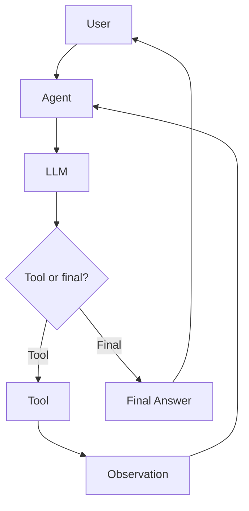
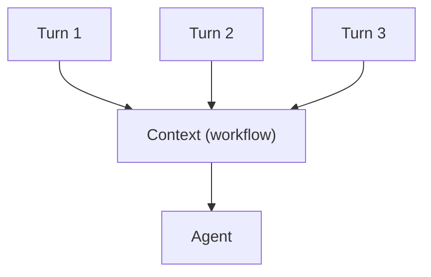

# Tutorial 04 — Agents: The Decision Loop

> **Companion to:** `../LlamaIndex.md` sections 34–46, 70–71.
> **Goal:** Build agents with `FunctionAgent`, `ReActAgent`, and `AgentWorkflow`; make them stateful with `Context`; observe their tool calls; and combine RAG + calculator tools into **agentic RAG**.

---

## 4.1 What an Agent Actually Is

An agent is not `LLM + Tools`. It is an **execution loop**:



LlamaIndex implements this loop as a `Workflow` under the hood. Every agent type is a different *control strategy* for "what the LLM is asked to produce":

```text
FunctionAgent → structured tool call (JSON)             ← function-calling models
ReActAgent    → free-text "Thought → Action → Answer"   ← any chat model
CodeActAgent  → emits code as its "action"
```

> They are different control strategies, not different kinds of intelligence.

---

## 4.2 FunctionAgent — The Modern Default

```python
# Both import paths work:
from llama_index.core.agent import FunctionAgent
# from llama_index.core.agent.workflow import FunctionAgent
from llama_index.core import Settings


def multiply(a: float, b: float) -> float:
    """Multiply two numbers. Use for any multiplication request."""
    return a * b


def add(a: float, b: float) -> float:
    """Add two numbers. Use for any addition request."""
    return a + b


agent = FunctionAgent(
    tools=[multiply, add],        # plain functions are auto-wrapped
    llm=Settings.llm,             # Ollama llama3.1 from Tutorial 01
    system_prompt="You are a helpful assistant that performs math.",
)

response = await agent.run(user_msg="What is 12 * 7?")
print(str(response))
```

Because `Settings.llm` is our Ollama function-calling model, the agent quite literally:

1. sends the user message + the two JSON tool schemas,
2. gets back a **structured tool call** (`multiply`, `{"a": 12, "b": 7}`),
3. executes the tool,
4. feeds the observation back,
5. returns the final answer.

> `FunctionAgent` requires `llm.metadata.is_function_calling_model == True`. If you set that wrongly on a model without tool support, you'll see nonsense — fix the flag or use `ReActAgent`.

---

## 4.3 ReActAgent — Reasoning Before Acting

For models without a function-calling API:

```python
from llama_index.core.agent import ReActAgent

agent = ReActAgent(
    tools=[multiply, add],
    llm=Settings.llm,
    system_prompt="You are a helpful assistant.",
)

response = await agent.run(user_msg="What is 12 * 7?")
print(str(response))
```

ReAct produces an explicit reasoning trace:

```text
Thought: I need to multiply 12 and 7.
Action: multiply
Action Input: {"a": 12, "b": 7}
Observation: 84
Thought: I now know the answer.
Answer: 84
```

This is the same loop **we built from scratch** in the earlier curriculum — `Tool` → named action → parse → observe. LlamaIndex just formalizes the parse.

| Property | FunctionAgent | ReActAgent |
| --- | --- | --- |
| Tool calls | Structured JSON | Free-text actions |
| Parsing | Trivial (model-native) | Regex/LLM-based |
| Model requirement | Function calling API | Any chat model |
| Typical use | Modern model APIs | Broad-compat models |
| Reliability | Higher | Fragile on long chains |

---

## 4.4 AgentWorkflow — The Workflow-First Wrapper

`AgentWorkflow` wraps one or more agents. The convenience constructor picks the right agent type for your LLM automatically:

```python
from llama_index.core.agent import AgentWorkflow

workflow = AgentWorkflow.from_tools_or_functions(
    [multiply, add],
    llm=Settings.llm,
    system_prompt="You are a helpful assistant that performs math.",
)

response = await workflow.run(user_msg="What is 12 * 7?")
print(str(response))
```

> `from_tools_or_functions` chooses `FunctionAgent` when the LLM supports function calling, else `ReActAgent`. This is one call to remember — it's the entry point used across the new docs.

---

## 4.5 Observing the Loop — Streaming Events

Every agent streams structured events (they are workflows, after all):

```python
from llama_index.core.agent.workflow import (
    AgentStream,
    ToolCall,
    ToolCallResult,
)

handler = workflow.run(user_msg="Compute (12 * 7) + 3.")

async for event in handler.stream_events():
    if isinstance(event, ToolCall):
        print(f"CALL  {event.tool_name}({event.tool_kwargs})")
    elif isinstance(event, ToolCallResult):
        print(f"RESULT {event.tool_name} -> {event.tool_output}")
    elif isinstance(event, AgentStream):
        print(event.delta, end="", flush=True)
```

You get, in order: which tool was chosen, with what arguments, and what it returned. That is the *behavior trace* you need for debugging (and what observability tools consume — see Tutorial 06).

---

## 4.6 State — The `Context` Object

**Agents are stateless by default.** Two `run()` calls do not remember each other:

```python
await workflow.run(user_msg="My name is Alice.")      # forgotten
await workflow.run(user_msg="What is my name?")       # "I don't know"
```

To make a conversation stateful, reuse a `Context` across runs:

```python
from llama_index.core.workflow import Context

ctx = Context(workflow)                                 # context belongs to the workflow

await workflow.run(user_msg="My name is Alice.", ctx=ctx)
await workflow.run(user_msg="What is my name?", ctx=ctx)  # remembers Alice
```

Why it works: the workflow stores chat **memory** inside the context, and tool-call results accumulate there too. The loop now looks like:



### Reading and writing state

The current agent shares a state dictionary through the context's store:

```python
state = await ctx.store.get("state")       # dict
await ctx.store.set("state", {**state, "name": "Alice"})
```

Inside a **tool**, use the `edit_state` context manager (this is how agents persist data across a run and across turns):

```python
from llama_index.core.workflow import Context


async def remember(ctx: Context, name: str) -> str:
    """Remember the user's name for later."""
    async with ctx.store.edit_state() as agent_state:
        agent_state["state"]["user_name"] = name
    return f"Remembered {name}."


agent = FunctionAgent(
    tools=[remember],      # FunctionTool auto-detects the ctx param
    llm=Settings.llm,
)
```

> The recommended current idiom — use `edit_state()` / `ctx.store` rather than the older `get_state()/set_state()` on the context.

---

## 4.7 Multi-Agent: AgentWorkflow with Handoffs

Give each agent a `name`, a `description`, and a `can_handoff_to` list. The framework injects a `handoff` tool automatically:

```python
from llama_index.core.agent import AgentWorkflow, FunctionAgent

researcher = FunctionAgent(
    name="ResearchAgent",
    description="Researches topics and writes notes.",
    system_prompt="You are a researcher. Hand off to WriteAgent when research is done.",
    llm=Settings.llm,
    tools=[search_knowledge],          # your tools
    can_handoff_to=["WriteAgent"],
)

writer = FunctionAgent(
    name="WriteAgent",
    description="Writes a markdown report from notes.",
    system_prompt="You are a writer.",
    llm=Settings.llm,
    tools=[write_report],
    can_handoff_to=["ResearchAgent"],
)

team = AgentWorkflow(
    agents=[researcher, writer],
    root_agent="ResearchAgent",                     # name (string), not the object
    initial_state={"research_notes": [], "report": "Not written yet."},
)

response = await team.run(user_msg="Research agentic RAG and write me a report.")
print(str(response))
```

Flow: ResearchAgent calls tools → hands off to WriteAgent via the `handoff` tool → WriteAgent writes → workflow ends. The handoff tool is `return_direct=True`, but it does **not** stop the workflow — it switches `current_agent_name` and the loop continues.

> **Guardrails:** unknown agent name or a non-permitted handoff target returns an error ToolOutput rather than silently switching. `"handoff"` is reserved; you cannot use it as a real tool name.

---

## 4.8 Agentic RAG — The Agent Decides When to Retrieve

Combine a calculator tool and a `QueryEngineTool` in one agent:

```python
from llama_index.core.tools import QueryEngineTool
from llama_index.core.agent import AgentWorkflow

agent = AgentWorkflow.from_tools_or_functions(
    [multiply, add, knowledge_tool],       # knowledge_tool = QueryEngineTool from Tutorial 03
    llm=Settings.llm,
    system_prompt="Answer from the knowledge base when relevant; use math tools for calculations.",
)
```

Ask a math question and a knowledge question:

```python
r1 = await agent.run(user_msg="What is 123 * 456?")            # uses multiply
print(r1)
r2 = await agent.run(user_msg="What is an AI agent, per my documents?")  # uses knowledge_tool
print(r2)
```

That division of labor — the LLM choosing between grounded retrieval and a computation — is the entire point of **agentic RAG**:

```text
Traditional RAG:
  question → always retrieve → LLM → answer

Agentic RAG:
  question → agent → decide "do I need my knowledge base?" → call QueryEngineTool → observe → answer
```

---

## 4.9 Structured Output from Agents

Ask the agent to return a Pydantic object instead of prose:

```python
from llama_index.core.bridge.pydantic import BaseModel


class Answer(BaseModel):
    value: float
    reasoning: str


agent = FunctionAgent(tools=[multiply], llm=Settings.llm, output_cls=Answer)

response = await agent.run(user_msg="What is 12 * 7?")
print(response)
print(response.get_pydantic_model(Answer))   # -> Answer(value=84.0, reasoning=...)
```

> With local Ollama models, structured output benefits from `json_mode=True` or low temperature in your `Ollama(...)` config (Tutorial 01).

---

## 4.10 Errors, Iteration Limits, Streaming Control

- **Default max iterations:** 20. Override per run: `await agent.run(user_msg="...", max_iterations=10)`.
- **`early_stopping_method`:** `"force"` (default, raises a `WorkflowRuntimeError`) or `"generate"` (one final LLM call producing a best-effort summary).
- **Tool errors:** exceptions become `ToolOutput(is_error=True, exception=e)` fed back to the model — the agent can read the error and retry.
- **Streaming:** agents stream by default; set `streaming=False` if your local model's streaming misbehaves.
- **Async only:** everything is `await`-based (`agent.run`, `workflow.run`). In a notebook, just make the cell `async def main(): ...` and `await main()`, or use `asyncio.run(...)` in a script.

**Ollama-specific tips:** prefer `qwen3`/`llama3.1`/`llama3.3` for reliable local tool calling; keep `temperature` low (0.1–0.2); set `context_window` explicitly; call `pip install -U llama-index-llms-ollama` if tool calls arrive broken.

---

## 4.11 Exercises

1. **First agent:** Build a `FunctionAgent` with `add`, `multiply`, `subtract` tools. Ask it 5 different questions and record (question, chosen tool, arguments, result) — spot when the Model picks the wrong tool.
2. **Effect of descriptions:** Create two versions of a math tool — one with `description="Math tool"` and one with a detailed description. Compare tool-choice accuracy on the same 5 questions.
3. **Stateful conversation:** Use `Context(workflow)` and run 3 turns: introduce yourself, ask to remember a fact, ask "what's my fact?". Repeat **without** the context and compare.
4. **Observe the loop:** Stream `ToolCall`/`ToolCallResult`/`AgentStream` events for the agentic RAG agent and write down the exact sequence.
5. **Structured output:** Build the `Answer` Pydantic model agent from §4.9 and print `get_pydantic_model`.

---

## 4.12 Wrapping Up

```text
FunctionAgent / ReActAgent = the decision loop (a Workflow internally)
AgentWorkflow  = one runner for one or many agents, with handoffs
Context         = the state bucket that makes agents conversational
stream_events   = the observability window into the loop
QueryEngineTool = how RAG becomes an agent capability  ← agentic RAG
```

Next tutorial zooms out: when you need **explicit** control flow around the agent — branching, loops, joins, human approval — you use `Workflow` directly.

---

## References

- Building agents: <https://developers.llamaindex.ai/python/framework/understanding/agent>
- Multi-agent: <https://developers.llamaindex.ai/python/framework/understanding/agent/multi_agent>
- State: <https://developers.llamaindex.ai/python/framework/understanding/agent/state>
- Streaming events: <https://developers.llamaindex.ai/python/framework/understanding/agent/streaming>
- Chat engines: <https://developers.llamaindex.ai/python/framework/module_guides/deploying/chat_engines/usage_pattern>