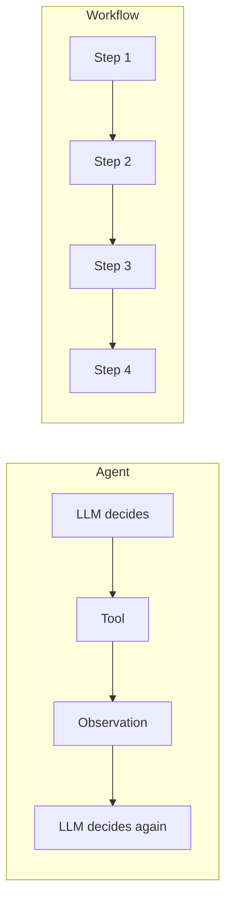
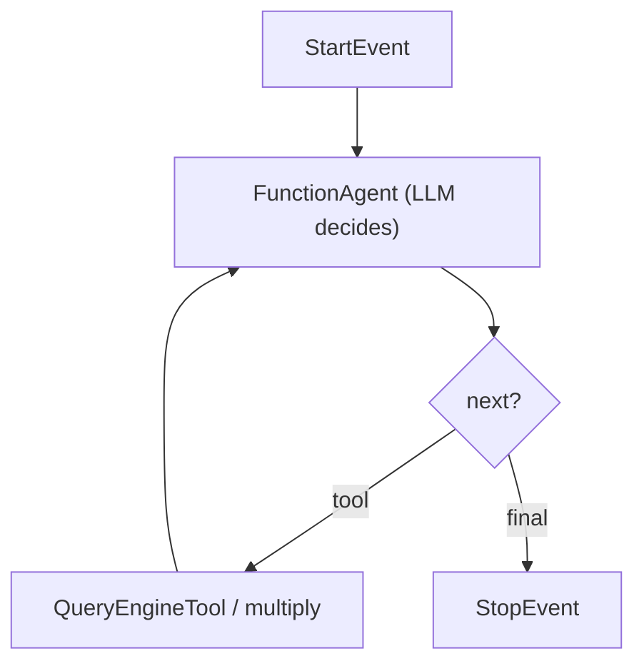

# Tutorial 05 — Workflows: Explicit Control Flow

> **Companion to:** `../LlamaIndex.md` sections 47–57, 72–74.
> **Goal:** Master the `Workflow` engine — steps, events, branching, loops, joins, shared state (Context), human-in-the-loop, and how to embed an *agent* inside a workflow.

---

## 5.1 Agent vs Workflow

```text
Agent:      "What should I do next?"        → dynamic, LLM decides
Workflow:   "I know the shape of this run." → explicit, orchestrated
```



The interesting engineering is combining them: keep the *shape* fixed (workflow), let the *decisions inside* be dynamic (agent).

---

## 5.2 The Core API

```python
from llama_index.core.workflow import (
    Workflow,
    Event,
    StartEvent,
    StopEvent,
    step,
)
```

The rules:

- A **`Workflow`** subclass owns a set of `@step` methods.
- Each step receives one **`Event`** and returns one or more events.
- `StartEvent` lands on a step annotated to receive it; execution flows through the events you return.
- Type hints **define the graph** — the workflow engine wires steps based on event types.

### Minimal workflow

```python
class HelloWorkflow(Workflow):
    @step
    async def hello(self, ev: StartEvent) -> StopEvent:
        return StopEvent(result="Hello from a LlamaIndex Workflow!")


workflow = HelloWorkflow()
result = await workflow.run()
print(str(result))      # event.result
```

### Two-step workflow with a custom event

```python
class ProcessingEvent(Event):
    intermediate: str


class MyWorkflow(Workflow):
    @step
    async def step_one(self, ev: StartEvent) -> ProcessingEvent:
        return ProcessingEvent(intermediate="step 1 done")

    @step
    async def step_two(self, ev: ProcessingEvent) -> StopEvent:
        return StopEvent(result=f"Finished: {ev.intermediate}")


result = await MyWorkflow().run()
print(str(result))      # Finished: step 1 done
```

Pass input data through `StartEvent` fields:

```python
class ProcessingEvent(Event):
    value: int


class DoubleWorkflow(Workflow):
    @step
    async def double(self, ev: StartEvent) -> ProcessingEvent:
        return ProcessingEvent(value=ev.number * 2)

    @step
    async def format(self, ev: ProcessingEvent) -> StopEvent:
        return StopEvent(result=f"Doubled = {ev.value}")


result = await DoubleWorkflow().run(number=21)   # Doubled = 42
```

The event payload is what carries information between steps:

```text
StartEvent(number=21)
   ↓
step_one → ProcessingEvent(value=42)
   ↓
step_two → StopEvent(result="Doubled = 42")
```

---

## 5.3 Branches — Sending Events to Different Steps

Instead of returning, send events explicitly with `ev.send_event(...)`:

```python
class BranchSignals(Event):
    number: int


class BranchWorkflow(Workflow):
    @step
    async def decide(self, ev: StartEvent) -> BranchSignals:
        if ev.number > 10:
            ev.send_event(BranchSignals(number=ev.number))
        else:
            ev.send_event(BranchSignals(number=ev.number))

        return None   # no direct event returned; send_event did the routing

    @step
    async def big_path(self, ev: BranchSignals) -> StopEvent:
        return StopEvent(result=f"big: {ev.number}")

    @step
    async def small_path(self, ev: BranchSignals) -> StopEvent:
        return StopEvent(result=f"small: {ev.number}")
```

How the branching works: `decide` broadcasts a `BranchSignals` event; *both* listeners (`big_path`, `small_path`) receive it. To enforce a real conditional, filter inside the receiving steps:

```python
@step
async def big_path(self, ev: BranchSignals) -> StopEvent | None:
    if ev.number > 10:
        return StopEvent(result=f"big: {ev.number}")
    return None          # ignore events that aren't for this branch

@step
async def small_path(self, ev: BranchSignals) -> StopEvent | None:
    if ev.number <= 10:
        return StopEvent(result=f"small: {ev.number}")
    return None
```

> Tip: use `@step(num_workers=N)` for steps that must handle many events concurrently instead of serializing them.

---

## 5.4 Loops — Re-Sending Events

A workflow loops by sending an event back to an earlier step:

```python
class LoopWorkflow(Workflow):
    @step
    async def count_till_stop(self, ev: StartEvent) -> StopEvent:
        counter = ev.current
        if counter >= ev.target:
            return StopEvent(result=f"reached {counter}")
        return LoopEvent(current=counter + 1)
```

With a `LoopEvent(Event)` carrying `current`, the workflow re-enters until `current == target`. (Beware of infinite loops — always have a terminating branch.)

---

## 5.5 Joins — Waiting for Multiple Events

Fan-out + gather is the most common real pattern: run two steps in parallel, then combine.

```python
class VecStack(Event):
    vec: int
    direction: str   # "a" or "b"


class SumWorkflow(Workflow):
    @step
    async def generate_a(self, ev: StartEvent) -> VecStack:
        return VecStack(vec=ev.value * 2, direction="a")

    @step
    async def generate_b(self, ev: StartEvent) -> VecStack:
        return VecStack(vec=ev.value * 3, direction="b")

    @step(num_workers=4)
    async def combine(self, ev: VecStack) -> StopEvent:
        ready = ev.collect_events(generate_a, generate_b)
        if ready is None:
            return None   # not all inputs arrived yet

        total = sum(e.vec for e in ready)
        return StopEvent(result=f"total = {total}")
```

- `ev.collect_events(step_fn_a, step_fn_b)` returns `None` **until all** have fired once, then returns the collected event list.
- The receiving step must allow `None` returns (so it can "wait").
- Set `num_workers` so parallel sends don't serialize.

---

## 5.6 Shared State — `Context` and `ctx.data`

Events carry data between steps; `Context` carries data **across the whole workflow** (and across repeated `run()` calls):

```python
class ServerWorkflow(Workflow):
    @step
    async def set_host(self, ev: StartEvent) -> StopEvent:
        self.ctx.data["hostname"] = ev.hostname   # self.ctx is the run's Context
        return StopEvent(result="host set")

    @step
    async def get_host(self, ev: StartEvent) -> StopEvent:
        return StopEvent(result=self.ctx.data.get("hostname", "unknown"))
```

Shared state survives between runs if you reuse the Context:

```python
ctx = Context(workflow)
await workflow.run(ctx=ctx, hostname="server-01")
await workflow.run(ctx=ctx)            # still knows server-01
```

For complex mutable data, `ctx.data` is a dict you can read/write freely (regular dict, no event requirement). Agents use the same machinery — remember `ctx.store` from Tutorial 04.

---

## 5.7 Graph Visualization

Since type hints define the graph, LlamaIndex can draw it:

```python
from llama_index.core.workflow import draw_all_possible_flows

draw_all_possible_flows(SumWorkflow, filename="sum_workflow.png")   # requires graphviz installed
```

Useful for checking that branches/loops/joins are wired as intended.

---

## 5.8 Human-in-the-Loop

The workflow can pause and wait for a human decision. Define custom input/response events and re-raise a "waiting" exception to block until the human answers:

```python
import asyncio
from llama_index.core.workflow import Context, InputRequiredEvent, HumanResponseEvent


class AgentTeamWorkflow(Workflow):
    @step
    async def verify(self, ev: StartEvent, ctx: Context) -> StopEvent:
        ctx.send_event(InputRequiredEvent(prefix="Should we publish? "))
        response = ctx.wait_for_event(HumanResponseEvent, default=PublishOverride(timeout=None))
        if response is None:
            # timed out / no human
            return StopEvent(result="published")
        if response.response.lower().startswith("y"):
            return StopEvent(result="published")
        return StopEvent(result="aborted by human")
```

The workflow's `.run()` returns a partial result, and the **loop you write** re-invokes it when the human answers (`HumanResponseEvent` → create a new `Context.from_events(...)`). This is precisely how the `FunctionAgent` HITL / tool-callback pattern from Tutorial 03 is implemented under the hood.

> Human-in-the-loop is where workflows earn their keep: the branch point is **not** delegated to an LLM; a human decides.

---

## 5.9 Nesting Workflows and Embedding Agents

A step can run another workflow as easily as calling a function:

```python
class OuterWorkflow(Workflow):
    @step
    async def run_inner(self, ev: StartEvent) -> StopEvent:
        inner = InnerWorkflow(verbose=True)
        result = await inner.run(x=ev.x)
        return StopEvent(result=f"inner said: {result}")
```

And the agent you built in Tutorial 04 is itself a workflow — put it *inside* another workflow:

```python
from llama_index.core.agent import FunctionAgent

class OrchestratorWorkflow(Workflow):
    def __init__(self, llm, **kwargs):
        super().__init__(**kwargs)
        self.agent = FunctionAgent(
            tools=[multiply, knowledge_tool],
            llm=llm,
            system_prompt="Answer against the knowledge base; use math tools when needed.",
        )

    @step
    async def route_and_run(self, ev: StartEvent) -> StopEvent:
        # Explicit structure; dynamic decision inside
        response = await self.agent.run(user_msg=ev.query)
        return StopEvent(result=str(response))
```



This is the **hybrid pattern** the whole curriculum points to:

```text
Workflow (explicit skeleton)
   ↓
Agent (dynamic decisions)
   ↓
Tools + RAG (capabilities)
   ↓
Workflow continues
```

---

## 5.10 Exercises

1. **Hello workflow:** Build the minimal workflow from §5.2 and pass a value through `StartEvent`.
2. **Branch:** Recreate the `branching` example with `number > 10`; print which path ran. Draw the graph.
3. **Loop:** Write a counter workflow that loops from 0 to `target` by re-sending an event; enforce a max iteration in the event payload.
4. **Join:** Build the `generate_a` / `generate_b` / `combine` workflow using `collect_events` and `num_workers`.
5. **State:** Build a workflow where one step stores into `ctx.data` and a later step reads it; run twice reusing a `Context`.
6. **Failure recovery:** Add a `Verify` step between `Retrieve` and `Answer` that re-sends a `RetryRequest` event back to `Retrieve` (see `LlamaIndex.md` §72), with an iteration cap.

---

## 5.11 Wrapping Up

```text
Workflow = explicit, inspectable control flow
Agent    = dynamic, LLM-driven control flow
Event    = the message contract between steps
Context  = mutable state across the whole run (and across runs)
collect_events = join points (fan-out → gather)
send_event     = branch points and loops
HumanResponseEvent = decision points owned by people, not LLMs
```

Now the series converges: Tutorial 06 builds one **end-to-end agentic RAG project** that uses everything — RAG, tools, agents, workflows, persistence, evaluation, and observability — with your local Ollama stack.

---

## References

- Workflows intro: [https://developers.llamaindex.ai/python/framework/module_guides/workflows](https://developers.llamaindex.ai/python/framework/module_guides/workflows)
- Workflows detailed: [https://developers.llamaindex.ai/python/framework/workflows/basic_workflow](https://developers.llamaindex.ai/python/framework/workflows/basic_workflow)
- Branches/loops/joins: [https://developers.llamaindex.ai/python/framework/workflows/branching_workflow](https://developers.llamaindex.ai/python/framework/workflows/branching_workflow)
- Human in the loop: [https://developers.llamaindex.ai/python/framework/workflows/human_in_the_loop](https://developers.llamaindex.ai/python/framework/workflows/human_in_the_loop)
