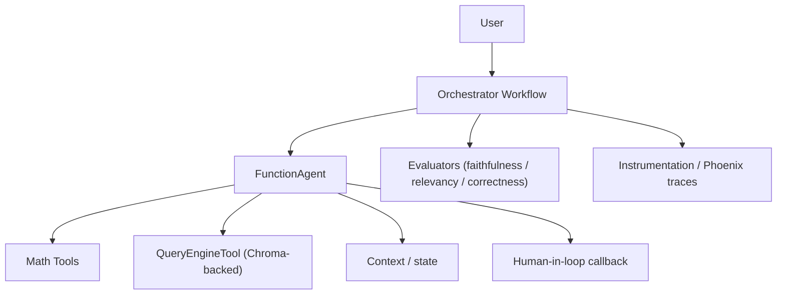

# Tutorial 06 — End-to-End Project: Local Agentic RAG with Evaluation

> **Companion to:** `../LlamaIndex.md` sections 58–85.
> **Goal:** Combine everything — RAG pipeline, tools, agent, workflow, persistence, state, evaluation, observability — into one self-contained project that runs **100% locally** on Ollama.

---

## 6.1 What We Build



The system answers from a local knowledge base *and* computes, decides retrieval itself, remembers the conversation, asks a human for approval at a critical step, logs everything, and measures its own answer quality.

---

## 6.2 Project Layout

```text
llamaindex-lab/
├── .venv/
├── data/
│   ├── agents.md
│   ├── tools.md
│   └── workflows.md
├── src/
│   ├── __init__.py
│   ├── settings.py      # Settings wired to Ollama
│   ├── model.py         # LLM + embedding builders
│   ├── index.py         # build / load the vector index (Chroma)
│   ├── tools.py         # FunctionTools + QueryEngineTool
│   ├── agent.py         # FunctionAgent + AgentWorkflow
│   ├── workflow.py      # Orchestrator workflow
│   └── eval.py          # evaluation harness
├── chroma_db/           # persisted index (gitignore me)
├── main.py              # CLI entry point
└── requirements.txt
```

---

## 6.3 Configuration + Models (`src/settings.py`)

```python
from llama_index.core import Settings
from llama_index.llms.ollama import Ollama
from llama_index.embeddings.ollama import OllamaEmbedding

Settings.llm = Ollama(
    model="llama3.1",            # or "qwen3" for most reliable local tool-calling
    request_timeout=360.0,
    context_window=8000,
    temperature=0.1,
    is_function_calling_model=True,
)

Settings.embed_model = OllamaEmbedding(
    model_name="nomic-embed-text",     # 768 dims
    base_url="http://localhost:11434",
)

Settings.context_window = 8000
Settings.num_output = 512
```

> Every script in the project starts with `from src.settings import Settings` — one place to swap models.

---

## 6.4 The Index (`src/index.py`)

Build once, load forever (no re-embedding):

```python
import chromadb
from llama_index.core import VectorStoreIndex, SimpleDirectoryReader
from llama_index.core import StorageContext
from llama_index.core.node_parser import SentenceSplitter
from llama_index.vector_stores.chroma import ChromaVectorStore


def build_index(data_dir: str = "./data", persist_dir: str = "./chroma_db"):
    documents = SimpleDirectoryReader(input_dir=data_dir).load_data()

    db = chromadb.PersistentClient(path=persist_dir)
    collection = db.get_or_create_collection("agent_kb")
    vector_store = ChromaVectorStore(chroma_collection=collection)
    storage_context = StorageContext.from_defaults(vector_store=vector_store)

    index = VectorStoreIndex.from_documents(
        documents,
        storage_context=storage_context,
        transformations=[
            SentenceSplitter(chunk_size=512, chunk_overlap=50),
        ],
    )
    return index


def load_index(persist_dir: str = "./chroma_db") -> VectorStoreIndex:
    """No re-embedding: vectors are already stored on disk."""
    db = chromadb.PersistentClient(path=persist_dir)
    collection = db.get_or_create_collection("agent_kb")
    vector_store = ChromaVectorStore(chroma_collection=collection)
    return VectorStoreIndex.from_vector_store(vector_store)
```

Build it once:

```bash
python -c "from src.index import build_index; build_index()"
```

---

## 6.5 Tools (`src/tools.py`)

Math tools + the RAG tool:

```python
from llama_index.core.tools import FunctionTool, QueryEngineTool


def multiply(a: float, b: float) -> float:
    """Multiply two numbers. Use for any multiplication request."""
    return a * b


def add(a: float, b: float) -> float:
    """Add two numbers. Use for any addition request."""
    return a + b


def divide(a: float, b: float) -> float:
    """Divide two numbers. Raises on division by zero."""
    if b == 0:
        raise ValueError("Cannot divide by zero — ask the user for a non-zero divisor.")
    return a / b


def make_agent_tools(index) -> list:
    query_engine = index.as_query_engine(
        similarity_top_k=3,
        response_mode="compact",
    )
    knowledge_tool = QueryEngineTool.from_defaults(
        query_engine=query_engine,
        name="knowledge_base",
        description=(
            "Search the local knowledge base about AI agents, tools, "
            "workflows, RAG, and LlamaIndex. Use whenever the answer "
            "might be grounded in the indexed documents."
        ),
    )
    return [
        FunctionTool.from_defaults(multiply),
        FunctionTool.from_defaults(add),
        FunctionTool.from_defaults(divide),
        knowledge_tool,
    ]
```

---

## 6.6 The Agent (`src/agent.py`)

Stateful agent capable of **agentic RAG** (chooses between math and retrieval):

```python
from llama_index.core.agent import AgentWorkflow
from llama_index.core.workflow import Context


async def build_agent(tools: list) -> AgentWorkflow:
    return AgentWorkflow.from_tools_or_functions(
        tools,
        llm=Settings.llm,
        system_prompt=(
            "You are a helpful assistant. Use the knowledge_base tool when "
            "an answer should be grounded in the documents. Use math tools "
            "for arithmetic. Be concise and cite the tool you used."
        ),
    )


async def chat(agent, user_msg: str, ctx: Context | None = None):
    response = await agent.run(user_msg=user_msg, ctx=ctx)
    return str(response)
```

Reuse a single `Context` for multi-turn memory:

```python
from src.agent import build_agent, chat
from src.index import load_index
from src.tools import make_agent_tools
from src.settings import Settings
from llama_index.core.workflow import Context

agent = await build_agent(make_agent_tools(load_index()))
ctx = Context(agent)

await chat(agent, "My project is called 'Agent Systems'.", ctx)
await chat(agent, "What is my project called?", ctx)   # remembers
await chat(agent, "What is 123 * 456?", ctx)           # calculator path
await chat(agent, "What is an AI agent, per my documents?", ctx)  # RAG path
```

---

## 6.7 Orchestrator Workflow (`src/workflow.py`)

Wrap the agent in an explicit skeleton with a **human-approval checkpoint**:

```python
from llama_index.core.workflow import (
    Workflow,
    Event,
    StartEvent,
    StopEvent,
    step,
    Context,
    InputRequiredEvent,
    HumanResponseEvent,
)


class ApprovalRequest(Event):
    """Sent to the human-approval branch when user action is risky."""
    query: str


class AgentOrchestrator(Workflow):
    def __init__(self, agent, approval_words=("publish", "send", "approve"), **kwargs):
        super().__init__(**kwargs)
        self.agent = agent
        self.approval_words = approval_words

    @step
    async def run_agent(self, ev: StartEvent) -> StopEvent | None:
        msg = ev.query
        response = str(await self.agent.run(user_msg=msg, ctx=ev.ctx))

        if any(word in msg.lower() for word in self.approval_words):
            ev.send_event(ApprovalRequest(query=f"{msg}\n\nAgent response: {response}"))
            return None              # branch to ask_human
        return StopEvent(result=response)

    @step(num_workers=2)
    async def ask_human(self, ev: ApprovalRequest, ctx: Context) -> StopEvent:
        ctx.send_event(InputRequiredEvent(prefix=f"Approve this action? {ev.query} (y/n): "))
        decision = ctx.wait_for_event(HumanResponseEvent)
        if decision and decision.response.strip().lower().startswith("y"):
            return StopEvent(result="Approved and completed by human.")
        return StopEvent(result="Cancelled by human.")
```

> This is the hybrid pattern: the two-stage skeleton is explicit (run → approve), but within `run_agent` the **LLM decides** which tools to call. The human owns the risky branch, not the model.

---

## 6.8 Observability

One-liner wiring before anything else runs:

```python
# pip install arize-phoenix
import llama_index.core
llama_index.core.set_global_handler("arize_phoenix")
# Phoenix UI at http://localhost:6006 — every LLM call, retrieval, and tool
# invocation is traced automatically.
```

Free, local, zero-config. Alternative for eval + tracing in one UI:

```python
# pip install opik llama-index-callbacks-opik
from llama_index.core import set_global_handler
set_global_handler("opik")
```

Or DIY with handler events (e.g. a `TokenCountingHandler`) on `Settings.callback_manager` for token budgets.

---

## 6.9 Evaluation (`src/eval.py`)

Score the three dimensions from `LlamaIndex.md` §58–62:

```python
import asyncio
from llama_index.core.evaluation import (
    FaithfulnessEvaluator,
    RelevancyEvaluator,
    CorrectnessEvaluator,
    BatchEvalRunner,
)
from llama_index.core import Settings


def evaluate(query_engine, queries, references=None):
    faithfulness = FaithfulnessEvaluator(llm=Settings.llm)
    relevancy = RelevancyEvaluator(llm=Settings.llm)
    correctness = CorrectnessEvaluator(llm=Settings.llm)

    runner = BatchEvalRunner(
        {
            "faithfulness": faithfulness,
            "relevancy": relevancy,
            "correctness": correctness,
        },
        workers=4,
    )

    kwargs = {}
    if references:
        kwargs["reference"] = references

    results = asyncio.run(
        runner.aevaluate_queries(query_engine, queries=queries, **kwargs)
    )
    return results
```

Run it:

```python
from src.eval import evaluate
from src.index import load_index

qe = load_index().as_query_engine()
queries = [
    "What is an AI agent?",
    "What does an agent need in order to use tools?",
    "How do workflows differ from agents?",
]
results = evaluate(qe, queries)
for name, res in results.items():
    for r in res:
        print(name, r.passing, r.score)
```

What the numbers mean:

```text
faithfulness → is the answer supported by retrieved context? (hallucination guard)
relevancy    → did the answer actually address the question?
correctness  → 1–5 vs a reference answer (pass ≥ 4.0)
```

---

## 6.10 CLI (`main.py`)

```python
import asyncio
from src.agent import chat
from src.index import load_index
from src.tools import make_agent_tools
from src.settings import Settings
from llama_index.core.agent import AgentWorkflow
from llama_index.core.workflow import Context


async def main():
    agent = AgentWorkflow.from_tools_or_functions(
        make_agent_tools(load_index()),
        llm=Settings.llm,
        system_prompt="Be concise; use tools when needed.",
    )
    ctx = Context(agent)
    print("Ask anything ('exit' to quit).")
    while True:
        msg = input("> ")
        if msg.strip().lower() in {"exit", "quit"}:
            break
        print(str(await agent.run(user_msg=msg, ctx=ctx)))


if __name__ == "__main__":
    asyncio.run(main())
```

```bash
python main.py
```

---

## 6.11 Putting It All Together — What You Should Be Able to Say

On a single running Ollama server you now produce:

1. **RAG:** index → retrieve → synthesize (Tutorial 02)
2. **Tool abstraction:** schema/name/description design (Tutorial 03)
3. **Agent loop:** structured tool calls, streaming events, stateful `Context` (Tutorial 04)
4. **Explicit control:** orchestrator workflow with human checkpoint (Tutorial 05)
5. **Quality:** faithfulness / relevancy / correctness scores (this tutorial)
6. **Observability:** traces of every LLM + tool call (this tutorial)

And — most importantly — you could explain **how each piece works underneath**, because you replaced OpenAI with local Ollama, disabled nothing, and watched every layer.

---

## 6.12 Exercises

1. **Cold-start test:** Wipe `./chroma_db`, rebuild, and time `build_index()` vs `load_index()`. The load path should be near-instant (no embeddings).
2. **Budget tracking:** Add a `TokenCountingHandler` to `Settings.callback_manager` and report tokens spent per conversation in the CLI.
3. **Regress on prompts:** Change the `knowledge_base` tool description and re-run the evaluation harness; compare faithfulness before/after.
4. **Multi-agent upgrade:** Replace the single `AgentWorkflow` with a `ResearchAgent` + `WriteAgent` team (Tutorial 04 §4.7) and have the orchestrator delegate.
5. **HITL testbed:** Ask the CLI to "publish the answer" and confirm you get asked for approval before the workflow completes.
6. **Next step — internal mechanics:** Pick `FunctionTool`, and implement a lookup that *prints the exact JSON schema* the model receives (`metadata.to_openai_tool()`). Diff it against what you wrote from scratch in the earlier curriculum.

---

## References

- Curated path: this tutorial series and `../LlamaIndex.md`
- Evaluation: [https://developers.llamaindex.ai/python/framework/module_guides/evaluating/usage_pattern](https://developers.llamaindex.ai/python/framework/module_guides/evaluating/usage_pattern)
- Observability: [https://developers.llamaindex.ai/python/framework/module_guides/observability](https://developers.llamaindex.ai/python/framework/module_guides/observability)
- Multi-agent: [https://developers.llamaindex.ai/python/framework/understanding/agent/multi_agent](https://developers.llamaindex.ai/python/framework/understanding/agent/multi_agent)
- Local starter: [https://developers.llamaindex.ai/python/framework/getting_started/starter_example_local](https://developers.llamaindex.ai/python/framework/getting_started/starter_example_local)
