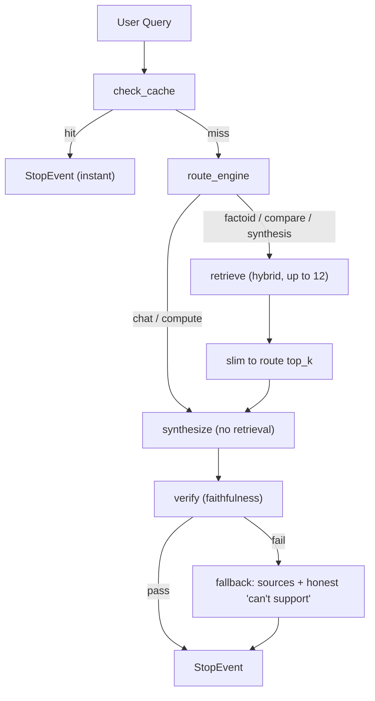

# Tutorial 07 — Adaptive Routing: Route → Retrieve → Rerank → Verify → Synthesize

> **Companion to:** Tutorials 01–06 (the full stack you built) and the "Adaptive System" design brief.
> **Goal:** Build a system that **adapts to the query and the data** — choosing per request whether to retrieve, how much to retrieve, how to rerank, and how to synthesize — while enforcing a **grounded-or-don't-answer** guarantee, a **query cache** for speed, and a **faithfulness gate** for accuracy. Runs 100% locally on Ollama.

---

## 7.1 What "Adaptive" Buys Us

A fixed pipeline treats every question the same way: always retrieve, always the same top_k, always one response mode, always full latency. That is slow when it should be instant, and shallow when it should be deep.

```text
Fixed:    query → retrieve(5) → synthesize(compact) → answer     [same cost for everything]
Adaptive: query → route → {skip retrieval OR top_k∈{3,6,8} OR compute OR chat}
                      → {rerank?} → synthesize(route-specific) → verify(grounded?)
```

Biggest win first: **most real traffic is simple.** Routing lets those queries skip retrieval entirely and answer in one model call.

**The invariant this tutorial never breaks** (your no-hallucination rule):

> Every answer is either (a) grounded in cited retrieved nodes that passed a faithfulness check, or (b) an explicit "I couldn't find a supported answer" — with the sources shown. No invented facts. Ever.

---

## 7.2 Architecture



Events that carry data between steps:

```python
class CacheHit(Event):
    query: str
    results: tuple          # (text, sources)


class RouteEvent(Event):
    query: str
    route: Route
    need_retrieval: bool
    top_k: int
    response_mode: str


class RetrieveRequest(Event):
    query: str
    route: Route
    top_k: int
    response_mode: str


class SynthesizeRequest(Event):
    query: str
    route: Route
    response_mode: str
    nodes: list


class ResponseEvent(Event):
    query: str
    response: Response      # has .response text and .source_nodes
    route: Route
```

---

## 7.3 Project Layout (extends Tutorial 06)

```text
llamaindex-lab/
├── src/
│   ├── settings.py       # Ollama models (Tutorial 01)
│   ├── index.py          # Chroma index (Tutorial 06)
│   ├── adaptive.py       # ← NEW: routes, config, cache, workflow
│   └── eval.py           # evaluators (Tutorial 06)
├── main.py               # updated to run the adaptive workflow
└── data/
```

---

## 7.4 The Route Space

```python
from enum import Enum


class Route(str, Enum):
    FACT    = "factoid"      # short factual answer, shallow retrieval
    COMPARE = "compare"      # two+ things, need breadth
    SYNTH   = "synthesis"    # overview/analysis, need depth
    CHAT    = "chat"         # greeting/small talk, no retrieval
    COMPUTE = "compute"      # arithmetic (or a tool route, see 7.12)
```

Per-route policy — **this table is the adaptivity**:

```python
ROUTE_CONFIG = {
    Route.FACT:    {"need_retrieval": True,  "top_k": 3,  "response_mode": "compact"},
    Route.COMPARE: {"need_retrieval": True,  "top_k": 6,  "response_mode": "tree_summarize"},
    Route.SYNTH:   {"need_retrieval": True,  "top_k": 8,  "response_mode": "refine"},
    Route.CHAT:    {"need_retrieval": False, "top_k": 0,  "response_mode": "compact"},
    Route.COMPUTE: {"need_retrieval": False, "top_k": 0,  "response_mode": "compact"},
}
```

Explicit knobs so every adaptive choice is testable:

```python
from dataclasses import dataclass


@dataclass
class AdaptiveConfig:
    hybrid: bool = True       # dense + BM25 fusion
    rerank: bool = False      # LLMRerank (higher precision, more latency — measure first)
    cache: bool = True        # exact + semantic query cache
    verify: bool = True       # faithfulness gate
    router_model: str = "qwen3:4b"   # small, cheap router (or "llama3.2:3b")
```

> Toggling `hybrid=False` or `verify=False` gives you a **baseline** to measure against. Everything is an experiment, not a belief.

---

## 7.5 Step 1 — Query Caching (speed, zero quality loss)

```python
import math
import time
from llama_index.core import Settings


class QueryCache:
    """Exact + semantic cache. Semantic hit = cosine similarity >= threshold."""

    def __init__(self, threshold: float = 0.93):
        self.threshold = threshold
        self._items = {}          # key -> (text, sources, expires_at)
        self._embeddings = {}     # key -> embedding

    def _norm(self, query: str) -> str:
        return " ".join(query.lower().split())

    @staticmethod
    def _cosine(a: list, b: list) -> float:
        dot = sum(x * y for x, y in zip(a, b))
        na = math.sqrt(sum(x * x for x in a))
        nb = math.sqrt(sum(y * y for y in b))
        return dot / (na * nb) if na and nb else 0.0

    def get(self, query: str) -> tuple | None:
        """Return (text, sources) on hit, else None. A hit costs no LLM/tool call."""
        key = self._norm(query)
        item = self._items.get(key)
        if item and item[2] > time.time():
            return item[0], item[1]

        q_emb = Settings.embed_model.get_query_embedding(query)
        for other, emb in self._embeddings.items():
            item = self._items.get(other)
            if (
                item and item[2] > time.time()
                and self._cosine(q_emb, emb) >= self.threshold
            ):
                return item[0], item[1]
        return None

    def put(self, query: str, text: str, sources: list, ttl: float = 86400.0):
        key = self._norm(query)
        self._items[key] = (text, sources, time.time() + ttl)
        self._embeddings[key] = Settings.embed_model.get_query_embedding(query)
```

In the workflow, a cache hit short-circuits straight to `StopEvent` — the cheapest latency win for repeated and near-identical questions.

---

## 7.6 Step 2 — The Router (cheap model, JSON output)

The router is **not trusted with facts** — it only picks a pipeline. Its failure mode must default to the *grounded* path, never the free-form one.

```python
import json
from llama_index.core.llms import ChatMessage
from llama_index.llms.ollama import Ollama

ROUTER_PROMPT = """Classify the user query into EXACTLY one category.

- factoid: a short factual answer that exists in the user's documents
- compare: asks to compare or contrast two or more things
- synthesis: wants an overview, analysis, or explanation spanning topics
- compute: requires arithmetic or calculation
- chat: greeting, small talk, or a question that needs no knowledge

Respond with ONLY valid JSON: {"route": "<one of the five>", "reason": "<one line>"}

Query: {query}
"""


def make_router(model: str) -> Ollama:
    return Ollama(
        model=model,                       # e.g. "qwen3:4b" or "llama3.2:3b"
        json_mode=True,                    # forces valid JSON
        temperature=0.0,
        request_timeout=120.0,
        is_function_calling_model=False,   # we only need JSON, not tools
    )


def classify_route(query: str, router: Ollama) -> Route:
    msg = ChatMessage(role="user", content=ROUTER_PROMPT.format(query=query))
    try:
        out = str(router.chat([msg]).message.content)
        return Route(json.loads(out)["route"])
    except Exception:
        return Route.FACT      # safe default: grounded retrieval path
```

---

## 7.7 Step 3 — Adaptive Retrieval (build once, slim per route)

Build the **hybrid retriever once** with generous breadth (12 candidates), then slim it per route with cheap post-processors — so BM25 is never rebuilt per query:

```python
from llama_index.core import Settings
from llama_index.core.retrievers import QueryFusionRetriever
from llama_index.core.postprocessor import TopKNodePostprocessor, LLMRerank


def build_retriever(index, config: AdaptiveConfig):
    vector_retriever = index.as_retriever(similarity_top_k=12)

    if config.hybrid:
        from llama_index.retrievers.bm25 import BM25Retriever
        import Stemmer

        bm25 = BM25Retriever.from_defaults(
            docstore=index.docstore,
            similarity_top_k=12,
            stemmer=Stemmer.Stemmer("english"),
        )
        return QueryFusionRetriever(
            [vector_retriever, bm25],
            similarity_top_k=12,
            mode="relative_score",
        )
    return vector_retriever


def route_postprocessors(route: Route, config: AdaptiveConfig) -> list:
    top_k = ROUTE_CONFIG[route]["top_k"]
    if config.rerank:
        return [LLMRerank(top_n=top_k, llm=Settings.llm)]
    return [TopKNodePostprocessor(top_k=top_k)]
```

The retrieve step:

```python
@step
async def retrieve_route(self, ev: RetrieveRequest) -> SynthesizeRequest:
    candidates = self.retriever.retrieve(ev.query)          # up to 12
    for pp in route_postprocessors(ev.route, self.config):
        candidates = pp.postprocess_nodes(candidates, query_bundle=ev.query)
    return SynthesizeRequest(
        query=ev.query,
        route=ev.route,
        response_mode=ROUTE_CONFIG[ev.route]["response_mode"],
        nodes=[c.node for c in candidates],
    )
```

> Rerank stays off by default: it costs one LLM call per candidate. Flip the switch and **measure** whether precision improves enough to pay for it.

---

## 7.8 Step 4 — Synthesis (route-matched, no re-retrieval)

Key design point: route-slimmed nodes are passed **straight to the synthesizer**. We never trigger a second retrieval during synthesis — that would both waste latency and introduce inconsistent top_k.

```python
from llama_index.core import Response
from llama_index.core.response_synthesizers import get_response_synthesizer


@step
async def synthesize_route(self, ev: SynthesizeRequest) -> ResponseEvent:
    if not ev.nodes:                      # chat / compute / simple path
        answer = str(Settings.llm.complete(ev.query))
        response = Response(response=answer, source_nodes=[])
    else:                                 # grounded path: synthesize over cited nodes
        synthesizer = get_response_synthesizer(response_mode=ev.response_mode)
        result = await synthesizer.asynthesize(ev.query, ev.nodes)
        response = Response(response=str(result), source_nodes=ev.nodes)
    return ResponseEvent(query=ev.query, route=ev.route, response=response)
```

The response mode is chosen by the route:

| Route        | Response mode      | Behavior                                  |
| ------------ | ------------------ | ----------------------------------------- |
| factoid      | `compact`        | pack 3 chunks into context, one pass      |
| compare      | `tree_summarize` | recursive bottom-up summary over 6 chunks |
| synthesis    | `refine`         | incremental refinement over 8 chunks      |
| chat/compute | none               | direct LLM call, zero retrieval           |

---

## 7.9 Step 5 — The Faithfulness Gate (accuracy guarantee)

```python
from llama_index.core.evaluation import FaithfulnessEvaluator


@step
async def verify_route(self, ev: ResponseEvent) -> StopEvent:
    if not self.config.verify or not ev.response.source_nodes:
        return StopEvent(result=ev.response.response)

    evaluator = FaithfulnessEvaluator(llm=Settings.llm)
    result = await evaluator.aevaluate_response(response=ev.response)

    if result.passing:
        return StopEvent(result=ev.response.response)

    # Honest fallback: never present an ungrounded answer as fact.
    citations = "\n".join(
        f"- {n.get_content()[:120]}..." for n in ev.response.source_nodes[:3]
    )
    return StopEvent(
        result=(
            "I couldn't find a fully supported answer to that.\n"
            f"Here is the closest evidence from your knowledge base:\n{citations}"
        )
    )
```

This is the enforcement point for your no-hallucination rule — fluent-but-wrong answers are caught automatically on every request.

---

## 7.10 Full Workflow Wiring

```python
from llama_index.core.workflow import Workflow, StartEvent, StopEvent, step


class AdaptiveWorkflow(Workflow):
    """Route → Retrieve → Slim → Synthesize → Verify, with cache fast-path."""

    def __init__(self, index, config: AdaptiveConfig = AdaptiveConfig(), **kwargs):
        super().__init__(**kwargs)
        self.config = config
        self.cache = QueryCache()
        self.retriever = build_retriever(index, config)

    @step
    async def route_engine(self, ev: StartEvent) -> None:
        query = ev.query

        if self.config.cache:
            hit = self.cache.get(query)
            if hit:
                ev.send_event(CacheHit(query=query, results=hit))
                return None

        route = classify_route(query, router=self._router())
        cfg = ROUTE_CONFIG[route]
        ev.send_event(
            RetrieveRequest(query=query, route=route, **cfg)
            if cfg["need_retrieval"]
            else SynthesizeRequest(query=query, route=route,
                                   response_mode=cfg["response_mode"], nodes=[])
        )
        return None

    def _router(self):
        if not hasattr(self, "_router_llm"):
            self._router_llm = make_router(self.config.router_model)
        return self._router_llm

    @step
    async def cache_hit_route(self, ev: CacheHit) -> StopEvent:
        text, _sources = ev.results
        return StopEvent(result=text)

    @step
    async def retrieve_route(self, ev: RetrieveRequest) -> SynthesizeRequest:
        # ... body from 7.7 ...

    @step
    async def synthesize_route(self, ev: SynthesizeRequest) -> ResponseEvent:
        # ... body from 7.8 ...

    @step
    async def verify_route(self, ev: ResponseEvent) -> StopEvent:
        # ... body from 7.9 ...
```

Run it:

```python
async def main():
    from src.index import load_index
    from src.settings import Settings   # noqa: ensures models are configured

    index = load_index()                # Chroma, no re-embedding (Tutorial 06)
    wf = AdaptiveWorkflow(index)

    queries = [
        "What is an AI agent?",                              # factoid
        "Compare a workflow and an agent.",                  # compare
        "Summarize how tools, agents and workflows relate.", # synthesis
        "Hello!",                                            # chat → no retrieval
        "What is 123 * 456?",                                # compute → no retrieval
    ]
    for q in queries:
        t0 = time.perf_counter()
        out = await wf.run(query=q)
        print(f"[{time.perf_counter() - t0:.2f}s] {q}\n  -> {out}")
```

> **Note:** `COMPUTE` answers arithmetically via `Settings.llm.complete` in this core workflow. For real tool execution on that route, hand it to the `FunctionAgent` from Tutorial 04/06 — see 7.12.

---

## 7.11 The Comparison Harness — Prove It Works

"Adaptive is better" is a claim — measure it against the fixed baseline on the same queries. Baseline = the default `index.as_query_engine()` (always top_k=5, always `compact`).

```python
import time
from llama_index.core.evaluation import FaithfulnessEvaluator


async def compare(index, queries):
    baseline_engine = index.as_query_engine()
    evaluator = FaithfulnessEvaluator(llm=Settings.llm)

    for q in queries:
        # Baseline
        t0 = time.perf_counter()
        b_resp = baseline_engine.query(q)
        b_lat = time.perf_counter() - t0
        b_faith = (await evaluator.aevaluate_response(response=b_resp)).passing

        # Adaptive (self-verifying; per-request audit row tells you its faithfulness)
        t0 = time.perf_counter()
        a_out = await AdaptiveWorkflow(index, AdaptiveConfig(cache=True)).run(query=q)
        a_lat = time.perf_counter() - t0

        print(f"{q[:40]:42} base={b_lat:5.2f}s f={b_faith}  "
              f"adapt={a_lat:5.2f}s gone={a_out}...")
```

Record two runs on **real** workloads:

1. **Chat/greeting-heavy workload** → adaptive should be 3–10× faster (no retrieval at all).
2. **Comparison-heavy workload** → adaptive should show equal-or-better faithfulness (wider net + `tree_summarize`).

If the numbers contradict the claims, you have real data to tune against — that's the entire point.

---

## 7.12 Route → Agent (compute & tool routes)

For routes that need **tools** (compute, external calls), send the query to your Tutorial 04/06 agent instead of the synthesizer. The routing skeleton stays identical:

```python
class AgentRequest(Event):
    query: str
    route: Route


class AdaptiveWithTools(AdaptiveWorkflow):
    def __init__(self, index, agent, **kwargs):
        super().__init__(index, **kwargs)
        self.agent = agent               # a FunctionAgent / AgentWorkflow (Tutorial 04/06)

    @step
    async def agent_route(self, ev: AgentRequest) -> StopEvent:
        response = await self.agent.run(user_msg=ev.query, ctx=self.ctx)
        return StopEvent(result=str(response))
```

Wire `ROUTE_CONFIG[Route.COMPUTE]` to emit `AgentRequest` instead of `SynthesizeRequest`, and the compute route now runs `multiply` / `add` / `divide` tools (Tutorial 03). **The workflow owns the skeleton; the agent owns the decisions** — the hybrid pattern from Tutorial 05.

---

## 7.13 Observability: The Audit Trail (non-negotiable)

Log every adaptive decision — this is what makes the system explainable, hence safe:

```python
import json


class AuditLogger:
    def __init__(self, path: str = "./audit.jsonl"):
        self.path = path

    def log(self, record: dict):
        with open(self.path, "a") as f:
            f.write(json.dumps(record) + "\n")
```

Record one row per request:

```json
{"query": "Compare a workflow and an agent.", "route": "compare",
 "top_k": 6, "response_mode": "tree_summarize",
 "retrieved": ["node_id_1", "node_id_2"],
 "reranked": false, "cache": false, "faithfulness": true, "latency_s": 0.87}
```

Rules:

- Every request → one row.
- Every grounded answer → the node ids it cited (auditability).
- Every failed faithfulness check → the row that flagged it and the fallback text.

With this file you can answer — for any request — *which query, which route, which sources, how fast, and was it grounded?* (the guarantee from `LlamaIndex.md` §58).

---

## 7.14 Exercises

1. **Latency table:** Run the comparison harness with `hybrid=False` and `verify=False`; note what each toggle costs in speed and in faithfulness.
2. **Cache proof:** Ask the same exact query twice, then a near-paraphrase once; print `cache` flags and latencies for all three.
3. **Routing accuracy:** 20 hand-labeled queries, count router misses, and check whether failures defaulted to `factoid` (safe). Report a confusion-style table by route.
4. **Faithfulness gate test:** Ask a question with NO supporting doc (e.g. "Did your documents mention Mars rovers?") and confirm the workflow returns the honest "couldn't find a fully supported answer" path — not a hallucination.
5. **Rerank experiment:** Enable `rerank=True`; measure precision and latency on your 20 queries. Decide with data whether it stays on.
6. **Route → agent:** Wire the `COMPUTE` route to your Tutorial 04 `FunctionAgent` and verify `"What is 123*456?"` executes a tool rather than the LLM computing in its head.

---

## 7.15 Wrapping Up

You now have a system that is:

- **Adaptive to the query** — routes, dynamic top_k, route-matched synthesis, a chat/compute no-retrieval fast path.
- **Adaptive to the data** — hybrid dense+BM25 retrieval sized once per corpus, cached embeddings, lemma-spanning evidence.
- **Accurate** — faithfulness gate on every grounded answer; honest "can't support" fallback; audit log on every decision.
- **Fast** — routing before retrieval, exact + semantic cache, no per-query index rebuilds, async throughout.
- **Provable** — the comparison harness yields per-query latency and faithfulness numbers, not vibes.

```text
query → cache? → route → retrieve(12) → top_k(route) → synthesize(route) → verify → answer
                    └→ no-retrieval path (chat / compute)
                    └→ cache hit → instant answer
Every step logged, every answer citable, every route measurable.
```

---

## References

- Query fusion (dense + BM25): [https://developers.llamaindex.ai/python/framework/module_guides/querying/retrievers](https://developers.llamaindex.ai/python/framework/module_guides/querying/retrievers)
- Node post-processors / `LLMRerank`: [https://developers.llamaindex.ai/python/framework/module_guides/querying/node_postprocessors](https://developers.llamaindex.ai/python/framework/module_guides/querying/node_postprocessors)
- Response modes: [https://developers.llamaindex.ai/python/framework/module_guides/querying/response_synthesizers](https://developers.llamaindex.ai/python/framework/module_guides/querying/response_synthesizers)
- Evaluation (`FaithfulnessEvaluator`): [https://developers.llamaindex.ai/python/framework/module_guides/evaluating/usage_pattern](https://developers.llamaindex.ai/python/framework/module_guides/evaluating/usage_pattern)
- Workflows (routing / loops): [https://developers.llamaindex.ai/python/framework/workflows/basic_workflow](https://developers.llamaindex.ai/python/framework/workflows/basic_workflow)
- Tutorial 06 (the project this extends): <./06-agentic-rag-end-to-end.md>
