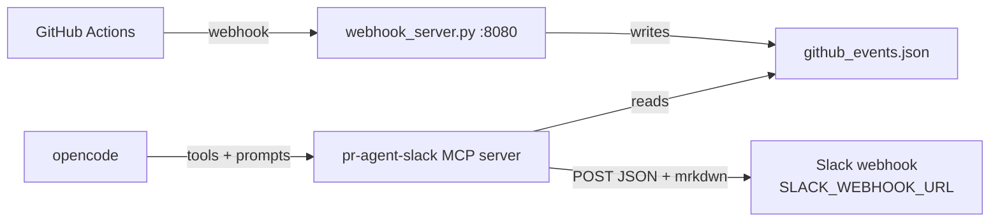

# Module 3: Slack Notification — Implementation

Completes the PR Agent with **Slack notifications**, combining all MCP
primitives: **Tools** (webhook POST to Slack), **Prompts** (Slack formatting),
and the **webhook integration** from Module 2 — end-to-end team automation
from GitHub → local event log → assistant analysis → Slack.

Host: **opencode** (via its built-in MCP client).
Environment: **conda env `aisystem`**.

## What's Implemented

Module 3 adds one tool and two prompts on top of Modules 1 & 2:

| Item | Kind | Purpose |
|------|------|---------|
| `send_slack_notification` | Tool | POST a formatted message to the team Slack channel |
| `format_ci_failure_alert` | Prompt | Format a CI failure for Slack |
| `format_ci_success_summary` | Prompt | Format a successful deployment for Slack |

Everything from Modules 1 & 2 is present: `analyze_file_changes`,
`get_pr_templates`, `suggest_template`, `get_recent_actions_events`,
`get_workflow_status`, and the four CI/CD prompts.

## Architecture



Pipeline: `GitHub → local event storage → assistant analysis → Slack notification`.

## Setup

```bash
conda activate aisystem
cd projects/mcp-proj3
pip install "mcp[cli]" aiohttp requests pytest pytest-asyncio
```

Set the Slack webhook URL (secret — never commit it):

```bash
export SLACK_WEBHOOK_URL="https://hooks.slack.com/services/YOUR/WEBHOOK/URL"
```

Create it: https://api.slack.com/apps → new app ("MCP Course Notifications") →
enable Incoming Webhooks → add to workspace → copy URL.

Smoke-test the webhook:

```bash
curl -X POST -H 'Content-type: application/json' \
  --data '{"text":"Hello from MCP Course!"}' \
  $SLACK_WEBHOOK_URL
```

Terminal services:

```bash
# Terminal 1: webhook server
python webhook_server.py

# Terminal 2 (optional, for live GitHub events):
cloudflared tunnel --url http://localhost:8080
```

## Register with opencode

Add to `opencode.json` — note `SLACK_WEBHOOK_URL` in `environment`:

```json
{
  "mcp": {
    "pr-agent-slack": {
      "type": "local",
      "command": ["/path/to/conda/envs/aisystem/bin/python", "/absolute/path/to/mcp-proj3/server.py"],
      "environment": {
        "SLACK_WEBHOOK_URL": "https://hooks.slack.com/services/YOUR/WEBHOOK/URL"
      }
    }
  }
}
```

Verify:

```bash
python -c "import server; print('pr-agent-slack MCP server OK')"
pytest test_server.py -v
```

---

## `server.py` (full implementation)

Replace the contents of `server.py` with the code below.

```python
#!/usr/bin/env python3
"""
Module 3: Slack Notification Integration
Combines all MCP primitives (Tools and Prompts) for complete team communication workflows.
"""

import json
import os
import subprocess
import requests
from typing import Optional
from pathlib import Path

from mcp.server.fastmcp import FastMCP

# Initialize the FastMCP server
mcp = FastMCP("pr-agent-slack")

# PR template directory (shared between starter and solution)
TEMPLATES_DIR = Path(__file__).parent.parent.parent / "templates"

# Default PR templates
DEFAULT_TEMPLATES = {
    "bug.md": "Bug Fix",
    "feature.md": "Feature",
    "docs.md": "Documentation",
    "refactor.md": "Refactor",
    "test.md": "Test",
    "performance.md": "Performance",
    "security.md": "Security"
}

# File where webhook server stores events
EVENTS_FILE = Path(__file__).parent / "github_events.json"

# Type mapping for PR templates
TYPE_MAPPING = {
    "bug": "bug.md",
    "fix": "bug.md",
    "feature": "feature.md",
    "enhancement": "feature.md",
    "docs": "docs.md",
    "documentation": "docs.md",
    "refactor": "refactor.md",
    "cleanup": "refactor.md",
    "test": "test.md",
    "testing": "test.md",
    "performance": "performance.md",
    "optimization": "performance.md",
    "security": "security.md"
}


def _load_events() -> list:
    """Load events from EVENTS_FILE, returning [] if missing/empty/invalid."""
    if not EVENTS_FILE.exists():
        return []
    try:
        with open(EVENTS_FILE, "r") as f:
            events = json.load(f)
        return events if isinstance(events, list) else []
    except (json.JSONDecodeError, IOError):
        return []


# ===== Tools from Modules 1 & 2 (with output limiting) =====

@mcp.tool()
async def analyze_file_changes(
    base_branch: str = "main",
    include_diff: bool = True,
    max_diff_lines: int = 500
) -> str:
    """Get the full diff and list of changed files in the current git repository.

    Args:
        base_branch: Base branch to compare against (default: main)
        include_diff: Include the full diff content (default: true)
        max_diff_lines: Maximum number of diff lines to include (default: 500)
    """
    try:
        # Get list of changed files
        files_result = subprocess.run(
            ["git", "diff", "--name-status", f"{base_branch}...HEAD"],
            capture_output=True,
            text=True,
            check=True
        )

        # Get diff statistics
        stat_result = subprocess.run(
            ["git", "diff", "--stat", f"{base_branch}...HEAD"],
            capture_output=True,
            text=True
        )

        # Get the actual diff if requested
        diff_content = ""
        truncated = False
        diff_lines = []
        if include_diff:
            diff_result = subprocess.run(
                ["git", "diff", f"{base_branch}...HEAD"],
                capture_output=True,
                text=True
            )
            diff_lines = diff_result.stdout.split('\n')

            # Check if we need to truncate
            if len(diff_lines) > max_diff_lines:
                diff_content = '\n'.join(diff_lines[:max_diff_lines])
                diff_content += f"\n\n... Output truncated. Showing {max_diff_lines} of {len(diff_lines)} lines ..."
                diff_content += "\n... Use max_diff_lines parameter to see more ..."
                truncated = True
            else:
                diff_content = diff_result.stdout

        # Get commit messages for context
        commits_result = subprocess.run(
            ["git", "log", "--oneline", f"{base_branch}..HEAD"],
            capture_output=True,
            text=True
        )

        analysis = {
            "base_branch": base_branch,
            "files_changed": files_result.stdout,
            "statistics": stat_result.stdout,
            "commits": commits_result.stdout,
            "diff": diff_content if include_diff else "Diff not included (set include_diff=true to see full diff)",
            "truncated": truncated,
            "total_diff_lines": len(diff_lines) if include_diff else 0
        }

        return json.dumps(analysis, indent=2)

    except subprocess.CalledProcessError as e:
        return json.dumps({"error": f"Git error: {e.stderr}"})
    except Exception as e:
        return json.dumps({"error": str(e)})


@mcp.tool()
async def get_pr_templates() -> str:
    """List available PR templates with their content."""
    try:
        templates = [
            {
                "filename": filename,
                "type": template_type,
                "content": (TEMPLATES_DIR / filename).read_text(encoding="utf-8")
            }
            for filename, template_type in DEFAULT_TEMPLATES.items()
        ]
        return json.dumps(templates, indent=2)
    except Exception as e:
        return json.dumps({"error": str(e)}, indent=2)


@mcp.tool()
async def suggest_template(changes_summary: str, change_type: str) -> str:
    """Let the assistant analyze the changes and suggest the most appropriate PR template.

    Args:
        changes_summary: Your analysis of what the changes do
        change_type: The type of change you've identified (bug, feature, docs, refactor, test, etc.)
    """
    try:
        # Get available templates
        templates_response = await get_pr_templates()
        templates = json.loads(templates_response)

        # Find matching template
        template_file = TYPE_MAPPING.get(change_type.lower(), "feature.md")
        selected_template = next(
            (t for t in templates if t["filename"] == template_file),
            templates[0] if templates else {}
        )

        suggestion = {
            "recommended_template": selected_template,
            "reasoning": f"Based on your analysis: '{changes_summary}', this appears to be a {change_type} change.",
            "template_content": selected_template.get("content"),
            "usage_hint": "Customize the template content with the specific changes in this PR."
        }

        return json.dumps(suggestion, indent=2)
    except Exception as e:
        return json.dumps({"error": str(e), "hint": "Call get_pr_templates first to see available templates"})


@mcp.tool()
async def get_recent_actions_events(limit: int = 10) -> str:
    """Get recent GitHub Actions events received via webhook.

    Args:
        limit: Maximum number of events to return (default: 10)
    """
    events = _load_events()

    if not events:
        return json.dumps({"message": "No GitHub Actions events received yet",
                           "events": []}, indent=2)

    recent = events[-limit:]
    return json.dumps({"count": len(recent), "events": recent}, indent=2)


@mcp.tool()
async def get_workflow_status(workflow_name: Optional[str] = None) -> str:
    """Get the current status of GitHub Actions workflows.

    Args:
        workflow_name: Optional specific workflow name to filter by
    """
    events = _load_events()

    if not events:
        return json.dumps({"message": "No GitHub Actions events received yet",
                           "workflows": []}, indent=2)

    # Filter for workflow events
    workflow_events = [e for e in events if e.get("workflow_run") is not None]

    if workflow_name:
        workflow_events = [
            e for e in workflow_events
            if e["workflow_run"].get("name") == workflow_name
        ]

    # Group by workflow, keeping the latest run per name
    workflows = {}
    for event in workflow_events:
        run = event["workflow_run"]
        name = run.get("name", "unknown")
        updated_at = run.get("updated_at") or run.get("created_at") or ""
        if name not in workflows or updated_at > workflows[name]["updated_at"]:
            workflows[name] = {
                "name": name,
                "status": run.get("status"),
                "conclusion": run.get("conclusion"),
                "run_number": run.get("run_number"),
                "branch": run.get("head_branch"),
                "commit": (run.get("head_sha") or "")[:7],
                "updated_at": updated_at,
                "html_url": run.get("html_url")
            }

    return json.dumps({"workflows": list(workflows.values())}, indent=2)


# ===== Module 3: Slack Integration Tool =====

@mcp.tool()
async def send_slack_notification(message: str) -> str:
    """Send a formatted notification to the team Slack channel.

    Args:
        message: The message to send to Slack (supports Slack markdown)
    """
    webhook_url = os.getenv("SLACK_WEBHOOK_URL")
    if not webhook_url:
        return json.dumps({
            "status": "error",
            "message": "SLACK_WEBHOOK_URL environment variable not set"
        })

    try:
        # Include "mrkdwn": true so Slack renders bold/links/code properly
        response = requests.post(
            webhook_url,
            json={"text": message, "mrkdwn": True},
            timeout=10
        )

        if response.status_code == 200:
            return json.dumps({
                "status": "success",
                "message": "Notification sent to Slack",
                "text": message[:200]
            })

        return json.dumps({
            "status": "error",
            "status_code": response.status_code,
            "response": response.text[:500]
        })
    except Exception as e:
        return json.dumps({
            "status": "error",
            "message": f"Error sending message: {str(e)}"
        })


# ===== Module 3: Slack Formatting Prompts =====

@mcp.prompt()
async def format_ci_failure_alert():
    """Create a Slack alert for CI/CD failures with rich formatting."""
    return """Format this GitHub Actions failure as a Slack message using ONLY Slack markdown syntax:

❌ *CI Failed* - [Repository Name]

> Brief summary of what failed

*Details:*
• Workflow: `workflow_name`
• Branch: `branch_name`
• Commit: `commit_hash`

*Next Steps:*
• <https://github.com/test/repo/actions/runs/123|View Action Logs>

CRITICAL: Use EXACT Slack link format: <https://full-url|Link Text>
Examples:
- CORRECT: <https://github.com/user/repo|Repository>
- WRONG: [Repository](https://github.com/user/repo)
- WRONG: https://github.com/user/repo

Other Slack formats:
- *text* for bold (NOT **text**)
- `text` for code
- > text for quotes
- • for bullets"""


@mcp.prompt()
async def format_ci_success_summary():
    """Create a Slack message celebrating successful deployments."""
    return """Format this successful GitHub Actions run as a Slack message using ONLY Slack markdown syntax:

✅ *Deployment Successful* - [Repository Name]

> Brief summary of what was deployed

*Changes:*
• Key feature or fix 1
• Key feature or fix 2

*Links:*
• <https://github.com/user/repo|View Changes>

CRITICAL: Use EXACT Slack link format: <https://full-url|Link Text>
Examples:
- CORRECT: <https://github.com/user/repo|Repository>
- WRONG: [Repository](https://github.com/user/repo)
- WRONG: https://github.com/user/repo

Other Slack formats:
- *text* for bold (NOT **text**)
- `text` for code
- > text for quotes
- • for bullets"""


# ===== Prompts from Module 2 (Complete) =====

@mcp.prompt()
async def analyze_ci_results():
    """Analyze recent CI/CD results and provide insights."""
    return """Please analyze the recent CI/CD results from GitHub Actions:

1. First, call get_recent_actions_events() to fetch the latest CI/CD events
2. Then call get_workflow_status() to check current workflow states
3. Identify any failures or issues that need attention
4. Provide actionable next steps based on the results

Format your response as:
## CI/CD Status Summary
- **Overall Health**: [Good/Warning/Critical]
- **Failed Workflows**: [List any failures with links]
- **Successful Workflows**: [List recent successes]
- **Recommendations**: [Specific actions to take]
- **Trends**: [Any patterns you notice]"""


@mcp.prompt()
async def create_deployment_summary():
    """Generate a deployment summary for team communication."""
    return """Create a deployment summary for team communication:

1. Check workflow status with get_workflow_status()
2. Look specifically for deployment-related workflows
3. Note the deployment outcome, timing, and any issues

Format as a concise message suitable for Slack:

🚀 **Deployment Update**
- **Status**: [✅ Success / ❌ Failed / ⏳ In Progress]
- **Environment**: [Production/Staging/Dev]
- **Version/Commit**: [If available from workflow data]
- **Duration**: [If available]
- **Key Changes**: [Brief summary if available]
- **Issues**: [Any problems encountered]
- **Next Steps**: [Required actions if failed]

Keep it brief but informative for team awareness."""


@mcp.prompt()
async def generate_pr_status_report():
    """Generate a comprehensive PR status report including CI/CD results."""
    return """Generate a comprehensive PR status report:

1. Use analyze_file_changes() to understand what changed
2. Use get_workflow_status() to check CI/CD status
3. Use suggest_template() to recommend the appropriate PR template
4. Combine all information into a cohesive report

Create a detailed report with:

## 📋 PR Status Report

### 📝 Code Changes
- **Files Modified**: [Count by type - .py, .js, etc.]
- **Change Type**: [Feature/Bug/Refactor/etc.]
- **Impact Assessment**: [High/Medium/Low with reasoning]
- **Key Changes**: [Bullet points of main modifications]

### 🔄 CI/CD Status
- **All Checks**: [✅ Passing / ❌ Failing / ⏳ Running]
- **Test Results**: [Pass rate, failed tests if any]
- **Build Status**: [Success/Failed with details]
- **Code Quality**: [Linting, coverage if available]

### 📌 Recommendations
- **PR Template**: [Suggested template and why]
- **Next Steps**: [What needs to happen before merge]
- **Reviewers**: [Suggested reviewers based on files changed]

### ⚠️ Risks & Considerations
- [Any deployment risks]
- [Breaking changes]
- [Dependencies affected]"""


@mcp.prompt()
async def troubleshoot_workflow_failure():
    """Help troubleshoot a failing GitHub Actions workflow."""
    return """Help troubleshoot failing GitHub Actions workflows:

1. Use get_recent_actions_events() to find recent failures
2. Use get_workflow_status() to see which workflows are failing
3. Analyze the failure patterns and timing
4. Provide systematic troubleshooting steps

Structure your response as:

## 🔧 Workflow Troubleshooting Guide

### ❌ Failed Workflow Details
- **Workflow Name**: [Name of failing workflow]
- **Failure Type**: [Test/Build/Deploy/Lint]
- **First Failed**: [When did it start failing]
- **Failure Rate**: [Intermittent or consistent]

### 🔍 Diagnostic Information
- **Error Patterns**: [Common error messages or symptoms]
- **Recent Changes**: [What changed before failures started]
- **Dependencies**: [External services or resources involved]

### 💡 Possible Causes (ordered by likelihood)
1. **[Most Likely]**: [Description and why]
2. **[Likely]**: [Description and why]
3. **[Possible]**: [Description and why]

### ✅ Suggested Fixes
**Immediate Actions:**
- [ ] [Quick fix to try first]
- [ ] [Second quick fix]

**Investigation Steps:**
- [ ] [How to gather more info]
- [ ] [Logs or data to check]

**Long-term Solutions:**
- [ ] [Preventive measure]
- [ ] [Process improvement]

### 📚 Resources
- [Relevant documentation links]
- [Similar issues or solutions]"""


if __name__ == "__main__":
    # Run MCP server normally
    print("Starting PR Agent Slack MCP server...")
    print("Make sure to set SLACK_WEBHOOK_URL environment variable")
    print("To receive GitHub webhooks, run the webhook server separately:")
    print("  python webhook_server.py")
    mcp.run()
```

---

## Design Notes

- **Secret handling.** `SLACK_WEBHOOK_URL` is read from the environment only —
  never hardcoded or committed. Missing token returns a clear JSON error.
- **`mrkdwn: true`.** The webhook payload enables Slack markdown so `*bold*`,
  `` `code` ``, `> quotes`, and `<url|text>` links render correctly.
  **Slack markdown ≠ GitHub markdown:** `*text*` for bold, not `**text**`.
- **Prompts shape the send.** `format_ci_failure_alert` and
  `format_ci_success_summary` are *templates the assistant fills*, using the raw
  event data from `get_recent_actions_events` / `get_workflow_status`; then
  `send_slack_notification` delivers.
- **Timeout + status surfacing.** POST uses a 10s timeout; non-200 responses and
  connection errors are returned as JSON, never raised.

## Example workflow in opencode

```
User: "Check recent CI events and notify the team about any failures"

Assistant:
1. Calls get_recent_actions_events() → finds a failed CI run
2. Applies format_ci_failure_alert() prompt → builds Slack message
3. Calls send_slack_notification() with the formatted message
4. Reports back: "Sent failure alert to #dev-team channel"
```

For curl-based end-to-end tests (fake GitHub events, no real repo needed), see
the provided **`manual_test.md`** — replace every "Claude Code" instruction with
the same prompt typed into opencode.

> ⚠️ Treat `SLACK_WEBHOOK_URL` like a password: env var only, never in git.