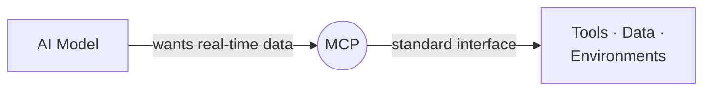
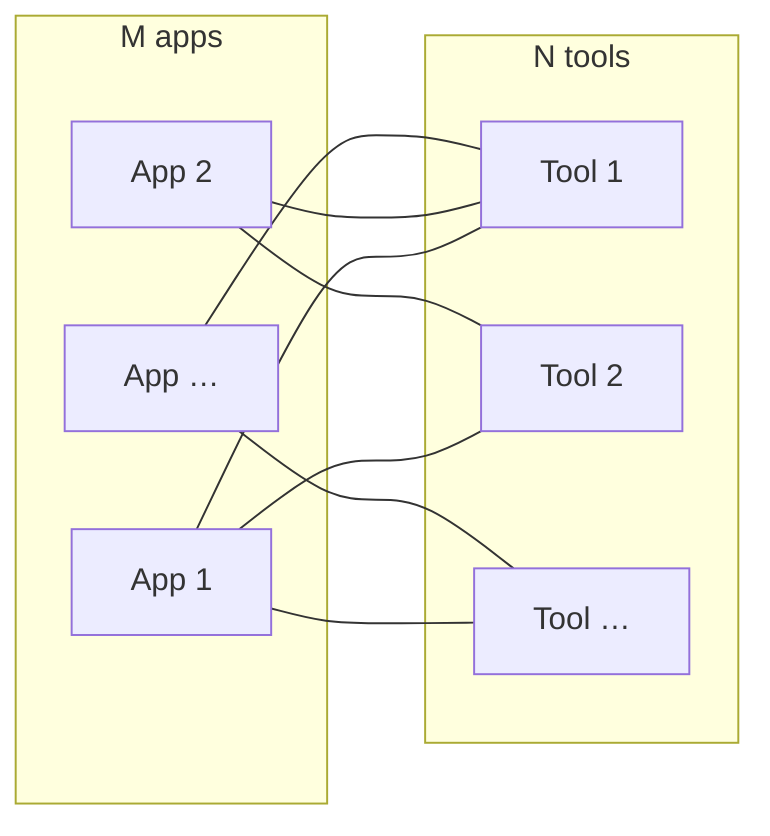
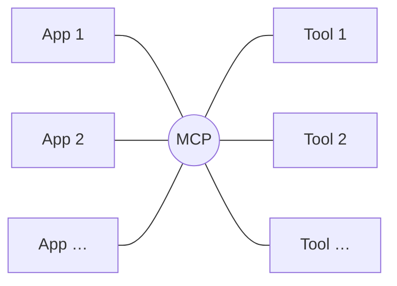
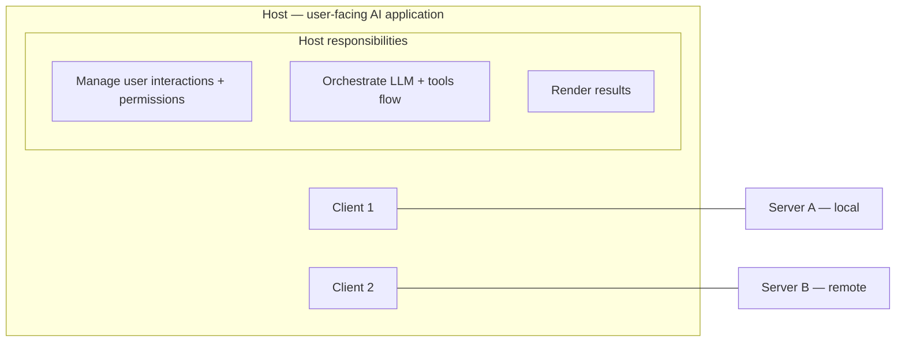
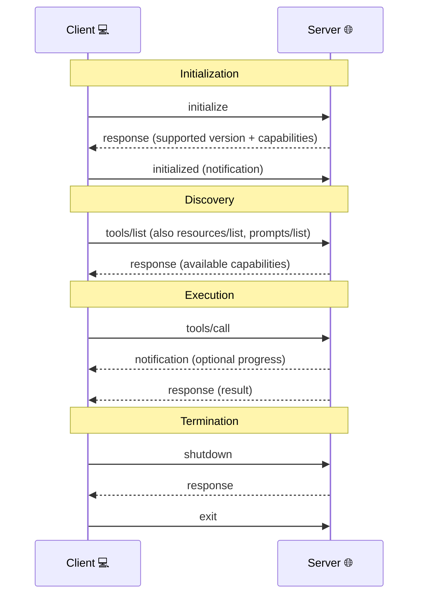
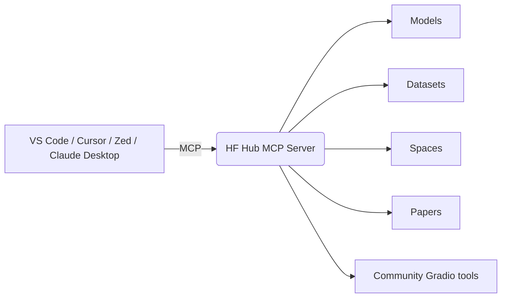
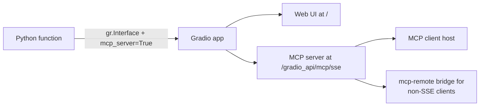

# Unit 1 — MCP Fundamentals, Architecture and Core Concepts

> **Course reference:** `unit1/*.mdx` (12 sections)
> **Goal:** Understand what MCP is, its architecture, wire protocol, capabilities, SDKs, and the client ecosystem — then prove it with two quizzes.

---

## 1. Why MCP exists (`introduction.mdx`)

Large Language Models (LLMs) are limited by their **training data**. A model knows the world up to the moment it was trained — but your database, your files, your APIs, and live services are outside that window. **MCP's primary purpose is to enable AI models to connect with external data sources, tools, and environments.**

MCP is an open standard that sits between an AI application and the external capabilities it needs:



The rest of this unit unpacks what that standard actually is and how the pieces fit together.

---

## 2. Key concepts & terminology (`key-concepts.mdx`)

MCP is often described as the **"USB-C for AI applications."** Just as USB-C standardized how peripherals plug into computers, MCP standardizes how AI applications plug into external tools and data. That standardization benefits everyone:

- **Users** — simpler, more consistent experiences across AI apps
- **AI application developers** — drop-in integration with a growing ecosystem
- **Tool/data providers** — build one implementation that works everywhere
- **The ecosystem** — more interoperability, less fragmentation

### The M×N integration problem

Without a standard, connecting **M** AI applications to **N** tools requires **M × N custom integrations** — one bespoke adapter for every pairing.



With MCP, it becomes an **M + N problem**: each application implements the *client* side once, each tool implements the *server* side once, and they meet at the standard.



### Core components (defined here, deepened next section)

- **Host** — the *user-facing AI application* end-users interact with (e.g., Claude Desktop, Cursor, a smolagents app).
- **Client** — a component *within* the host that manages a **1:1 connection with a single server**.
- **Server** — an external program/service exposing capabilities (Tools, Resources, Prompts) via MCP.

> [!WARNING]
> A lot of content uses "Client" and "Host" interchangeably. Technically, the **Host** is the user-facing application and the **Client** is the component inside it that talks to one server.

### Capabilities overview

| Capability | Description | Example |
| ---------- | ----------- | ------- |
| **Tools** | Executable functions the model invokes to act or compute. Typically tied to the application's use case. | Weather tool returning current conditions |
| **Resources** | Read-only data sources providing context without heavy computation. | A scientific-paper resource for a research assistant |
| **Prompts** | Predefined templates/workflows guiding interactions between user, model, and capabilities. | A summarization prompt |
| **Sampling** | Server-initiated requests for the Client/Host to perform LLM interactions (recursive/agentic). | A writing app reviewing its own output |

A code-agent app might use them like this:

| Entity | Name | Description |
| --- | --- | --- |
| Tool | Code Interpreter | Executes code the LLM wrote |
| Resource | Documentation | The app's docs |
| Prompt | Code Style | Guides the LLM's code generation |
| Sampling | Code Review | LLM reviews its own code and refines it |

---

## 3. Architectural components (`architectural-components.mdx`)

MCP is a **client–server architecture** with three participants and well-defined responsibilities.



### Host
The user-facing application: **Chat apps** (ChatGPT, Claude Desktop), **AI IDEs** (Cursor, Continue), or **custom agents** built with LangChain or smolagents. Responsibilities:

- Managing user interactions and permissions
- Initiating connections to MCP Servers via MCP Clients
- Orchestrating the overall flow between user requests, LLM processing, and external tools
- Rendering results back to users

### Client
A component **inside the Host** that manages communication with **one** MCP Server:

- Maintains a **1:1 connection** with a single server
- Handles the protocol-level details of MCP communication
- Acts as the intermediary between Host logic and the external server

### Server
An external program/service exposing capabilities:

- Provides access to specific external tools, data sources, or services
- Acts as a **lightweight wrapper** around existing functionality
- Can run **locally** (same machine as Host) or **remotely** (over the network)
- Exposes capabilities in a **standardized, discoverable format**

### The 7-step communication flow

1. **User Interaction** — user expresses intent to the **Host**.
2. **Host Processing** — Host processes input (possibly with an LLM) to decide what's needed.
3. **Client Connection** — Host directs its **Client** to connect to the appropriate Server(s).
4. **Capability Discovery** — Client queries the Server for available Tools/Resources/Prompts.
5. **Capability Invocation** — Host instructs the Client to invoke specific capabilities.
6. **Server Execution** — Server runs the capability and returns results to the Client.
7. **Result Integration** — Client relays results to the Host, which weaves them into LLM context or shows them to the user.

> [!TIP]
> **Modularity is the point.** One Host can connect to many Servers via different Clients; new Servers join the ecosystem without changes to existing Hosts; capabilities compose across Servers. This is exactly what reduces M×N to M+N.

Guiding design principles: **standardization**, **simplicity**, **safety** (explicit user approval for sensitive ops), **discoverability**, **extensibility** (versioning + capability negotiation), and **interoperability**.

---

## 4. The communication protocol (`communication-protocol.mdx`)

> [!WARNING]
> This is the nitty-gritty layer. You won't need all of it to build, but you should know it exists and how it works.

### JSON-RPC 2.0 — the foundation

MCP uses **JSON-RPC 2.0** as the message format for all Client↔Server communication. Why JSON-RPC?

- Human-readable and easy to debug
- Language-agnostic
- Well-established with clear specs and wide adoption

Three message types:

**1. Requests** — Client → Server, initiates an operation. Has a unique `id`, a method (`e.g. tools/call`), and optional `params`.

```json
{
  "jsonrpc": "2.0",
  "id": 1,
  "method": "tools/call",
  "params": {
    "name": "weather",
    "arguments": {
      "location": "San Francisco"
    }
  }
}
```

**2. Responses** — Server → Client, replies to a request. Echoes the `id`, with either `result` (success) or `error` (failure).

```json
{
  "jsonrpc": "2.0",
  "id": 1,
  "result": {
    "temperature": 62,
    "conditions": "Partly cloudy"
  }
}
```

```json
{
  "jsonrpc": "2.0",
  "id": 1,
  "error": {
    "code": -32602,
    "message": "Invalid location parameter"
  }
}
```

**3. Notifications** — one-way, no response required. Usually Server → Client for updates.

```json
{
  "jsonrpc": "2.0",
  "method": "progress",
  "params": {
    "message": "Processing data...",
    "percent": 50
  }
}
```

### Transports

JSON-RPC defines the *message format*; MCP also specifies how messages *move*:

**stdio (Standard Input/Output)** — local communication, same machine.

- Host launches the Server as a **subprocess**; communicates via the server's stdin/stdout.
- **Use cases:** local tools like file-system access or local scripts.
- **Advantages:** simple, no network config, sandboxed by the OS.

**HTTP + SSE (Server-Sent Events) / Streamable HTTP** — remote communication.

- Communication over HTTP; the server pushes updates to the client via SSE on a persistent connection.
- **Use cases:** remote APIs, cloud services, shared resources.
- **Advantages:** works across networks, integrates with web services, serverless-compatible.
- Recent updates introduced/refined **"Streamable HTTP"**, letting servers dynamically upgrade to SSE for streaming while staying serverless-friendly.

### The interaction lifecycle



1. **Initialization** — Client connects; they exchange protocol versions and capabilities.
2. **Discovery** — Client lists available tools (repeat for resources, prompts).
3. **Execution** — Client invokes capabilities, possibly with progress notifications.
4. **Termination** — Graceful close: `shutdown` → response → `exit`.

### Protocol evolution

The protocol is **extensible and adaptable**: initialization includes **version negotiation** for backward compatibility, and **capability discovery** lets clients adapt to each server's feature set — so basic and advanced servers coexist.

---

## 5. Capabilities deep dive (`capabilities.mdx`)

Servers expose capabilities in **four categories**. The course teaches them as framework-agnostic functions to focus on *concepts*; Unit 2+ shows real MCP code.

### Tools — model-controlled actions

- **Control:** the AI model decides *when* to call a tool based on user request + context.
- **Safety:** tools have side effects → usually require **explicit user approval**.
- **Use cases:** sending messages, creating tickets, querying APIs, calculations.

```python
def get_weather(location: str) -> dict:
    """Get the current weather for a specified location."""
    # Connect to weather API and fetch data
    return {
        "temperature": 72,
        "conditions": "Sunny",
        "humidity": 45
    }
```

*(JS equivalent: `function getWeather(location) { return { … } }`)*

### Resources — application-controlled, read-only context

- **Control:** the **Host application** decides when to access them.
- **Nature:** data retrieval with minimal computation, like a REST **GET**.
- **Safety:** read-only → lower risk than Tools.
- **Use cases:** file contents, database records, configuration info.

```python
def read_file(file_path: str) -> str:
    """Read the contents of a file at the specified path."""
    with open(file_path, 'r') as f:
        return f.read()
```

*(JS: `fs.readFile(filePath, 'utf8', …)` promised)*

### Prompts — user-controlled templates

- **Control:** user-controlled, often presented as UI options.
- **Purpose:** structure interactions for optimal use of available Tools and Resources.
- **Selection:** users pick a prompt *before* the model starts, setting interaction context.
- **Use cases:** common workflows, specialized task templates, guided interactions.

```python
def code_review(code: str, language: str) -> list:
    """Generate a code review for the provided code snippet."""
    return [
        {
            "role": "system",
            "content": f"You are a code reviewer examining {language} code. Provide a detailed review highlighting best practices, potential issues, and suggestions for improvement."
        },
        {
            "role": "user",
            "content": f"Please review this {language} code:\n\n```{language}\n{code}\n```"
        }
    ]
```

*(JS mirrors this with template literals)*

### Sampling — server-initiated LLM calls

- **Control:** **server-initiated**, but requires Client/Host facilitation.
- **Purpose:** server-driven agentic behaviors, recursive or multi-step interactions.
- **Safety:** like Tools, typically requires user approval.
- **Use cases:** complex multi-step tasks, autonomous agent workflows.

The sampling flow:
1. Server sends `sampling/createMessage` to the client
2. Client reviews (and can modify) the request
3. Client samples from an LLM
4. Client reviews the completion
5. Client returns the result to the server

> [!TIP]
> This **human-in-the-loop** design keeps users in control of what the LLM sees and generates. When implementing sampling, provide clear, well-structured prompts and include relevant context.

### How they work together

| Capability | Controlled By | Direction | Side Effects | Approval Needed | Typical Use Cases |
|------------|---------------|-----------|--------------|-----------------|-------------------|
| Tools      | Model (LLM)   | Client → Server | Yes (potentially) | Yes | Actions, API calls, data manipulation |
| Resources  | Application   | Client → Server | No (read-only) | Typically no | Data retrieval, context gathering |
| Prompts    | User          | Server → Client | No | No (selected by user) | Guided workflows, specialized templates |
| Sampling   | Server        | Server → Client → Server | Indirectly | Yes | Multi-step tasks, agentic behaviors |

The complementary flow: user selects a **Prompt** → the prompt pulls context from **Resources** → the model calls **Tools** to act → for complex ops the Server uses **Sampling** for more LLM processing.

### Dynamic discovery

MCP clients discover capabilities dynamically at connect time:
- `tools/list` — discover Tools
- `resources/list` — discover Resources
- `prompts/list` — discover Prompts

This lets clients adapt to *any* server without hardcoding its functionality.

---

## 6. The MCP SDK (`sdk.mdx`)

The MCP SDKs (official, for **JavaScript** and **Python** mainly) hide the protocol details so you can focus on your application's capabilities. They handle protocol communication, capability registration/discovery, serialization, connection management, and error handling.

### Python SDK — FastMCP

```python
from mcp.server.fastmcp import FastMCP

# Create an MCP server
mcp = FastMCP("Weather Service")

# Tool implementation
@mcp.tool()
def get_weather(location: str) -> str:
    """Get the current weather for a specified location."""
    return f"Weather in {location}: Sunny, 72°F"

# Resource implementation
@mcp.resource("weather://{location}")
def weather_resource(location: str) -> str:
    """Provide weather data as a resource."""
    return f"Weather data for {location}: Sunny, 72°F"

# Prompt implementation
@mcp.prompt()
def weather_report(location: str) -> str:
    """Create a weather report prompt."""
    return f"""You are a weather reporter. Weather report for {location}?"""


# Run the server
if __name__ == "__main__":
    mcp.run()
```

Run it in development mode and open the MCP Inspector:

```bash
mcp dev server.py
```

Output mirrors this:

```
Starting MCP inspector...
⚙️ Proxy server listening on port 6277
Spawned stdio transport
Connected MCP client to backing server transport
Created web app transport
Set up MCP proxy
🔍 MCP Inspector is up and running at http://127.0.0.1:6274 🚀
```

Open `http://127.0.0.1:6274` to see the server's capabilities and call them from the browser UI.

### JavaScript SDK

```javascript
// index.mjs
import {
  McpServer,
  ResourceTemplate,
} from "@modelcontextprotocol/sdk/server/mcp.js";
import { StdioServerTransport } from "@modelcontextprotocol/sdk/server/stdio.js";
import { z } from "zod";

// Create an MCP server
const server = new McpServer({
  name: "Weather Service",
  version: "1.0.0",
});

// Tool implementation
server.tool("get_weather", { location: z.string() }, async ({ location }) => ({
  content: [
    {
      type: "text",
      text: `Weather in ${location}: Sunny, 72°F`,
    },
  ],
}));

// Resource implementation
server.resource(
  "weather",
  new ResourceTemplate("weather://{location}", { list: undefined }),
  async (uri, { location }) => ({
    contents: [
      {
        uri: uri.href,
        text: `Weather data for ${location}: Sunny, 72°F`,
      },
    ],
  })
);

// Prompt implementation
server.prompt(
  "weather_report",
  { location: z.string() },
  async ({ location }) => ({
    messages: [
      {
        role: "assistant",
        content: {
          type: "text",
          text: "You are a weather reporter.",
        },
      },
      {
        role: "user",
        content: {
          type: "text",
          text: `Weather report for ${location}?`,
        },
      },
    ],
  })
);

// Run the server
const transport = new StdioServerTransport();
await server.connect(transport);
```

Inspect it:

```bash
npx @modelcontextprotocol/inspector node ./index.mjs
```

### SDKs across languages

| Language   | Repository | Maintainer(s) | Status |
| ---------- | ---------- | ------------- | ------ |
| TypeScript | `modelcontextprotocol/typescript-sdk` | Anthropic | Active |
| Python     | `modelcontextprotocol/python-sdk` | Anthropic | Active |
| Java       | `modelcontextprotocol/java-sdk` | Spring AI (VMware) | Active |
| Kotlin     | `modelcontextprotocol/kotlin-sdk` | JetBrains | Active |
| C#         | `modelcontextprotocol/csharp-sdk` | Microsoft | Preview |
| Swift      | `modelcontextprotocol/swift-sdk` | loopwork-ai | Active |
| Rust       | `modelcontextprotocol/rust-sdk` | Anthropic/Community | Active |
| Dart       | `leehack/mcp_dart` | Flutter Community | Active |

---

## 7. MCP clients (`mcp-clients.mdx`)

**MCP Clients** are the bridge between the Host and external capabilities — a specialized module in the host that handles MCP communications.

### User-interface clients

- **Chat interface:** Claude Desktop (Anthropic)
- **Interactive development:** VS Code extensions (e.g., Continue), **Cursor** (built-in MCP client), **Zed**

These support connecting to multiple MCP servers and real-time tool invocation.

### Quick-connect to the Hugging Face MCP Server

1. Visit `https://huggingface.co/settings/mcp` while logged in.
2. Select your MCP-compatible client (VS Code, Cursor, Zed, Claude Desktop).
3. Copy the generated config snippet into your client's MCP config.
4. Restart/reload the client — you should see "Hugging Face" connected.

> Prefer the **generated snippet** over hand-written config; it's tailored per client.

### Configuring MCP clients — `mcp.json`

> [!TIP]
> The MCP spec is still evolving, so configuration methods evolve too. These are current best practices. The config is simple and consistent across major hosts.

Basic structure:

```json
{
  "servers": [
    {
      "name": "Server Name",
      "transport": {
        "type": "stdio|sse",
        // Transport-specific configuration
      }
    }
  ]
}
```

**stdio server** (local script — command + args):

```json
{
  "servers": [
    {
      "name": "File Explorer",
      "transport": {
        "type": "stdio",
        "command": "python",
        "args": ["/path/to/file_explorer_server.py"]
      }
    }
  ]
}
```

**HTTP+SSE server** (remote — URL):

```json
{
  "servers": [
    {
      "name": "Remote API Server",
      "transport": {
        "type": "sse",
        "url": "https://example.com/mcp-server"
      }
    }
  ]
}
```

**Environment variables** — pass secrets cast via `env`:

```python
import os

# Access environment variables
github_token = os.environ.get("GITHUB_TOKEN")
if not github_token:
    raise ValueError("GITHUB_TOKEN environment variable is required")
```

```javascript
// Access environment variables
const githubToken = process.env.GITHUB_TOKEN;
if (!githubToken) {
    throw new Error("GITHUB_TOKEN environment variable is required");
}
```

```json
{
  "servers": [
    {
      "name": "GitHub API",
      "transport": {
        "type": "stdio",
        "command": "python",
        "args": ["/path/to/github_server.py"],
        "env": {
          "GITHUB_TOKEN": "your_github_token"
        }
      }
    }
  ]
}
```

### Tiny Agents as MCP clients

Tiny Agents can run MCP servers from the command line — for **both Python and JavaScript** on the same basis: `npm`/`npx` plus `huggingface_hub[mcp]`.

Setup:

```bash
# install npx
npm install -g npx
```

```bash
pip install "huggingface_hub[mcp]>=0.32.0"
```

```bash
# Login using the new CLI
hf auth login
```

> **Note:** `huggingface-cli` is deprecated and replaced by `hf`. If you get "command not found", update `huggingface_hub`.

**Configure token permissions** (mandatory for hosted models): on the [Access Tokens page](https://huggingface.co/settings/tokens), edit your MCP token's permissions and enable **"Make calls to Inference Providers"** under *Inference*.

**Python — `agent.json`** (Playwright browser agent):

```json
{
    "name": "playwright-agent",
    "description": "Agent with Playwright MCP server",
    "model": "Qwen/Qwen2.5-72B-Instruct",
    "provider": "novita",
    "servers": [
        {
            "type": "stdio",
            "command": "npx",
            "args": ["@playwright/mcp@latest"]
        }
    ]
}
```

Run it:

```bash
tiny-agents run agent.json
```

**JavaScript** — install and run:

```bash
npm install @huggingface/tiny-agents
mkdir my-agent
touch my-agent/agent.json
```

```json
{
    "model": "Qwen/Qwen2.5-72B-Instruct",
    "provider": "novita",
    "servers": [
        {
            "type": "stdio",
            "command": "npx",
            "args": ["@playwright/mcp@latest"]
        }
    ]
}
```

```bash
npx @huggingface/tiny-agents run ./my-agent
```

On run, the agent loads and lists the tools it discovered from its connected MCP servers, then takes your prompts. A demo prompt from the course:

> do a Web Search for HF inference providers on Brave Search and open the first result and then give me the list of the inference providers supported on Hugging Face

---

## 8. The Hugging Face MCP Server (`hf-mcp-server.mdx`)

Hugging Face provides a **hosted MCP server** with **built-in tools** for exploring the Hub:

- Search **models**, **datasets**, **Spaces**, and **papers**
- Commun??: configured through `https://huggingface.co/settings/mcp`, which generates client-specific snippets for **VS Code, Cursor, Zed, Claude Desktop**
- Extensible with **community tools** via Gradio Spaces that are MCP-compatible



---

## 9. Gradio MCP (`gradio-mcp.mdx`)

**Gradio** turns Python functions into web UIs **and**, with MCP support, into MCP servers — automatically.

Install:

```bash
uv pip install "gradio[mcp]"
```

A Gradio MCP server (letter counter):

```python
import gradio as gr

def letter_counter(word: str, letter: str) -> int:
    """
    Count the number of occurrences of a letter in a word or text.

    Args:
        word (str): The input text to search through
        letter (str): The letter to search for

    Returns:
        int: The number of times the letter appears in the text
    """
    word = word.lower()
    letter = letter.lower()
    count = word.count(letter)
    return count

# Create a standard Gradio interface
demo = gr.Interface(
    fn=letter_counter,
    inputs=["textbox", "textbox"],
    outputs="number",
    title="Letter Counter",
    description="Enter text and a letter to count how many times the letter appears in the text."
)

# Launch both the Gradio web interface and the MCP server
if __name__ == "__main__":
    demo.launch(mcp_server=True)
```

Key facts:

- Launch with `demo.launch(mcp_server=True)` OR set the environment variable:

```bash
export GRADIO_MCP_SERVER=True
```

- The MCP endpoint lives at: `http://your-server:port/gradio_api/mcp/sse`
- Tool schemas are visible at `/gradio_api/mcp/schema` or the "View API" link
- Gradio **auto-converts Python functions into MCP tools**: input components → argument schema, outputs → response format
- You can host **free MCP servers on Hugging Face Spaces**
- For clients that don't support SSE natively, use **`mcp-remote`** as a bridge:

```json
{
  "mcpServers": {
    "gradio": {
      "command": "npx",
      "args": [
        "mcp-remote",
        "http://your-server:port/gradio_api/mcp/sse"
      ]
    }
  }
}
```

The pipeline:



---

## 10. Unit 1 recap (`unit1-recap.mdx`)

Everything Unit 1 established:

- **Architecture:** client–server; **Host**, **Client**, **Server**.
- **Capabilities:** Tools (model-controlled), Resources (app-controlled), Prompts (user-controlled), Sampling (server-initiated).
- **Communication:** **JSON-RPC 2.0** over **stdio** or **HTTP+SSE (Streamable HTTP)**.
- **Lifecycle:** initialization → discovery → execution → termination.
- **Discovery:** dynamic via `tools/list`, `resources/list`, `prompts/list`.
- **SDKs:** official in many languages (Python, TypeScript, Java, Kotlin, C#, Swift, Rust, Dart).
- **Clients:** Claude Desktop, Cursor, VS Code/Continue, Zed, Tiny Agents, Gradio.
- **HF integrations:** hosted **HF MCP Server** (models/datasets/Spaces/papers) and **Gradio MCP** servers (`mcp_server=True`), deployable for free on Spaces.

---

## 11. Quiz 1 — MCP Fundamentals (`quiz1.mdx`)

Test yourself (answers are collapsed below each question):

**Q1: What is the primary purpose of Model Context Protocol (MCP)?**
- To limit the training data of AI models
- **To enable AI models to connect with external data sources, tools, and environments** ✅ — MCP's main goal is interoperability
- To replace prompting when using Large Language Models
- To create a new programming language for AI

**Q2: What problem does MCP primarily aim to solve?**
- The lack of AI models
- The high cost of training LLMs
- **The M×N Integration Problem** ✅ — MCP standardizes connections to avoid M×N custom integrations
- The difficulty in creating new AI algorithms

**Q3: Which of the following is a key benefit of MCP?**
- Reduced AI model accuracy
- Increased complexity in AI development
- **Standardization and interoperability in the AI ecosystem** ✅
- Isolation of AI models from external systems

**Q4: In MCP terminology, what is a "Host"?**
- The external program exposing capabilities
- **The user-facing AI application** ✅
- A read-only data source
- A pre-defined template for interactions

**Q5: What does "M×N Integration Problem" refer to in the context of AI applications?**
- The difficulty of training M models with N datasets
- **The challenge of connecting M AI applications to N external tools without a standard** ✅
- The problem of managing M users across N applications
- The complexity of developing M features for N different user segments

---

## 12. Quiz 2 — MCP SDK (`quiz2.mdx`)

**Q1: What is the main purpose of the MCP SDKs?**
- To define the MCP protocol specification
- **To make it easier to implement MCP clients and servers** ✅ — SDKs abstract low-level protocol details
- To provide a visual interface for MCP interactions
- To replace the need for programming languages

**Q2: Which of the following functionalities do the MCP SDKs typically handle?**
- Optimizing MCP Servers
- Defining new AI algorithms
- **Message serialization/deserialization** ✅ — a core function for handling JSON-RPC messages
- Hosting Large Language Models

**Q3: According to the provided text, which company maintains the official Python SDK for MCP?**
- Google
- **Anthropic** ✅
- Microsoft
- JetBrains

**Q4: What command is used to start a development MCP server using a Python file named `server.py`?**
- `python server.py run`
- `mcp start server.py`
- **`mcp dev server.py`** ✅
- `serve mcp server.py`

**Q5: What is the role of JSON-RPC 2.0 in MCP?**
- As a primary transport mechanism for remote communication
- **As the message format for all communication between Clients and Servers** ✅
- As a tool for debugging AI models
- As a method for defining AI capabilities like Tools and Resources

---

## Summary

- MCP exists because **LLMs are limited by training data**; it connects them to external tools/data.
- **M×N → M+N** via one standard ("USB-C for AI").
- **Host / Client / Server** — distinct roles; modular, reusable, swappable.
- Wire protocol: **JSON-RPC 2.0** (requests/responses/notifications) over **stdio** or **HTTP+SSE / Streamable HTTP**.
- Lifecycle: **initialize → discover → execute → terminate**.
- Four capabilities with clear control boundaries: **Tools, Resources, Prompts, Sampling** (plus dynamic discovery).
- **SDKs** make building trivial (`mcp dev server.py`, Inspector).
- **Clients:** Claude Desktop, Cursor, VS Code/Continue, Zed, Tiny Agents — configured via `mcp.json` (stdio/SSE, env vars).
- **HF MCP Server** + **Gradio MCP** (`mcp_server=True`, `/gradio_api/mcp/sse`).

*Next → Unit 2 tutorial: build an end-to-end sentiment-analysis MCP application.*