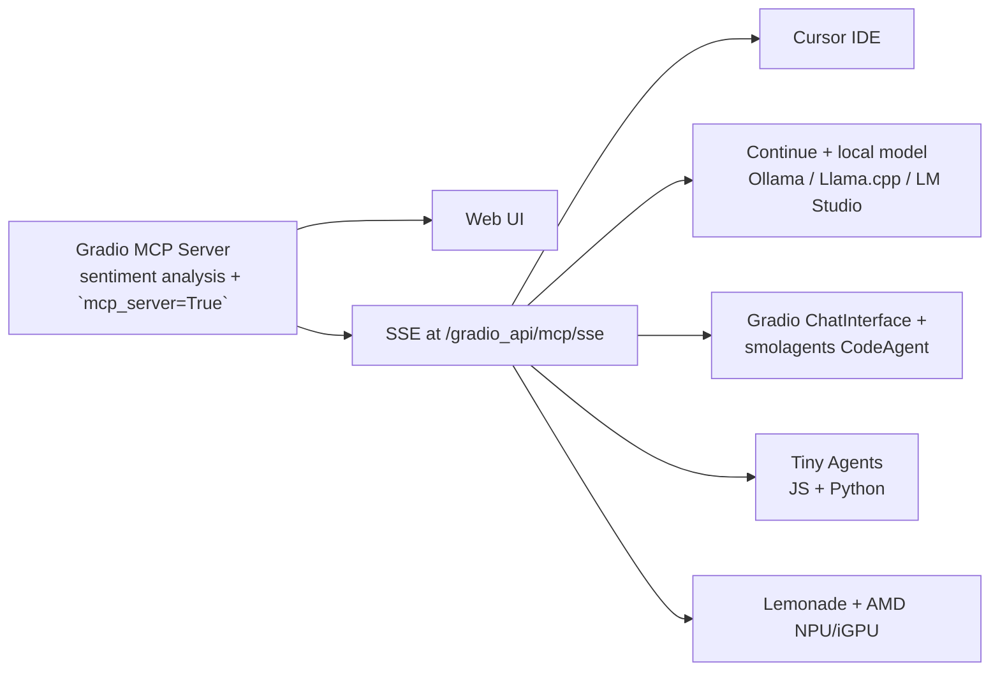

# Unit 2 — End-to-end Use Case: MCP in Action (Sentiment Analysis)

> **Course reference:** `unit2/*.mdx` (introduction + 7 sections)
> **Goal:** Build a complete, shareable MCP application — a **sentiment analysis server** with multiple clients (IDE, local model, agent, tiny agent) — and deploy it to Hugging Face Spaces.

---

## Overview (`introduction.mdx`)

You build a **sentiment analysis MCP server** with Gradio, then connect to it from several clients — demonstrating one server, many host/clients. You also deploy it to HF Spaces.



**Prerequisites:** Unit 1 completion, Python 3.10+, Node.js 18+, and a Hugging Face account.

---

## 1. Build the Gradio MCP Server (`gradio-server.mdx`)

### Setup

```bash
mkdir mcp-sentiment
cd mcp-sentiment
python -m venv venv
source venv/bin/activate  # On Windows: venv\Scripts\activate
pip install "gradio[mcp]" textblob
```

### `app.py` — the server

```python
import json
import gradio as gr
from textblob import TextBlob

def sentiment_analysis(text: str) -> str:
    """
    Analyze the sentiment of the given text.

    Args:
        text (str): The text to analyze

    Returns:
        str: A JSON string containing polarity, subjectivity, and assessment
    """
    blob = TextBlob(text)
    sentiment = blob.sentiment

    result = {
        "polarity": round(sentiment.polarity, 2),  # -1 (negative) to 1 (positive)
        "subjectivity": round(sentiment.subjectivity, 2),  # 0 (objective) to 1 (subjective)
        "assessment": "positive" if sentiment.polarity > 0 else "negative" if sentiment.polarity < 0 else "neutral"
    }

    return json.dumps(result)

# Create the Gradio interface
demo = gr.Interface(
    fn=sentiment_analysis,
    inputs=gr.Textbox(placeholder="Enter text to analyze..."),
    outputs=gr.Textbox(),  # Changed from gr.JSON() to gr.Textbox()
    title="Text Sentiment Analysis",
    description="Analyze the sentiment of text using TextBlob"
)

# Launch the interface and MCP server
if __name__ == "__main__":
    demo.launch(mcp_server=True)
```

> [!TIP]
> Accept inputs as `str` for better MCP client compatibility and convert inside the function. **Type hints and docstrings are critical** — Gradio uses them to generate accurate MCP tool schemas.

Alternatively, enable the MCP server via environment variable:

```bash
export GRADIO_MCP_SERVER=True
```

Run it:

```bash
python app.py
```

- The function is exposed **both** as a web UI and as an MCP tool.
- The MCP server now runs at: `http://localhost:7860/gradio_api/mcp/sse`

### Connect a non-SSE client via `mcp-remote`

```json
{
  "mcpServers": {
    "gradio": {
      "command": "npx",
      "args": [
        "mcp-remote",
        "http://localhost:7860/gradio_api/mcp/sse"
      ]
    }
  }
}
```

### Deploy to HF Spaces

`requirements.txt`:

```
gradio[mcp]
textblob
```

Push to a Gradio-type Space:

```bash
git init
git add app.py requirements.txt
git commit -m "Initial commit"
git remote add origin https://huggingface.co/spaces/YOUR_USERNAME/mcp-sentiment
git push -u origin main
```

Deployed MCP endpoint pattern:

```
https://YOUR_USERNAME-mcp-sentiment.hf.space/gradio_api/mcp/sse
```

---

## 2. MCP Clients & configuring Cursor (`clients.mdx`)

### The `mcp.json` structure

Two-transport config (stdio + SSE):

```json
{
  "servers": [
    {
      "name": "MCP Server",
      "transport": {
        "type": "sse",
        "url": "http://localhost:7860/gradio_api/mcp/sse"
      }
    }
  ]
}
```

Remote SSE:

```json
{
  "servers": [
    {
      "name": "Remote MCP Server",
      "transport": {
        "type": "sse",
        "url": "https://example.com/gradio_api/mcp/sse"
      }
    }
  ]
}
```

UI-style clients use a flat `mcpServers` map:

```json
{
  "mcpServers": {
    "mcp": {
      "url": "http://localhost:7860/gradio_api/mcp/sse"
    }
  }
}
```

### Cursor IDE

Cursor now supports **native remote MCP** via direct URL, but `mcp-remote` bridges clients that lack native SSE support.

**macOS (`~/.cursor/mcp.json`):**

```json
{
  "mcpServers": {
    "sentiment-analysis": {
      "command": "npx",
      "args": [
        "-y",
        "mcp-remote",
        "https://YOURUSENAME-mcp-sentiment.hf.space/gradio_api/mcp/sse",
        "--transport",
        "sse-only"
      ]
    }
  }
}
```

**Windows:**

```json
{
  "mcpServers": {
    "sentiment-analysis": {
      "command": "cmd",
      "args": [
        "/c",
        "npx",
        "-y",
        "mcp-remote",
        "https://YOURUSENAME-mcp-sentiment.hf.space/gradio_api/mcp/sse",
        "--transport",
        "sse-only"
      ]
    }
  }
}
```

**Native remote MCP:**

```json
{
  "mcpServers": {
    "my-server": {
      "url": "https://your-mcp-server.hf.space/gradio_api/mcp/sse"
    }
  }
}
```

> Open Cursor MCP settings with `Ctrl+Shift+J` / `Cmd+Shift+J` → Tools & Integrations → **Add Custom MCP**.

---

## 3. Continue + local models (`continue-client.mdx`)

**Continue** (VS Code/JetBrains extension) connects to **fully local** open-source models — a privacy-preserving alternative to cloud models — and to MCP servers. Tools are given to the model as JSON objects with `name` + arguments schema.

**The tool handshake:** tools sent with requests → model picks a tool → user approves → Continue calls it → result returns to model → model answers.

Install a local model server first:

```bash
# Llama.cpp
llama-server -hf unsloth/Devstral-Small-2505-GGUF:Q4_K_M

# Ollama
ollama run hf.co/unsloth/Devstral-Small-2505-GGUF:Q4_K_M
```

Create `.continue/` config — `config.yaml` with the model provider:

**Llama.cpp:**

```yaml
name: Llama.cpp model
version: 0.0.1
schema: v1
models:
  - provider: llama.cpp
    model: unsloth/Devstral-Small-2505-GGUF
    apiBase: http://localhost:8080
    defaultCompletionOptions:
      contextLength: 8192 # Adjust based on the model
    name: Llama.cpp Devstral-Small
    roles:
      - chat
      - edit
```

**LM Studio** (uses port 1234):

```yaml
name: LM Studio Model
version: 0.0.1
schema: v1
models:
  - provider: lmstudio
    model: unsloth/Devstral-Small-2505-GGUF
    name: LM Studio Devstral-Small
    apiBase: http://localhost:1234/v1
    roles:
      - chat
      - edit
```

**Ollama:**

```yaml
name: Ollama Devstral model
version: 0.0.1
schema: v1
models:
  - provider: ollama
    model: unsloth/devstral-small-2505-gguf:Q4_K_M
    defaultCompletionOptions:
      contextLength: 8192
    name: Ollama Devstral-Small
    roles:
      - chat
      - edit
```

Add an MCP server to Continue by putting the config in `.continue/mcpServers/`:

```yaml
name: Playwright mcpServer
version: 0.0.1
schema: v1
mcpServers:
  - name: Browser search
    command: npx
    args:
      - "@playwright/mcp@latest"
```

Test the full workflow with this prompt (model browses the web via the Playwright MCP tool):

```
1. Using playwright, navigate to https://news.ycombinator.com.

2. Extract the titles and URLs of the top 4 posts on the homepage.

3. Create a file named hn.txt in the root directory of the project.

4. Save this list as plain text in the hn.txt file, with each line containing the title and URL separated by a hyphen.

Do not output code or instructions—just complete the task and confirm when it is done.
```

> [!TIP]
> Use models with **built-in tool-calling support** (Codestral, Qwen, Llama 3.1x) for reliable MCP integration.

---

## 4. Gradio as an MCP Client (`gradio-client.mdx`)

Gradio can act as an **MCP Client** too — connect to a *remote* MCP server via **smolagents**, wrapped in a Gradio `ChatInterface` for a chatbot UI.

Install:

```bash
pip install "smolagents[mcp]" "gradio[mcp]" mcp fastmcp
```

The complete example (connect → agent → chat UI):

```python
import gradio as gr
import os

from smolagents import InferenceClientModel, CodeAgent, MCPClient


try:
    mcp_client = MCPClient(
        {"url": "https://abidlabs-mcp-tool-http.hf.space/gradio_api/mcp/sse", "transport": "sse",}
    )
    tools = mcp_client.get_tools()

    model = InferenceClientModel(token=os.getenv("HUGGINGFACE_API_TOKEN"))
    agent = CodeAgent(tools=[*tools], model=model, additional_authorized_imports=["json", "ast", "urllib", "base64"])

    demo = gr.ChatInterface(
        fn=lambda message, history: str(agent.run(message)),
        type="messages",
        examples=["Analyze the sentiment of the following text 'This is awesome'"],
        title="Agent with MCP Tools",
        description="This is a simple agent that uses MCP tools to answer questions.",
    )

    demo.launch()
finally:
    mcp_client.disconnect()
```

`requirements.txt`:

```
gradio[mcp]
smolagents[mcp]
```

Deploy like any Gradio app:

```bash
git init
git add app.py requirements.txt
git commit -m "Initial commit"
git remote add origin https://huggingface.co/spaces/YOUR_USERNAME/mcp-client
git push -u origin main
```

> [!WARNING]
> Always close the MCP client in a `finally` block with `mcp_client.disconnect()`.

---

## 5. Tiny Agents (`tiny-agents.mdx`)

**Tiny Agents** run MCP servers from the command line via JSON config — in both **JavaScript** (`@huggingface/tiny-agents`) and **Python** (`huggingface_hub[mcp]`).

Setup:

```bash
# install npx
npm install -g npx

# bridge: stdio → SSE
npm i mcp-remote

# JS tiny-agents
npm install @huggingface/tiny-agents
# or Python tiny-agents
pip install "huggingface_hub[mcp]>=0.32.0"

# project scaffold
mkdir my-agent
touch my-agent/agent.json
cd my-agent
```

`agent.json`:

```json
{
	"model": "Qwen/Qwen2.5-72B-Instruct",
    "provider": "novita",
	"servers": [
		{
			"type": "stdio",
			"command": "npx",
			"args": [
				"mcp-remote",
				"http://localhost:7860/gradio_api/mcp/sse"
			]
		}
	]
}
```

| Field | Description |
|-------|-------------|
| `model` | The open source model to use for the agent |
| `provider` | The inference provider to use for the agent |
| `servers` | The servers to use for the agent. We use `mcp-remote` to reach our Gradio MCP server |

Run it:

```bash
# JS
npx @huggingface/tiny-agents run agent.json
# Python
tiny-agents run agent.json
```

Programmatic equivalents:

```ts
const agent = new Agent({
    provider: process.env.PROVIDER ?? "novita",
    model: process.env.MODEL_ID ?? "Qwen/Qwen2.5-72B-Instruct",
    apiKey: process.env.HF_TOKEN,
    servers: [
        // ... existing servers ...
        {
            command: "npx",
            args: [
                "mcp-remote",
                "http://localhost:7860/gradio_api/mcp/sse"  // Your Gradio MCP server
            ]
        }
    ],
});
```

```python
import os

from huggingface_hub import Agent

agent = Agent(
    model="Qwen/Qwen2.5-72B-Instruct",
    provider="novita",
    servers=[
        {
            "command": "npx",
            "args": [
                "mcp-remote",
                "http://localhost:7860/gradio_api/mcp/sse"  # Your Gradio MCP server
            ]
        }
    ],
)
```

Local model variant (LM Studio at port 1234):

```json
{
	"model": "Qwen/Qwen3-32B",
	"endpointUrl": "http://localhost:1234/v1",
	"servers": [
		{
			"type": "stdio",
			"command": "npx",
			"args": [
				"mcp-remote",
				"http://localhost:1234/v1/mcp/sse"
			]
		}
	]
}
```

Connect to the deployed Space:

```json
{
    command: "npx",
    args: [
        "mcp-remote",
        "https://YOUR_USERNAME-mcp-sentiment.hf.space/gradio_api/mcp/sse"
    ]
}
```

> The agent connects to multiple servers, discovers tools dynamically, and loads them on start.

---

## 6. Lemonade Server — local inference on AMD (`lemonade-server.mdx`)

**Lemonade Server** provides local model inference accelerated by **AMD NPU and iGPU**, enabling a fully private file assistant. Stimulate CPU across all platforms; GPU via Vulkan; NPU on AMD Ryzen AI 300 series (Windows only).

Setup:

```bash
uv venv --python 3.11
source .venv/bin/activate
uv pip install lemonade-sdk==8.0.3
```

(Or from source: `git clone https://github.com/lemonade-sdk/lemonade-sdk.git && cd lemonade-sdk && pip install -e .`)

Launch:

```bash
lemonade-server-dev serve
```

Import custom models via the UI: `http://localhost:8000/#model-management`.

Agent config — Windows (note `npx.cmd`):

```json
{
  "model": "Qwen3-8B-GGUF",
  "endpointUrl": "http://localhost:8000/api/",
  "servers": [
    {
      "type": "stdio",
      "command": "C:\\Program Files\\nodejs\\npx.cmd",
      "args": [
        "mcp-remote",
        "http://localhost:7860/gradio_api/mcp/sse"
      ]
    }
  ]
}
```

Linux:

```json
{
  "model": "Qwen3-8B-GGUF",
  "endpointUrl": "http://localhost:8000/api/",
  "servers": [
    {
      "type": "stdio",
      "command": "npx",
      "args": [
        "mcp-remote",
        "http://localhost:7860/gradio_api/mcp/sse"
      ]
    }
  ]
}
```

> **(Note)** The `http://localhost:1234/v1/mcp/sse` endpoint inside `lemonade` CLI examples demonstrates an *LM Studio–style* endpoint; the two ports are distinct services — the course uses Lemonade only for inference (`:8000`) and `mcp-remote` for the Gradio SSE bridge.

### The private file assistant (resume evaluation)

Purpose: a local, privacy-focused file assistant for sensitive data.

```bash
mkdir file-assistant
cd file-assistant
```

Config (Windows / Linux variants — this one shown for Linux):

```json
{
  "model": "user.jan-nano",
  "endpointUrl": "http://localhost:8000/api/",
  "servers": [
    {
      "type": "stdio",
      "command": "npx",
      "args": [
        "-y",
        "@wonderwhy-er/desktop-commander"
      ]
    }
  ]
}
```

The **Desktop Commander MCP server** provides file-system access and terminal control. Model info:

```
Model Name: user.jan-nano
Checkpoint: Menlo/Jan-nano-gguf:jan-nano-4b-Q4_0.gguf
Recipe: llamacpp
```

Create context files:

```bash
mkdir candidates
touch candidates/john_resume.md
```

Add `job_description.md` (a "Senior Food Technology Engineer" role) and `candidates/john_resume.md` (candidate's resume). Run:

```bash
tiny-agents run agent.json
```

The agent loads 18 tools from Desktop Commander:

```
Agent loaded with 18 tools:
 • get_config
 • set_config_value
 • read_file
 • read_multiple_files
 • write_file
 • create_directory
 • list_directory
 • move_file
 • search_files
 • search_code
 • get_file_info
 • edit_block
 • execute_command
 • read_output
 • force_terminate
 • list_sessions
 • list_processes
 • kill_process
 »
```

Prompt the agent to evaluate the candidate against the job description and draft an invitation — with the model, files, and tooling all running **locally**, so the resume data never leaves your machine.

Sample generated artifact:

```markdown
# Interview Invitation

Dear John,

We would like to invite you for an interview for the Senior Food Technology Engineer position. The interview will be held on [insert date and time] at [insert location or virtual meeting details].

Please confirm your availability and let us know if you need any additional information.

Best regards,
[Your Name]
[Your Contact Information]
```

---

## Summary

- **One Gradio server** (`mcp_server=True`) = web UI **and** MCP tool at `/gradio_api/mcp/sse`.
- **Clients galore:** Cursor (config or native remote) → Continue + local models (Llama.cpp/Ollama/LM Studio) → Gradio `ChatInterface` + smolagents → Tiny Agents (JS/Python) → Lemonade-powered local assistant.
- **`mcp-remote`** bridges stdio-only clients to SSE-based Gradio servers.
- Deployment = push `app.py` + `requirements.txt` to a Gradio-type **HF Space**.
- **Privacy:** Continue with local models and Lemonade keep everything on-device.

*Next → Unit 3 tutorial: a PR-agent workflow server for Claude Code.*