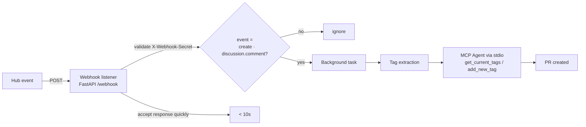

# Unit 3.1 — The Pull Request Agent on the Hugging Face Hub

> **Course reference:** `unit3_1/*.mdx` (introduction, setting-up-the-project, creating-the-mcp-server, mcp-client, webhook-listener, quiz1, quiz2, conclusion)
> **Goal:** Build and deploy a **Pull Request Agent** that automatically tags model repositories on the Hugging Face Hub when a discussion comment asks for it — a complete automation system combining an MCP server, an LLM agent, a webhook listener, and a testing interface.

---

## Overview (`introduction.mdx`)

The agent listens for **Hub discussion comment events** via webhook, extracts tag suggestions from the comment text, and creates pull requests that add those tags to the repository's `README.md` model card.

### Webhook flow



### The four components

| File | Purpose | Description |
|------|---------|-------------|
| `mcp_server.py` | **Core MCP Server** | FastMCP-based server with tools for reading and updating model tags |
| `app.py` | **Webhook Listener & Agent** | FastAPI app that receives webhooks, processes discussions, and creates PRs |
| `requirements.txt` | **Dependencies** | Python packages including FastMCP, FastAPI, and huggingface-hub |
| `pyproject.toml` | **Project Configuration** | Modern Python packaging with uv dependency management |
| `Dockerfile` | **Deployment** | Container configuration for Hugging Face Spaces |
| `env.example` | **Configuration Template** | Required environment variables and secrets |
| `cleanup.py` | **Utility** | Helper script for development and testing cleanup |

Key behaviors:

- Tags are extracted from comments via **explicit patterns** (`tags: ...`), **hashtags** (`#tag`), and **natural-language mentions**.
- The MCP server exposes `get_current_tags` and `add_new_tag`.
- **Background task processing** keeps webhook responses under 10 seconds.
- Deploys to **HF Spaces** with a Dockerfile-based container.

---

## 1. Setting up the project (`setting-up-the-project.mdx`)

Clone the starter repo:

```bash
git clone https://huggingface.co/spaces/mcp-course/tag-this-repo
```

Project layout:

```
hf-pr-agent/
├── mcp_server.py              # Core MCP server with tagging tools
├── app.py                     # FastAPI webhook listener and agent
├── requirements.txt           # Python dependencies
├── pyproject.toml             # Project configuration
├── env.example                # Environment variables template
├── cleanup.py                 # Development utility
```

`pyproject.toml`:

```toml
[project]
name = "mcp-course-unit3-example"
version = "0.1.0"
description = "FastAPI and Gradio app for Hugging Face Hub discussion webhooks"
readme = "README.md"
requires-python = ">=3.11"
dependencies = [
    "fastapi>=0.104.0",
    "uvicorn[standard]>=0.24.0",
    "gradio>=4.0.0",
    "huggingface-hub[mcp]>=0.32.0",
    "pydantic>=2.0.0",
    "python-multipart>=0.0.6",
    "requests>=2.31.0",
    "python-dotenv>=1.0.0",
    "fastmcp>=2.0.0",
]

[build-system]
requires = ["hatchling"]
build-backend = "hatchling.build"

[tool.hatch.build.targets.wheel]
packages = ["src"]
```

Environment:

```bash
uv venv
source .venv/bin/activate # or .venv/Scripts/activate on Windows
uv sync
```

`env.example`:

```bash
# Hugging Face API Token (required)
# Get from: https://huggingface.co/settings/tokens
HF_TOKEN=hf_your_token_here

# Webhook Secret (required for production)
# Use a strong, random string
WEBHOOK_SECRET=your-webhook-secret-here

# Model for the agent (optional)
HF_MODEL=owner/model

# Provider for MCP agent (optional)
HF_PROVIDER=huggingface
```

Generate a strong secret:

```bash
python -c "import secrets; print(secrets.token_hex(32))"
```

> [!WARNING]
> `HF_TOKEN` and `WEBHOOK_SECRET` are required. **Never commit `.env` files** to version control.

---

## 2. Creating the MCP server (`creating-the-mcp-server.mdx`)

The heart of the agent — two tools that abstract Hub API complexity:

| Tool | Description |
| --- | --- |
| `get_current_tags` | Retrieves existing tags from a model repository |
| `add_new_tag` | Adds a new tag to a repository via pull request |

### Imports and configuration

```python
#!/usr/bin/env python3
"""
Simplified MCP Server for HuggingFace Hub Tagging Operations using FastMCP
"""

import os
import json
from fastmcp import FastMCP
from huggingface_hub import HfApi, model_info, ModelCard, ModelCardData
from huggingface_hub.utils import HfHubHTTPError
from dotenv import load_dotenv

load_dotenv()
```

> [!TIP]
> If you're using uv, create a `.env` file in the project root and you won't need `load_dotenv()` when running with `uv run`.

```python
# Configuration
HF_TOKEN = os.getenv("HF_TOKEN")

# Initialize HF API client
hf_api = HfApi(token=HF_TOKEN) if HF_TOKEN else None

# Create the FastMCP server
mcp = FastMCP("hf-tagging-bot")
```

The conditional `hf_api` lets the server start even without a token (useful for testing structure).

### Tool 1 — `get_current_tags`

```python
@mcp.tool()
def get_current_tags(repo_id: str) -> str:
    """Get current tags from a HuggingFace model repository"""
    print(f"🔧 get_current_tags called with repo_id: {repo_id}")

    if not hf_api:
        error_result = {"error": "HF token not configured"}
        json_str = json.dumps(error_result)
        print(f"❌ No HF API token - returning: {json_str}")
        return json_str

    try:
        print(f"📡 Fetching model info for: {repo_id}")
        info = model_info(repo_id=repo_id, token=HF_TOKEN)
        current_tags = info.tags if info.tags else []
        print(f"🏷️ Found {len(current_tags)} tags: {current_tags}")

        result = {
            "status": "success",
            "repo_id": repo_id,
            "current_tags": current_tags,
            "count": len(current_tags),
        }
        json_str = json.dumps(result)
        print(f"✅ get_current_tags returning: {json_str}")
        return json_str

    except Exception as e:
        print(f"❌ Error in get_current_tags: {str(e)}")
        error_result = {"status": "error", "repo_id": repo_id, "error": str(e)}
        json_str = json.dumps(error_result)
        print(f"❌ get_current_tags error returning: {json_str}")
        return json_str
```

Pattern: **fetch → process → structure as JSON → graceful errors**.

> [!TIP]
> **All MCP tools must return strings, not Python objects** — hence `json.dumps()`. And the extensive emoji logging isn't overkill: your server runs *autonomously* reacting to Hub events, so you won't watch logs in real time.

### Tool 2 — `add_new_tag`

```python
@mcp.tool()
def add_new_tag(repo_id: str, new_tag: str) -> str:
    """Add a new tag to a HuggingFace model repository via PR"""
    print(f"🔧 add_new_tag called with repo_id: {repo_id}, new_tag: {new_tag}")

    if not hf_api:
        error_result = {"error": "HF token not configured"}
        json_str = json.dumps(error_result)
        print(f"❌ No HF API token - returning: {json_str}")
        return json_str

    try:
        # Get current model info and tags
        print(f"📡 Fetching current model info for: {repo_id}")
        info = model_info(repo_id=repo_id, token=HF_TOKEN)
        current_tags = info.tags if info.tags else []
        print(f"🏷️ Current tags: {current_tags}")

        # Check if tag already exists
        if new_tag in current_tags:
            print(f"⚠️ Tag '{new_tag}' already exists in {current_tags}")
            result = {
                "status": "already_exists",
                "repo_id": repo_id,
                "tag": new_tag,
                "message": f"Tag '{new_tag}' already exists",
            }
            json_str = json.dumps(result)
            print(f"🏷️ add_new_tag (already exists) returning: {json_str}")
            return json_str
```

> [!TIP]
> **Validate before acting.** Checking the current state prevents duplicate PRs and gives better user feedback.

Model-card handling (works even on repos with no README):

```python
        # Add the new tag to existing tags
        updated_tags = current_tags + [new_tag]
        print(f"🆕 Will update tags from {current_tags} to {updated_tags}")

        # Create model card content with updated tags
        try:
            # Load existing model card
            print(f"📄 Loading existing model card...")
            card = ModelCard.load(repo_id, token=HF_TOKEN)
            if not hasattr(card, "data") or card.data is None:
                card.data = ModelCardData()
        except HfHubHTTPError:
            # Create new model card if none exists
            print(f"📄 Creating new model card (none exists)")
            card = ModelCard("")
            card.data = ModelCardData()

        # Update tags - create new ModelCardData with updated tags
        card_dict = card.data.to_dict()
        card_dict["tags"] = updated_tags
        card.data = ModelCardData(**card_dict)
```

PR creation:

```python
        # Create a pull request with the updated model card
        pr_title = f"Add '{new_tag}' tag"
        pr_description = f"""
## Add tag: {new_tag}

This PR adds the `{new_tag}` tag to the model repository.

**Changes:**
- Added `{new_tag}` to model tags
- Updated from {len(current_tags)} to {len(updated_tags)} tags

**Current tags:** {", ".join(current_tags) if current_tags else "None"}
**New tags:** {", ".join(updated_tags)}

🤖 This is a pull request created by the Hugging Face Hub Tagging Bot.
"""

        print(f"🚀 Creating PR with title: {pr_title}")

        # Create commit with updated model card using CommitOperationAdd
        from huggingface_hub import CommitOperationAdd

        commit_info = hf_api.create_commit(
            repo_id=repo_id,
            operations=[
                CommitOperationAdd(
                    path_in_repo="README.md", path_or_fileobj=str(card).encode("utf-8")
                )
            ],
            commit_message=pr_title,
            commit_description=pr_description,
            token=HF_TOKEN,
            create_pr=True,
        )

        # Extract PR URL from commit info
        pr_url_attr = commit_info.pr_url
        pr_url = pr_url_attr if hasattr(commit_info, "pr_url") else str(commit_info)

        print(f"✅ PR created successfully! URL: {pr_url}")

        result = {
            "status": "success",
            "repo_id": repo_id,
            "tag": new_tag,
            "pr_url": pr_url,
            "previous_tags": current_tags,
            "new_tags": updated_tags,
            "message": f"Created PR to add tag '{new_tag}'",
        }
        json_str = json.dumps(result)
        print(f"✅ add_new_tag success returning: {json_str}")
        return json_str

    except Exception as e:
        print(f"❌ Error in add_new_tag: {str(e)}")
        print(f"❌ Error type: {type(e)}")
        import traceback
        print(f"❌ Traceback: {traceback.format_exc()}")

        error_result = {
            "status": "error",
            "repo_id": repo_id,
            "tag": new_tag,
            "error": str(e),
        }
        json_str = json.dumps(error_result)
        print(f"❌ add_new_tag error returning: {json_str}")
        return json_str
```

Key points:

- `create_commit(..., create_pr=True)` **creates a pull request** instead of committing to `main` — the standard Hub workflow for metadata changes and good governance.
- Clear PR descriptions + "🤖 created by the Hub Tagging Bot" transparency help maintainers review automated PRs.
- Errors include the full **traceback** — invaluable for debugging.
- Emojis (🔧 📡 ✅ ❌) create visual patterns for fast log scanning.

> [!WARNING]
> **Infinite-loop risk:** with `create_pr=True`, every commit generates a PR. If a PR is never merged, the commit can be re-triggered repeatedly. The duplicate-tag checks help prevent this.

> [!NOTE]
> The MCP server runs as a **separate process** from the main application — better isolation, and reusable by multiple clients.

---

## 3. The MCP Client: the Agent (`mcp-client.mdx`)

The client uses `huggingface_hub`'s **Agent** to combine LLM reasoning with the MCP tools. The agent connects to the MCP server over **stdio** as a subprocess.

### Configuration & singleton

```python
from huggingface_hub.inference._mcp.agent import Agent
from typing import Optional, Literal

# Configuration
HF_TOKEN = os.getenv("HF_TOKEN")
HF_MODEL = os.getenv("HF_MODEL", "microsoft/DialoGPT-medium")
DEFAULT_PROVIDER: Literal["hf-inference"] = "hf-inference"

# Global agent instance
agent_instance: Optional[Agent] = None
```

### Lazy singleton creation

```python
async def get_agent():
    """Get or create Agent instance"""
    print("🤖 get_agent() called...")
    global agent_instance
    if agent_instance is None and HF_TOKEN:
        print("🔧 Creating new Agent instance...")
        print(f"🔑 HF_TOKEN present: {bool(HF_TOKEN)}")
        print(f"🤖 Model: {HF_MODEL}")
        print(f"🔗 Provider: {DEFAULT_PROVIDER}")

        try:
            agent_instance = Agent(
                model=HF_MODEL,
                provider=DEFAULT_PROVIDER,
                api_key=HF_TOKEN,
                servers=[
                    {
                        "type": "stdio",
                        "command": "python",
                        "args": ["mcp_server.py"],
                        "cwd": ".",
                        "env": {"HF_TOKEN": HF_TOKEN} if HF_TOKEN else {},
                    }
                ],
            )
            print("✅ Agent instance created successfully")
            print("🔧 Loading tools...")
            await agent_instance.load_tools()
            print("✅ Tools loaded successfully")
        except Exception as e:
            print(f"❌ Error creating/loading agent: {str(e)}")
            agent_instance = None
```

- `stdio` → the MCP server launches as a subprocess (`python mcp_server.py`).
- `load_tools()` **discovers** `get_current_tags` and `add_new_tag` and makes them available to the agent's reasoning.
- The **singleton pattern** (create once, reuse) avoids repeated startup overhead.

Example usage — the agent *reasons* about which tools to call:

```python
# Example of how the agent would use tools
async def example_tool_usage():
    agent = await get_agent()

    if agent:
        # The agent can reason about which tools to use
        response = await agent.run(
            "Check the current tags for microsoft/DialoGPT-medium and add the tag 'conversational-ai' if it's not already present"
        )
        print(response)
```

### Processing webhook comments via the agent

```python
async def process_webhook_comment(webhook_data: Dict[str, Any]):
    """Process webhook to detect and add tags"""
    print("🏷️ Starting process_webhook_comment...")

    try:
        comment_content = webhook_data["comment"]["content"]
        discussion_title = webhook_data["discussion"]["title"]
        repo_name = webhook_data["repo"]["name"]

        # Extract potential tags from the comment and discussion title
        comment_tags = extract_tags_from_text(comment_content)
        title_tags = extract_tags_from_text(discussion_title)
        all_tags = list(set(comment_tags + title_tags))

        print(f"🔍 All unique tags: {all_tags}")

        if not all_tags:
            return ["No recognizable tags found in the discussion."]

        # Get agent instance
        agent = await get_agent()
        if not agent:
            return ["Error: Agent not configured (missing HF_TOKEN)"]

        # Process each tag
        result_messages = []
        for tag in all_tags:
            try:
                # Use agent to process the tag
                prompt = f"""
                For the repository '{repo_name}', check if the tag '{tag}' already exists.
                If it doesn't exist, add it via a pull request.

                Repository: {repo_name}
                Tag to check/add: {tag}
                """

                print(f"🤖 Processing tag '{tag}' for repo '{repo_name}'")
                response = await agent.run(prompt)

                # Parse agent response for success/failure
                if "success" in response.lower():
                    result_messages.append(f"✅ Tag '{tag}' processed successfully")
                else:
                    result_messages.append(f"⚠️ Issue with tag '{tag}': {response}")

            except Exception as e:
                error_msg = f"❌ Error processing tag '{tag}': {str(e)}"
                print(error_msg)
                result_messages.append(error_msg)

        return result_messages
```

### Tag extraction — three strategies

```python
import re
from typing import List

# Recognized ML/AI tags for validation
RECOGNIZED_TAGS = {
    "pytorch", "tensorflow", "jax", "transformers", "diffusers",
    "text-generation", "text-classification", "question-answering",
    "text-to-image", "image-classification", "object-detection",
    "fill-mask", "token-classification", "translation", "summarization",
    "feature-extraction", "sentence-similarity", "zero-shot-classification",
    "image-to-text", "automatic-speech-recognition", "audio-classification",
    "voice-activity-detection", "depth-estimation", "image-segmentation",
    "video-classification", "reinforcement-learning", "tabular-classification",
    "tabular-regression", "time-series-forecasting", "graph-ml", "robotics",
    "computer-vision", "nlp", "cv", "multimodal",
}

def extract_tags_from_text(text: str) -> List[str]:
    """Extract potential tags from discussion text"""
    text_lower = text.lower()
    explicit_tags = []

    # Pattern 1: "tag: something" or "tags: something"
    tag_pattern = r"tags?:\s*([a-zA-Z0-9-_,\s]+)"
    matches = re.findall(tag_pattern, text_lower)
    for match in matches:
        tags = [tag.strip() for tag in match.split(",")]
        explicit_tags.extend(tags)

    # Pattern 2: "#hashtag" style
    hashtag_pattern = r"#([a-zA-Z0-9-_]+)"
    hashtag_matches = re.findall(hashtag_pattern, text_lower)
    explicit_tags.extend(hashtag_matches)

    # Pattern 3: Look for recognized tags mentioned in natural text
    mentioned_tags = []
    for tag in RECOGNIZED_TAGS:
        if tag in text_lower:
            mentioned_tags.append(tag)

    # Combine and deduplicate
    all_tags = list(set(explicit_tags + mentioned_tags))

    # Filter to only include recognized tags or explicitly mentioned ones
    valid_tags = []
    for tag in all_tags:
        if tag in RECOGNIZED_TAGS or tag in explicit_tags:
            valid_tags.append(tag)

    return valid_tags
```

### Background processing for fast webhook responses

```python
from fastapi import BackgroundTasks

@app.post("/webhook")
async def webhook_handler(request: Request, background_tasks: BackgroundTasks):
    """Handle webhook and process in background"""

    # Validate webhook quickly
    if request.headers.get("X-Webhook-Secret") != WEBHOOK_SECRET:
        return {"error": "Invalid secret"}

    webhook_data = await request.json()

    # Process in background to return quickly
    background_tasks.add_task(process_webhook_comment, webhook_data)

    return {"status": "accepted"}
```

---

## 4. The webhook listener (`webhook-listener.mdx`)

FastAPI app that receives, validates, and dispatches Hub `discussion.comment` events.

### Setup

```python
import os
import json
from datetime import datetime
from typing import List, Dict, Any, Optional

from fastapi import FastAPI, Request, BackgroundTasks
from fastapi.middleware.cors import CORSMiddleware
from pydantic import BaseModel

# Configuration
WEBHOOK_SECRET = os.getenv("WEBHOOK_SECRET")
HF_TOKEN = os.getenv("HF_TOKEN")

# Simple storage for processed operations
tag_operations_store: List[Dict[str, Any]] = []

app = FastAPI(title="HF Tagging Bot")
app.add_middleware(CORSMiddleware, allow_origins=["*"])
```

Event model:

```python
class WebhookEvent(BaseModel):
    event: Dict[str, str]          # Contains action and scope information
    comment: Dict[str, Any]        # Comment content and metadata
    discussion: Dict[str, Any]     # Discussion information
    repo: Dict[str, str]           # Repository details
```

### Handler: validate → parse → filter → dispatch

```python
@app.post("/webhook")
async def webhook_handler(request: Request, background_tasks: BackgroundTasks):
    """
    Handle incoming webhooks from Hugging Face Hub
    Following the pattern from: https://raw.githubusercontent.com/huggingface/hub-docs/refs/heads/main/docs/hub/webhooks-guide-discussion-bot.md
    """
    print("🔔 Webhook received!")

    # Step 1: Validate webhook secret (security)
    webhook_secret = request.headers.get("X-Webhook-Secret")
    if webhook_secret != WEBHOOK_SECRET:
        print("❌ Invalid webhook secret")
        return {"error": "incorrect secret"}, 400

    # Step 2: Parse webhook data
    try:
        webhook_data = await request.json()
        print(f"📥 Webhook data: {json.dumps(webhook_data, indent=2)}")
    except Exception as e:
        print(f"❌ Error parsing webhook data: {str(e)}")
        return {"error": "invalid JSON"}, 400

    # Step 3: Validate event structure
    event = webhook_data.get("event", {})
    if not event:
        print("❌ No event data in webhook")
        return {"error": "missing event data"}, 400

    # Step 4: Check if this is a discussion comment creation
    # Following the webhook guide pattern:
    if (
        event.get("action") == "create" and
        event.get("scope") == "discussion.comment"
    ):
        print("✅ Valid discussion comment creation event")

        # Process in background to return quickly to Hub
        background_tasks.add_task(process_webhook_comment, webhook_data)

        return {
            "status": "accepted",
            "message": "Comment processing started",
            "timestamp": datetime.now().isoformat()
        }
    else:
        print(f"ℹ️ Ignoring event: action={event.get('action')}, scope={event.get('scope')}")
        return {
            "status": "ignored",
            "reason": "Not a discussion comment creation"
        }
```

### Processing logic (with monitoring store)

```python
async def process_webhook_comment(webhook_data: Dict[str, Any]):
    """
    Process webhook comment to detect and add tags
    Integrates with our MCP client for Hub interactions
    """
    print("🏷️ Starting process_webhook_comment...")

    try:
        # Extract comment and repository information
        comment_content = webhook_data["comment"]["content"]
        discussion_title = webhook_data["discussion"]["title"]
        repo_name = webhook_data["repo"]["name"]
        discussion_num = webhook_data["discussion"]["num"]
        comment_author = webhook_data["comment"]["author"].get("id", "unknown")

        print(f"📝 Comment from {comment_author}: {comment_content}")
        print(f"📰 Discussion: {discussion_title}")
        print(f"📦 Repository: {repo_name}")

        # Extract potential tags from comment and title
        comment_tags = extract_tags_from_text(comment_content)
        title_tags = extract_tags_from_text(discussion_title)
        all_tags = list(set(comment_tags + title_tags))

        print(f"🔍 Found tags: {all_tags}")

        # Store operation for monitoring
        operation = {
            "timestamp": datetime.now().isoformat(),
            "repo_name": repo_name,
            "discussion_num": discussion_num,
            "comment_author": comment_author,
            "extracted_tags": all_tags,
            "comment_preview": comment_content[:100] + "..." if len(comment_content) > 100 else comment_content,
            "status": "processing"
        }
        tag_operations_store.append(operation)

        if not all_tags:
            operation["status"] = "no_tags"
            operation["message"] = "No recognizable tags found"
            print("❌ No tags found to process")
            return

        # Get MCP agent for tag processing
        agent = await get_agent()
        if not agent:
            operation["status"] = "error"
            operation["message"] = "Agent not configured (missing HF_TOKEN)"
            print("❌ No agent available")
            return

        # Process each extracted tag
        operation["results"] = []
        for tag in all_tags:
            try:
                print(f"🤖 Processing tag '{tag}' for repo '{repo_name}'")

                # Create prompt for agent to handle tag processing
                prompt = f"""
                Analyze the repository '{repo_name}' and determine if the tag '{tag}' should be added.

                First, check the current tags using get_current_tags.
                If '{tag}' is not already present and it's a valid tag, add it using add_new_tag.

                Repository: {repo_name}
                Tag to process: {tag}

                Provide a clear summary of what was done.
                """

                response = await agent.run(prompt)
                print(f"🤖 Agent response for '{tag}': {response}")

                # Parse response and store result
                tag_result = {
                    "tag": tag,
                    "response": response,
                    "timestamp": datetime.now().isoformat()
                }
                operation["results"].append(tag_result)

            except Exception as e:
                error_msg = f"❌ Error processing tag '{tag}': {str(e)}"
                print(error_msg)
                operation["results"].append({
                    "tag": tag,
                    "error": str(e),
                    "timestamp": datetime.now().isoformat()
                })

        operation["status"] = "completed"
        print(f"✅ Completed processing {len(all_tags)} tags")
```

### Support endpoints

```python
@app.get("/")
async def root():
    """Root endpoint with basic information"""
    return {
        "name": "HF Tagging Bot",
        "status": "running",
        "description": "Webhook listener for automatic model tagging",
        "endpoints": {
            "webhook": "/webhook",
            "health": "/health",
            "operations": "/operations"
        }
    }

@app.get("/health")
async def health_check():
    """Health check endpoint for monitoring"""
    agent = await get_agent()

    return {
        "status": "healthy",
        "timestamp": datetime.now().isoformat(),
        "components": {
            "webhook_secret": "configured" if WEBHOOK_SECRET else "missing",
            "hf_token": "configured" if HF_TOKEN else "missing",
            "mcp_agent": "ready" if agent else "not_ready"
        }
    }

@app.get("/operations")
async def get_operations():
    """Get recent tag operations for monitoring"""
    # Return last 50 operations
    recent_ops = tag_operations_store[-50:] if tag_operations_store else []
    return {
        "total_operations": len(tag_operations_store),
        "recent_operations": recent_ops
    }
```

### Local testing

`test_webhook_local.py`:

```python
# test_webhook_local.py
import requests
import json

# Test data matching webhook format
test_webhook_data = {
    "event": {
        "action": "create",
        "scope": "discussion.comment"
    },
    "comment": {
        "content": "This model needs tags: pytorch, transformers",
        "author": {"id": "test-user"}
    },
    "discussion": {
        "title": "Missing tags",
        "num": 1
    },
    "repo": {
        "name": "test-user/test-model"
    }
}

# Send test webhook
response = requests.post(
    "http://localhost:8000/webhook",
    json=test_webhook_data,
    headers={"X-Webhook-Secret": "your-test-secret"}
)

print(f"Status: {response.status_code}")
print(f"Response: {response.json()}")
```

Simulation endpoint for quick manual testing:

```python
@app.post("/simulate_webhook")
async def simulate_webhook(
    repo_name: str,
    discussion_title: str,
    comment_content: str
) -> str:
    """Simulate webhook for testing purposes"""

    # Create mock webhook data
    mock_webhook_data = {
        "event": {
            "action": "create",
            "scope": "discussion.comment"
        },
        "comment": {
            "content": comment_content,
            "author": {"id": "test-user"}
        },
        "discussion": {
            "title": discussion_title,
            "num": 999
        },
        "repo": {
            "name": repo_name
        }
    }

    # Process the simulated webhook
    await process_webhook_comment(mock_webhook_data)

    return f"Simulated webhook processed for {repo_name}"
```

> [!NOTE]
> For **HF Spaces deployment**, use the Space's "Direct URL" + `/webhook` as the configured webhook endpoint.

---

## 5. Quiz 1 — MCP Server implementation (`quiz1.mdx`)

**Q1: What is the primary role of an MCP Server in the Pull Request Agent architecture?**
- A) To host the user interface for the application — *backend capabilities, not the UI*
- B) To expose tools and resources that the AI agent can use to interact with GitHub — *this project uses the HF Hub, not GitHub*
- C) **To expose tools for reading and updating model repository tags on the Hugging Face Hub** ✅ — `get_current_tags` and `add_new_tag`
- D) To train the AI model on pull request data — *runtime capabilities, not training*

**Q2: In the FastMCP implementation, why must all MCP tool functions return strings instead of Python objects?**
- A) To improve performance by reducing memory usage
- B) **To ensure reliable data exchange between the MCP server and client** ✅ — MCP requires string responses, so we `json.dumps()`
- C) To make the code easier to debug
- D) To comply with Hugging Face Hub API requirements

**Q3: When implementing `add_new_tag`, what is the purpose of checking if a tag already exists before creating a pull request?**
- A) To reduce API calls and improve performance
- B) **To prevent creating duplicate pull requests and provide better user feedback** ✅
- C) To comply with Hugging Face Hub rate limits
- D) To ensure the tag format is valid

**Q4: What happens when a model repository doesn't have an existing README.md file?**
- A) The `add_new_tag` tool will fail with an error
- B) **The tool creates a new ModelCard with ModelCardData and proceeds with the tag addition** ✅ — handles `HfHubHTTPError`
- C) The tool skips adding the tag and returns a warning
- D) The tool automatically creates a default README with placeholder content

**Q5: What is the significance of using `create_pr=True` in `hf_api.create_commit()`?**
- A) It makes the commit directly to the main branch
- B) **It automatically creates a pull request instead of committing directly to main** ✅ — enables the review workflow
- C) It creates a private branch only the owner can see
- D) It validates the commit before creating it

**Q6: Why does the implementation use extensive logging with emojis throughout the code?**
- A) To make the code more fun and engaging
- B) **To help with debugging and monitoring when the server runs autonomously in response to Hub events** ✅
- C) To comply with FastMCP logging requirements
- D) To reduce the amount of text in log files

---

## 6. Quiz 2 — Complete system, client, webhook (`quiz2.mdx`)

**Q1: What is the primary purpose of the webhook listener in the Pull Request Agent architecture?**
- A) To provide a user interface for managing pull requests
- B) **To receive and process Hugging Face Hub discussion comment events in real-time** ✅
- C) To store pull request data permanently in a database
- D) To authenticate users with the Hugging Face Hub

**Q2: In the Agent-based MCP client implementation, how does the client connect to the MCP server?**
- A) Through direct function calls in the same process
- B) **Using stdio connection type to communicate with the MCP server as a subprocess** ✅ — `python mcp_server.py` via stdin/stdout
- C) By writing files to a shared directory
- D) Through HTTP REST API calls

**Q3: Why does the webhook handler use FastAPI's `background_tasks.add_task()` instead of processing synchronously?**
- A) To reduce server memory usage
- B) To comply with Hugging Face Hub requirements
- C) **To return responses quickly (within 10 seconds) while allowing complex tag processing in the background** ✅
- D) To enable multiple webhook requests to be processed in parallel

**Q4: What is the purpose of validating the `X-Webhook-Secret` header?**
- A) To identify which repository sent the webhook
- B) **To prevent unauthorized requests and ensure the webhook is legitimate from Hugging Face** ✅
- C) To decode the webhook payload data
- D) To determine which MCP tools to use

**Q5: What happens when `await agent_instance.load_tools()` is called?**
- A) It downloads tools from the Hugging Face Hub
- B) **It discovers and makes available the MCP tools from the connected server (`get_current_tags` and `add_new_tag`)** ✅
- C) It starts the FastAPI webhook server
- D) It authenticates with the Hugging Face API

**Q6: How does the Agent intelligently use MCP tools when processing a natural language instruction?**
- A) It randomly calls available tools until one works
- B) It always calls `get_current_tags` first, then `add_new_tag`
- C) **It reasons about the instruction and determines which tools to call and in what sequence** ✅
- D) It requires explicit function calls in the instruction

**Q7: What filtering logic determines whether a webhook event should trigger tag processing?**
- A) All webhook events are processed regardless of type
- B) **Only events where `action='create'` and `scope='discussion.comment'`** ✅
- C) Only events from verified repository owners
- D) Only events that contain the word 'tag'

---

## 7. Conclusion (`conclusion.mdx`)

Congratulations! 🎉 You built a **Pull Request Agent** that automatically enhances HF model repositories through intelligent tagging — with four components working together:

- **MCP Server** (`mcp_server.py`) — FastMCP + Hub API integration
- **MCP Client (Agent)** — intelligent orchestration with language-model reasoning
- **Webhook Listener** (FastAPI) — real-time event processing from the Hub
- **Testing Interface** (Gradio) — development and monitoring dashboard

Next steps from the course:

- **Continue learning:** advanced MCP patterns, other automation frameworks, multi-agent systems and tool composition.
- **Build more agents:** domain-specific automation, other webhook types (model uploads/downloads), different workflows.
- **Share your work:** open-source your agent, write about patterns, contribute to the MCP ecosystem.
- **Scale your impact:** deploy for multiple repos/organizations, build more sophisticated workflows, explore commercial applications.

> [!TIP]
> Consider documenting your experience and sharing it with the community — the journey from learning MCP to building a production agent helps others explore AI automation.

---

*That's the end of the course tutorials. Projects (`hf_mcp_projects.zip`) are covered in a separate, later phase.*