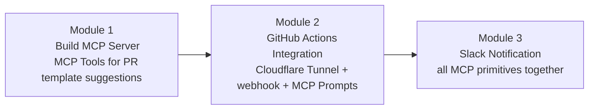
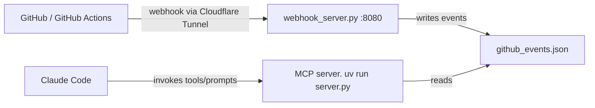
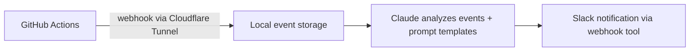

# Unit 3 — Deployed Use Case: The PR Agent Workflow (Claude Code)

> **Course reference:** `unit3/*.mdx` (introduction + 4 modules)
> **Goal:** Build a **Pull Request (PR) Agent workflow server** for **Claude Code** across three modules, exercising all three MCP primitives — Tools, Prompts, and Integration (webhooks).

---

## Overview (`introduction.mdx`)

Build a PR-agent MCP **workflow server** that runs inside Claude Code and helps with pull requests end to end. Three modules, each building on the last:



- **Module 1:** MCP Tools that suggest PR templates from git changes.
- **Module 2:** a webhook server exposed via **Cloudflare Tunnel** plus **MCP Prompts** for CI/CD monitoring.
- **Module 3:** **Slack notifications**, combining Tools + Prompts + Integration.

> [!WARNING]
> Testing the MCP server integration requires **Claude Code** (by Anthropic) — `claude mcp add` / `claude mcp list`.

Start by cloning everything:

```bash
git clone https://github.com/huggingface/mcp-course.git
```

---

## Module 1 — Build an MCP Server (`build-mcp-server.mdx`)

### Setup

```bash
cd mcp-course/projects/unit3/build-mcp-server/starter
uv venv .venv
source .venv/bin/activate # On Windows use: .venv\Scripts\activate
uv sync --all-extras
# Validate your starting code
uv run python validate_starter.py
# Run the tests
uv run pytest test_server.py -v
```

### Register with Claude Code

```bash
# Add the MCP server to Claude Code
claude mcp add pr-agent -- uv --directory /absolute/path/to/starter run server.py

# Verify the server is configured
claude mcp list
```

### Core MCP pattern

> [!TIP]
> **The core MCP philosophy: give Claude raw data and let it make intelligent decisions — don't hardcode rigid rules.**

The three-tool design splits responsibility:

| Tool | Role |
|------|------|
| `analyze_file_changes` | **Data collection** — raw git diff + stats |
| `get_pr_templates` | **Resource management** — available PR templates |
| `suggest_template` | **Decision-making** — picks the best template for Claude's consideration |

### Tool implementation pattern

```python
@mcp.tool()
async def tool_name(param1: str, param2: bool = True) -> str:
    """Tool description for Claude.

    Args:
        param1: Description of parameter
        param2: Optional parameter with default
    """
    # Your implementation
    result = {"key": "value"}
    return json.dumps(result)
```

### Error handling — always return valid JSON

```python
try:
    result = subprocess.run(["git", "diff"], capture_output=True, text=True)
    return json.dumps({"output": result.stdout})
except Exception as e:
    return json.dumps({"error": str(e)})
```

### Handling large outputs (token limits)

> [!WARNING]
> MCP tools have a **25,000 token limit** per response:
> `Error: MCP tool response (262521 tokens) exceeds maximum allowed tokens (25000)`
> Implement pagination/truncation.

```python
@mcp.tool()
async def analyze_file_changes(base_branch: str = "main",
                              include_diff: bool = True,
                              max_diff_lines: int = 500) -> str:
    """Analyze file changes with smart output limiting.

    Args:
        base_branch: Branch to compare against
        include_diff: Whether to include the actual diff
        max_diff_lines: Maximum diff lines to include (default 500)
    """
    try:
        # Get the diff
        result = subprocess.run(
            ["git", "diff", f"{base_branch}...HEAD"],
            capture_output=True,
            text=True
        )

        diff_output = result.stdout
        diff_lines = diff_output.split('\n')

        # Smart truncation if needed
        if len(diff_lines) > max_diff_lines:
            truncated_diff = '\n'.join(diff_lines[:max_diff_lines])
            truncated_diff += f"\n\n... Output truncated. Showing {max_diff_lines} of {len(diff_lines)} lines ..."
            diff_output = truncated_diff

        # Get summary statistics
        stats_result = subprocess.run(
            ["git", "diff", "--stat", f"{base_branch}...HEAD"],
            capture_output=True,
            text=True
        )

        return json.dumps({
            "stats": stats_result.stdout,
            "total_lines": len(diff_lines),
            "diff": diff_output if include_diff else "Use include_diff=true to see diff",
            "files_changed": self._get_changed_files(base_branch)
        })

    except Exception as e:
        return json.dumps({"error": str(e)})
```

### Running git from Claude's working directory (roots)

Use `mcp.get_context()` → `session.list_roots()` to learn where Claude is working:

```python
@mcp.tool()
async def analyze_file_changes(...):
    # Get Claude's working directory from roots
    context = mcp.get_context()
    roots_result = await context.session.list_roots()

    # Extract the path from the FileUrl object
    working_dir = roots_result.roots[0].uri.path

    # Use it for all git commands
    result = subprocess.run(
        ["git", "diff", "--name-status"],
        capture_output=True,
        text=True,
        cwd=working_dir  # Run in Claude's directory!
    )
```

Troubleshooting snippet:

```python
# Get Claude's working directory from roots
context = mcp.get_context()
roots_result = await context.session.list_roots()
working_dir = roots_result.roots[0].uri.path  # FileUrl object has .path property

# Use it in subprocess calls
subprocess.run(["git", "diff"], cwd=working_dir)
```

> [!NOTE]
> `roots[0].uri` is a `FileUrl` — use its `.path` property, not `str(uri)`.

### Solution walkthrough (`build-mcp-server-solution-walkthrough.mdx`)

The solution is a single `server.py` that composes the three tools:

1. **Imports & FastMCP setup** — one `@mcp.tool()` per capability.
2. **`analyze_file_changes`** — pure data collection: runs `git diff …HEAD` and `git --stat` from Claude's **root working directory**, applies smart truncation over `max_diff_lines`, and returns JSON stats + diff.
3. **`get_pr_templates`** — locates template files via the roots directory (respecting where Claude is actually working) and lists them.
4. **`suggest_template`** — the only "decision" tool: follows the philosophy of **returning data and context, letting Claude choose** rather than encoding the choice in Python. It calls the template loader and returns a JSON object the LLM interprets, so the model stays in the loop.

Validation is three-layered: `validate_starter.py`, `pytest test_server.py -v`, and live inspection through Claude Code (`claude mcp list`).

**Testing:** run the server in Inspector (`mcp dev server.py`) or ask Claude Code to call each tool and confirm JSON responses.

---

## Module 2 — GitHub Actions Integration (`github-actions-integration.mdx`)

Add a **webhook server**, **CI/CD monitoring tools**, and **MCP Prompts** so Claude can watch and reason about GitHub Actions runs in real time.

### Project structure

```
github-actions-integration/
├── starter/          # Your starting point
│   ├── server.py     # Module 1 code + TODOs
│   ├── pyproject.toml
│   └── README.md
└── solution/         # Complete implementation
    ├── server.py     # Full webhook + prompts
    ├── pyproject.toml
    └── README.md
```

### Architecture



### Setup & run

```bash
uv sync
```

Three processes:

```bash
# Terminal 1: start the webhook server
python webhook_server.py

# Terminal 2: start the MCP server
uv run server.py

# Terminal 3: expose localhost to GitHub via Cloudflare Tunnel
cloudflared tunnel --url http://localhost:8080
```

Events arrive at the webhook server (port **8080**) and are stored in a simple log file:

```python
# File where webhook server stores events
EVENTS_FILE = Path(__file__).parent / "github_events.json"
```

> [!TIP]
> The events file acts as a **simple event log — no database needed.**

### MCP Prompts (user-initiated)

> [!WARNING]
> **Prompts are user-initiated templates**, unlike Tools which Claude calls automatically. Users select a prompt *before* the model starts, shaping how Claude works.

Four prompts:

| Prompt | Purpose |
|--------|---------|
| `analyze_ci_results` | Analyze recent CI runs and summarize outcomes |
| `create_deployment_summary` | Summarize a deployment |
| `generate_pr_status_report` | Report overall PR/CI status |
| `troubleshoot_workflow_failure` | Guide diagnosis of a failing workflow |

---

## Module 3 — Slack Notification (`slack-notification.mdx`)

Complete the pipeline with **Slack notifications** — Tools (webhook POST) + Prompts (message formatting) + Integration (webhook + analysis) working together.

### Smoke-test the webhook

```bash
curl -X POST -H 'Content-type: application/json' \
  --data '{"text":"Hello from MCP Course!"}' \
  YOUR_WEBHOOK_URL
```

Store the hook as an env var (**secret — never commit it**):

```bash
export SLACK_WEBHOOK_URL="https://hooks.slack.com/services/YOUR/WEBHOOK/URL"
```

### The Slack notification tool

```python
import os
import requests
from mcp.types import TextContent

@mcp.tool()
def send_slack_notification(message: str) -> str:
    """Send a formatted notification to the team Slack channel."""
    webhook_url = os.getenv("SLACK_WEBHOOK_URL")
    if not webhook_url:
        return "Error: SLACK_WEBHOOK_URL environment variable not set"

    try:
        # TODO: Send POST request to webhook_url
        # TODO: Include message in JSON payload with "mrkdwn": true
        # TODO: Handle response and return status
        pass
    except Exception as e:
        return f"Error sending message: {str(e)}"
```

`requests.post(webhook_url, json={"text": message, "mrkdwn": True})` to finish it.

### Formatting prompts

Failure alert:

```python
@mcp.prompt()
def format_ci_failure_alert() -> str:
    """Create a Slack alert for CI/CD failures."""
    return """Format this GitHub Actions failure as a Slack message:

Use this template:
:rotating_light: *CI Failure Alert* :rotating_light:

A CI workflow has failed:
*Workflow*: workflow_name
*Branch*: branch_name
*Status*: Failed
*View Details*: <LOGS_LINK|View Logs>

Please check the logs and address any issues.

Use Slack markdown formatting and keep it concise for quick team scanning."""
```

Success summary:

```python
@mcp.prompt()
def format_ci_success_summary() -> str:
    """Create a Slack message celebrating successful deployments."""
    return """Format this successful GitHub Actions run as a Slack message:

Use this template:
:white_check_mark: *Deployment Successful* :white_check_mark:

Deployment completed successfully for [Repository Name]

*Changes:*
- Key feature or fix 1
- Key feature or fix 2

*Links:*
<PR_LINK|View Changes>

Keep it celebratory but informative. Use Slack markdown formatting."""
```

> [!TIP]
> **Slack markdown ≠ GitHub markdown:** use `*text*` for bold (not `**text**`), and set `"mrkdwn": true` in the payload.

### Run all three services

```bash
# Terminal 1: Start webhook server
python webhook_server.py

# Terminal 2: Start MCP server
uv run server.py

# Terminal 3: Start Cloudflare Tunnel
cloudflared tunnel --url http://localhost:8080
```

### Example workflow

```
User: "Check recent CI events and notify the team about any failures"

Claude:
1. Uses get_recent_actions_events (from Module 2)
2. Finds a workflow failure
3. Uses format_ci_failure_alert prompt to create message
4. Uses send_slack_notification tool to deliver it
5. Reports back: "Sent failure alert to #dev-team channel"
```

Expected outputs:

**Failure alert 🚨:**

```
🚨 *CI Failure Alert* 🚨

A CI workflow has failed:
*Workflow*: CI (Run #42)
*Branch*: feature/slack-integration
*Status*: Failed
*View Details*: <https://github.com/user/mcp-course/actions/runs/123|View Logs>

Please check the logs and address any issues.
```

**Success message ✅:**

```
✅ *Deployment Successful* ✅

Deployment completed successfully for mcp-course

*Changes:*
- Added team notification system
- Integrated MCP Tools and Prompts

*Links:*
<https://github.com/user/mcp-course/pull/42|View Changes>
```

### Project structure

```
slack-notification/
├── starter/          # Your starting point
│   ├── server.py     # Modules 1+2 code + TODOs
│   ├── webhook_server.py  # From Module 2
│   ├── pyproject.toml
│   └── README.md
└── solution/         # Complete implementation
    ├── server.py     # Full Slack integration
    ├── webhook_server.py
    └── README.md
```

> [!WARNING]
> Webhook URLs are sensitive secrets — store them as env vars and **never commit them to version control**.

The complete pipeline:



---

## Recap

- **Module 1:** FastMCP server with `analyze_file_changes` (data), `get_pr_templates` (resources), `suggest_template` (decision) — run git from Claude's **roots**, respect the **25k token limit**, always return JSON.
- **Module 2:** webhook server (`:8080`) + `github_events.json` log + **MCP Prompts** for CI workflows, exposed to GitHub via **Cloudflare Tunnel**.
- **Module 3:** Slack Tools + Prompts, markdown formatting, env-var secrets, all primitives in one pipeline.
- Philosophy throughout: **give Claude raw data; let it decide.**

*Next → Unit 3.1 tutorial: the Pull Request Agent that auto-tags HF Hub repos from discussions.*