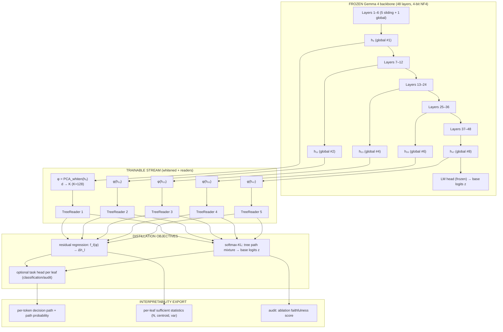

# GiST-4

## Interpretable Post-Training for Gemma 4 via Attached Dynamic Soft Decision Trees

**Version:** 0.1 (design draft)
**Status:** Architecture + theory + implementation guide
**Scope:** Post-training only — no pretraining, no backbone modification

---

## Abstract

Pretrained Gemma 4 models (12B dense, 26B A4B MoE, 31B dense) are black boxes: their
semantics are distributed across 48 layers and thousands of attention heads. We propose
**GiST-4** (*Gemma-interpretable Soft-Tree*), a post-training architecture that attaches a
family of **dynamically growing soft decision trees** ("tree readers") to a **frozen** Gemma 4
backbone. Each reader is inserted at a sparse set of layers and trained — via hidden-state and
logit **distillation** — to reproduce the base model's computations in a human-readable,
axis-aligned decision structure. Because only the small tree parameters are trainable
(~0.5–2% of total), the method is feasible on free-tier/consumer hardware (Kaggle 2×T4,
Apple Silicon via a 4-bit small base) and requires no pretraining run.

This report provides (a) the formal theory of the attached soft-tree reader — probabilistic
path model, distillation objective, measure-theoretic growth criterion, and the two-phase
gradient-ownership paradigm — and (b) a complete, implementation-ready guide (configs, data
pipeline, PyTorch code aligned with `ddtree.py`, training loop, evaluation, and a machine-readable
interpretability export schema).

---

## Table of Contents

- [Part I — Theory](#part-i--theory)
  - [1. Problem statement](#1-problem-statement)
  - [2. Design principles](#2-design-principles)
  - [3. The architecture at a glance](#3-the-architecture-at-a-glance)
  - [4. Formal model](#4-formal-model)
  - [5. Distillation objective](#5-distillation-objective)
  - [6. Growth criterion: measure-theoretic purity](#6-growth-criterion-measure-theoretic-purity)
  - [7. The two-phase paradigm](#7-the-two-phase-paradigm)
  - [8. Faithfulness budget](#8-faithfulness-budget)
- [Part II — Implementation](#part-ii--implementation)
  - [9. Hardware plan](#9-hardware-plan)
  - [10. Configuration](#10-configuration)
  - [11. Data pipeline (caching phase)](#11-data-pipeline-caching-phase)
  - [12. Whitened subspace projection](#12-whitened-subspace-projection)
  - [13. The TreeReader module](#13-the-treereader-module)
  - [14. Two-phase training loop](#14-two-phase-training-loop)
  - [15. Evaluation and the interpretability export plane](#15-evaluation-and-the-interpretability-export-plane)
  - [16. Deployment on Kaggle 2×T4 and MacBook 16GB](#16-deployment-on-kaggle-2t4-and-macbook-16gb)
  - [17. Experiment plan](#17-experiment-plan)
- [Part III — Discussion](#part-iii--discussion)
  - [18. Limitations](#18-limitations)
  - [19. Relation to existing work](#19-relation-to-existing-work)
  - [20. Guidelines for growth hyperparameters](#20-guidelines-for-growth-hyperparameters)

---

# Part I — Theory

## 1. Problem statement

Let $\Phi_\theta$ be a pretrained, frozen causal language model with $L$ decoder layers.
For an input sequence $X \in \mathbb{Z}^{B \times S}$ of token ids, $\Phi$ produces:

- hidden states $h_l \in \mathbb{R}^{B \times S \times d}$ at every layer $l \in {1..L}$,
- next-token logits $z = \Phi_{\text{head}}(h_L) \in \mathbb{R}^{B \times S \times V}$.

**Goal.** Build a *post-training* module $T$ (the "reader") such that for any input:

1. **Faithfulness:** $T$ reproduces the base model's behavior where it matters ($T$'s output
   is predictive of the base's residual stream, layer outputs, or logits on the same inputs).
2. **Interpretability:** every $T$ decision is a sequence of axis-aligned splits with
   measurable statistics — a **decision path** a human can read, audit, and annotate.
3. **Adaptivity:** $T$'s complexity grows only where the base model itself exhibits high
   decision variance — no unused capacity.
4. **Feasibility:** only $T$'s parameters are optimized *with the backbone frozen
   (4-bit quantized)*, so the entire procedure runs on consumer hardware.

## 2. Design principles

Four guiding principles, each inherited directly from one side of the fusion:

| #  | Principle                                                                                                 | From                                |
| -- | --------------------------------------------------------------------------------------------------------- | ----------------------------------- |
| P1 | Keep the backbone frozen; never back-propagate into Gemma gates.                                          | PEFT practice                       |
| P2 | Read, don't rewrite: insert readers at the*global attention* layers where the model "summarizes" state. | Gemma 4 hybrid 5:1 pattern          |
| P3 | Let structure grow from data: split a leaf only when empirical residual variance demands it.              | `ddtree.py` `evaluate_and_grow` |
| P4 | Make splits axis-aligned in a*whitened* subspace so paths are human-readable.                           | interpretability design             |

P2 justifies the insertion set: in Gemma 4 the global layers (multiples of 6 for 12B; layers
6, 12, ..., 48) are exactly the points where the model performs global information mixing.
Inserting a reader *after a global layer* gives it the richest, most "decided" representation.

## 3. The architecture at a glance



## 4. Formal model

### 4.1 Whitened subspace

For each insertion layer $l$, collect hidden states over a calibration corpus and fit PCA:

$$
\mu_l = \mathbb{E}[h_l], \quad W_l = \text{top-}K \text{ eigenvectors of } \mathrm{Cov}[h_l]
$$

Define the whitening map:

$$
\phi_l(h) = (h - \mu_l)\, W_l \in \mathbb{R}^{K}, \qquad K \ll d
$$

$W_l$ is **frozen after calibration**. Its columns are ordered principal directions of the
model's own state space, so tree splits $x_j \le t$ are interpretable: *"the j-th dominant
feature of the model's internal representation falls below threshold t."*

### 4.2 Soft decision tree as a probabilistic model

A (soft) binary decision tree $T$ is a collection of nodes $v$. Each internal node $v$
carries a router parameter $\theta_v = (w_v, b_v)$; each leaf $\ell$ carries a predictor
$f_\ell$. For an input $x = \phi_l(h)$:

- **Split probability** (left/right):
  $$
  p_\ell(v \to \text{left} \mid x) = \sigma(w_v^\top x + b_v), \qquad
  p(v \to \text{right}) = 1 - \sigma(w_v^\top x + b_v).
  $$
- **Path probability** to leaf $\ell$:
  $$
  \pi_\ell(x) = \prod_{v \in \text{path}(\text{root} \to \ell)} p(v \to \text{child} \mid x).
  $$
- **Mixture prediction**:
  $$
  \hat{y}(x) = \sum_{\ell \in \text{leaves}} \pi_\ell(x)\, f_\ell(\phi(x)).
  $$
- **Sparse masking**: routing weights below $\epsilon = 10^{-5}$ are treated as zero
  (`ddtree.py`, `EPS`), so effective compute is $O(\text{active nodes})$, not $O(\text{tree
  size})$. This is the tree's analog of Gemma's sparse top-k expert activation (`26B A4B`).

### 4.3 Reader module per insertion layer

Where $f_\ell$ is the leaf predictor, residual decomposition of the base model defines the
target of the reader. Let $g_l$ be layer $l+1$'s first transformation. The residual stream
obeys (Gemma 4 block, README §28):

$$
h_{l+1} = h_l + \underbrace{\text{Attn}_l(h_l)}_{\Delta_h} + \underbrace{\text{FFN}_l(\cdot)}_{\Delta_f} .
$$

The reader at insertion $l$ is trained to predict the **aggregate residual delta**

$$
\Delta_l(x) = h_{l'} - h_l
$$

(idempotent over $l' > l$, but practically we fix $l' = l+1$-global span) from the whitened
input:

$$
\widehat{\Delta_l}(x) = \sum_{\ell} \pi_\ell(x)\, f_\ell(x), \qquad
\mathcal{L}_{\text{res}} = \frac{1}{N}\sum_i \| \Delta_l(x^{(i)}) - \widehat{\Delta_l}(x^{(i)}) \|^2 .
$$

$\widehat{\Delta_l}$ is the reader's *statement* of "what the model changed about this token
at this layer" — expressed as a weighted combination of readable leaf functions.

### 4.4 Sufficient statistics (empirical measure)

Each node accumulates weighted sufficient statistics during the no-grad phase
(`ddtree.py:accumulate_stats`):

$$
N_v = \sum_i \pi_v(x^{(i)}), \quad
S^{\text{X}}_v = \sum_i \pi_v(x^{(i)}) x^{(i)}, \quad
S^{\text{X2}}_v = \sum_i \pi_v(x^{(i)}) (x^{(i)})^{\otimes 2}
$$

and likewise for $Y$ (the target). These give the *local* mean/covariance used by both the
growth criterion and the interpretability export (per-leaf cluster descriptions).

## 5. Distillation objective

The reader must reproduce the base model's behavior. Total loss:

$$
\mathcal{L} = \underbrace{\lambda_{\text{res}} \, \mathcal{L}_{\text{res}}}_{\text{residual regression}}
+ \underbrace{\lambda_{\text{KL}} \, \mathcal{L}_{\text{KL}}}_{\text{logit distillation}}
+ \underbrace{\lambda_{\text{task}} \, \mathcal{L}_{\text{task}}}_{\text{downstream (optional)}}
+ \underbrace{\lambda_{\text{purity}} \, \mathbb{E}[H(\pi_\ell)]}_{\text{path concentration (optional)}} .
$$

Where:

- $\mathcal{L}_{\text{res}}$: residual regression (Section 4.3) — the tree learns the
  *mechanism*, expressed in representation space.
- $\mathcal{L}_{\text{KL}}$: for a target-token set $\mathcal{V}_{\text{proj}}$ (e.g.,
  next-token logits top-k or a task vocabulary):
  $$
  \mathcal{L}_{\text{KL}} = \mathrm{KL}\big( \mathrm{softmax}(z_{\text{base}})
  \,\|\, \mathrm{softmax}(g_{\text{leaf}}(\hat{y})) \big)
  $$

  where $g_{\text{leaf}}$ is a lightweight layer mapping the leaf mixture into logit space.
- $\mathcal{L}_{\text{task}}$: optional supervised head on the leaf mixture (e.g., toxicity
  binary, code-review classification) — this is what makes the *task decision* itself
  tractable to a path.
- $\mathcal{L}_{\text{purity}}$: confidence penalty that keeps paths decisive
  ($\pi_\ell \to \{0,1\}$), counteracting the product-trap of many soft splits. It is
  optional and should be small ($\lambda_{\text{purity}} \approx 10^{-3}$) to not corrupt
  faithfulness.

## 6. Growth criterion: measure-theoretic purity

### 6.1 Scale-invariant impurity

A leaf splits when its remaining *decision uncertainty* exceeds a threshold. Define the
(empirical) covariance tensors at a leaf $v$:

$$
\mathrm{Cov}_{\text{X}}(v) = \frac{S^{\text{X2}}_v}{N_v} - \left(\frac{S^{\text{X}}_v}{N_v}\right)^2 \in \mathbb{R}^{K \times K}, \qquad
\mathrm{Var}_{\text{Y}}(v) = \frac{S^{\text{Y2}}_v}{N_v} - \frac{(S^{\text{Y}}_v)^2}{N_v}.
$$

Normalize against the root to make the criterion scale-invariant (valid across corpora,
hidden-state magnitudes, and batch sizes):

$$
G(v) = \alpha \cdot \frac{\mathrm{tr}\,\mathrm{Cov}_{\text{X}}(v)}{\mathrm{tr}\,\mathrm{Cov}_{\text{X}}(\text{root})}
+ \beta \cdot \frac{\mathrm{Var}_{\text{Y}}(v)}{\mathrm{Var}_{\text{Y}}(\text{root})}.
$$

⚠ Note the sign convention: for the *reader*, an **increase** in local variance means
incompletely-resolved decisions → trigger growth. For downstream regression it is often
variance *residual* — be consistent: GiST uses **unexplained-variance growth**:
$G(v) > \tau \Rightarrow$ split.

### 6.2 Split rule

A leaf $v$ with $N_v \ge N_{\min}$ is bisected when

$$
G(v) > \tau, \qquad \tau \in (0,1).
$$

Bifurcation initializes the router along the maximum-variance direction of the local
covariance (`ddtree.py:_bifurcate_node`):

$$
w_v = \frac{\mathrm{diag}(\mathrm{Cov}_{\text{X}}(v))}{\|\mathrm{diag}(\mathrm{Cov}_{\text{X}}(v))\|}
\qquad \text{(normalize)},
\qquad b_v = -w_v^\top \mu_v .
$$

The normal is the dominant feature direction — i.e., the split is *the* most explanatory
axis-aligned cut the data allows. Children **inherit the parent's leaf weights** (ddtree
already implements this; conceptually the tree analog of Gemma's unified K=V parameter
sharing) so gradient flow remains smooth across the bifurcation and output does not jump.

### 6.3 Why variance, not entropy or Gini

- Variance over $\phi(h)$ is the natural surrogate for "unresolved decision surface" in a
  continuous representation space.
- It is a **sufficient statistic** we already accumulate — no extra cost.
- It degrades gracefully: a leaf with no data has zero variance and never splits (the `N < N_min` guard doubles as a robustness gate).

## 7. The two-phase paradigm

One of the distinctive features of `ddtree.py` is a **two-phase training loop**. GiST-4
inherits it intact.

### Phase A — Growth/measurement (`torch.no_grad`)

1. Reset all node statistics.
2. Route the current (cached) calibration batch through the tree, accumulating sufficient
   statistics — **no autograd graph**.
3. Compute $G(v)$ for all leaves, collect those exceeding $\tau$.
4. `_bifurcate_node` on each; newborns are registered in the tree's `nn.ModuleList` so the
   optimizer discovers them on the next step.

*Why no_grad:* the topology change (creating children, overwriting parent router weights) is
not a differentiable operation; running it under no_grad keeps the measurement phase
interpretable and free, and guarantees the subsequent autograd phase builds a clean graph
only over the *new* topology.

### Phase B — Training (`autograd`)

1. Forward through the tree on the batch → $\hat{y}(x)$, $\pi_\ell(x)$.
2. Compute $\mathcal{L}$ (Section 5) against cached base-model targets.
3. `loss.backward()` flows gradient to router weights and leaf predictors **only**.
4. Optimizer steps apply exclusively to the attached reader stream.

### Why the phases must alternate

If we trained a fixed topology first, we'd lock a premature structure. If we grew every
step, we'd thrash. The alternation (e.g., grow every $k=8$ steps) gives the reader time to
*use* the leaves it was given, and only adds capacity when scheduling shows persistent
unexplained variance — mimicking how Gemma 4 introduces global layers sparsely.

## 8. Faithfulness budget

Faithfulness is what separates this from a decorative visualization. Define three audits:

**R1 — Residual reconstruction**: how much of the base residual delta is explained by the
reader:

$$
\mathrm{Faith}_1 = 1 - \frac{\| \Delta_l - \widehat{\Delta_l} \|^2}{\| \Delta_l \|^2}.
$$

**R2 — Path ablation**: fix one instance, compute the path $\ell^* = \arg\max_\ell
\pi_\ell(x)$; zero out all leaves not on the path and re-evaluate:

$$
\mathrm{Faith}_2 = 1 - \frac{\| y_{\text{base}} - y_{\text{ablate}} \|}
{\| y_{\text{base}} \|}.
$$

A high $\mathrm{Faith}_2$ means the *explained* decision is the *actual* decision.

**R3 — Logit agreement**: the tree leaf-mixture vs. base next-token agreement (top-1 /
top-5):

$$
\mathrm{Faith}_3 = \frac{|\, \mathrm{topk}(g_{\text{leaf}}(\hat{y})) \cap
\mathrm{topk}(z_{\text{base}})\,|}{k} .
$$

A reader with $\mathrm{Faith}_1 \gtrsim 0.7$, $\mathrm{Faith}_2 \gtrsim 0.8$,
$\mathrm{Faith}_3 \gtrsim 0.6$ is honestly "the readable surface of the model", not a
parallel black box.

---

# Part II — Implementation

## 9. Hardware plan

| Platform                        | Base model (frozen, 4-bit NF4)      | Reader stream                           | Feasible?               |
| ------------------------------- | ----------------------------------- | --------------------------------------- | ----------------------- |
| Kaggle 2×T4 (30 GB total VRAM) | 12B at ~6.7 GB; 26B A4B at ~14.4 GB | Whitener + 5 readers ≈ 20–150M params | ✅ yes (12B & 26B)      |
| MacBook 16 GB unified           | E2B (~2.9 GB) / E4B (~4.5 GB)       | Same reader stack, small base           | ✅ yes (research scale) |
| MacBook 16 GB unified           | 12B                                 | —                                      | ❌ no (too large)       |

Notes:

- `bitsandbytes` does **not** run on Apple MPS. Use Apple-Metal-aware loading
  (`mlx`/`llama.cpp`-style) for the Mac path, or CPU fp32 for the base only (slow).
- On Kaggle, keep `CUDA_VISIBLE_DEVICES="0"` and offload the base to GPU 0, readers to GPU 0
  with gradient accumulation; or pipeline-split base layers across both GPUs.

## 10. Configuration

Centralize everything in a single dataclass (aligns with Gemma-4-12B verified constants).

```python
@dataclass
class GiSTConfig:
    # --- Gemma 4 base (verified in README §3) ---
    base_model_id: str = "google/gemma-4-12B-it"    # change for E4B/Mac path
    d_model: int = 3840
    num_hidden_layers: int = 48
    global_stride: int = 6                          # global layers at multiples of 6
    load_in_4bit: bool = True
    max_seq_len: int = 2048                         # calibration/training seq len
    use_bidirectional_attention: str = "vision"

    # --- Whitening ---
    K: int = 128                                    # PCA components (interpretability)
    pca_whitening: bool = True

    # --- Insertion set ---
    # Global layers after global attention: 6,12,18,24,30,36,42,48 → sample every other
    insert_ids: Tuple[int, ...] = (5, 11, 23, 35, 47)   # 0-indexed h_l after these blocks

    # --- Tree readers ---
    leaf_activation: str = "gelu_pytorch_tanh"
    leaf_hidden: int = 4 * 128                       # gated MLP hidden
    out_features_residual: int = 3840                # f_ℓ maps φ → d_model dims
    out_features_logit: int = 1024                   # g_leaf maps φ → token-subspace logits

    # --- Growth ---
    growth_threshold: float = 0.35
    min_samples: float = 2048
    alpha: float = 0.5
    beta: float = 0.5
    grow_every: int = 8                              # grow every k optimizer steps
    max_leaves_per_reader: int = 512                 # hard cap on structure

    # --- Objective ---
    lambda_res: float = 1.0
    lambda_kl: float = 0.1
    lambda_task: float = 0.0                         # set > 0 for supervised audit tasks
    lambda_purity: float = 1e-3

    # --- Optimizer ---
    lr: float = 3e-4
    weight_decay: float = 0.01
    batch_size: int = 4
    grad_accum: int = 8
    warmup_steps: int = 200
    total_steps: int = 20_000
    fp16: bool = True
    bf16: bool = False

    # --- Export ---
    export_dir: str = "export/interpretability"
    trace_every: int = 500
```

## 11. Data pipeline (caching phase)

The base model is **run once** over the corpus; hidden states (at insert layers) and logits
are cached to disk. Readers train on the cache — this is what makes post-training cheap.

```python
def cache_base_outputs(cfg: GiSTConfig, dataloader, base_model, tokenizer):
    os.makedirs("cache", exist_ok=True)
    base_model.eval()
    pca_estimator = PCA(n_components=cfg.K, whiten=False)  # fit per insert layer
    collected = {l: [] for l in cfg.insert_ids}
    with torch.no_grad():
        for step, batch in enumerate(dataloader):
            out = base_model(
                batch["input_ids"].to("cuda"),
                output_hidden_states=True,
                return_dict=True,
            )
            # cache only the insert-layer hidden states (slice from output.hidden_states)
            for l in cfg.insert_ids:
                collected[l].append(out.hidden_states[l + 1].float().cpu())  # after block l
            # optionally cache logits on a token subspace (reduce memory)
            if step % 500 == 0:
                print(f"cached {step} batches")
        for l, tensors in collected.items():
            torch.save(torch.cat(tensors, dim=0), f"cache/h_{l}.pt")
    return collected
```

> Memory note: cache `float16`/`bfloat16`, not fp32. K=128-whitened stats are also cached, so
> the full 3840-d states only live transiently.

## 12. Whitened subspace projection

Fit PCA on the cached hidden states (per insert layer), freeze the transform.

```python
class WhitenedSubspace(nn.Module):
    """Frozen (linear) whitening: φ(h) = (h - μ) @ W. W columns = top-K PCA directions."""
    def __init__(self, d_in: int, K: int, mu: Tensor, W: Tensor):
        super().__init__()
        self.register_buffer("mu", mu)
        self.register_buffer("W", W)      # (d_in, K)
        self.out_features = K

    def forward(self, h: Tensor) -> Tensor:
        return (h - self.mu) @ self.W
```

Fit-from-cache helper (drop any remaining std before normalizing):

```python
def fit_whiteners(cfg, cache_dir="cache"):
    whiteners = {}
    for l in cfg.insert_ids:
        H = torch.load(f"cache/h_{l}.pt").reshape(-1, cfg.d_model).float()
        mu = H.mean(dim=0).numpy()
        # PCA via SVD of centered data (numerically stable for H ∈ R^{N×3840})
        Hc = H - H.mean(dim=0, keepdim=True)
        Vt = torch.linalg.svd(Hc, full_matrices=False).V      # (3840, 3840)
        W = Vt[:, :cfg.K].contiguous()                         # (3840, K)
        whiteners[l] = WhitenedSubspace(cfg.d_model, cfg.K,
                                        torch.as_tensor(mu), W.to("cuda"))
    return whiteners
```

Interpretability note: because $W$’s columns are exact SVD principal directions, a readback of
split thresholds $x_j \le t$ reads as "the j-th dominant direction of the model's state
space is low/high". Optionally attach token- or feature-level labels to these directions via
a `direction_label(direction)` look-up table (e.g., top-5 contributing tokens from a probe).

## 13. The TreeReader module

Bundle the tree core (reuses `ddtree.py` classes) with leaf gated-MLP predictors, a residual
head, and a logit head. Children inherit leaf predictor weights on growth (already the tree's
behavior), so readers smoothly extend.

```python
class GatedMLP(nn.Module):
    """Gemma-4-style gated FFN (README §6): down(gelu_tanh(gate(x)) * up(x))."""
    def __init__(self, d_in, d_inter, d_out, act="gelu_pytorch_tanh"):
        super().__init__()
        self.gate = nn.Linear(d_in, d_inter, bias=False)
        self.up   = nn.Linear(d_in, d_inter, bias=False)
        self.down = nn.Linear(d_inter, d_out, bias=False)
        self.act = F.gelu if act == "gelu_pytorch_tanh" else ...
    def forward(self, x):
        return self.down(self.act(self.gate(x)) * self.up(x))
```

```python
class TreeReader(nn.Module):
    """Attached reader: whitened features in → (residual pred, logit pred, paths)."""
    def __init__(self, cfg: GiSTConfig, whitener: WhitenedSubspace):
        super().__init__()
        self.whitener = whitener
        self.K = whitener.out_features

        # Tree core from ddtree.py; leaf_linear replaced by a gated MLP + logit head.
        self.tree = DynamicSoftTree(in_features=self.K, out_features=1)

        # Leaf predictor contract: reader.forward returns mixture of these heads.
        self.res_head  = GatedMLP(self.K, cfg.leaf_hidden, cfg.out_features_residual)
        self.logit_head = nn.Linear(cfg.K, cfg.out_features_logit)
        if cfg.lambda_task > 0:
            self.task_head = nn.Linear(cfg.K, 1)     # binary audit, adjust per task
            self.bn = nn.BatchNorm1d(cfg.K)

        # Keep Gemma-style output normalization for stable logits.
        self.softcap = lambda z: 30.0 * torch.tanh(z / 30.0)

    def forward(self, h: Tensor):
        x = self.whitener(h)                          # (B, S, K)
        flow = {}                                     # ddtree flow export
        y_res = self.forward_tree_residual(x, flow)   # (B, S, d_model)
        y_log = self.softcap(self.logit_head(x))      # (B, S, out_features_logit)
        return {"residual": y_res, "logit": y_log, "flow": flow}

    def forward_tree_residual(self, x, flow):
        B, S, K = x.shape
        flat = x.reshape(B * S, K)
        # ddtree forward is batched over (N, K) — reshape batch token dimension.
        out = self.tree(flat, flow=flow)              # (B*S, 1) mixture of leaf gated-MLPs
        return out.reshape(B, S, self.out_features_residual)
```

## 14. Two-phase training loop

```python
def grow_phase(reader, cached_batch, targets, cfg):
    """Phase A: measure + grow (no_grad), per ddtree.evaluate_and_grow."""
    reader.tree.evaluate_and_grow(
        cached_batch,                    # whitened features (N, K)
        targets,                         # residual deltas or task labels
        growth_threshold=cfg.growth_threshold,
        min_samples=cfg.min_samples,
        alpha=cfg.alpha,
        beta=cfg.beta,
        root_stats={ "trace_X": 1.0, "var_Y": 1.0 },   # scale-invariance anchor
    )
    # enforce hard cap on structure from either maestro growth or leak
    if len(reader.tree.all_nodes) > cfg.max_leaves_per_reader:
        prune_least_mass_paths(reader, keep=cfg.max_leaves_per_reader)
```

```python
def train_phase(step, reader, batch, cached_targets, base_logits_cache, cfg):
    reader.train()
    out = reader(batch["hidden"])               # whitened features inside reader
    L = cfg.lambda_res * F.mse_loss(out["residual"], cached_targets["delta"])
    if cfg.lambda_kl > 0:
        L = L + cfg.lambda_kl * kl_div_logits(out["logit"], base_logits_cache)
    if cfg.lambda_task > 0:
        L = L + cfg.lambda_task * F.binary_cross_entropy_with_logits(
            reader.task_head(out["logit"]).squeeze(-1), batch["label"].float())
    if cfg.lambda_purity > 0:
        L = L + cfg.lambda_purity * path_entropy(out["flow"])
    return L
```

```python
def main_train(cfg):
    whitener = fit_whiteners(cfg)
    reader = TreeReader(cfg, whitener).to("cuda")

    optim = torch.optim.AdamW(reader.parameters(),
                              lr=cfg.lr, weight_decay=cfg.weight_decay)
    scheduler = torch.optim.lr_scheduler.OneCycleLR(optim, max_lr=cfg.lr,
                                                    total_steps=cfg.total_steps)

    for step, batch in enumerate(loader):          # loader feeds cached h_l + targets
        cached = bundle(batch, insert_ids=cfg.insert_ids)   # {l: (h, delta, base_logits)}
        if step % cfg.grow_every == 0:             # Phase A
            for l, r in zip(cfg.insert_ids, reader_stack):
                grow_phase(r, cached.whitened_for(l), cached.delta_for(l), cfg)
        loss = train_phase(step, reader, cached, batch, cfg)  # Phase B
        loss.backward()
        # clip grads (stable training with freshly grown leaves)
        torch.nn.utils.clip_grad_norm_(reader.parameters(), 1.0)
        optim.step(); optim.zero_grad(); scheduler.step()

        if step % cfg.trace_every == 0:
            export_trace(reader, batch, cfg)                # Section 15
```

## 15. Evaluation and the interpretability export plane

Every `trace_every` steps — and at the end — materialize machine-readable explanations.

```python
def export_trace(reader, batch, cfg):
    ids = batch["input_ids"]
    tokens = tokenizer.convert_ids_to_tokens(ids[0].tolist())
    out = reader(batch["hidden"].to("cuda"))
    flow = out["flow"]

    record = {"tokens": tokens, "layers": []}
    # tree topology + per-node stats
    for node in reader.tree.traverse():
        record["nodes"].append({
            "uid": node.uid, "leaf": node.is_leaf(),
            "mass": round(float(node.N), 4),
            "centroid": topk_indices(node, k=8),      # ⟨x_j⟩ per PCA direction
            "var": node.local_stats()[1].tolist(),
        })
    # per-token decision path
    paths = per_token_paths(reader.tree, batch["hidden"][0])   # B,S,K → [path]
    record["decisions"] = [{
        "token": tokens[t],
        "path": [{"node": n.uid, "split": f"x_dir_{j} < {t:.3f}"} for n, j, t in p],
        "p": round(prob, 4),
    } for t, (p, prob) in enumerate(paths)]
    json.dump(record, open(f"{cfg.export_dir}/trace_{step:06d}.json", "w"), indent=2)
```

**Faithfulness dashboard** (run after training):

```python
def faithfulness_run(reader, eval_loader, base_model, cfg):
    F1, F2, F3 = [], [], []
    for batch in eval_loader:
        hidden = batch["hidden"].to("cuda")
        base_z = base_model(batch["input_ids"].to("cuda")).logits      # frozen forward
        # R1 residual reconstruction, R2 path ablation, R3 top-k logit agreement
        F1.append(residual_explained(reader, hidden, batch["delta"]))
        F2.append(path_ablation_score(reader, hidden, base_z))
        F3.append(logit_agreement(reader, hidden, base_z, k=5))
    return {"faith_1_residual": np.mean(F1), "faith_2_ablation": np.mean(F2),
            "faith_3_logit_top5": np.mean(F3)}
```

## 16. Deployment on Kaggle 2×T4 and MacBook 16GB

### Kaggle 2×T4 (primary)

- **Base:** `google/gemma-4-12B-it` (or E4B) loaded with `BitsAndBytesConfig(load_in_4bit=True, bnb_4bit_quant_type="nf4", bnb_4bit_compute_dtype=torch.float16)` and `device_map="auto"`.
- **Precision:** fp16 (T4 has no native bf16 — verify with `torch.cuda.is_bf16_supported()`).
- **Pipeline for readers:** readers stay on GPU 0; base forward on GPU 0 with
  `output_hidden_states=True`; use gradient checkpointing *off* for readers (tiny), on for
  anything touching the frozen base.
- **Caching:** run the corpus *once*, save whitened features + deltas + logit-subspace targets
  to `/kaggle/working`. Readers train from cache → extremely fast steps.
- **Quota:** 30 h/week free. Milestone 0–2 (E4B, K=64, 2 readers) fits in a single session.

### MacBook 16GB (research scale)

- **Base:** `unsloth/gemma-4-e4b-it-bnb-4bit` (or equivalent small), or convert to
  `mlx`/`gguf`; base runs in fp32 on CPU for the caching pass (slow but one-time) — or use
  Metal via `mlx-lm`.
- Readers on `mps` device; keep token batch small. Expect research-scale only (K=64, 1–2
  readers, ~10–50k calibration tokens).

## 17. Experiment plan

| Experiment          | Question                                                              | Base    | Readers                  | Data                     |
| ------------------- | --------------------------------------------------------------------- | ------- | ------------------------ | ------------------------ |
| E0 smoke            | Does the pipeline run end-to-end on T4?                               | E4B     | 1 reader, K=64, 2k steps | ANY public corpus slice  |
| E1 faithfulness     | Do R1/R2/R3 reach the acceptance thresholds?                          | 12B     | 5 readers, K=128         | FineWeb-edu 100k tokens  |
| E2 interpretability | Are paths coherent (path purity entropy ↓, leaf clusters labelable)? | 12B     | 5 readers                | FineWeb-edu + code slice |
| E3 audit task       | Toxicity/code-review F1 with per-leaf explainability                  | 12B     | 5 readers + task head    | Jigsaw toxic / HumanEval |
| E4 hardware         | 26B A4B via which budget / run-length ceiling                         | 26B A4B | 5 readers                | FineWeb 10B slice        |
| E5 ablations        | λ's, K, insert spacing, grow_every                                   | 12B     | —                       | controlled holdout       |

Baselines to beat: (a) standalone `ddtree.py` on raw features, (b) dense LoRA adapter of same
parameter budget, (c) frozen-random tree reader (no distillation) — demonstrates distillation
is what carries faithfulness.

---

# Part III — Discussion

## 18. Limitations

1. **Readable ≠ same performance.** The reader *explains* the frozen model; it does not
   improve or guarantee base accuracy. Task-head gains are incidental.
2. **Axis alignment is representation-bound.** Splits are interpretable only in a whitened
   subspace; raw-feature trees will produce dense, unreadable hyperplanes.
3. **Growth can be unstable.** Freshly created leaves need warm-up; clip grads, use small
   `lambda_purity`, and keep `max_leaves` capped.
4. **Fixed-base training strata.** If the base is later fine-tuned, readers must be re-fit
   against the new checkpoint (post-training assumption holds).
5. **Token-domain analog needed.** The growth criterion uses *variance in representation
   space*; mapping it to language-level concepts (topic, clause boundaries) is an open,
   research-grade refinement.

## 19. Relation to existing work

- **LLM-Boost / PFN-Boost (arXiv 2502.02672):** seed the first tree with LLM scores, learn
  residuals — the reverse direction of our distillation, but validates that tree+transformer
  beat both components alone on tabular data.
- **MetaTree (arXiv 2402.03774):** a Transformer *generates* trees; GiST-4 instead
  *attaches* trees to a frozen Transformer to read it.
- **ERMoE (arXiv 2511.10971):** eigenbasis-content routing = our PCA-whitened router init,
  generalized.
- **S′MoRE (NeurIPS 2025):** per-token residual *trees* inside LLMs — the closest structural
  analog to our TreeReader placement; GiST adds the growth-under-frozen-base distillation.
- **GPTree / MoDT:** interpretable Mixture-of-Decision-Trees baselines for the audit-task
  head.
- **SAE line of work (DeepMind mono/Multi unigram):** both SAEs and GiST "open the model";
  SAEs explain *features*, GiST-4 explains *decisions (paths)* — complementary, not
  competing.

## 20. Guidelines for growth hyperparameters

| Hyperparameter          | Rule of thumb                                                                                 |
| ----------------------- | --------------------------------------------------------------------------------------------- |
| `growth_threshold τ` | start 0.35; raise (grow less) if topology explodes, lower (grow more) if faith-1 plateaus low |
| `min_samples`         | ≥ 2048 for 2048-token sequences; raise for stability                                         |
| `alpha / beta`        | 0.5/0.5 for balanced hidden-state + task signal; tasks with clean labels → β ¿ alpha       |
| `grow_every`          | 8–16; lower = more responsive, higher = stabler                                              |
| `K` (PCA dims)        | 64–128; K too small → unreadable directions, too large → splits lose axis meaning          |
| `lambda_purity`       | ≤ 1e-3; high values destroy faithfulness                                                     |
| `max_leaves`          | 256–512/reader; guard against unbounded growth                                               |

---

*Documented source of truth:* `README.md` (Gemma-4 verified config), `ddtree.py` (two-phase
soft tree API: `DynamicNode`, `DynamicSoftTree`, `evaluate_and_grow`, `_bifurcate_node`,
`EPS` pruning). All code blocks above are aligned to those existing APIs.
