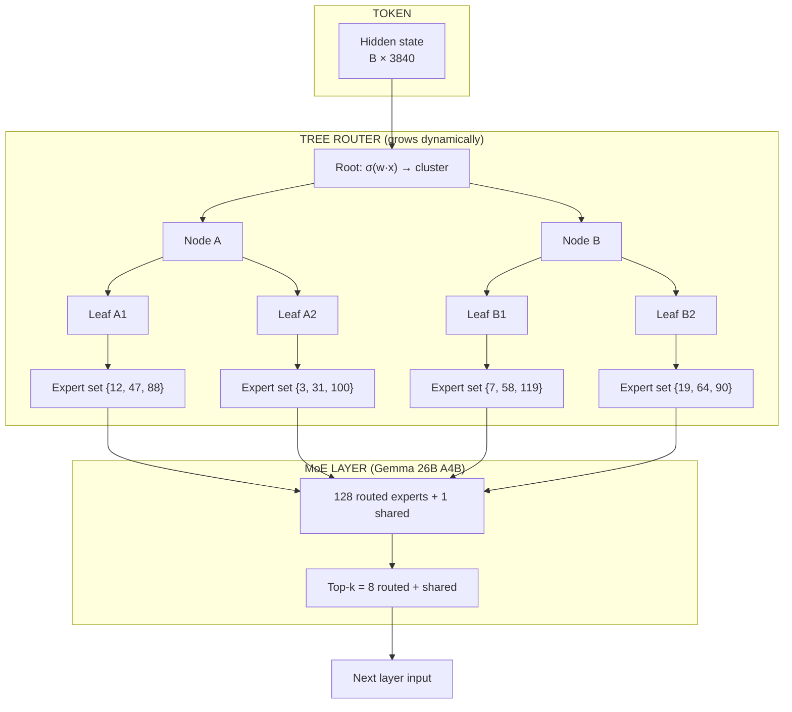
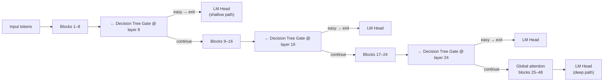
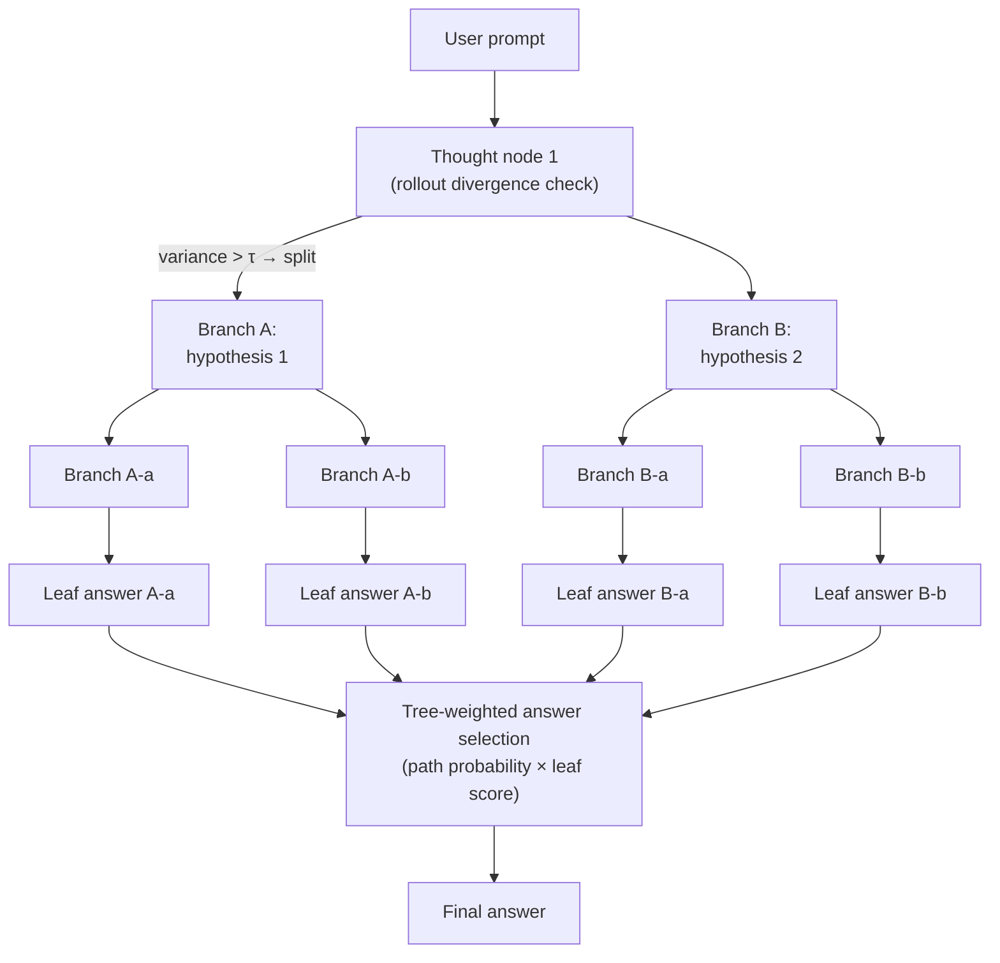
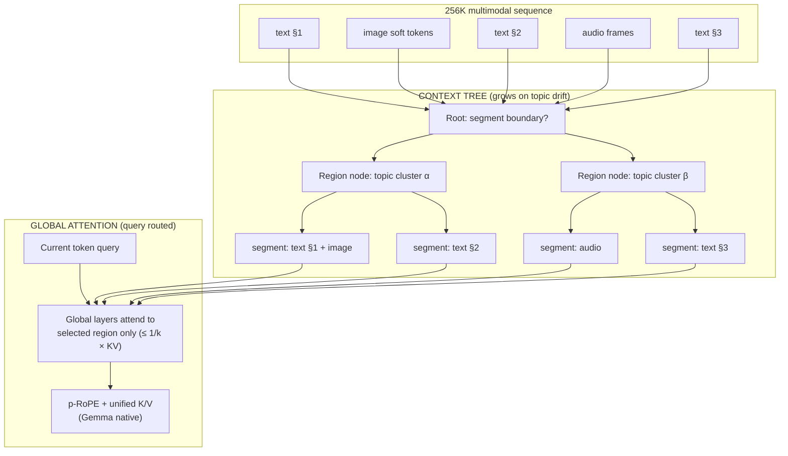
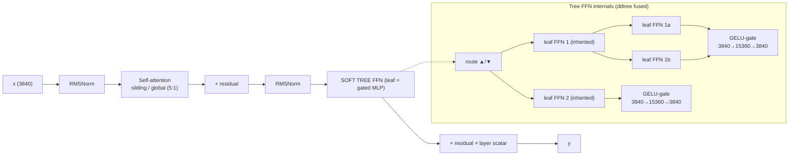

# Gemma 4 × DynamicSoftTree — Fusion Architectures

Novel architectures that fuse **Gemma 4** (dense/sparse decoder-only Transformer, hybrid
attention, encoder-free multimodality) with the **`ddtree.py` DynamicSoftTree** (dynamically
growing soft decision tree with the two-phase grow/train paradigm).

- Gemma 4 source: `README.md` (48-layer 12B config, 5:1 sliding/global layers, MoE 26B A4B)
- Tree source: `ddtree.py` (`DynamicNode`, `DynamicSoftTree`, `evaluate_and_grow`, `_bifurcate_node`)

Core idea — the two systems have complementary inductive biases:

```
Gemma 4             ddtree
─────────────────────────────
dense & distributed   sparse & local
correlational         axis-aligned, interpretable
fixed depth (48)      adaptive depth (grows on error)
learned router        data-driven max-variance splits
second-order stats    first-order sufficient stats
quadratic/lazy        O(active nodes), zero compute on mask
```

---

## 1. Tree-Routed MoE (fit: Gemma 26B A4B + ddtree)

Replace the dense `route_linear` gate on Gemma's 128-expert MoE with an interpretable,
growing soft tree router. Each leaf of the router selects top-k experts.

Backed by: **ERMoE** (eigenbasis routing tied to expert subspaces), **MoDT** (mixture of
decision trees with gating), **S'MoRE** (per-token "residual tree" routing), **Heterogeneous MoE**
(arXiv 2608.24195).



Innovation:

- Router splits appear **only** where expert-use variance is high (growth rule `G(v) > τ`)
- Routing paths are human-readable ("math tokens → path B")
- `_bifurcate_node` variance-direction init replaces the learned gate initialization

---

## 2. Adaptive-Depth / Early-Exit Gate (fit: Gemma 12B dense + ddtree)

Per-token decision trees between layer blocks decide: **shortcut to LM head** or **continue**.
Easy tokens exit early; hard tokens traverse all 48 layers.



Innovation:

- Splits appear where exit-decision variance is high (uncertain tokens keep traveling)
- Deterministic, provable per-token compute cost — an auditable "complexity score"
- Reuses ddtree's `flow` dict to expose probability mass per gate in real time

---

## 3. Tree-of-Thought Decoder for Thinking Mode (fit: Gemma thinking + ddtree)

Gemma 4's `<|think|>` chain is linear. Make reasoning a real branching tree: a node
bifurcates when candidate rollouts diverge (cross-rollout variance); leaves emit candidate
answers; soft routing picks the final one.



Innovation:

- Growth phase (`no_grad`) detects contradictions/divergence → `_bifurcate_node`
- Training phase (`autograd`) optimizes leaf answers
- Auditable: you can trace *why* a branch was pruned (path probability < EPS)

---

## 4. Context-Segmentation Tree over the 256K KV Cache

A hierarchical tree segments the long multimodal sequence into thematic regions. Gemma's
8 global layers then query only tree-selected regions instead of the whole 256K context.
Attacks KV-cache memory from the *content* side (what is worth attending to).



Innovation:

- Tree growth = detected topical drift; interpretable "the document has N topics"
- Complements sliding-window (geometry) with content-aware sparsity
- Naturally handles interleaved text/image/audio from the 12B Unified fusion space

---

## 5. Leaf-Augmented FFN (memory cells)

Replace selected FFN layers with soft decision trees whose **leaves are small gated FFNs**.
On split, children inherit the parent's leaf weights (`_bifurcate_node`) — behaving like a
growing associative memory over token clusters, exactly the "inherit knowledge" mechanism.
Backed by: **S'MoRE** (residual trees inside LLM FFNs), **LLM-Boost / PFN-Boost**
(seed first tree with transformer scores, learn residuals — the reverse fusion).



---

## 6. How to actually use Gemma 4 components inside `ddtree.py`

Concrete mapping — each Gemma component → the exact place it plugs into the tree
(see `ddtree.py` line refs).

### 6.1 RMSNorm (swap for raw stats normalization)

`DynamicNode.local_stats()` (line 83) uses raw mean/var. Gemma normalizes every branch
(`rms_norm_eps=1e-6`). Add `RMSNorm` before `route_linear` / `leaf_linear` inputs:

```python
# ddtree.py — DynamicNode.__init__ (line 41)
self.norm = RMSNorm(in_features, eps=1e-6)
# forward routing: logits = self.route_linear(self.norm(X_act))  (line 170)
# leaf predict:    preds   = self.leaf_linear(self.norm(X_act)) (line 165)
```

Why: scale-invariant splits across leaves with wildly different data distributions; the
growth criterion (`G(v)`) then compares like-for-like.

### 6.2 p-RoPE-style positional conditioning (needed for sequence data)

`route_linear(X)` (line 170) is position-blind. For token sequences, inject position like
Gemma's **Proportional RoPE** (`theta=1e6`, `partial_rotary_factor=0.25`) into routing:

```python
# concatenate rope(position_ids, head_dim=256) to the node input
# or: broadcast-add 2D factorized position embedding to X before route_linear
```

Why: lets a single tree route over many positions without exploding split count.

### 6.3 Gated MLP leaf predictors (swap `leaf_linear`)

Replace `leaf_linear` (line 44) with Gemma's gated FFN (`gelu_tanh(gate(x)) * up(x)` then
`down`), using `intermediate_size = 4 × in_features`:

```python
class GatedMLP(nn.Module):
    def __init__(self, d, d_inter):
        self.gate = nn.Linear(d, d_inter, bias=False)
        self.up   = nn.Linear(d, d_inter, bias=False)
        self.down = nn.Linear(d_inter, d, bias=False)
    def forward(self, x):
        return self.down(nn.functional.gelu(self.gate(x), approximate="tanh") * self.up(x))
```

Why: 2:1 non-linearity of the gate beats a single Linear, and the leafs *inherit
exactly this structure* on `_bifurcate_node` (line 302), so grown children keep capacity.

### 6.4 Logit softcap on the router (30 × tanh)

Add `30 * tanh(z / 30)` to the router logits (line 170):

Why: prevents `sigmoid` from saturating on outlier activations → smoother `p_left/p_right`,
stable probability flow for the EPS-mask pruning (line 157).

### 6.5 Unified K/V — already in ddtree! (`attention_k_eq_v = true`)

Gemma sets `v_proj=None; value = key`. ddtree's `_bifurcate_node` already does the tree
analog: children **inherit the parent's leaf weights** (lines 302-305). Document it this way
— it is the exact "key output reused as value" trick applied to tree growth.

### 6.6 Top-k sparse experts from the 26B A4B (128 experts, top-8 + 1 shared)

Keep ddtree's sparse masked forward but extend leaves to a **leaf reservoir**:

- 1 shared expert always active (Gemma `num_experts` + shared design)
- top-k of `n_leaf` leaves activated per token
- growth still decides *when* a new leaf/expert is born

### 6.7 Token embedding scale `× √(d)` (text embedding path, README §19)

Before feeding text tokens into the tree, scale embeddings by `sqrt(in_features)` exactly
like Gemma (`E → E × sqrt(3840)`). Stabilizes the first-layer `route_linear`.

### 6.8 Encoder-free multimodal soft tokens (12B Unified)

Reuse the **shared multimodal embedder** (`RMSNorm → Linear`):

- Image patches → 6912-d → `LayerNorm → Dense → LayerNorm` → 3840 (fits `in_features`)
- Audio frames → 640-d → `RMSNorm → Linear` → 3840
- Tree routes over the fused 3840-d space with **bidirectional attention for the vision
  region** (`use_bidirectional_attention="vision"`)

### 6.9 Hybrid attention depth pattern (5:1 sliding/global)

Map Gemma's 5:1 pattern onto **tree depth**: shallow levels (1–3) use restricted
sliding-window routing (local context only); the last global level attends to all regions.
Orchestrated by a per-level window size in the router.

---

## 7. Research grounding (found via web search, Feb 2026)

| Paper                                              | Idea                                                                  | Relation to our fusion                                                                    |
| -------------------------------------------------- | --------------------------------------------------------------------- | ----------------------------------------------------------------------------------------- |
| **LLM-Boost / PFN-Boost** (arXiv 2502.02672) | LLM predictions seed the first GBDT tree; trees learn the residuals   | The exact complement of our Arch 5 — proven both fusions beat either component alone     |
| **MetaTree** (arXiv 2402.03774)              | A Transformer*generates* decision trees (recursive split selection) | Reverse direction: a transformer building the ddtree topology (validation of the concept) |
| **GPTree**                                   | LLM-powered decision tree, expert-in-the-loop rebuild                 | Human-auditable growth — same goal as our interpretable routing                          |
| **MoE-X** (ICML 2025)                        | Intrinsic interpretable MoE via sparse activation                     | Validates our Arch 1 (interpretable expert routing)                                       |
| **ERMoE** (arXiv 2511.10971)                 | Eigenbasis-reparameterized MoE; routing = content alignment           | Arch 1 router init could use eigenbasis score instead of variance hyperplane              |
| **S'MoRE** (NeurIPS 2025)                    | Per-token "residual tree" through LoRA-residual experts               | Strong overlap with Arch 1 & 5 — strongest published evidence the tree-shaped MoE works  |
| **MoDT** (arXiv 2211.14617)                  | Mixture of decision trees, linear gating + tree experts               | Baseline for Arch 1                                                                       |
| **Heterogeneous MoE** (arXiv 2608.24195)     | Per-node inductive-bias selection under a gating mixture              | Extension: let leaves choose their own expert type                                        |
| **Soft-token fusion** (arXiv 2607.10016)     | Numeric/embedding soft tokens fused into LM embedding space           | Arch 4 region segmentation over soft tokens                                               |

---

## 8. Recommended implementation order

```
Milestone 1   Base fusion (cheap to prove on 2×T4 / MacBook)
   ├── RMSNorm + GatedMLP leaf + logit softcap + √d scaling
   └── tree FFN injected into blocks of a small Gemma-nano (≈1–3B) → fit on Kaggle T4
           ↓
Milestone 2   Tree-Routed router (Arch 1) on the 26B A4B MoE
   └── top-k leaf reservoir + growth via expert-use variance
           ↓
Milestone 3   Adaptive-depth gates (Arch 2)
   └── early-exit tree gates at layers 8/16/24; watch per-token compute
           ↓
Milestone 4   Context-segmentation tree (Arch 4) — the 256K KV paper
           ↓
Milestone 5   Tree-of-Thought (Arch 3) — the reasoning-mode paper
```

Caveat (from the earlier analysis): transformers represent knowledge non-locally — the tree
should route on **clustered/whitened activations** (PCA → interpretable axes), not raw
embeddings, or the splits will be unreadable. The growth criterion needs a token-domain
analog of `G(v)`, not raw regression variance.
